# Screens of the symbol editor

> [Home](../README.md) › [Screens](README.md) › Symbol editor

Status: draft, written by the assistant from the [Symbols](../symbols/README.md) pages, themselves a draft, then reviewed. It adds no rule. Kinds and statuses are explained in the [guide of this folder](README.md). The pipes are in [Pipes](pipes.md).

## SY-00 · Navigation bar of the symbol mode

Path: Symbols. On the far left of every screen of the symbol mode.

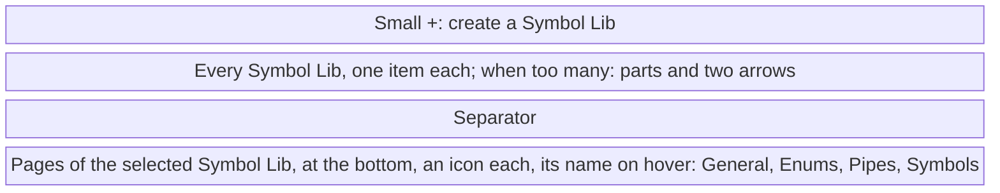

| ID | Element | Kind | Values and behaviour | Status | Source |
| --- | --- | --- | --- | --- | --- |
| SY-00.1 | Create a Symbol Lib | Button (small + in a square, like a library), at the top | Creates a Symbol Lib; asks its name only, as SN-00.1 (2026-11-23, decision 0089: no page of all the Symbol Libs). | Decided | [Libraries and symbols](../symbols/01-libraries-and-symbols.md#navigation-bar-of-the-symbol-mode) |
| SY-00.3 | Symbol Libs | List (one item each) | Under the +: every Symbol Lib, as quick links. One click selects a library and opens its page last used, or Symbols the first time (assistant's reading). The list takes the room down to the separator. An item: two letters taken from the name of the library, in a square (2026-11-23); no colour, no icon chosen by the user; three letters to try; its name on hover (assistant's proposal). | Decided (list, two letters), Proposed (hover, page opened), Open (three letters, how the letters are taken) | [Libraries and symbols](../symbols/01-libraries-and-symbols.md#navigation-bar-of-the-symbol-mode) |
| SY-00.5 | Previous part, next part | Button each (arrow icon), at the top and at the bottom of the list | When the libraries no longer fit above the separator: the list is cut into parts, never scrolled; an arrow opens the next part (2026-11-23). The arrows show only when the list is cut; then both, at every part, the one that leads nowhere greyed (2026-11-23); "Part 1 of 2" on hover (assistant's proposal). | Decided (parts, arrows), Proposed (text on hover) | [Libraries and symbols](../symbols/01-libraries-and-symbols.md#navigation-bar-of-the-symbol-mode) |
| SY-00.2 | Separator | — | Between the list of the Symbol Libs and the pages of the selected one. | Decided | [Libraries and symbols](../symbols/01-libraries-and-symbols.md#navigation-bar-of-the-symbol-mode) |
| SY-00.4 | Pages of the selected Symbol Lib | Buttons, at the bottom of the bar, never moving | Four: General ([SY-01](#sy-01--general-page-of-a-symbol-lib)), Enums ([SY-12](#sy-12--enums-of-a-symbol-lib)), Pipes ([Pipes](pipes.md)), Symbols ([SY-02](#sy-02--left-hand-panel-of-the-pages-symbols-and-pipes)). In this order (2026-11-23). Shown only once a Symbol Lib is selected (end of 2026-11-17, kept). Each: its icon alone, its name in a tooltip on hover, as [nav-rail-item](../design-system/07-molecules/nav-rail-item.md) (2026-11-23); no frame, unlike the libraries; the page shown filled. Icons (2026-11-23): `icon/general`, `icon/enums`, `icon/pipes`, `icon/symbols`. | Decided (place, icons, icon alone), Proposed (look of the icons) | [Libraries and symbols](../symbols/01-libraries-and-symbols.md#navigation-bar-of-the-symbol-mode) |

Gaps:

- Going from the symbol mode to Metadata is done in the top bar (see the [guide](README.md#top-bar-of-the-window)).
- With no Symbol Lib yet, the bar shows the + only; what the rest of the screen shows then.

## SY-01 · General page of a Symbol Lib

Path: Symbols › a Symbol Lib › General (2026-11-23, decision 0089, which removes the page of all the Symbol Libs).

| ID | Element | Kind | Values and behaviour | Status | Source |
| --- | --- | --- | --- | --- | --- |
| SY-01.1 | Name | Text field | The name of the library. | Decided | [Libraries and symbols](../symbols/01-libraries-and-symbols.md#general-page-of-a-symbol-lib) |
| SY-01.2 | Delete the Symbol Lib | Button, then a warning (dialog) | Under the name, as "Delete the type" in General of Metadata ([MD-02.8](metadata.md#md-02--general)). Takes its symbols and its pipe styles with it (2026-11-23). The warning says "Delete Plant A?" (the name of the library), then "The Symbol Lib is deleted at once, with its symbols and its pipe styles." (wording: assistant's proposal). | Decided (button, what it takes), Proposed (wording) | [Libraries and symbols](../symbols/01-libraries-and-symbols.md#general-page-of-a-symbol-lib) |
| SY-01.3 | More information | not said | What else the page shows of a library is not said. | Open | [Libraries and symbols](../symbols/01-libraries-and-symbols.md#general-page-of-a-symbol-lib) |
| SY-01.4 | Left-hand panel | — | None: the page has no list, so its content starts after the navigation bar. | Proposed | [Libraries and symbols](../symbols/01-libraries-and-symbols.md#the-left-hand-panel-of-the-symbol-mode) |

Gaps:

- Duplicate (to change a look over time, the user creates a new Symbol Lib: is it a copy of the old one?).

## SY-02 · Left-hand panel of the pages Symbols and Pipes

Path: Symbols › a Symbol Lib › Symbols, or › Pipes. Since the end of 2026-11-17 the symbols and the pipe styles are two pages of the navigation bar, no longer two zones of one panel. On the page Symbols, the panel stays on the left while a symbol is open in the editor.

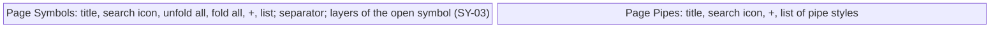

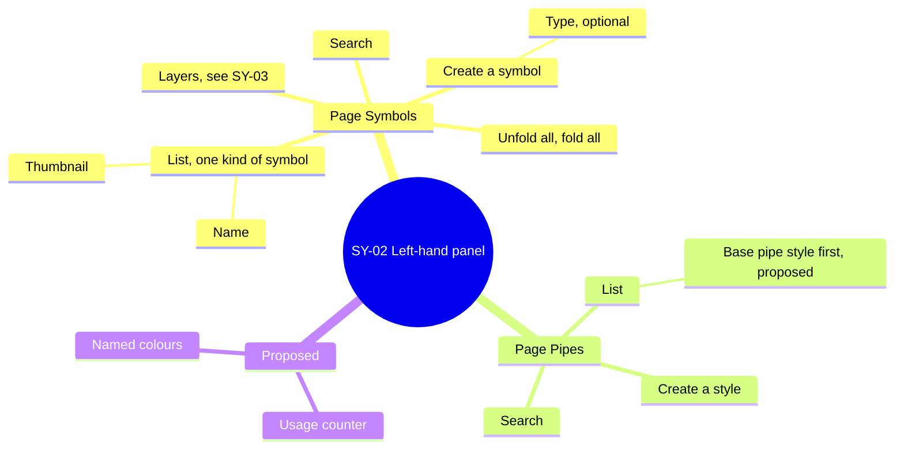

| ID | Element | Kind | Values and behaviour | Status | Source |
| --- | --- | --- | --- | --- | --- |
| SY-02.1 | List of symbols | Tree | One kind of symbol: no static or dynamic. A tree, as in Metadata: a sub-symbol under its parent (2026-11-18, replaces the flat list). A click on an item opens it in the editor. | Decided | [Sub-symbols](../symbols/12-sub-symbols.md) |
| SY-02.2 | Search the symbols | Button (search icon), then a text field | On the line of the title "Symbols", next to the +; a click opens the field over the whole line; it filters the list (2026-11-23: no field shown all the time). | Decided | [Layout rules](README.md#search-a-small-icon-on-the-line-of-the-title) |
| SY-02.3 | Create a symbol | Button (small +) | On the right of the title "Symbols". The type can be chosen here, never imposed (no preset since 2026-11-24). | Decided | [Libraries and symbols](../symbols/01-libraries-and-symbols.md) |
| SY-02.4 | Type, at creation | Select, optional | All the types of Metadata (no library of types). How the choice stays quick in a big tree: open. | Decided | [Libraries and symbols](../symbols/01-libraries-and-symbols.md) |
| SY-02.5 | Item of the list | Thumbnail + name | The thumbnail is the symbol, or its outlines only (as Figma's outline view). | Decided (thumbnail: Open) | [Libraries and symbols](../symbols/01-libraries-and-symbols.md) |
| SY-02.6 | List of pipe styles | List | On the page Pipes (end of 2026-11-17). Flat; a click opens the style (see [Pipes](pipes.md)). | Decided | [Libraries and symbols](../symbols/01-libraries-and-symbols.md) |
| SY-02.7 | Search the pipe styles | Button (search icon), then a text field | As SY-02.2, on the line of the title "Pipe styles". | Decided | [Layout rules](README.md#search-a-small-icon-on-the-line-of-the-title) |
| SY-02.8 | Create a pipe style | Button (icon with a small +) | On the right of the title "Pipe styles" ([layout rules](README.md#a-title-and-a-small--on-its-right), 2026-11-16). | Decided | [Libraries and symbols](../symbols/01-libraries-and-symbols.md) |
| SY-02.9 | Base pipe style | Item of the list | First item of the pipe styles list. | Proposed | [Libraries and symbols](../symbols/01-libraries-and-symbols.md) |
| SY-02.10 | Broken mark | — | A small red mark on a broken item. | Decided | [Libraries and symbols](../symbols/01-libraries-and-symbols.md) |
| SY-02.11 | Usage counter | — | "Used by 38 pipes", on symbols and styles. | Proposed | [Libraries and symbols](../symbols/01-libraries-and-symbols.md) |
| SY-02.12 | Named colours | List | A flat list "Colours" that symbols and styles point to. | Proposed | [Fill and border](../symbols/04-drawing-mode/fill-and-border.md) |
| SY-02.13 | Create a sub-symbol | Button (small +) | On the right of a symbol, when the mouse is over it, as for the types of Metadata; also a + in the editor of the open symbol (its place: Open). The sub-symbol is in the same Symbol Lib. | Decided (place in the editor: Open) | [Sub-symbols](../symbols/12-sub-symbols.md) |
| SY-02.14 | Fault of a sub-symbol | — | When the parent changes type or loses it, every sub-symbol goes into fault and the application says so. How it shows: with the list of faults (Open). | Decided (look: Open) | [Sub-symbols](../symbols/12-sub-symbols.md) |
| SY-02.15 | Unfold all, fold all the symbols | Button each (icon) | On the line of the title "Symbols", between the search icon and the +, as on the title "Layers" (SY-03.14): every parent of the tree of symbols (Product Owner, 2026-11-24). | Decided | [Libraries and symbols](../symbols/01-libraries-and-symbols.md#the-left-hand-panel-of-the-symbol-mode) |

Gaps:

- What an item shows besides its thumbnail and name.
- Duplicate, rename and delete a symbol or a pipe style. Settled: deleting a symbol deletes its sub-symbols with it (2026-11-18, decision 0046, see [Sub-symbols](../symbols/12-sub-symbols.md#deleting-a-parent)); the control is still open.
- Sort of the lists (by name, by creation)?

## SY-03 · Symbol editor: what every mode shares

Path: Symbols › a Symbol Lib › a symbol.

The layout is decided, except the place of the tool bar (bottom or top) and of the zoom field.

```mermaid
block-beta
    columns 4
    rail["Navigation bar SY-00"]
    left["Left-hand panel: SY-02 symbols, separator, then the layers"] canvas["Drawing area: modes menu floating top left, horizontal, icons; tool bar floating at the bottom, the tools of the mode only"] panel["Right-hand panel: options of the selection, type of the symbol"]
```

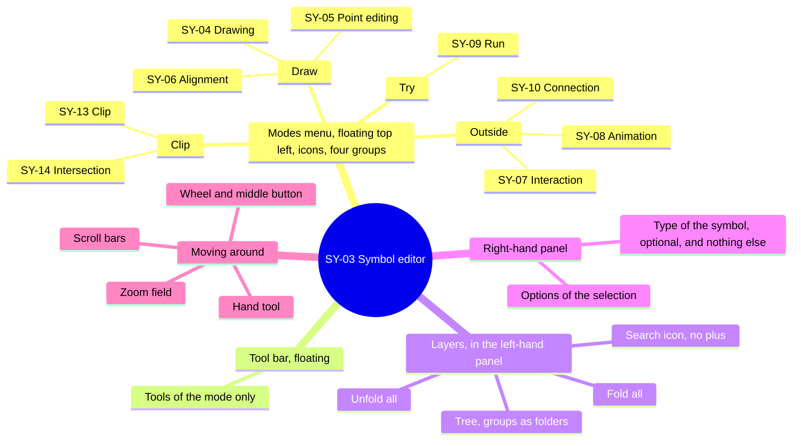

| ID | Element | Kind | Values and behaviour | Status | Source |
| --- | --- | --- | --- | --- | --- |
| SY-03.1 | Modes menu | Floating bar, horizontal, icons only (name in the tooltip) | At the top left of the drawing area, four groups split by a separator: Drawing, Point editing, Alignment │ Clip, Intersection │ Connection, Animation, Interaction │ Run (2026-11-25, being tried; Intersection added the same day). Interaction, Animation and Run need a type; Clip, a selected shape. | Decided (groups: being tried), icons to draw | [Editor](../symbols/03-editor/README.md) |
| SY-03.2 | Tool bar | Floating bar | The tools of the mode, nothing else (2026-11-25); at the bottom of the drawing area (leaning) or at the top. | Decided (place: Open) | [Editor](../symbols/03-editor/README.md) |
| SY-03.3 | Show the advanced tools | — | Removed (2026-11-25): the advanced tools are not in this version ([SY-11](#sy-11--advanced-tools)). | Decided | [Advanced tools](../symbols/03-editor/expert-menu/README.md) |
| SY-03.4 | Type | Select, optional | In the right-hand panel; among all the types of Metadata; can be removed. | Decided | [Type and faceplate](../symbols/02-type-and-faceplate.md) |
| SY-03.5 | Preset | — | Removed (Product Owner, 2026-11-24): there are no presets; the symbol chooses its type and nothing else, and a sub-type of Metadata stands for another way of showing it. | Decided | [Type and faceplate](../symbols/02-type-and-faceplate.md) |
| SY-03.6 | Faceplate entries | — | Removed (Product Owner, 2026-11-24): no choice of the faceplate entries in the symbol; the faceplate is the one of its type ([MD-14](metadata.md#md-14--faceplate)). | Decided | [Type and faceplate](../symbols/02-type-and-faceplate.md) |
| SY-03.7 | Hand | Button (tool) | Moves the view; also the middle button held. In every mode. | Decided | [Hand](../symbols/03-editor/hand.md) |
| SY-03.8 | Zoom | Number field (%) | Shown in one place (which one: not said); the user can type a value; 100 % is the real size. | Decided | [Editor](../symbols/03-editor/README.md) |
| SY-03.9 | Select | Button (tool) | In every mode except Run; picks what the mode works on. | Decided | [Select](../symbols/03-editor/select.md) |
| SY-03.10 | Entirely enclosed | Toggle | Visible equivalent of Ctrl + Shift during a selection rectangle (2026-11-26, replaces Alt). | Decided | [Select](../symbols/03-editor/select.md) |
| SY-03.11 | Precise move | Key held while moving with Select, no button | A shape, a point or a handle moves pixel by pixel of the symbol; no toggle in the tool bar; the key is Ctrl (2026-11-25). | Decided | [Precise move](../symbols/03-editor/precise-move.md) |
| SY-03.12 | Layers | Tree | In the left-hand panel; groups as folders; one line per shape, its border included; the clip shapes under their shape. Under the layers, in every mode: the connection points (SY-10.5), then the interaction zones (SY-07.10), each title with the icon of its mode; a click on an element of another mode, or on that icon, opens that mode (2026-11-26, [layout rule](README.md#nothing-hidden-every-list-in-every-mode)). | Decided | [Layers](../symbols/03-editor/layers.md) |
| SY-03.13 | Search the layers | Button (search icon), then a text field | On the line of the title "Layers", under a separator; opens a field over the title that filters by name. No + on this title (2026-11-23). | Decided | [Layers](../symbols/03-editor/layers.md) |
| SY-03.14 | Unfold all, fold all | Button each | Every group of the tree. | Decided | [Layers](../symbols/03-editor/layers.md) |
| SY-03.15 | Line of a layer | — | Name and icon of its kind; on its right, the icon of the Animation mode when the layer has an animation, that of the Interaction mode when it is the place of an interaction, grey, blue while their mode is open; a click opens that mode on the layer, in every mode (2026-11-26). Hide, lock proposed. | Decided (name, kind, icons), Proposed (hide, lock) | [Layers](../symbols/03-editor/layers.md) |
| SY-03.16 | Undo, redo | not said | The undo history keeps every action (decision 0093). No save: each change is written as it is made. | Decided (history, no save), Open (place) | [Files and conflicts](../storage/files-and-conflicts.md#undo-history) |
| SY-03.17 | Layout guides | Button in a floating bar under the modes menu, then a popup | + Column, + Row, + Grid; one line per guide with its value, a place button and a −; the place button makes the guide follow the mouse, a click puts it; an eye hides them all; grid cells W × H linked by a chain (2026-11-25). | Decided (place, eye, placement from the line, grid W × H linked by a chain), Proposed (the rest of the form) | [Layout guides](../symbols/03-editor/layout-guides.md) |
| SY-03.19 | Scroll bars | Scroll bar, horizontal and vertical | Shown as soon as part of the drawing is out of the view, always visible (no hover needed); gone once the whole drawing fits (2026-11-26). Same in the synoptic editor. | Decided | [Editor](../symbols/03-editor/README.md#moving-around-the-drawing) |
| SY-03.18 | Snapping | not said | Minimum set proposed by the research; snaps to the guides too. A temporary guide of equal spacing while a shape is moved, and no distribution (2026-11-26). | Proposed (minimum set), Decided (equal spacing) | [Editor](../symbols/03-editor/README.md), [Select](../symbols/03-editor/select.md#equal-spacing) |

Gaps:

- Does the right-hand panel show the type only when nothing is selected (assumption)?
- How a layer is named, and whether the tree order is the stacking order.
- Frame of the symbol (size, fit to content): proposed by the research, not placed in a screen.
- Place of the zoom field, of undo and redo.

## SY-04 · Drawing mode

Path: symbol editor › Drawing (the default mode).

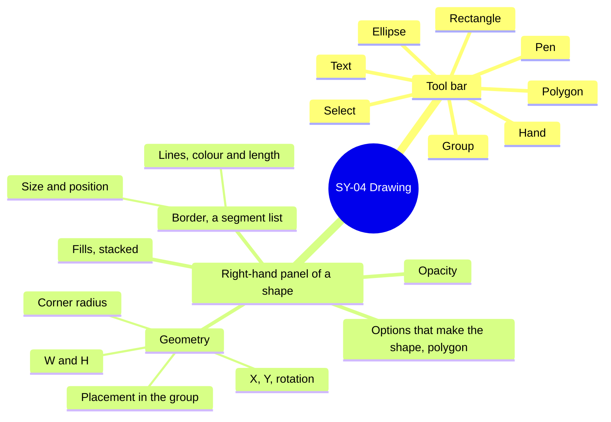

### Tool bar

| ID | Element | Kind | Values and behaviour | Status | Source |
| --- | --- | --- | --- | --- | --- |
| SY-04.1 | Tools | Button | In this order: Select, Hand, Group, Rectangle, Ellipse, Polygon, Pen, Text. | Decided | [Drawing mode](../symbols/04-drawing-mode/README.md) |
| SY-04.2 | Pen: straight line | Button | Turns the curve being drawn back into a straight line. | Decided | [Pen](../symbols/04-drawing-mode/pen.md) |
| SY-04.3 | Pen: angle lock | Toggle + Select | Step 15°, 30°, 45° or 90° (45° usual). | Decided (steps: Proposed) | [Pen](../symbols/04-drawing-mode/pen.md) |

### Panel of a shape: fill, border, effects

| ID | Element | Kind | Values and behaviour | Status | Source |
| --- | --- | --- | --- | --- | --- |
| SY-04.4 | Fills | [Colour field](../controls/colour-field.md) per line, + on the title | Several fills stacked, the top line on top; the + adds one, the − of a line removes it (2026-11-25). Each line: swatch, colour │ opacity; the swatch opens the paint popup: Plain colour, Linear, Radial (no conic, pattern or image: set aside, 2026-11-25), eyedropper, hue and opacity sliders, Hex, HSL, HSB (2026-11-25). | Decided | [Fill and border](../symbols/04-drawing-mode/fill-and-border.md#several-fills) |
| SY-04.5 | Border | [Segment list](../controls/segment-list.md), small + on the title | A shape can have a border; a group cannot. The + adds a line (2026-11-24). No line: no border; no toggle (2026-11-24). | Decided | [Fill and border](../symbols/04-drawing-mode/fill-and-border.md#border-options) |
| SY-04.6 | Border size | Number field, no unit | Under the lines, on the line of the position. Example 2. | Decided | [Fill and border](../symbols/04-drawing-mode/fill-and-border.md#border-options) |
| SY-04.7 | Border position | Segmented control | Next to the size: Inside, Middle, Outside, one click (2026-11-26, replaces the select). An open path has the three too, Inside and Outside on one side of the line (2026-11-25). | Decided | [Fill and border](../symbols/04-drawing-mode/fill-and-border.md#border-of-an-open-path) |
| SY-04.8 | Colour of a line of the border | [Colour field](../controls/colour-field.md) | Colour │ opacity on each line; 0 % for a gap. A gradient in a line: Open. | Decided | [Fill and border](../symbols/04-drawing-mode/fill-and-border.md#border-options) |
| SY-04.9 | Dashes of the border | Lines of the segment list | One line: a plain border; two lines or more: a dash sequence, each line a colour and a length, repeated (2026-11-24; replaces the editor [PI-04](pipes.md#pi-04--segment-list) opened from the panel). | Decided | [Fill and border](../symbols/04-drawing-mode/fill-and-border.md#border-options) |
| SY-04.10 | Caps and joins | — | Removed (2026-11-25): not offered. | Decided | [Fill and border](../symbols/04-drawing-mode/fill-and-border.md#border-of-an-open-path) |
| SY-04.11 | Effects | — | Removed (2026-11-25): no section "Effects" in this version; the clip is a mode ([SY-13](#sy-13--clip-mode)), the opacity a line (SY-04.44). Its screens stay as a record. | Decided | [Effects](../symbols/04-drawing-mode/effects-and-masks.md#the-section-effects) |
| SY-04.12 | Effects offered | — | Removed with the section (2026-11-25). | Decided | [Effects](../symbols/04-drawing-mode/effects-and-masks.md#catalogue-of-the-effects) |
| SY-04.13 | Clip | — | Moved to the Clip mode ([SY-13](#sy-13--clip-mode), 2026-11-25). | Decided | [Clip mode](../symbols/04-drawing-mode/clip-mode.md) |
| SY-04.39 | Clip editing | — | Replaced by the Clip mode ([SY-13](#sy-13--clip-mode), 2026-11-25). | Decided | [Clip mode](../symbols/04-drawing-mode/clip-mode.md) |

### Effects one by one

Each effect of the catalogue has its line and what it opens (popup, list), and its editing mode when it has one (the model of the clip editing, see [Editing modes](../symbols/04-drawing-mode/effects-and-masks.md#editing-modes)). The Product Owner's first selection (2026-11-25) keeps the opacity, the editing of the linear and radial gradients and the border that keeps its width; the rest is set aside, its screens kept as a record. Figma: page Spec, section "Symbol mode · Effects", one row per effect; the kept ones again in "Symbol mode · Effects kept (2026-11-25)".

| ID | Element | Kind | Values and behaviour | Status | Source |
| --- | --- | --- | --- | --- | --- |
| SY-04.40 | Mask | Line, settings popup | Mode Alpha or Luminance; shapes and Edit on the drawing. | Set aside | [Clip, mask, fade](../symbols/04-drawing-mode/effects-clip-and-mask.md#mask) |
| SY-04.41 | Mask editing | State of the drawing area | As the clip editing; the mask shapes have fills. | Set aside | [Clip, mask, fade](../symbols/04-drawing-mode/effects-clip-and-mask.md#mask) |
| SY-04.42 | Fade | Line, settings popup | Linear or Radial; angle; From and To in percent. | Set aside | [Clip, mask, fade](../symbols/04-drawing-mode/effects-clip-and-mask.md#fade) |
| SY-04.43 | Fade editing | State of the drawing area | A line with the handles From and To over the shape. | Set aside | [Clip, mask, fade](../symbols/04-drawing-mode/effects-clip-and-mask.md#fade) |
| SY-04.44 | Opacity | Line of the panel, under the geometry, with a percent field | The opacity of the whole object; no popup; 100 % by default. | Kept (2026-11-25), POC; place: Decided (2026-11-25) | [Opacity and blend](../symbols/04-drawing-mode/effects-opacity-and-blend.md#opacity) |
| SY-04.45 | Blend mode | Line with a select | The list of the modes, grouped. | Set aside | [Opacity and blend](../symbols/04-drawing-mode/effects-opacity-and-blend.md#blend-mode) |
| SY-04.46 | Background blur | Line, settings popup | Radius. | Set aside | [Opacity and blend](../symbols/04-drawing-mode/effects-opacity-and-blend.md#background-blur) |
| SY-04.47 | Drop shadow | Line, settings popup | X, Y, Blur, Spread, Colour; Edit on the drawing. | Set aside | [Shadows and light](../symbols/04-drawing-mode/effects-shadows-and-light.md#drop-shadow) |
| SY-04.48 | Shadow editing | State of the drawing area | A handle drags the offset, a ring the blur. | Set aside | [Shadows and light](../symbols/04-drawing-mode/effects-shadows-and-light.md#drop-shadow) |
| SY-04.49 | Outer glow | Line, settings popup | Size, Colour. | Set aside | [Shadows and light](../symbols/04-drawing-mode/effects-shadows-and-light.md#outer-glow) |
| SY-04.50 | Inner shadow | Line, settings popup | X, Y, Blur, Colour; Edit on the drawing. | Set aside | [Shadows and light](../symbols/04-drawing-mode/effects-shadows-and-light.md#inner-shadow) |
| SY-04.51 | Inner shadow editing | State of the drawing area | The handles of the shadow, inside the shape. | Set aside | [Shadows and light](../symbols/04-drawing-mode/effects-shadows-and-light.md#inner-shadow) |
| SY-04.52 | Inner glow | Line, settings popup | Size, Colour. | Set aside | [Shadows and light](../symbols/04-drawing-mode/effects-shadows-and-light.md#inner-glow) |
| SY-04.53 | Lighting | Line, settings popup | Relief or Shine; Far, Point or Spot; azimuth, elevation; depth; shine; colour; Edit on the drawing. | Set aside | [Shadows and light](../symbols/04-drawing-mode/effects-shadows-and-light.md#lighting) |
| SY-04.54 | Light editing | State of the drawing area | The light is a handle: bulb, cone or arrow. | Set aside | [Shadows and light](../symbols/04-drawing-mode/effects-shadows-and-light.md#lighting) |
| SY-04.55 | Blur | Line, settings popup | Radius X and Y, linked by a chain. | Set aside | [Blur and sharpness](../symbols/04-drawing-mode/effects-blur-and-sharpness.md#blur) |
| SY-04.56 | Sharpen, edges, emboss | Line, settings popup | Kind, Strength. | Set aside | [Blur and sharpness](../symbols/04-drawing-mode/effects-blur-and-sharpness.md#sharpen-edges-emboss) |
| SY-04.57 | Colour adjustments | Line, settings popup | Seven sliders and Reset. | Set aside | [Colour](../symbols/04-drawing-mode/effects-colour.md#colour-adjustments) |
| SY-04.58 | Colour overlay | Line, settings popup | Colour, Blend. | Set aside | [Colour](../symbols/04-drawing-mode/effects-colour.md#colour-overlay) |
| SY-04.59 | Colour map | Line, settings popup | Duotone, Posterize or Threshold, and their settings. | Set aside | [Colour](../symbols/04-drawing-mode/effects-colour.md#colour-map) |
| SY-04.60 | Thicken, thin | Line, settings popup | Operation, Radius. | Set aside | [Texture and distortion](../symbols/04-drawing-mode/effects-texture-and-distortion.md#thicken-thin) |
| SY-04.61 | Noise | Line, settings popup | Kind, Scale, Detail, Seed, Opacity, Mono or Colour. | Set aside | [Texture and distortion](../symbols/04-drawing-mode/effects-texture-and-distortion.md#noise-texture) |
| SY-04.62 | Distortion | Line, settings popup | Strength, Scale, Detail, Seed. | Set aside | [Texture and distortion](../symbols/04-drawing-mode/effects-texture-and-distortion.md#distortion) |
| SY-04.63 | Filter chain | Line, Edit button | "Filter chain · 4 steps". | Set aside | [Filter chain](../symbols/04-drawing-mode/effects-filter-chain.md) |
| SY-04.64 | Filter editing | State of the drawing area | A graph of the steps; the step selected in the right-hand panel. | Set aside | [Filter chain](../symbols/04-drawing-mode/effects-filter-chain.md) |
| SY-04.65 | Linear gradient | Tab of the paint popup | Stops bar, Repeat, Edit on the drawing. | Decided (kind), POC (the rest) | [Paints](../symbols/04-drawing-mode/paints.md#linear-gradient) |
| SY-04.66 | Linear gradient editing | State of the drawing area | The gradient line, its ends and its stops. | Kept (2026-11-25), POC | [Paints](../symbols/04-drawing-mode/paints.md#linear-gradient) |
| SY-04.67 | Radial gradient | Tab of the paint popup | Stops bar, Repeat, Edit on the drawing. | Decided (kind), POC (the rest) | [Paints](../symbols/04-drawing-mode/paints.md#radial-gradient) |
| SY-04.68 | Radial gradient editing | State of the drawing area | Centre, radius, focal point. | Kept (2026-11-25), POC | [Paints](../symbols/04-drawing-mode/paints.md#radial-gradient) |
| SY-04.69 | Conic gradient | Tab of the paint popup | Stops bar, Start angle. | Set aside | [Paints](../symbols/04-drawing-mode/paints.md#conic-gradient) |
| SY-04.70 | Conic gradient editing | State of the drawing area | Centre, start angle. | Set aside | [Paints](../symbols/04-drawing-mode/paints.md#conic-gradient) |
| SY-04.71 | Pattern | Tab of the paint popup | Tile, Size, Angle, Colour, Edit the tile. | Set aside | [Paints](../symbols/04-drawing-mode/paints.md#pattern) |
| SY-04.72 | Tile editing | State of the drawing area | The tile big in the middle, drawn with the shape tools; the shape repeats it around. | Set aside | [Paints](../symbols/04-drawing-mode/paints.md#pattern) |
| SY-04.73 | Image | Tab of the paint popup | Choose an image, Fit, Opacity. | Set aside | [Paints](../symbols/04-drawing-mode/paints.md#image) |
| SY-04.74 | Arrow heads | Line "Ends" of the border, two selects | None, Arrow, Open arrow, Circle, Square, Diamond, Bar, Custom; Size. | Set aside | [Lines and text](../symbols/04-drawing-mode/effects-lines-and-text.md#arrow-heads) |
| SY-04.75 | Head editing | State of the drawing area | A custom head drawn big, the end of the line as a guide. | Set aside | [Lines and text](../symbols/04-drawing-mode/effects-lines-and-text.md#arrow-heads) |
| SY-04.76 | Border that keeps its width | Switch in the border | Keep the width when scaled; the border is computed again at the scale of the symbol. | Kept (2026-11-25), POC | [Lines and text](../symbols/04-drawing-mode/effects-lines-and-text.md#border-that-keeps-its-width) |
| SY-04.77 | Crisp edges | Line of the effects | On or off by its eye. | Set aside | [Lines and text](../symbols/04-drawing-mode/effects-lines-and-text.md#crisp-edges) |
| SY-04.78 | Text along a path | Line of the text panel, popup | Path, Start, Side. | Set aside | [Lines and text](../symbols/04-drawing-mode/effects-lines-and-text.md#text-along-a-path) |
| SY-04.79 | Path editing | State of the drawing area | The path followed, the start of the text as a handle. | Set aside | [Lines and text](../symbols/04-drawing-mode/effects-lines-and-text.md#text-along-a-path) |

### Panel of a shape: geometry and options by tool

The order of the panel: the options that make the shape (polygon), the geometry, the fills, the border, the effects ([Geometry](../symbols/04-drawing-mode/geometry.md#order-of-the-right-hand-panel), 2026-11-25).

| ID | Element | Kind | Values and behaviour | Status | Source |
| --- | --- | --- | --- | --- | --- |
| SY-04.36 | Width, height | [Size fields](../controls/size-fields.md) | W and H on one line, no unit; always fixed for a rectangle, an ellipse, a polygon, a path; Fixed or Hug for a group and a text. | Decided | [Geometry](../symbols/04-drawing-mode/geometry.md) |
| SY-04.37 | X, Y | Number field each | Under W and H, in pixels, no unit; on every element (2026-11-25). | Decided | [Geometry](../symbols/04-drawing-mode/geometry.md) |
| SY-04.38 | Rotation | Number field, degrees | On the line of X and Y; on every element (2026-11-25) but a group (2026-11-26). | Decided | [Geometry](../symbols/04-drawing-mode/geometry.md) |
| SY-04.14 | Corner radius | Number field, no unit | Under the height (2026-11-25): for the whole rectangle, for every corner of a path drawn with the pen, and for every corner of a polygon (2026-11-26). Never for an ellipse. | Decided | [Rectangle](../symbols/04-drawing-mode/rectangle.md), [Pen](../symbols/04-drawing-mode/pen.md#panel-of-a-path) |
| SY-04.15 | Link width and height | Icon button (link), at the end of the line W, H | Visible equivalent of the square or circle key. An icon on the size line rather than a toggle of its own (assistant, 2026-11-24). | Decided (link), Proposed (icon on the line) | [Size fields](../controls/size-fields.md#width-and-height-linked) |
| SY-04.16 | Polygon: number of sides | Number field | 3 to 20; first in the panel (2026-11-25). | Decided | [Polygon](../symbols/04-drawing-mode/polygon.md) |
| SY-04.17 | Polygon: how it fills its box | Segmented control | Filled, Equilateral, one click ([layout rule](README.md#a-segmented-control-for-two-to-four-short-options), 2026-11-26) (a third mode "like Figma": Open, advised against). | Decided | [Polygon](../symbols/04-drawing-mode/polygon.md) |
| SY-04.18 | Polygon: placed in its box | 9-point grid + segmented control | An anchor of the box, and whether a Corner or a Side touches it, one click (2026-11-26; the labels "Corner", "Side": assistant's). Labelled "Placed in box", so as not to read as the anchor in the group, lower in the same panel (2026-11-26). | Decided | [Polygon](../symbols/04-drawing-mode/polygon.md) |
| SY-04.19 | Group: width, height | [Size fields](../controls/size-fields.md), Fixed or Hug | W and H on one line; each value always shown, in pixels, no unit; the mode in the field, with a small arrow that opens a menu Fixed, Hug (2026-11-24). Hug by default. | Decided | [Group](../symbols/04-drawing-mode/group.md#two-sizes-hug-or-fixed) |
| SY-04.20 | Group: placement of the children | Segmented control + 9-point grid | Free (default) or Anchored, one click; the grid of the anchor always shown, of no use in Free (2026-11-26, replaces centred by default); the placement a child takes when it enters the group, then keeps (2026-11-26); Hug or Fixed alike, free children included (2026-11-26); no flex. No rotation for a group (2026-11-26). | Decided (choice), Proposed (form) | [Group](../symbols/04-drawing-mode/group.md#layout-of-the-children) |
| SY-04.21 | Child: section "In the group" | Section of its own: segmented control + 9-point grid | For every kind of element in a group (2026-11-26). Free (X and Y typed from the anchor, follows it when the group is resized) or Anchored (touches the anchor, X and Y read only), one click; always an anchor; no "As the group" (2026-11-26); a second grid for the anchor of the child makes it absolute (2026-11-25). | Decided (choice), Proposed (form) | [Geometry](../symbols/04-drawing-mode/geometry.md#in-the-group) |
| SY-04.22 | Group: create | Button (tool), Ctrl+G, right click "Group" | Three ways. | Decided | [Group](../symbols/04-drawing-mode/group.md) |

### Panel of a text

In order: geometry, font, colour, paragraph, effects (2026-11-25: "plus compactes et moins fouillis").

| ID | Element | Kind | Values and behaviour | Status | Source |
| --- | --- | --- | --- | --- | --- |
| SY-04.34 | Box of the text | [Size fields](../controls/size-fields.md), Fixed or Hug, then a segmented control | W and H of the box, Fixed or Hug (2026-11-25); in Hug, the fit mode: "Fit to" The glyphs or The line, one click (2026-11-26). | Decided | [Text](../symbols/04-drawing-mode/text.md#size-of-the-box) |
| SY-04.23 | Font family | Select | Fonts bundled with the software only (OFL proposed). | Decided | [Text](../symbols/04-drawing-mode/text.md#font) |
| SY-04.24 | Size | Number field | On the line of the style. | Decided | [Text](../symbols/04-drawing-mode/text.md#font) |
| SY-04.26 | Style | Select | Every weight of the font, each with its italic when the font has a real one: Regular, Italic, SemiBold, SemiBold Italic... (2026-11-25). | Decided | [Text](../symbols/04-drawing-mode/text.md#font) |
| SY-04.25 | Bold, italic | — | Removed (2026-11-25): the style select holds them. | Decided | [Text](../symbols/04-drawing-mode/text.md#font) |
| SY-04.28 | Text colour | [Colour field](../controls/colour-field.md) | Swatch, colour │ opacity. No background colour (removed 2026-11-25). | Decided | [Text](../symbols/04-drawing-mode/text.md#colour-and-border) |
| SY-04.29 | Text border | Small + on the title, a [colour field](../controls/colour-field.md) and a size | A true SVG stroke under the letters (2026-11-25). The + adds it, a − removes it; one colour, no dashes, no position. | Decided | [Text](../symbols/04-drawing-mode/text.md#colour-and-border) |
| SY-04.31 | Alignment | 9-point grid | The place of the text in its box (2026-11-25; replaces the two selects). | Decided | [Text](../symbols/04-drawing-mode/text.md#paragraph) |
| SY-04.32 | Spacing | Number field each, on one line | Letter spacing 0, word spacing 0, line height Auto. | Decided | [Text](../symbols/04-drawing-mode/text.md#paragraph) |
| SY-04.33 | Wrapping | Toggle | Lines wrap in the box. | Decided | [Text](../symbols/04-drawing-mode/text.md#paragraph) |
| SY-04.30 | Lines | Three toggle icon buttons on one line, then one colour field | Underline, strikethrough, line above, each on with the others; the colour shown once one is on. | Decided (lines), Proposed (form) | [Text](../symbols/04-drawing-mode/text.md#paragraph) |
| SY-04.35 | Embed the fonts | — | Removed from the text panel (2026-11-25): an option of the export of the views ([SN-12.6](synoptics.md#sn-12--publish)). | Decided | [Outputs](../synoptics/10-outputs.md) |

Gaps:

- Mirror of a shape: no control (the research proposes to recompute it in the points).
- Formatting part of a text ("format a part of it"): which options apply to a part, which to the whole text?

## SY-05 · Point editing mode

Path: symbol editor › Point editing.

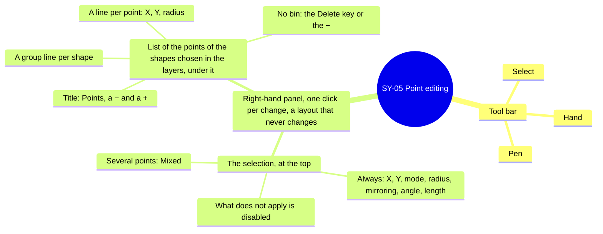

| ID | Element | Kind | Values and behaviour | Status | Source |
| --- | --- | --- | --- | --- | --- |
| SY-05.1 | Tools | Button | Select, Hand, Pen. | Decided | [Point editing mode](../symbols/05-point-editing-mode/README.md) |
| SY-05.2 | List of the points | List, editable lines | Under the options of the selection (2026-11-25, to confirm). The points of the shapes chosen in the layers; none for a group. Title: Points, with a − and a +; a group line per shape, then its points (2026-11-26). A line per point: name, X, Y, radius, edited in the line; the radius disabled in the handles mode, the mode not shown (2026-11-26, assistant's choice asked by the PO). Selecting in the list selects on the canvas and back. | Decided (lines, groups), Proposed (place, radius only) | [Point editing mode](../symbols/05-point-editing-mode/README.md#list-of-the-points) |
| SY-05.3 | Point mode | [Segmented control](../design-system/07-molecules/segmented-control.md), two icons | Corner radius or Handles, one click (2026-11-25, replaces the select); each keeps its settings. Also offered when a handle is selected (2026-11-25). An ellipse point: handles only. | Decided | [Points and handles](../symbols/05-point-editing-mode/points-and-handles.md) |
| SY-05.4 | Corner radius | Number field | Always shown; disabled in the handles mode and for a handle (2026-11-25). | Decided | [Points and handles](../symbols/05-point-editing-mode/points-and-handles.md) |
| SY-05.5 | Mirroring | Segmented control, three icons | None, Mirror angle, Mirror angle and length, one click (2026-11-25, replaces the select). Always shown; disabled in the corner radius mode. | Decided | [Points and handles](../symbols/05-point-editing-mode/points-and-handles.md#mirroring-of-the-handles) |
| SY-05.6 | Handle X, Y | Number field | A click on a handle selects it; X and Y of its end, as in Figma, in the same fields as a point; linked to angle and length. | Decided | [Points and handles](../symbols/05-point-editing-mode/points-and-handles.md#a-selected-handle) |
| SY-05.7 | Handle angle, length | Number field | Always shown (2026-11-25), enabled for a handle and for a mirrored point (SY-05.17). Linked to X and Y. Angle 0: flat, horizontal (proposal; horizontal or vertical: Open). | Decided (fields), Open (angle 0) | [Points and handles](../symbols/05-point-editing-mode/points-and-handles.md#a-selected-handle) |
| SY-05.8 | Remove a point | Delete key; a − on the title of the list | No bin on the lines: too close to the fields (2026-11-25). The −, enabled when points are selected: visible equivalent (2026-11-26). | Decided | [Point editing mode](../symbols/05-point-editing-mode/README.md#list-of-the-points) |
| SY-05.9 | Add a point | The Pen | The + of the list is removed (2026-11-26): the Pen adds the points; a point put on the outline never changes it, a circle stays a circle (2026-11-26). | Decided | [Point editing mode](../symbols/05-point-editing-mode/README.md#adding-a-point) |
| SY-05.18 | Name of a point | Text field, "Name" written in it while empty | Under the title of the selection; the name replaces "Point 2" in the title and the list; "Name" in the field, no title (2026-11-26). | Decided | [Points and handles](../symbols/05-point-editing-mode/points-and-handles.md#the-options-of-the-selection-always-the-same-lines) |
| SY-05.10 | Precise move | Ctrl held while dragging, no button (SY-03.11) | A point or a handle moves pixel by pixel of the symbol, even zoomed out. | Decided | [Precise move](../symbols/03-editor/precise-move.md) |
| SY-05.11 | Point X, Y | Number field | X and Y of the selected point, at the top of its options and in its line. | Decided | [Points and handles](../symbols/05-point-editing-mode/points-and-handles.md#the-options-of-the-selection-always-the-same-lines) |
| SY-05.12 | Several points selected | Title + fields | "3 points", in one shape or across several; a field whose values differ shows Mixed; a value typed goes to every point; mode and mirroring show no choice when they differ. | Decided | [Point editing mode](../symbols/05-point-editing-mode/README.md#several-points-selected) |
| SY-05.13 | Mirroring cell of a point line | — | Removed (2026-11-26): the list shows the radius only; a handle is selected on the canvas, or changed from its mirrored point (SY-05.17). | Proposed | [Point editing mode](../symbols/05-point-editing-mode/README.md#list-of-the-points) |
| SY-05.14 | Layout of the panel | — | The same lines whatever is selected; what does not apply is disabled, never hidden; nothing appears or disappears (2026-11-25). | Decided | [Point editing mode](../symbols/05-point-editing-mode/README.md#right-hand-panel) |
| SY-05.15 | Shapes chosen in the layers | [Layers](../symbols/03-editor/layers.md) of the left-hand panel | The shapes are chosen there only, Shift or Ctrl for several; a click on the canvas never changes them, no double click (2026-11-26). Shapes selected before the mode: kept (proposed). | Decided (layers only), Proposed (kept) | [Point editing mode](../symbols/05-point-editing-mode/README.md#which-shapes-are-edited) |
| SY-05.16 | Several shapes chosen | Canvas, list | The points of every chosen shape at once, on the canvas and in the list, grouped by shape (2026-11-26). | Decided | [Point editing mode](../symbols/05-point-editing-mode/README.md#which-shapes-are-edited) |
| SY-05.17 | Angle and length on a point | Number field (SY-05.7) | Mirror angle and length: both enabled on the point, moving both handles (2026-11-26). Mirror angle: the angle enabled, the length disabled (2026-11-26). None: both disabled. | Decided | [Points and handles](../symbols/05-point-editing-mode/points-and-handles.md#angle-and-length-on-a-point) |

Gaps:

- How the corner radius of a point is edited precisely on the canvas: "to be detailed later".

## SY-06 · Alignment mode

Path: symbol editor › Alignment.

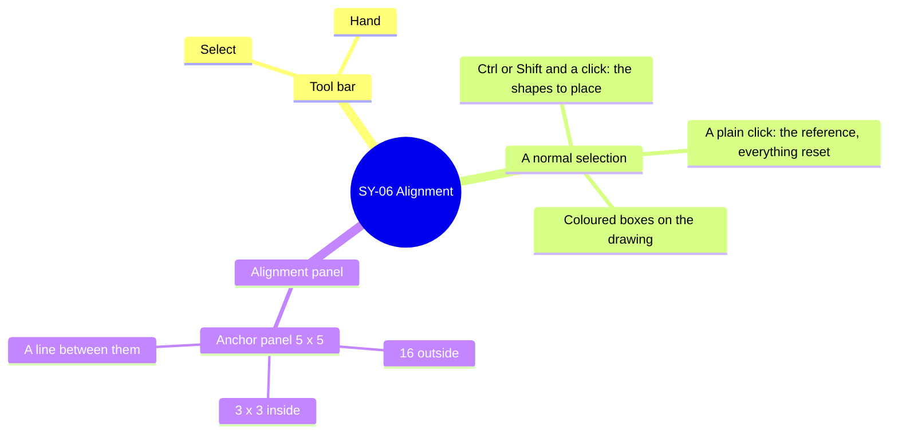

| ID | Element | Kind | Values and behaviour | Status | Source |
| --- | --- | --- | --- | --- | --- |
| SY-06.1 | Tools | Button | Select, Hand. | Decided | [Alignment mode](../symbols/06-alignment-mode/README.md) |
| SY-06.2 | Reference | A plain click, a coloured box on the drawing | A normal selection: a plain click resets everything and makes the shape clicked the reference; a click on an empty place selects nothing (2026-11-26, replaces Ctrl for the reference). No line nor button in the panel: a user manual explains it (2026-11-26). | Decided | [Alignment mode](../symbols/06-alignment-mode/README.md#the-reference-and-the-shapes-to-place-a-normal-selection) |
| SY-06.7 | To place | Ctrl or Shift and a click, a coloured box on the drawing | The shapes selected after the reference: Ctrl adds or takes out one, Shift adds every layer in between, as everywhere; on the drawing, Shift adds the shape clicked, like Ctrl (2026-11-26). No list nor button in the panel (2026-11-26). | Decided | [Alignment mode](../symbols/06-alignment-mode/README.md#the-reference-and-the-shapes-to-place-a-normal-selection) |
| SY-06.3 | Anchor panel | Large grid of 5 × 5 cells | The 3 × 3 of the middle: inside; the 16 around: outside; a line between them for the limit of the reference (2026-11-25). One click on a cell places the shapes at once (proposed). On a real shape: the centre and eight points on the outline (proposed). | Decided (panel), Proposed (placement at once, real shape) | [Alignment mode](../symbols/06-alignment-mode/README.md#the-anchor-panel) |
| SY-06.4 | Inside or outside | — | Removed (2026-11-25): the anchor panel holds both. | Decided | [Alignment mode](../symbols/06-alignment-mode/README.md#the-anchor-panel) |
| SY-06.5 | Distribution with equal spacing | — | Removed (2026-11-26): "on le fera pas". | Decided | [Alignment mode](../symbols/06-alignment-mode/README.md#what-the-research-found) |

Gaps:

- One anchor for all the shapes to place, or one each (Open).

## SY-07 · Interaction mode

Path: symbol editor › Interaction (symbol with a type only).

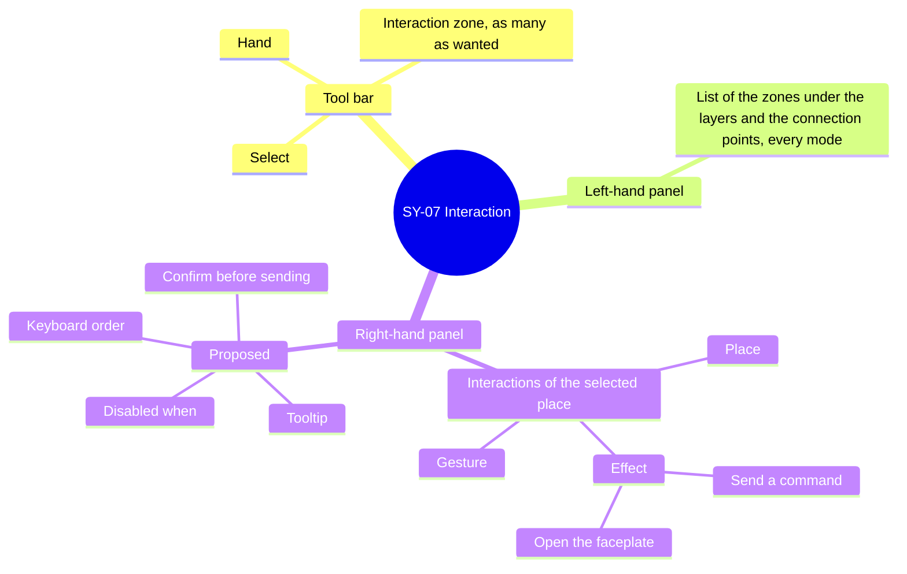

| ID | Element | Kind | Values and behaviour | Status | Source |
| --- | --- | --- | --- | --- | --- |
| SY-07.1 | Interaction zone | Button (tool) | Draws a zone by hand; each drag adds one, as many as wanted (2026-11-25). | Decided | [Interaction mode](../symbols/07-interaction-mode/README.md#interaction-zone-tool) |
| SY-07.2 | Place | — | A drawn zone, the whole symbol, or a layer (its real shape). Chosen by a click, in the list of the zones or on the drawing; no select (2026-11-25). | Decided | [Interaction mode](../symbols/07-interaction-mode/README.md) |
| SY-07.10 | Interaction zones | List, no + nor −, the icon of the mode on its title | In the left-hand panel, under the layers and the connection points, in every mode; the icon opens this mode (2026-11-26, said with a doubt: to judge on the screens; replaces the right-hand panel). A click selects a zone, its interactions on the right; from another mode, it opens this one. The tool adds a zone, the Delete key removes it. | Decided (to judge on the screens) | [Interaction mode](../symbols/07-interaction-mode/README.md#panels) |
| SY-07.3 | Interactions of the place | List | Several gestures per place. | Decided | [Interaction mode](../symbols/07-interaction-mode/README.md) |
| SY-07.4 | Gesture | Select | Click, double click, right click, while pressed, key (proposed list). | Decided (list: Proposed) | [Interaction mode](../symbols/07-interaction-mode/README.md) |
| SY-07.5 | Effect | Segmented control + Select | Command or Faceplate, one click (2026-11-26, replaces the first select of 2026-11-24); for Command, a select of the commands of the type (set a signal, trigger). | Decided | [Interaction mode](../symbols/07-interaction-mode/README.md) |
| SY-07.6 | Disabled when | Select (boolean output signal) | The place looks inactive and sends nothing. | Proposed | [Interaction mode](../symbols/07-interaction-mode/README.md) |
| SY-07.7 | Confirm before sending | Toggle | Off by default. | Proposed | [Interaction mode](../symbols/07-interaction-mode/README.md) |
| SY-07.8 | Tooltip | Text field | Plain text. | Proposed | [Interaction mode](../symbols/07-interaction-mode/README.md) |
| SY-07.9 | Keyboard order | not said | Order of the places reached with Tab. | Proposed | [Interaction mode](../symbols/07-interaction-mode/README.md) |

Gaps:

- Commands with a typed value no longer exist (2026-11-16): a command always sends a fixed value; a typed value goes through a faceplate entry set to write.
- Remove an interaction.

## SY-08 · Animation mode

Path: symbol editor › Animation (symbol with a type only).

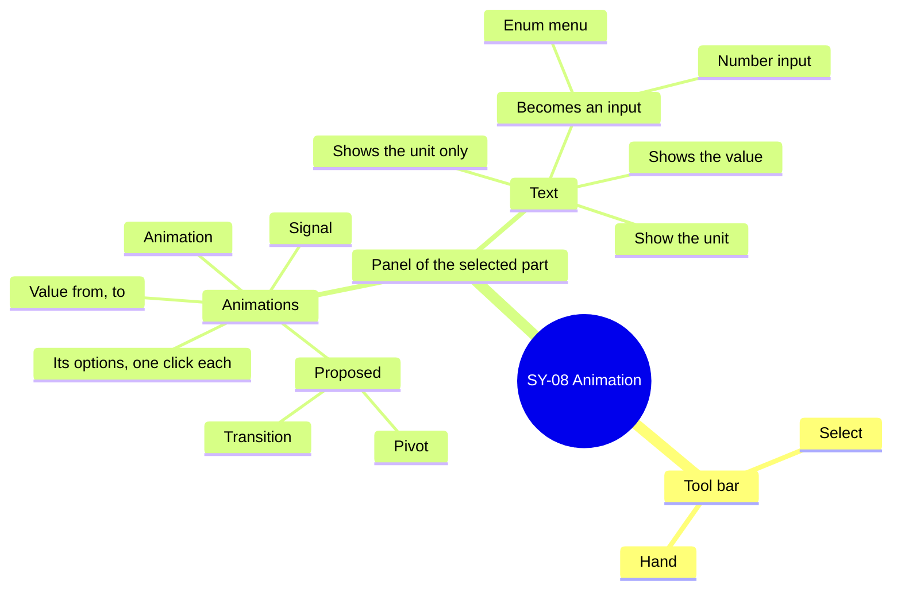

| ID | Element | Kind | Values and behaviour | Status | Source |
| --- | --- | --- | --- | --- | --- |
| SY-08.1 | Animations of the part | List, + on its title | The part is a shape, a layer or a text. The + adds an output signal, then the kind of animation is chosen (2026-11-25). | Decided | [Animation mode](../symbols/08-animation-mode/README.md) |
| SY-08.2 | Signal | Select | Output signals of the type only. | Decided | [Animation mode](../symbols/08-animation-mode/README.md) |
| SY-08.3 | Animation | Select | Only the animations that fit the type of the signal and the selected part: Rotate, Spin, Move, Endless scroll, Flow, Shake, Fill, Arc, Colour, Opacity, Show or hide, Swap, Blink, Pulse, Border style, Flip by sign (names of 2026-11-26, [catalogue](../symbols/08-animation-mode/animation-catalogue.md)); the Product Owner picks those of this version. | Proposed (list) | [Catalogue of the animations](../symbols/08-animation-mode/animation-catalogue.md) |
| SY-08.4 | How the value acts | Fields, no select | Follows from the animation (2026-11-26, the select "Mapping" removed): Follow the value (Value from, to; the part at each end), Speed (a value for one turn or one length per second), Steps (a table of ranges), Per state (true, false, or a column of the enum). Colour alone offers Steps or Blend for a number, one click. The options of an animation are segmented controls: Along (X, Y, Path), Direction, From (Bottom, Top, Left, Right, drawn as arrows), Colours (Fill, Border), Mirror, At zero. | Proposed | [Catalogue of the animations](../symbols/08-animation-mode/animation-catalogue.md) |
| SY-08.4c | Column of the enum | Select | For an enum signal: a column added to its enum on the Enums page of the Symbol Lib ([SY-12](#sy-12--enums-of-a-symbol-lib)); the property takes that column's value for the current item (2026-11-17). Only columns whose kind fits the property (assistant's reading). | Decided | [Enums of a Symbol Lib](../symbols/11-enums-of-a-symbol-lib.md#used-by-an-animation) |
| SY-08.4b | Value from, to (Follow the value) | Two fields: minimum, maximum | Each a signal of the type, input or output, or a number typed (the number: to confirm); the value animated stays an output. | Decided (signal in or out), Proposed (number) | [Animation mode](../symbols/08-animation-mode/README.md#the-input-range-of-a-bounded-linear-animation) |
| SY-08.5 | Transition | Segmented control + number field | None or Linear, one click (2026-11-26), with a short duration, the field shown for Linear only. | Proposed | [Animation mode](../symbols/08-animation-mode/README.md) |
| SY-08.6 | Pivot | 9-point grid or a point | Centre by default; for Rotate, Spin and Flip by sign. The same grid as the anchors of the drawing mode. | Proposed | [Animation mode](../symbols/08-animation-mode/README.md) |
| SY-08.7 | Text: what it shows | Segmented control | Written text, the value of a signal, or the unit of a signal only, one click (2026-11-26); short labels Text, Value, Unit (assistant's). | Decided | [Text](../symbols/04-drawing-mode/text.md) |
| SY-08.8 | Text: show the unit | Toggle | With the value. | Decided | [Animation mode](../symbols/08-animation-mode/README.md) |
| SY-08.9 | Text: becomes an input | Select | One select, the input signal written, or None (2026-11-26, the second select removed): a number signal gives a number input, an enum gives the menu of its display names (key sent); no text input, a signal is never a text (2026-11-18). What it writes is open since commands with a typed value were removed (2026-11-16); proposal: an input signal, directly. | Decided (input), Open (what it writes) | [Animation mode](../symbols/08-animation-mode/README.md) |
| SY-08.10 | Number format | Toggles | Thousand separator, sign, leading zeros, notation. | Proposed | [Animation mode](../symbols/08-animation-mode/README.md) |

Gaps:

- Remove an animation: a bin on the line, on hover, as drawn; two animations on the same property (proposed: forbidden, flagged).
- Each animation is drawn and explained, its panel included, in the Figma section "Symbol mode · Animations (2026-11-26)" of the page Spec.

## SY-09 · Run mode (name proposed: Test mode)

Path: symbol editor › Run (symbol with a type only).

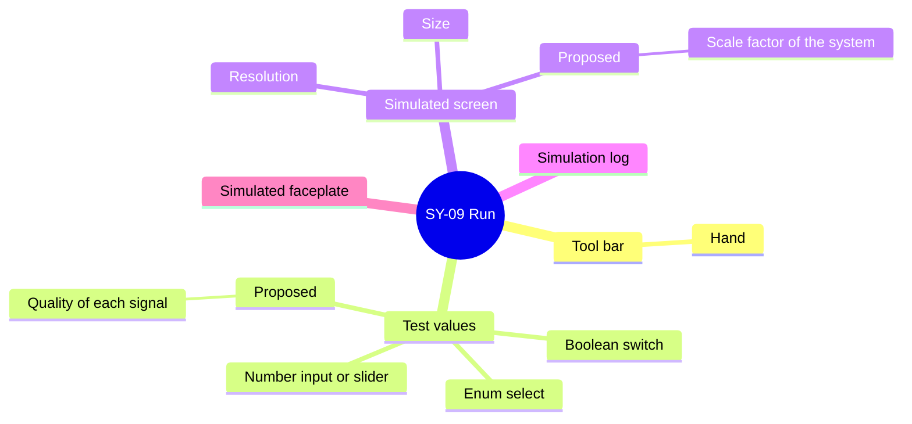

| ID | Element | Kind | Values and behaviour | Status | Source |
| --- | --- | --- | --- | --- | --- |
| SY-09.1 | Test value of a number | Number field or Slider | Any value: a signal has no bounds of its own since 2026-11-17 (a bound is a plain signal). The list also shows the signals used as a minimum or a maximum of an animation, inputs included (proposed). | Decided (field), Proposed (bound signals listed) | [Run mode](../symbols/09-run-mode/README.md#open-questions) |
| SY-09.2 | Test value of an enum | Select | The display names of the enum. | Decided | [Run mode](../symbols/09-run-mode/README.md) |
| SY-09.3 | Test value of a boolean | Toggle | — | Proposed | [Run mode](../symbols/09-run-mode/README.md) |
| SY-09.4 | Quality of a signal | Segmented control | Good, Uncertain, Bad, one click (2026-11-26, as in the test mode of a synoptic). | Proposed | [Run mode](../symbols/09-run-mode/README.md) |
| SY-09.5 | Simulated screen | Number fields (or a list of screens) | Size and resolution; scale factor proposed. | Decided | [Run mode](../symbols/09-run-mode/README.md) |
| SY-09.6 | Simulation log | List | A line per action: time, place, gesture, effect, value (proposed form). | Decided (form: Open) | [Run mode](../symbols/09-run-mode/README.md) |
| SY-09.7 | Simulated faceplate | Panel | Opens when an interaction opens the faceplate. | Decided (form: Open) | [Run mode](../symbols/09-run-mode/README.md) |

Gaps:

- A list of common screens, or only free fields?
- Clear the log; reset all the test values.

## SY-10 · Connection mode

Path: symbol editor › Connection (Product Owner, 2026-11-23).

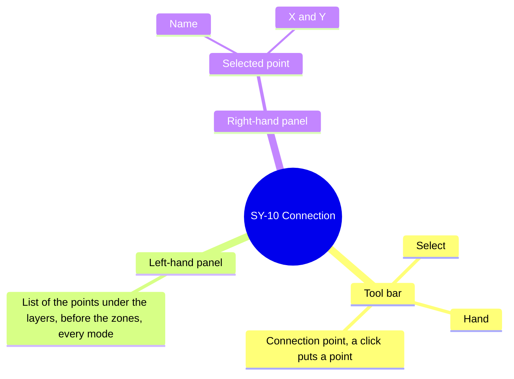

| ID | Element | Kind | Values and behaviour | Status | Source |
| --- | --- | --- | --- | --- | --- |
| SY-10.1 | Connection point | Button (tool) | Like the pen, without a line: each click puts a point where a pipe attaches (2026-11-25). | Decided | [Connection points](../symbols/pipes/connection-points.md#where-it-is-made-in-the-editor) |
| SY-10.2 | Position | Number fields | X and Y. | Decided | [Connection points](../symbols/pipes/connection-points.md) |
| SY-10.3 | Direction | — | Removed (2026-11-25): no direction, no inlet or outlet; the direction of a flow comes from a signal. | Decided | [Connection points](../symbols/pipes/connection-points.md#rules) |
| SY-10.4 | Name | Text field | Port A, port B... | Open | [Connection points](../symbols/pipes/connection-points.md) |
| SY-10.5 | List of the points | List, no + nor −, the icon of the mode on its title | In the left-hand panel, under the layers, before the zones, in every mode; the icon opens this mode; from another mode, a click on a point opens this one (2026-11-26, [layout rule](README.md#nothing-hidden-every-list-in-every-mode)). The tool adds a point, the Delete key removes it. | Decided (to judge on the screens) | [Connection points](../symbols/pipes/connection-points.md#where-it-is-made-in-the-editor) |

Gaps:

- Is this mode also offered to a symbol without a type (proposed: yes)?
- Size of the snapping zone.

## SY-11 · Advanced tools

Set aside: not in this version (Product Owner, 2026-11-25); kept as a record. The tool bar has no button to show them (SY-03.3 removed).

Path, in a later version: symbol editor › tool bar › "Show the advanced tools" button. The bar appears just above the tool bar.

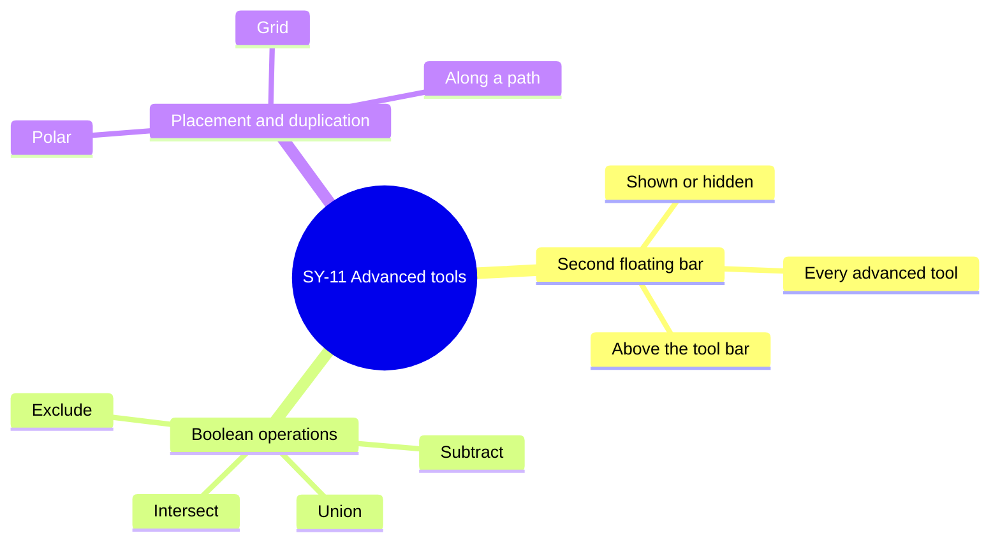

| ID | Element | Kind | Values and behaviour | Status | Source |
| --- | --- | --- | --- | --- | --- |
| SY-11.1 | Show the advanced tools | Button (in the tool bar) | Shows or hides the second bar (SY-03.3). Replaces the former three dots menu. | Decided | [Advanced tools](../symbols/03-editor/expert-menu/README.md) |
| SY-11.2 | Second bar | Floating bar | Just above the tool bar; holds every advanced tool. | Decided | [Advanced tools](../symbols/03-editor/expert-menu/README.md) |
| SY-11.3 | Boolean operation | Button each | Union, subtract, intersect, exclude; the result is a new shape. | Decided (list: Proposed) | [Boolean operations](../symbols/03-editor/expert-menu/boolean-operations.md) |
| SY-11.4 | Duplication rule | Segmented control | Polar, Path, Grid, one click (2026-11-26). | Decided (polar, along a path), Proposed (grid) | [Placement and duplication](../symbols/03-editor/expert-menu/placement-and-duplication.md) |
| SY-11.5 | Duplication options | Number fields + Toggle | Count or spacing, start and end angle, copies rotated or not. | Proposed | [Placement and duplication](../symbols/03-editor/expert-menu/placement-and-duplication.md) |

Gaps:

- How the reference of a duplication is picked (a point and a radius, a line): with the mouse, in fields, or both?
- Preview of the copies before they are made?

## SY-13 · Clip mode

Path: symbol editor › a shape selected › Clip, in the modes menu (2026-11-25).

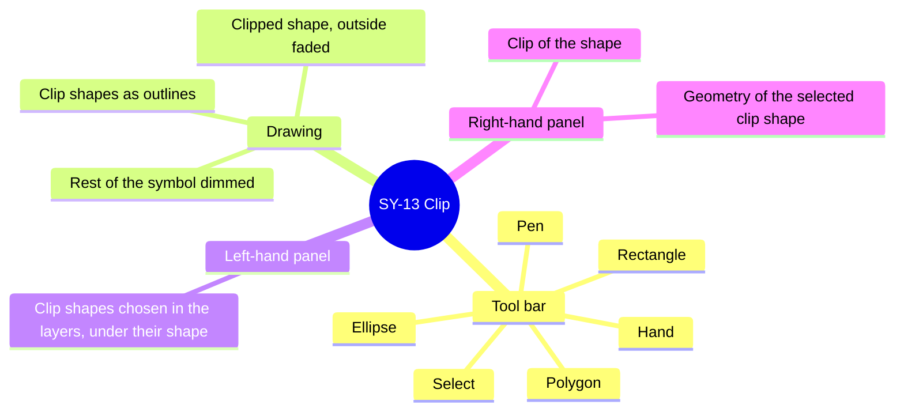

| ID | Element | Kind | Values and behaviour | Status | Source |
| --- | --- | --- | --- | --- | --- |
| SY-13.1 | Clip | Button of the modes menu | In its own group with Intersection after it, between Alignment and Connection, a separator on each side (2026-11-25); greyed with nothing selected, its tooltip says to select a shape first. | Decided (a mode, its place), Proposed (greyed) | [Clip mode](../symbols/04-drawing-mode/clip-mode.md) |
| SY-13.2 | Tools | Button | Select, Hand, Rectangle, Ellipse, Polygon, Pen; no Group, no Text. | Decided | [Clip mode](../symbols/04-drawing-mode/clip-mode.md) |
| SY-13.3 | Drawing | State of the drawing area | The clipped shape shown, its part outside the clip shapes faded; the rest of the symbol dimmed; the clip shapes as outlines. | Proposed | [Clip mode](../symbols/04-drawing-mode/clip-mode.md) |
| SY-13.4 | Clip shapes | Selection in the layers | Chosen in the layers, on the left, under their shape; no list of them in the right-hand panel, which holds the title "Clip of Casing" and the options of the selected clip shape (2026-11-26, [layout rule](README.md#a-list-to-choose-from-goes-on-the-left)). | Decided | [Clip mode](../symbols/04-drawing-mode/clip-mode.md) |
| SY-13.5 | Options of a clip shape | [Size fields](../controls/size-fields.md), number fields | Those of the same shape in the drawing mode, in the same order, without opacity, fill or border (2026-11-26, replaces X and Y first). Rectangle: W, H; X, Y, rotation; corner radius. Ellipse: the same without corner radius. Polygon: sides, filling of the box, anchor, then the same as the rectangle. Free form: the same as the rectangle. One screen per kind. | Decided | [Clip mode](../symbols/04-drawing-mode/clip-mode.md) |
| SY-13.6 | Pen in the Clip mode | Tool | Closed shapes only (2026-11-26); a path left open is not kept (proposed). | Decided (closed only), Proposed (open path) | [Clip mode](../symbols/04-drawing-mode/clip-mode.md) |
| SY-13.7 | Clip in the editor | Rule, a coloured note in Figma | The editor never applies the clip: the symbol is seen whole in every mode; the clip stays active once the mode is left, outside the editor. In Figma, a coloured note with an arrow on "Clip rectangle 1" says so (2026-11-26). | Decided | [Clip mode](../symbols/04-drawing-mode/clip-mode.md) |

Gaps:

- The name "Clip" (the Product Owner doubts it).
- A group or a text clipped; points of a clip shape edited where.

## SY-14 · Intersection mode

Path: symbol editor › Intersection, in the modes menu, right after Clip (2026-11-25).

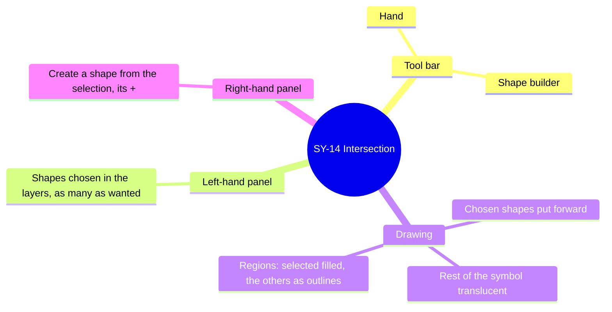

| ID | Element | Kind | Values and behaviour | Status | Source |
| --- | --- | --- | --- | --- | --- |
| SY-14.1 | Intersection | Button of the modes menu | Right after Clip, in its group (the group: assistant's choice). | Decided (place after Clip), Proposed (group) | [Intersection mode](../symbols/04-drawing-mode/intersection-mode.md) |
| SY-14.2 | Tools | Button | Hand, Shape builder (active when the mode opens); no Select. | Proposed | [Intersection mode](../symbols/04-drawing-mode/intersection-mode.md) |
| SY-14.3 | Chosen shapes | Selection in the layers | As many as wanted; put forward on the drawing, the rest translucent. Not listed again in the right-hand panel (2026-11-26). | Decided | [Intersection mode](../symbols/04-drawing-mode/intersection-mode.md#rules) |
| SY-14.4 | Regions | A click on the drawing with the Shape builder | A click selects a region, a click again unselects it, endlessly (2026-11-26); selected: filled; the others: outline. No list of the regions in the panel (2026-11-26). | Decided | [Intersection mode](../symbols/04-drawing-mode/intersection-mode.md#rules) |
| SY-14.5 | Create a shape from the selection | Title and a small + on its right | Enabled as soon as a region is selected; creates **one** path from every selected region, even apart; no option for one shape per region (2026-11-26). Then the selection empties, the mode stays (proposed); the chosen shapes stay (proposed). | Decided (+, one shape), Proposed (after) | [Intersection mode](../symbols/04-drawing-mode/intersection-mode.md#rules) |
| SY-14.6 | Validate, Cancel | — | Removed (2026-11-26): the + creates the shape; leaving the mode creates nothing. | Decided | [Intersection mode](../symbols/04-drawing-mode/intersection-mode.md#rules) |

Gaps:

- The name "Intersection" (the mode also makes unions and differences); a group, a text or an open path chosen.

## SY-12 · Enums of a Symbol Lib

Path: Symbols › a Symbol Lib › Enums, a page of the library in the navigation bar ([SY-00.4](#sy-00--navigation-bar-of-the-symbol-mode)).

Following the layout rules, the list of enums is on the left and the selected enum on the right, as on [MD-09](metadata.md#md-09--enums).

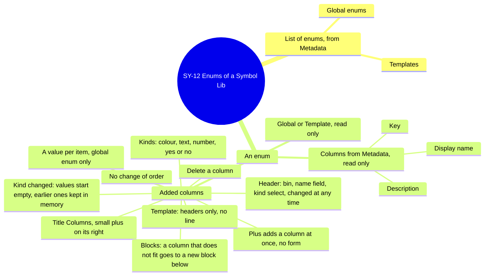

| ID | Element | Kind | Values and behaviour | Status | Source |
| --- | --- | --- | --- | --- | --- |
| SY-12.1 | Entry of the page | Button of the navigation bar | Enums, a page of the selected Symbol Lib ([SY-00.4](#sy-00--navigation-bar-of-the-symbol-mode), 2026-11-23). | Decided | [Libraries and symbols](../symbols/01-libraries-and-symbols.md#navigation-bar-of-the-symbol-mode) |
| SY-12.2 | List of enums | List | Every enum of Metadata, global and template; none is made here. Each line says Global or Template (2026-11-23). | Decided | [Enums of a Symbol Lib](../symbols/11-enums-of-a-symbol-lib.md) |
| SY-12.3 | Key, Display name, Description | Read-only columns | From Metadata, in the order of decision 0032; changed in Metadata only. A template has no items, so no lines: its name and its description are shown instead, read only (end of 2026-11-17). | Decided | [Enums of a Symbol Lib](../symbols/11-enums-of-a-symbol-lib.md) |
| SY-12.4 | Add a column | Button (+) on the right of the title "Columns" | As many columns as needed. The + adds the column at once, at the end of the last block, without a form (decision 0091, which replaces the form of 0090). The new column: name field focused and empty, kind Text by default, values empty text fields (Product Owner, 2026-11-23, replacing "Choose a kind"). The place of the + follows the [layout rules](README.md#a-title-and-a-small--on-its-right). | Decided | [Enums of a Symbol Lib](../symbols/11-enums-of-a-symbol-lib.md#added-columns) |
| SY-12.5 | Name of a column | Text field, always visible in the header of the column, above the kind | Edited at any time (end of 2026-11-17): `color`, `display name short`... | Decided | [Enums of a Symbol Lib](../symbols/11-enums-of-a-symbol-lib.md#added-columns) |
| SY-12.6 | Kind of value of a column | Select always visible in the header of the column, under the name | Chosen in the header once the column is added, for a global enum as for a template (decision 0090, which replaces "the first value chooses the kind"); changed at any time, without opening anything (decision 0091). A kind of animation, not a type of the model: Colour (RGBA), Text, Number, Yes / no (see [Kinds of value](../symbols/11-enums-of-a-symbol-lib.md#kinds-of-value)). On a change, nothing is converted: the new kind starts with empty values; the application remembers the values of the earlier kinds while it runs and gives them back if an earlier kind is chosen again (decision 0092). The change shows nothing, no warning, no notice (decision 0093). | Decided | [Enums of a Symbol Lib](../symbols/11-enums-of-a-symbol-lib.md#changing-the-kind) |
| SY-12.7 | Value of a column for an item | Field of the kind ([colour field](../controls/colour-field.md), text field, number field, checkbox) | Global enum only: one per item. For a template, filled with its items on each placed symbol, in the synoptic (end of 2026-11-17; the columns with the items: assistant's reading). | Decided | [Enums of a Symbol Lib](../symbols/11-enums-of-a-symbol-lib.md) |
| SY-12.8 | Delete a column | Icon button (bin), at the top of the header of the column, on the right, above the name | A column can be deleted (end of 2026-11-17); the bin is above the name (decision 0091). Deleted at once, with no confirmation, even with values: the undo history takes it back (decision 0093). | Decided | [Enums of a Symbol Lib](../symbols/11-enums-of-a-symbol-lib.md#added-columns) |
| SY-12.9 | Order of the columns | — | Not changed: no handle. | Decided | [Enums of a Symbol Lib](../symbols/11-enums-of-a-symbol-lib.md#added-columns) |
| SY-12.10 | Blocks of columns | Several tables, one under the other | No column narrowed, no sideways scroll: the added column that does not fit starts a new block below. Display name and Description in the first block only; each next block repeats the Key alone (Product Owner, 2026-11-23). Same lines in every block; the blocks follow the width of the window (decision 0091). | Decided | [Enums of a Symbol Lib](../symbols/11-enums-of-a-symbol-lib.md#when-the-columns-do-not-fit) |

Gaps:

- What a deleted column breaks in the animations.
- How the words Global and Template look in the list (a tag on the right of the line, in the test screen): for the design system.
