# Screens of the symbol editor

> [Home](../README.md) › [Screens](README.md) › Symbol editor

Status: draft, written by the assistant on 2026-11-11 from the [Symbols](../symbols/README.md) pages, themselves a draft, then updated with the Product Owner's review of 2026-11-15 (one list of symbols, left-hand panel, layers, floating bars, precise move) and of 2026-11-16 (no libraries of types, navigation bar). It adds no rule. Kinds and statuses are explained in the [guide of this folder](README.md). The pipes are in [Pipes](pipes.md).

## SY-00 · Navigation bar of the symbol mode

Path: Symbols. On the far left of every screen of the symbol mode (Product Owner, 2026-11-16).

| ID | Element | Kind | Values and behaviour | Status | Source |
| --- | --- | --- | --- | --- | --- |
| SY-00.1 | Libraries | Button (icon), at the top | A kind of "home": opens [SY-01](#sy-01--symbol-libs), the full list of the Symbol Libs with more information. | Decided | [Libraries and symbols](../symbols/01-libraries-and-symbols.md) |
| SY-00.2 | Separator | — | Between the Libraries button and the list. | Decided | [Libraries and symbols](../symbols/01-libraries-and-symbols.md) |
| SY-00.3 | Symbol Libs | List (one item each) | Every Symbol Lib, directly: one click changes the library shown in the left-hand panel. | Decided | [Libraries and symbols](../symbols/01-libraries-and-symbols.md) |

Gaps:

- How a Symbol Lib looks in the bar (icon, initials, name on hover).
- Going from the symbol mode to Metadata is done in the top bar (see the [guide](README.md#top-bar-of-the-window)).

## SY-01 · Symbol Libs

Path: Symbols › Libraries (the button at the top of the navigation bar).

The page is the full list of the Symbol Libs, with more information than the navigation bar. Following the layout rules, the list is on the left and the selected library on the right.

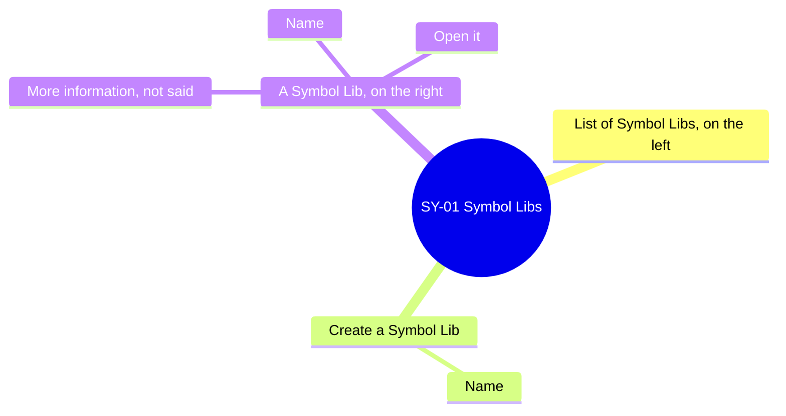

| ID | Element | Kind | Values and behaviour | Status | Source |
| --- | --- | --- | --- | --- | --- |
| SY-01.1 | List of Symbol Libs | List | On the left. The user selects one to see it on the right. | Decided | [Libraries and symbols](../symbols/01-libraries-and-symbols.md) |
| SY-01.2 | Create a Symbol Lib | Button (icon with a small +) | On the right of the title "Symbol Libs", above the list ([layout rules](README.md#a-title-and-a-small--on-its-right), 2026-11-16). Asks a name only. | Decided | [Libraries and symbols](../symbols/01-libraries-and-symbols.md) |
| SY-01.3 | Name | Text field | — | Decided | [Libraries and symbols](../symbols/01-libraries-and-symbols.md) |
| SY-01.4 | More information | not said | "Une liste mieux faite, avec plus d'infos": which information is not said (number of symbols and pipe styles, broken items, last change?). | Open | [Libraries and symbols](../symbols/01-libraries-and-symbols.md) |
| SY-01.5 | Open | not said (button) | Shows the library in the left-hand panel ([SY-02](#sy-02--left-hand-panel-of-a-symbol-lib)). | Implied | [Libraries and symbols](../symbols/01-libraries-and-symbols.md) |

Gaps:

- Rename, duplicate (to change a look over time, the user creates a new Symbol Lib: is it a copy of the old one?), delete.
- Which information the full list shows on each library.

## SY-02 · Left-hand panel of a Symbol Lib

Path: Symbols › a Symbol Lib. The panel stays on the left while a symbol is open in the editor.

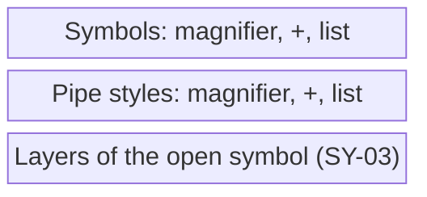

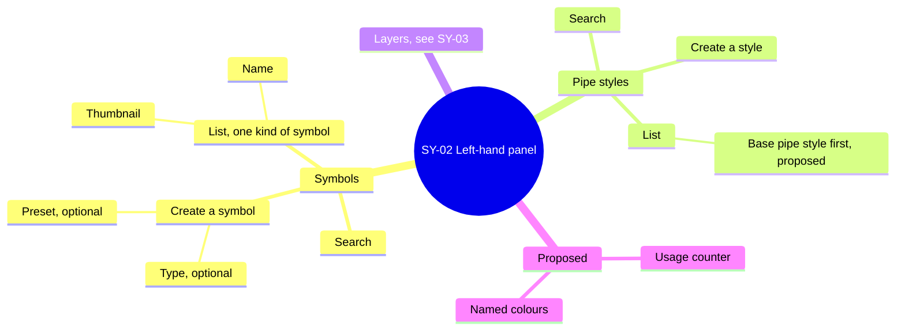

| ID | Element | Kind | Values and behaviour | Status | Source |
| --- | --- | --- | --- | --- | --- |
| SY-02.1 | List of symbols | List | One flat list, one kind of symbol: no static or dynamic. A click on an item opens it in the editor. | Decided | [Libraries and symbols](../symbols/01-libraries-and-symbols.md) |
| SY-02.2 | Search the symbols | Text field (magnifier) | Filters the list. | Decided | [Libraries and symbols](../symbols/01-libraries-and-symbols.md) |
| SY-02.3 | Create a symbol | Button (+) | The type and preset can be chosen here, never imposed. | Decided | [Libraries and symbols](../symbols/01-libraries-and-symbols.md) |
| SY-02.4 | Type, at creation | Select, optional | All the types of Metadata (no library of types). How the choice stays quick in a big tree: open. | Decided | [Libraries and symbols](../symbols/01-libraries-and-symbols.md) |
| SY-02.5 | Item of the list | Thumbnail + name | The thumbnail is the symbol, or its outlines only (as Figma's outline view). | Decided (thumbnail: Open) | [Libraries and symbols](../symbols/01-libraries-and-symbols.md) |
| SY-02.6 | List of pipe styles | List | Flat; a click opens the style (see [Pipes](pipes.md)). | Decided | [Libraries and symbols](../symbols/01-libraries-and-symbols.md) |
| SY-02.7 | Search the pipe styles | Text field (magnifier) | Filters the list. | Decided | [Libraries and symbols](../symbols/01-libraries-and-symbols.md) |
| SY-02.8 | Create a pipe style | Button (icon with a small +) | On the right of the title "Pipe styles" ([layout rules](README.md#a-title-and-a-small--on-its-right), 2026-11-16). | Decided | [Libraries and symbols](../symbols/01-libraries-and-symbols.md) |
| SY-02.9 | Base pipe style | Item of the list | First item of the pipe styles list. | Proposed | [Libraries and symbols](../symbols/01-libraries-and-symbols.md) |
| SY-02.10 | Broken mark | — | A small red mark on a broken item. | Decided | [Libraries and symbols](../symbols/01-libraries-and-symbols.md) |
| SY-02.11 | Usage counter | — | "Used by 38 pipes", on symbols and styles. | Proposed | [Libraries and symbols](../symbols/01-libraries-and-symbols.md) |
| SY-02.12 | Named colours | List | A flat list "Colours" that symbols and styles point to. | Proposed | [Fill and border](../symbols/04-drawing-mode/fill-and-border.md) |

Gaps:

- What an item shows besides its thumbnail and name.
- Duplicate, rename and delete a symbol or a pipe style.
- Sort of the lists (by name, by creation)?

## SY-03 · Symbol editor: what every mode shares

Path: Symbols › a Symbol Lib › a symbol.

The layout is decided (Product Owner, 2026-11-15), except the place of the tool bar (bottom or top) and of the zoom field.

```mermaid
block-beta
    columns 4
    rail["Navigation bar SY-00"]
    left["Left-hand panel: SY-02 symbols and pipe styles, then the layers"] canvas["Drawing area: modes menu floating top left; advanced tools bar above the tool bar; tool bar floating at the bottom"] panel["Right-hand panel: options of the selection, type and preset of the symbol"]
```

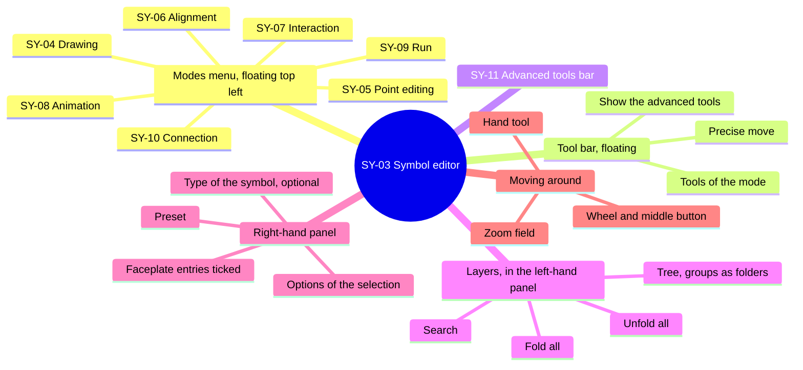

| ID | Element | Kind | Values and behaviour | Status | Source |
| --- | --- | --- | --- | --- | --- |
| SY-03.1 | Modes menu | Floating menu | At the top left of the drawing area: Drawing, Point editing, Alignment, Interaction, Animation, Run, Connection. Interaction, Animation and Run need a type. | Decided (Connection: Proposed) | [Editor](../symbols/03-editor/README.md) |
| SY-03.2 | Tool bar | Floating bar | The tools of the mode; at the bottom of the drawing area (leaning) or at the top. | Decided (place: Open) | [Editor](../symbols/03-editor/README.md) |
| SY-03.3 | Show the advanced tools | Button (in the tool bar) | Shows or hides the [SY-11](#sy-11--advanced-tools) bar just above. | Decided | [Advanced tools](../symbols/03-editor/expert-menu/README.md) |
| SY-03.4 | Type | Select, optional | In the right-hand panel; among all the types of Metadata; can be removed. | Decided | [Type, preset and faceplate](../symbols/02-type-and-faceplate.md) |
| SY-03.5 | Preset | Select | In the right-hand panel; then its defaults, display units, decimals, and the texts of the title and description elements of the faceplate are edited here (no title nor description by default since 2026-11-16). | Decided | [Type, preset and faceplate](../symbols/02-type-and-faceplate.md) |
| SY-03.6 | Faceplate entries | Checkbox per entry | The full list is always there. | Decided | [Type, preset and faceplate](../symbols/02-type-and-faceplate.md) |
| SY-03.7 | Hand | Button (tool) | Moves the view; also the middle button held. In every mode. | Decided | [Hand](../symbols/03-editor/hand.md) |
| SY-03.8 | Zoom | Number field (%) | Shown in one place (which one: not said); the user can type a value; 100 % is the real size. | Decided | [Editor](../symbols/03-editor/README.md) |
| SY-03.9 | Select | Button (tool) | In every mode except Run; picks what the mode works on. | Decided | [Select](../symbols/03-editor/select.md) |
| SY-03.10 | Entirely enclosed | Toggle | Visible equivalent of Alt during a selection rectangle. | Decided | [Select](../symbols/03-editor/select.md) |
| SY-03.11 | Precise move | Toggle | Visible equivalent of the key that moves a dragged point or handle pixel by pixel. | Decided (key: Open) | [Precise move](../symbols/03-editor/precise-move.md) |
| SY-03.12 | Layers | Tree | In the left-hand panel; groups as folders; one line per shape, its border included. | Decided | [Layers](../symbols/03-editor/layers.md) |
| SY-03.13 | Search the layers | Text field (magnifier) | Filters by name. | Decided | [Layers](../symbols/03-editor/layers.md) |
| SY-03.14 | Unfold all, fold all | Button each | Every group of the tree. | Decided | [Layers](../symbols/03-editor/layers.md) |
| SY-03.15 | Line of a layer | — | Name; icon of its kind, hide, lock proposed. | Decided (name), Proposed (the rest) | [Layers](../symbols/03-editor/layers.md) |
| SY-03.16 | Undo, redo, save | not said | Listed as missing by the research. | Proposed | [Editor](../symbols/03-editor/README.md) |
| SY-03.17 | Grid, snapping, guides | not said | Minimum set proposed by the research. | Proposed | [Editor](../symbols/03-editor/README.md) |

Gaps:

- Does the right-hand panel show the type and preset only when nothing is selected (assumption)?
- How a layer is named, and whether the tree order is the stacking order.
- Frame of the symbol (size, fit to content): proposed by the research, not placed in a screen.
- Place of the zoom field, of undo and redo, of save.

## SY-04 · Drawing mode

Path: symbol editor › Drawing (the default mode).

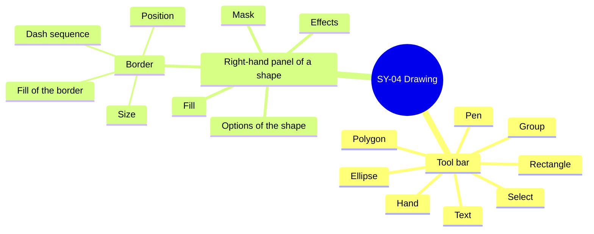

### Tool bar

| ID | Element | Kind | Values and behaviour | Status | Source |
| --- | --- | --- | --- | --- | --- |
| SY-04.1 | Tools | Button | In this order: Select, Hand, Group, Rectangle, Ellipse, Polygon, Pen, Text. | Decided | [Drawing mode](../symbols/04-drawing-mode/README.md) |
| SY-04.2 | Pen: straight line | Button | Turns the curve being drawn back into a straight line. | Decided | [Pen](../symbols/04-drawing-mode/pen.md) |
| SY-04.3 | Pen: angle lock | Toggle + Select | Step 15°, 30°, 45° or 90° (45° usual). | Decided (steps: Proposed) | [Pen](../symbols/04-drawing-mode/pen.md) |

### Panel of a shape: fill, border, effects

| ID | Element | Kind | Values and behaviour | Status | Source |
| --- | --- | --- | --- | --- | --- |
| SY-04.4 | Fill | not said (select + colour) | None, plain colour with opacity, linear gradient (stops, angle), radial gradient (stops, centre). | Proposed | [Fill and border](../symbols/04-drawing-mode/fill-and-border.md) |
| SY-04.5 | Border | not said (toggle) | A shape can have a border; a group cannot. | Decided | [Fill and border](../symbols/04-drawing-mode/fill-and-border.md) |
| SY-04.6 | Border size | Number field (px) | Example 2 px. | Decided | [Fill and border](../symbols/04-drawing-mode/fill-and-border.md) |
| SY-04.7 | Border position | Radio | Outside, middle, inside. An open path: middle only (proposed). | Decided | [Fill and border](../symbols/04-drawing-mode/fill-and-border.md) |
| SY-04.8 | Fill of the border | Same as the fill | Colour or gradient. | Decided | [Fill and border](../symbols/04-drawing-mode/fill-and-border.md) |
| SY-04.9 | Dashes of the border | Dash sequence editor | Segments, each a length and a colour, transparent for a gap (see [PI-04](pipes.md#pi-04--dash-sequence-editor)). | Decided | [Fill and border](../symbols/04-drawing-mode/fill-and-border.md) |
| SY-04.10 | Caps and joins | not said (radio) | Butt, round, square; miter, round, bevel. For open paths. | Proposed | [Fill and border](../symbols/04-drawing-mode/fill-and-border.md) |
| SY-04.11 | Effects menu | List + Button | Add, edit, remove; native SVG only; each effect kept only if it holds the performance. | Decided | [Effects and masks](../symbols/04-drawing-mode/effects-and-masks.md) |
| SY-04.12 | Effects offered | Select | Cut, gradients, dashes, colour change, drop shadow, blur, mask, inner shadow: each subject to the POC. | Proposed | [Effects and masks](../symbols/04-drawing-mode/effects-and-masks.md) |
| SY-04.13 | Mask | not said (select a shape) | The shape that cuts is chosen by the user. | Decided | [Effects and masks](../symbols/04-drawing-mode/effects-and-masks.md) |

### Panel of a shape: options by tool

| ID | Element | Kind | Values and behaviour | Status | Source |
| --- | --- | --- | --- | --- | --- |
| SY-04.14 | Rectangle: corner radius | Number field | For the whole rectangle. | Decided | [Rectangle](../symbols/04-drawing-mode/rectangle.md) |
| SY-04.15 | Rectangle, ellipse, polygon: link width and height | Toggle | Visible equivalent of the square or circle key. | Decided | [Rectangle](../symbols/04-drawing-mode/rectangle.md) |
| SY-04.16 | Polygon: number of sides | Number field | 3 to 20. | Decided | [Polygon](../symbols/04-drawing-mode/polygon.md) |
| SY-04.17 | Polygon: how it fills its box | Radio | Filled, Equilateral (a third mode "like Figma": Open, advised against). | Decided | [Polygon](../symbols/04-drawing-mode/polygon.md) |
| SY-04.18 | Polygon: anchor | not said (9-point grid) | An anchor of the box, and whether a corner or a side touches it. | Decided | [Polygon](../symbols/04-drawing-mode/polygon.md) |
| SY-04.19 | Group: width, height | Radio each | Fit or fixed; fixed gives a size. | Decided | [Group](../symbols/04-drawing-mode/group.md) |
| SY-04.20 | Group: placement of the children | not said (9-point grid) | Centred, or aligned left, right, top, bottom, with anchors; no flex. | Decided | [Group](../symbols/04-drawing-mode/group.md) |
| SY-04.21 | Child: absolute | Toggle + two anchors | Anchor of the group, anchor of the child. | Decided | [Group](../symbols/04-drawing-mode/group.md) |
| SY-04.22 | Group: create | Button (tool), Ctrl+G, right click "Group" | Three ways. | Decided | [Group](../symbols/04-drawing-mode/group.md) |

### Panel of a text

| ID | Element | Kind | Values and behaviour | Status | Source |
| --- | --- | --- | --- | --- | --- |
| SY-04.23 | Font family | Select | Fonts bundled with the software only (OFL proposed). | Decided | [Text](../symbols/04-drawing-mode/text.md) |
| SY-04.24 | Size | Number field | — | Decided | [Text](../symbols/04-drawing-mode/text.md) |
| SY-04.25 | Bold | Button | There by default, next to the weight list. | Decided | [Text](../symbols/04-drawing-mode/text.md) |
| SY-04.26 | Weight | Select | Every weight the font has. | Decided | [Text](../symbols/04-drawing-mode/text.md) |
| SY-04.27 | Italic | Button | Only when the font has a real italic. | Decided | [Text](../symbols/04-drawing-mode/text.md) |
| SY-04.28 | Text colour, background colour | Colour | — | Decided | [Text](../symbols/04-drawing-mode/text.md) |
| SY-04.29 | Text border | Toggle + size + colour | Native SVG stroke; the research says it is simple. | Decided (to keep: Open) | [Text](../symbols/04-drawing-mode/text.md) |
| SY-04.30 | Lines | Toggle each + colour | Underline, strikethrough, line above. | Decided | [Text](../symbols/04-drawing-mode/text.md) |
| SY-04.31 | Alignment | Radio | Left, centre, right; top, middle, bottom. | Decided | [Text](../symbols/04-drawing-mode/text.md) |
| SY-04.32 | Spacing | Number field each | Letter spacing, word spacing, line height. | Decided | [Text](../symbols/04-drawing-mode/text.md) |
| SY-04.33 | Wrapping | Toggle | Lines wrap in the box. | Decided | [Text](../symbols/04-drawing-mode/text.md) |
| SY-04.34 | Fit mode | Radio | Fit to the glyphs, or fit to the line. | Decided | [Text](../symbols/04-drawing-mode/text.md) |
| SY-04.35 | Embed the fonts | Toggle | In the exported SVG. | Decided | [Text](../symbols/04-drawing-mode/text.md) |

Gaps:

- Rotation and mirror of a shape: no control anywhere (the research proposes rotation as a property).
- Position and size (X, Y, width, height) of the selected shape: never listed as fields of the panel.
- Opacity of a whole shape or layer.
- Formatting part of a text ("format a part of it"): which options apply to a part, which to the whole text?
- Where is the "embed the fonts" option: on each text, or in the export?

## SY-05 · Point editing mode

Path: symbol editor › Point editing.

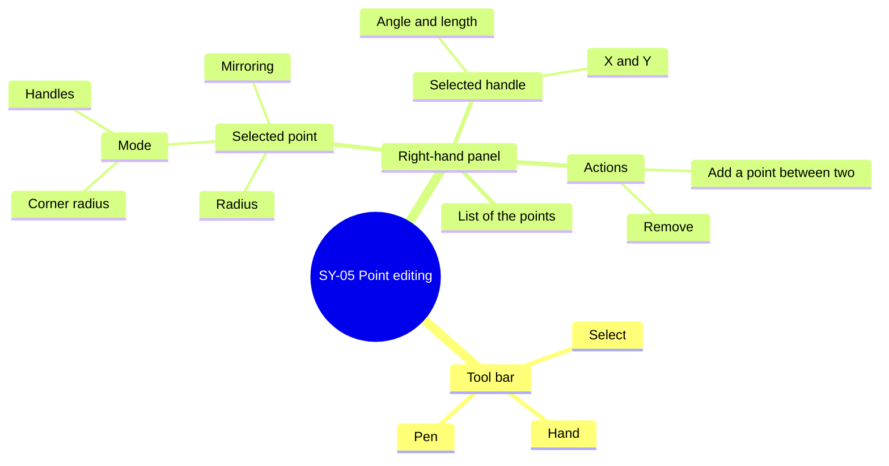

| ID | Element | Kind | Values and behaviour | Status | Source |
| --- | --- | --- | --- | --- | --- |
| SY-05.1 | Tools | Button | Select, Hand, Pen. | Decided | [Point editing mode](../symbols/05-point-editing-mode/README.md) |
| SY-05.2 | List of the points | List | Shape by shape; selecting in the list selects on the canvas and back. All shapes, or the selected ones: Open. | Decided | [Point editing mode](../symbols/05-point-editing-mode/README.md) |
| SY-05.3 | Point mode | Radio | Corner radius or Handles; each keeps its settings. An ellipse point: handles only. | Decided | [Points and handles](../symbols/05-point-editing-mode/points-and-handles.md) |
| SY-05.4 | Corner radius | Number field | — | Decided | [Points and handles](../symbols/05-point-editing-mode/points-and-handles.md) |
| SY-05.5 | Mirroring | Radio | None, Mirror angle, Mirror angle and length. | Decided | [Points and handles](../symbols/05-point-editing-mode/points-and-handles.md) |
| SY-05.6 | Handle X, Y | Number field | Linked to angle and length. | Decided | [Points and handles](../symbols/05-point-editing-mode/points-and-handles.md) |
| SY-05.7 | Handle angle, length | Number field | Linked to X and Y. | Decided | [Points and handles](../symbols/05-point-editing-mode/points-and-handles.md) |
| SY-05.8 | Remove | Button | Removes the selected points. | Decided | [Point editing mode](../symbols/05-point-editing-mode/README.md) |
| SY-05.9 | Add a point between two | Button | When two points are selected. | Decided | [Point editing mode](../symbols/05-point-editing-mode/README.md) |
| SY-05.10 | Precise move | Key held while dragging, or the toggle SY-03.11 | A point or a handle moves pixel by pixel of the symbol, even zoomed out. | Decided (key: Open) | [Precise move](../symbols/03-editor/precise-move.md) |

Gaps:

- Position X, Y of a selected point: only the handles have fields.
- How the corner radius of a point is edited precisely: "to be detailed later".

## SY-06 · Alignment mode

Path: symbol editor › Alignment.

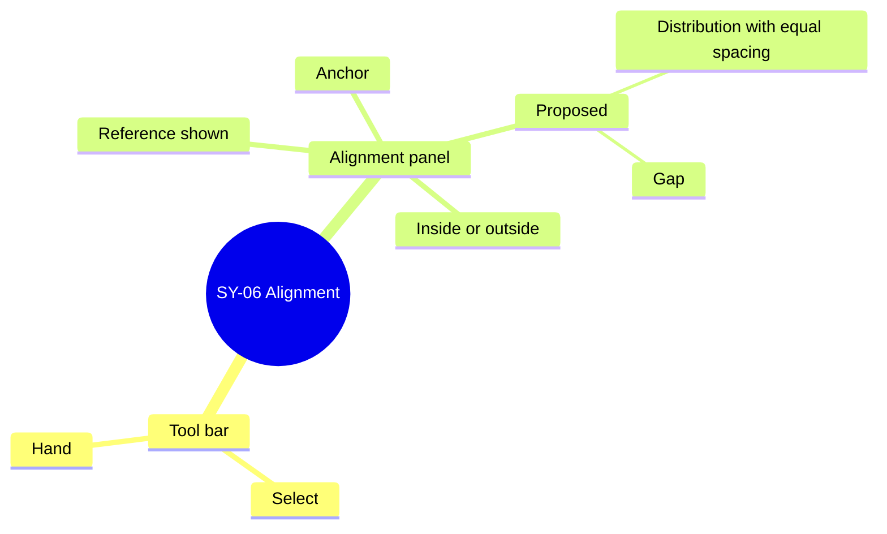

| ID | Element | Kind | Values and behaviour | Status | Source |
| --- | --- | --- | --- | --- | --- |
| SY-06.1 | Tools | Button | Select, Hand. | Decided | [Alignment mode](../symbols/06-alignment-mode/README.md) |
| SY-06.2 | Reference | — | The first shape selected; the panel shows which one. | Decided | [Alignment mode](../symbols/06-alignment-mode/README.md) |
| SY-06.3 | Anchor | not said (9-point grid) | On a real shape: the centre and eight points on the outline (proposed). | Decided (anchors on a real shape: Proposed) | [Anchors](../symbols/03-editor/anchors.md) |
| SY-06.4 | Inside or outside | Radio | Placement on the limit of the reference. | Decided | [Alignment mode](../symbols/06-alignment-mode/README.md) |
| SY-06.5 | Distribution with equal spacing | Button + number field | A typed gap between the edges. | Proposed | [Alignment mode](../symbols/06-alignment-mode/README.md) |
| SY-06.6 | Apply | not said | Does the shape move as soon as an anchor is chosen, or on a button? | Implied | — |

Gaps:

- One anchor for all the shapes to place, or one each (Open).
- When does the placement happen: at once, or on an "Apply" button?

## SY-07 · Interaction mode

Path: symbol editor › Interaction (symbol with a type only).

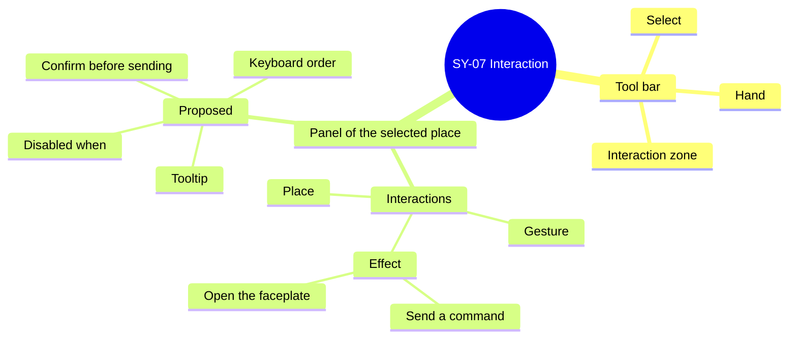

| ID | Element | Kind | Values and behaviour | Status | Source |
| --- | --- | --- | --- | --- | --- |
| SY-07.1 | Interaction zone | Button (tool) | Draws a zone by hand. | Decided | [Interaction mode](../symbols/07-interaction-mode/README.md) |
| SY-07.2 | Place | — | A drawn zone, the whole symbol, or a layer (its real shape). | Decided | [Interaction mode](../symbols/07-interaction-mode/README.md) |
| SY-07.3 | Interactions of the place | List | Several gestures per place. | Decided | [Interaction mode](../symbols/07-interaction-mode/README.md) |
| SY-07.4 | Gesture | Select | Click, double click, right click, while pressed, key (proposed list). | Decided (list: Proposed) | [Interaction mode](../symbols/07-interaction-mode/README.md) |
| SY-07.5 | Effect | Radio + Select | A command of the type (set a signal, trigger), or open the faceplate. | Decided | [Interaction mode](../symbols/07-interaction-mode/README.md) |
| SY-07.6 | Disabled when | Select (boolean output signal) | The place looks inactive and sends nothing. | Proposed | [Interaction mode](../symbols/07-interaction-mode/README.md) |
| SY-07.7 | Confirm before sending | Toggle | Off by default. | Proposed | [Interaction mode](../symbols/07-interaction-mode/README.md) |
| SY-07.8 | Tooltip | Text field | Plain text. | Proposed | [Interaction mode](../symbols/07-interaction-mode/README.md) |
| SY-07.9 | Keyboard order | not said | Order of the places reached with Tab. | Proposed | [Interaction mode](../symbols/07-interaction-mode/README.md) |

Gaps:

- Commands with a typed value no longer exist (2026-11-16): a command always sends a fixed value; a typed value goes through a faceplate entry set to write.
- Remove an interaction; edit or delete a zone.

## SY-08 · Animation mode

Path: symbol editor › Animation (symbol with a type only).

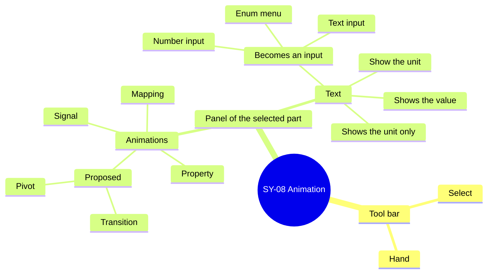

| ID | Element | Kind | Values and behaviour | Status | Source |
| --- | --- | --- | --- | --- | --- |
| SY-08.1 | Animations of the part | List | The part is a shape, a layer or a text. | Decided | [Animation mode](../symbols/08-animation-mode/README.md) |
| SY-08.2 | Signal | Select | Output signals of the type only. | Decided | [Animation mode](../symbols/08-animation-mode/README.md) |
| SY-08.3 | Property | Select | Rotation, position, opacity, visibility, fill or border colour, fill level, blink (proposed list). | Proposed | [Animation mode](../symbols/08-animation-mode/README.md) |
| SY-08.4 | Mapping | Select + fields | Bounded linear (input range, output range), by ranges (table), two values (boolean), state table (enum). | Proposed | [Animation mode](../symbols/08-animation-mode/README.md) |
| SY-08.5 | Transition | Radio + number field | None, or a short linear duration. | Proposed | [Animation mode](../symbols/08-animation-mode/README.md) |
| SY-08.6 | Pivot | 9-point grid or a point | Centre by default. | Proposed | [Animation mode](../symbols/08-animation-mode/README.md) |
| SY-08.7 | Text: what it shows | Radio | Written text, the value of a signal, or the unit of a signal only. | Decided | [Text](../symbols/04-drawing-mode/text.md) |
| SY-08.8 | Text: show the unit | Toggle | With the value. | Decided | [Animation mode](../symbols/08-animation-mode/README.md) |
| SY-08.9 | Text: becomes an input | Radio + Select | Number input, text input, or enum menu (display texts shown, key sent). What it writes is open since commands with a typed value were removed (2026-11-16); proposal: an input signal, directly. | Decided (input), Open (what it writes) | [Animation mode](../symbols/08-animation-mode/README.md) |
| SY-08.10 | Number format | Toggles | Thousand separator, sign, leading zeros, notation. | Proposed | [Animation mode](../symbols/08-animation-mode/README.md) |

Gaps:

- Blink: its rate is fixed (proposed), but is it a property, or a mapping of a boolean?
- Remove an animation; two animations on the same property (proposed: forbidden, flagged).

## SY-09 · Run mode (name proposed: Test mode)

Path: symbol editor › Run (symbol with a type only).

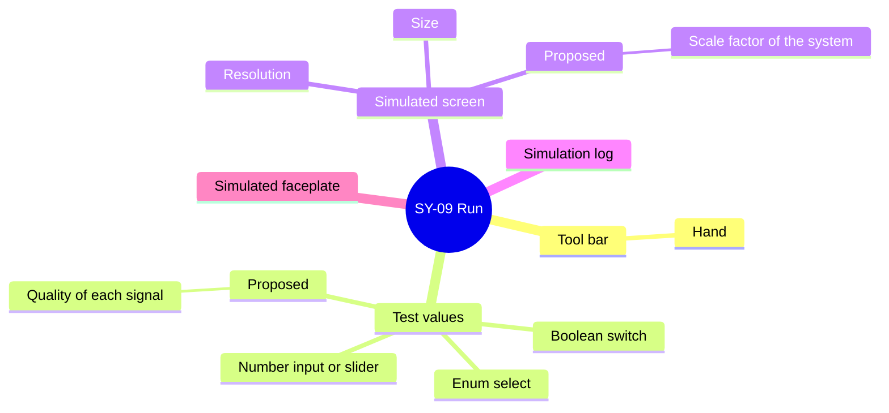

| ID | Element | Kind | Values and behaviour | Status | Source |
| --- | --- | --- | --- | --- | --- |
| SY-09.1 | Test value of a number | Number field or Slider | Within the bounds of the signal. | Decided | [Run mode](../symbols/09-run-mode/README.md) |
| SY-09.2 | Test value of an enum | Select | The display texts of the enum. | Decided | [Run mode](../symbols/09-run-mode/README.md) |
| SY-09.3 | Test value of a boolean | Toggle | — | Proposed | [Run mode](../symbols/09-run-mode/README.md) |
| SY-09.4 | Quality of a signal | Select | Good, uncertain, bad. | Proposed | [Run mode](../symbols/09-run-mode/README.md) |
| SY-09.5 | Simulated screen | Number fields (or a list of screens) | Size and resolution; scale factor proposed. | Decided | [Run mode](../symbols/09-run-mode/README.md) |
| SY-09.6 | Simulation log | List | A line per action: time, place, gesture, effect, value (proposed form). | Decided (form: Open) | [Run mode](../symbols/09-run-mode/README.md) |
| SY-09.7 | Simulated faceplate | Panel | Opens when an interaction opens the faceplate. | Decided (form: Open) | [Run mode](../symbols/09-run-mode/README.md) |

Gaps:

- A list of common screens, or only free fields?
- Clear the log; reset all the test values.

## SY-10 · Connection mode (proposed)

Path: symbol editor › Connection (assumption of the assistant).

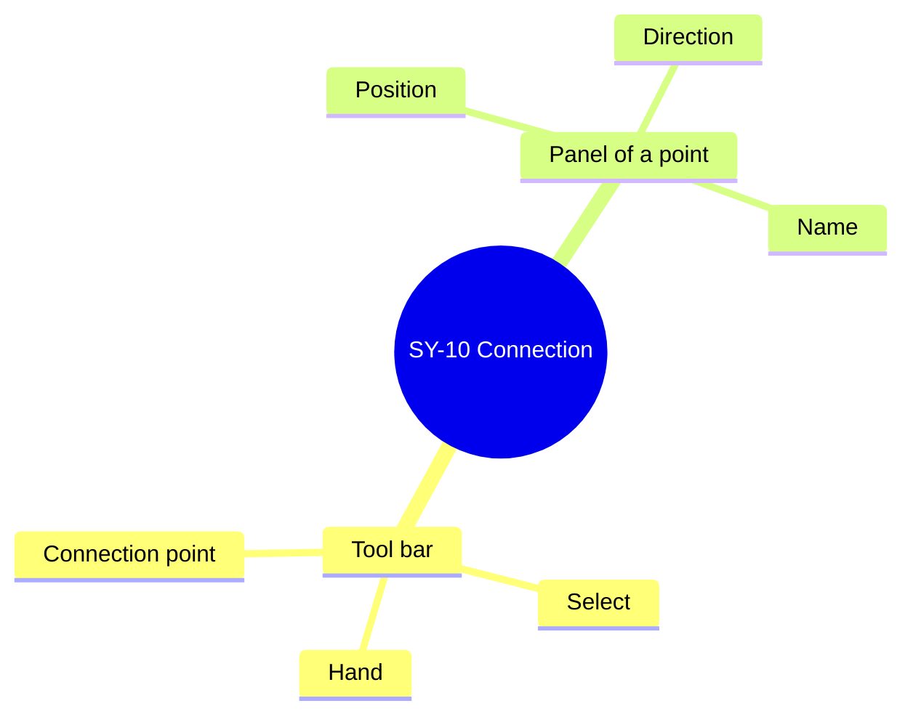

| ID | Element | Kind | Values and behaviour | Status | Source |
| --- | --- | --- | --- | --- | --- |
| SY-10.1 | Connection point | Button (tool) | Places a point where a pipe attaches. | Proposed | [Connection points](../symbols/pipes/connection-points.md) |
| SY-10.2 | Position | Number fields | — | Decided | [Connection points](../symbols/pipes/connection-points.md) |
| SY-10.3 | Direction | not said | The direction in which the pipe leaves the point. | Proposed | [Connection points](../symbols/pipes/connection-points.md) |
| SY-10.4 | Name | Text field | Inlet, outlet... | Open | [Connection points](../symbols/pipes/connection-points.md) |

Gaps:

- Is this mode also offered to a symbol without a type (proposed: yes)?
- Size of the snapping zone.

## SY-11 · Advanced tools

Path: symbol editor › tool bar › "Show the advanced tools" button. The bar appears just above the tool bar.

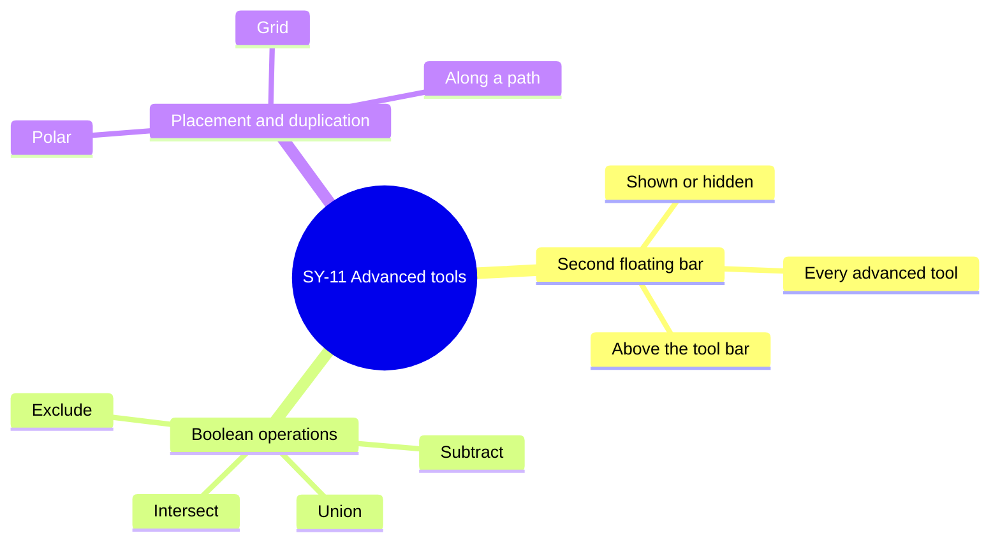

| ID | Element | Kind | Values and behaviour | Status | Source |
| --- | --- | --- | --- | --- | --- |
| SY-11.1 | Show the advanced tools | Button (in the tool bar) | Shows or hides the second bar (SY-03.3). Replaces the former three dots menu. | Decided | [Advanced tools](../symbols/03-editor/expert-menu/README.md) |
| SY-11.2 | Second bar | Floating bar | Just above the tool bar; holds every advanced tool. | Decided | [Advanced tools](../symbols/03-editor/expert-menu/README.md) |
| SY-11.3 | Boolean operation | Button each | Union, subtract, intersect, exclude; the result is a new shape. | Decided (list: Proposed) | [Boolean operations](../symbols/03-editor/expert-menu/boolean-operations.md) |
| SY-11.4 | Duplication rule | Radio | Polar, along a path, grid. | Decided (polar, along a path), Proposed (grid) | [Placement and duplication](../symbols/03-editor/expert-menu/placement-and-duplication.md) |
| SY-11.5 | Duplication options | Number fields + Toggle | Count or spacing, start and end angle, copies rotated or not. | Proposed | [Placement and duplication](../symbols/03-editor/expert-menu/placement-and-duplication.md) |

Gaps:

- How the reference of a duplication is picked (a point and a radius, a line): with the mouse, in fields, or both?
- Preview of the copies before they are made?
