# Screens of the symbol editor

> [Home](../README.md) › [Screens](README.md) › Symbol editor

Status: draft, written by the assistant from the [Symbols](../symbols/README.md) pages, themselves a draft, then reviewed. It adds no rule. Kinds and statuses are explained in the [guide of this folder](README.md). The pipes are in [Pipes](pipes.md).

## SY-00 · Navigation bar of the symbol mode

Path: Symbols. On the far left of every screen of the symbol mode.

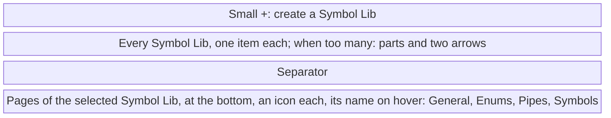

| ID | Element | Kind | Values and behaviour | Status | Source |
| --- | --- | --- | --- | --- | --- |
| SY-00.1 | Create a Symbol Lib | Button (small + in a square, like a library), at the top | Creates a Symbol Lib; asks its name only, as SN-00.1 (2026-11-23, decision 0089: no page of all the Symbol Libs). | Decided | [Libraries and symbols](../symbols/01-libraries-and-symbols.md#navigation-bar-of-the-symbol-mode) |
| SY-00.3 | Symbol Libs | List (one item each) | Under the +: every Symbol Lib, as quick links. One click selects a library and opens its page last used, or Symbols the first time (assistant's reading). The list takes the room down to the separator. An item: two letters taken from the name of the library, in a square (2026-11-23); no colour, no icon chosen by the user; three letters to try; its name on hover (assistant's proposal). | Decided (list, two letters), Proposed (hover, page opened), Open (three letters, how the letters are taken) | [Libraries and symbols](../symbols/01-libraries-and-symbols.md#navigation-bar-of-the-symbol-mode) |
| SY-00.5 | Previous part, next part | Button each (arrow icon), at the top and at the bottom of the list | When the libraries no longer fit above the separator: the list is cut into parts, never scrolled; an arrow opens the next part (2026-11-23). The arrows show only when the list is cut; then both, at every part, the one that leads nowhere greyed (2026-11-23); "Part 1 of 2" on hover (assistant's proposal). | Decided (parts, arrows), Proposed (text on hover) | [Libraries and symbols](../symbols/01-libraries-and-symbols.md#navigation-bar-of-the-symbol-mode) |
| SY-00.2 | Separator | — | Between the list of the Symbol Libs and the pages of the selected one. | Decided | [Libraries and symbols](../symbols/01-libraries-and-symbols.md#navigation-bar-of-the-symbol-mode) |
| SY-00.4 | Pages of the selected Symbol Lib | Buttons, at the bottom of the bar, never moving | Four: General ([SY-01](#sy-01--general-page-of-a-symbol-lib)), Enums ([SY-12](#sy-12--enums-of-a-symbol-lib)), Pipes ([Pipes](pipes.md)), Symbols ([SY-02](#sy-02--left-hand-panel-of-the-pages-symbols-and-pipes)). In this order (2026-11-23). Shown only once a Symbol Lib is selected (end of 2026-11-17, kept). Each: its icon alone, its name in a tooltip on hover, as [nav-rail-item](../design-system/07-molecules/nav-rail-item.md) (2026-11-23); no frame, unlike the libraries; the page shown filled. Icons (2026-11-23): `icon/general`, `icon/enums`, `icon/pipes`, `icon/symbols`. | Decided (place, icons, icon alone), Proposed (look of the icons) | [Libraries and symbols](../symbols/01-libraries-and-symbols.md#navigation-bar-of-the-symbol-mode) |

Gaps:

- Going from the symbol mode to Metadata is done in the top bar (see the [guide](README.md#top-bar-of-the-window)).
- With no Symbol Lib yet, the bar shows the + only; what the rest of the screen shows then.

## SY-01 · General page of a Symbol Lib

Path: Symbols › a Symbol Lib › General (2026-11-23, decision 0089, which removes the page of all the Symbol Libs).

| ID | Element | Kind | Values and behaviour | Status | Source |
| --- | --- | --- | --- | --- | --- |
| SY-01.1 | Name | Text field | The name of the library. | Decided | [Libraries and symbols](../symbols/01-libraries-and-symbols.md#general-page-of-a-symbol-lib) |
| SY-01.2 | Delete the Symbol Lib | Button, then a warning (dialog) | Under the name, as "Delete the type" in General of Metadata ([MD-02.8](metadata.md#md-02--general)). Takes its symbols and its pipe styles with it (2026-11-23). The warning says "Delete Plant A?" (the name of the library), then "The Symbol Lib is deleted at once, with its symbols and its pipe styles." (wording: assistant's proposal). | Decided (button, what it takes), Proposed (wording) | [Libraries and symbols](../symbols/01-libraries-and-symbols.md#general-page-of-a-symbol-lib) |
| SY-01.3 | More information | not said | What else the page shows of a library is not said. | Open | [Libraries and symbols](../symbols/01-libraries-and-symbols.md#general-page-of-a-symbol-lib) |
| SY-01.4 | Left-hand panel | — | None: the page has no list, so its content starts after the navigation bar. | Proposed | [Libraries and symbols](../symbols/01-libraries-and-symbols.md#the-left-hand-panel-of-the-symbol-mode) |

Gaps:

- Duplicate (to change a look over time, the user creates a new Symbol Lib: is it a copy of the old one?).

## SY-02 · Left-hand panel of the pages Symbols and Pipes

Path: Symbols › a Symbol Lib › Symbols, or › Pipes. Since the end of 2026-11-17 the symbols and the pipe styles are two pages of the navigation bar, no longer two zones of one panel. On the page Symbols, the panel stays on the left while a symbol is open in the editor.

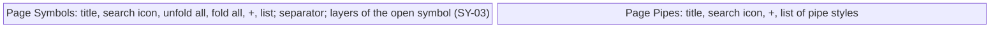

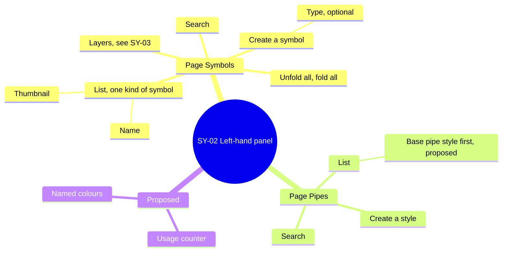

| ID | Element | Kind | Values and behaviour | Status | Source |
| --- | --- | --- | --- | --- | --- |
| SY-02.1 | List of symbols | Tree | One kind of symbol: no static or dynamic. A tree, as in Metadata: a sub-symbol under its parent (2026-11-18, replaces the flat list). A click on an item opens it in the editor. | Decided | [Sub-symbols](../symbols/12-sub-symbols.md) |
| SY-02.2 | Search the symbols | Button (search icon), then a text field | On the line of the title "Symbols", next to the +; a click opens the field over the whole line; it filters the list (2026-11-23: no field shown all the time). | Decided | [Layout rules](README.md#search-a-small-icon-on-the-line-of-the-title) |
| SY-02.3 | Create a symbol | Button (small +) | On the right of the title "Symbols". The type can be chosen here, never imposed (no preset since 2026-11-24). | Decided | [Libraries and symbols](../symbols/01-libraries-and-symbols.md) |
| SY-02.4 | Type, at creation | Select, optional | All the types of Metadata (no library of types). How the choice stays quick in a big tree: open. | Decided | [Libraries and symbols](../symbols/01-libraries-and-symbols.md) |
| SY-02.5 | Item of the list | Thumbnail + name | The thumbnail is the symbol, or its outlines only (as Figma's outline view). | Decided (thumbnail: Open) | [Libraries and symbols](../symbols/01-libraries-and-symbols.md) |
| SY-02.6 | List of pipe styles | List | On the page Pipes (end of 2026-11-17). Flat; a click opens the style (see [Pipes](pipes.md)). | Decided | [Libraries and symbols](../symbols/01-libraries-and-symbols.md) |
| SY-02.7 | Search the pipe styles | Button (search icon), then a text field | As SY-02.2, on the line of the title "Pipe styles". | Decided | [Layout rules](README.md#search-a-small-icon-on-the-line-of-the-title) |
| SY-02.8 | Create a pipe style | Button (icon with a small +) | On the right of the title "Pipe styles" ([layout rules](README.md#a-title-and-a-small--on-its-right), 2026-11-16). | Decided | [Libraries and symbols](../symbols/01-libraries-and-symbols.md) |
| SY-02.9 | Base pipe style | Item of the list | First item of the pipe styles list. | Proposed | [Libraries and symbols](../symbols/01-libraries-and-symbols.md) |
| SY-02.10 | Broken mark | — | A small red mark on a broken item. | Decided | [Libraries and symbols](../symbols/01-libraries-and-symbols.md) |
| SY-02.11 | Usage counter | — | "Used by 38 pipes", on symbols and styles. | Proposed | [Libraries and symbols](../symbols/01-libraries-and-symbols.md) |
| SY-02.12 | Named colours | List | A flat list "Colours" that symbols and styles point to. | Proposed | [Fill and border](../symbols/04-drawing-mode/fill-and-border.md) |
| SY-02.13 | Create a sub-symbol | Button (small +) | On the right of a symbol, when the mouse is over it, as for the types of Metadata; also a + in the editor of the open symbol (its place: Open). The sub-symbol is in the same Symbol Lib. | Decided (place in the editor: Open) | [Sub-symbols](../symbols/12-sub-symbols.md) |
| SY-02.14 | Fault of a sub-symbol | — | When the parent changes type or loses it, every sub-symbol goes into fault and the application says so. How it shows: with the list of faults (Open). | Decided (look: Open) | [Sub-symbols](../symbols/12-sub-symbols.md) |
| SY-02.15 | Unfold all, fold all the symbols | Button each (icon) | On the line of the title "Symbols", between the search icon and the +, as on the title "Layers" (SY-03.14): every parent of the tree of symbols (Product Owner, 2026-11-24). | Decided | [Libraries and symbols](../symbols/01-libraries-and-symbols.md#the-left-hand-panel-of-the-symbol-mode) |

Gaps:

- What an item shows besides its thumbnail and name.
- Duplicate, rename and delete a symbol or a pipe style. Settled: deleting a symbol deletes its sub-symbols with it (2026-11-18, decision 0046, see [Sub-symbols](../symbols/12-sub-symbols.md#deleting-a-parent)); the control is still open.
- Sort of the lists (by name, by creation)?

## SY-03 · Symbol editor: what every mode shares

Path: Symbols › a Symbol Lib › a symbol.

The layout is decided, except the place of the tool bar (bottom or top) and of the zoom field.

```mermaid
block-beta
    columns 4
    rail["Navigation bar SY-00"]
    left["Left-hand panel: SY-02 symbols, separator, then the layers"] canvas["Drawing area: modes menu floating top left, horizontal, icons; advanced tools bar above the tool bar; tool bar floating at the bottom"] panel["Right-hand panel: options of the selection, type of the symbol"]
```

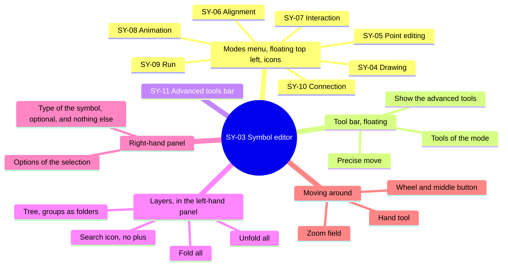

| ID | Element | Kind | Values and behaviour | Status | Source |
| --- | --- | --- | --- | --- | --- |
| SY-03.1 | Modes menu | Floating bar, horizontal, icons only (name in the tooltip) | At the top left of the drawing area, in this order: Drawing, Point editing, Connection, Alignment, Animation, Interaction, Run (2026-11-23). Interaction, Animation and Run need a type. | Decided (icons: to draw) | [Editor](../symbols/03-editor/README.md) |
| SY-03.2 | Tool bar | Floating bar | The tools of the mode; at the bottom of the drawing area (leaning) or at the top. | Decided (place: Open) | [Editor](../symbols/03-editor/README.md) |
| SY-03.3 | Show the advanced tools | Button (in the tool bar) | Shows or hides the [SY-11](#sy-11--advanced-tools) bar just above. | Decided | [Advanced tools](../symbols/03-editor/expert-menu/README.md) |
| SY-03.4 | Type | Select, optional | In the right-hand panel; among all the types of Metadata; can be removed. | Decided | [Type and faceplate](../symbols/02-type-and-faceplate.md) |
| SY-03.5 | Preset | — | Removed (Product Owner, 2026-11-24): there are no presets; the symbol chooses its type and nothing else, and a sub-type of Metadata stands for another way of showing it. | Decided | [Type and faceplate](../symbols/02-type-and-faceplate.md) |
| SY-03.6 | Faceplate entries | — | Removed (Product Owner, 2026-11-24): no choice of the faceplate entries in the symbol; the faceplate is the one of its type ([MD-14](metadata.md#md-14--faceplate)). | Decided | [Type and faceplate](../symbols/02-type-and-faceplate.md) |
| SY-03.7 | Hand | Button (tool) | Moves the view; also the middle button held. In every mode. | Decided | [Hand](../symbols/03-editor/hand.md) |
| SY-03.8 | Zoom | Number field (%) | Shown in one place (which one: not said); the user can type a value; 100 % is the real size. | Decided | [Editor](../symbols/03-editor/README.md) |
| SY-03.9 | Select | Button (tool) | In every mode except Run; picks what the mode works on. | Decided | [Select](../symbols/03-editor/select.md) |
| SY-03.10 | Entirely enclosed | Toggle | Visible equivalent of Alt during a selection rectangle. | Decided | [Select](../symbols/03-editor/select.md) |
| SY-03.11 | Precise move | Toggle | Visible equivalent of the key that moves a dragged point or handle pixel by pixel. | Decided (key: Open) | [Precise move](../symbols/03-editor/precise-move.md) |
| SY-03.12 | Layers | Tree | In the left-hand panel; groups as folders; one line per shape, its border included. | Decided | [Layers](../symbols/03-editor/layers.md) |
| SY-03.13 | Search the layers | Button (search icon), then a text field | On the line of the title "Layers", under a separator; opens a field over the title that filters by name. No + on this title (2026-11-23). | Decided | [Layers](../symbols/03-editor/layers.md) |
| SY-03.14 | Unfold all, fold all | Button each | Every group of the tree. | Decided | [Layers](../symbols/03-editor/layers.md) |
| SY-03.15 | Line of a layer | — | Name; icon of its kind, hide, lock proposed. | Decided (name), Proposed (the rest) | [Layers](../symbols/03-editor/layers.md) |
| SY-03.16 | Undo, redo | not said | The undo history keeps every action (decision 0093). No save: each change is written as it is made. | Decided (history, no save), Open (place) | [Files and conflicts](../storage/files-and-conflicts.md#undo-history) |
| SY-03.17 | Layout guides | Button in a floating bar under the modes menu, then a popup | + Column, + Row, + Grid; one line per guide with its value, a place button and a −; the place button makes the guide follow the mouse, a click puts it; an eye hides them all; grid cells W × H linked by a chain (2026-11-25). | Decided (place, eye, placement from the line), Proposed (grid W × H, the rest of the form) | [Layout guides](../symbols/03-editor/layout-guides.md) |
| SY-03.18 | Snapping | not said | Minimum set proposed by the research; snaps to the guides too. | Proposed | [Editor](../symbols/03-editor/README.md) |

Gaps:

- Does the right-hand panel show the type only when nothing is selected (assumption)?
- How a layer is named, and whether the tree order is the stacking order.
- Frame of the symbol (size, fit to content): proposed by the research, not placed in a screen.
- Place of the zoom field, of undo and redo.

## SY-04 · Drawing mode

Path: symbol editor › Drawing (the default mode).

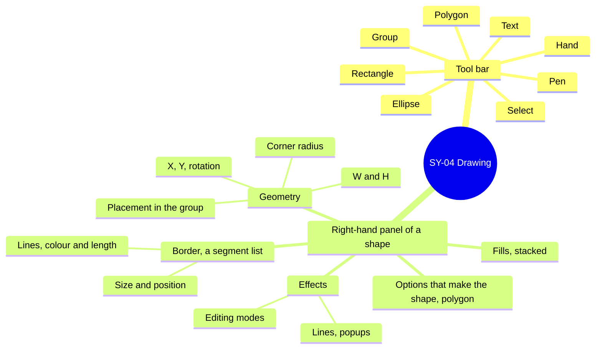

### Tool bar

| ID | Element | Kind | Values and behaviour | Status | Source |
| --- | --- | --- | --- | --- | --- |
| SY-04.1 | Tools | Button | In this order: Select, Hand, Group, Rectangle, Ellipse, Polygon, Pen, Text. | Decided | [Drawing mode](../symbols/04-drawing-mode/README.md) |
| SY-04.2 | Pen: straight line | Button | Turns the curve being drawn back into a straight line. | Decided | [Pen](../symbols/04-drawing-mode/pen.md) |
| SY-04.3 | Pen: angle lock | Toggle + Select | Step 15°, 30°, 45° or 90° (45° usual). | Decided (steps: Proposed) | [Pen](../symbols/04-drawing-mode/pen.md) |

### Panel of a shape: fill, border, effects

| ID | Element | Kind | Values and behaviour | Status | Source |
| --- | --- | --- | --- | --- | --- |
| SY-04.4 | Fills | [Colour field](../controls/colour-field.md) per line, + on the title | Several fills stacked, the top line on top; the + adds one, the − of a line removes it (2026-11-25). Each line: swatch, colour │ opacity; the swatch opens the paint popup: Plain colour, Linear, Radial (pattern: Open), eyedropper, hue and opacity sliders, Hex, HSL, HSB (2026-11-25). | Decided | [Fill and border](../symbols/04-drawing-mode/fill-and-border.md#several-fills) |
| SY-04.5 | Border | [Segment list](../controls/segment-list.md), small + on the title | A shape can have a border; a group cannot. The + adds a line (2026-11-24). No line: no border; no toggle (2026-11-24). | Decided | [Fill and border](../symbols/04-drawing-mode/fill-and-border.md#border-options) |
| SY-04.6 | Border size | Number field, no unit | Under the lines, on the line of the position. Example 2. | Decided | [Fill and border](../symbols/04-drawing-mode/fill-and-border.md#border-options) |
| SY-04.7 | Border position | Select | Next to the size: Outside, Middle, Inside; a select, not radios (2026-11-24). An open path has the three too, Inside and Outside on one side of the line (2026-11-25). | Decided | [Fill and border](../symbols/04-drawing-mode/fill-and-border.md#border-of-an-open-path) |
| SY-04.8 | Colour of a line of the border | [Colour field](../controls/colour-field.md) | Colour │ opacity on each line; 0 % for a gap. A gradient in a line: Open. | Decided | [Fill and border](../symbols/04-drawing-mode/fill-and-border.md#border-options) |
| SY-04.9 | Dashes of the border | Lines of the segment list | One line: a plain border; two lines or more: a dash sequence, each line a colour and a length, repeated (2026-11-24; replaces the editor [PI-04](pipes.md#pi-04--segment-list) opened from the panel). | Decided | [Fill and border](../symbols/04-drawing-mode/fill-and-border.md#border-options) |
| SY-04.10 | Caps and joins | — | Removed (2026-11-25): not offered. | Decided | [Fill and border](../symbols/04-drawing-mode/fill-and-border.md#border-of-an-open-path) |
| SY-04.11 | Effects | List, + on the title | The + opens the menu of the effects; each line: eye, name, a button (settings, Edit, or a value on the line), −; applied from the top down. | Decided | [Effects](../symbols/04-drawing-mode/effects-and-masks.md#the-section-effects) |
| SY-04.12 | Effects offered | Menu of the +, grouped by family | Clip and mask: Clip, Mask, Fade · Opacity and blend: Opacity, Blend mode, Background blur · Shadows and light: Drop shadow, Outer glow, Inner shadow, Inner glow, Lighting · Blur and sharpness: Blur, Sharpen · Colour: Colour adjustments, Colour overlay, Colour map · Texture: Thicken or thin, Noise, Distortion · Lines: Crisp edges · Expert: Filter chain. Everything not decided is tried in the POC (2026-11-25). | Proposed | [Effects](../symbols/04-drawing-mode/effects-and-masks.md#catalogue-of-the-effects) |
| SY-04.13 | Clip | Line of the effects, Edit button | The clip shapes belong to the shape; Edit enters the clip editing (SY-04.39). No "Mask" select any more (2026-11-25). | Decided | [Clip, mask, fade](../symbols/04-drawing-mode/effects-clip-and-mask.md#clip) |
| SY-04.39 | Clip editing | State of the drawing area | The shape stays shown, the rest dimmed; a bar "Clip of …" with Done at the top; the user draws the clip shapes with Rectangle, Ellipse, Polygon, Pen; Escape leaves. | Decided (2026-11-25), Proposed (bar) | [Clip, mask, fade](../symbols/04-drawing-mode/effects-clip-and-mask.md#clip) |

### Effects one by one

The proposals for the POC of the effects (2026-11-25): each effect has its line and what it opens (popup, list), and its editing mode when it has one (the model of the clip editing, see [Editing modes](../symbols/04-drawing-mode/effects-and-masks.md#editing-modes)). Figma: page Spec, section "Symbol mode · Effects", one row per effect.

| ID | Element | Kind | Values and behaviour | Status | Source |
| --- | --- | --- | --- | --- | --- |
| SY-04.40 | Mask | Line, settings popup | Mode Alpha or Luminance; shapes and Edit on the drawing. | POC | [Clip, mask, fade](../symbols/04-drawing-mode/effects-clip-and-mask.md#mask) |
| SY-04.41 | Mask editing | State of the drawing area | As the clip editing; the mask shapes have fills. | POC | [Clip, mask, fade](../symbols/04-drawing-mode/effects-clip-and-mask.md#mask) |
| SY-04.42 | Fade | Line, settings popup | Linear or Radial; angle; From and To in percent. | POC | [Clip, mask, fade](../symbols/04-drawing-mode/effects-clip-and-mask.md#fade) |
| SY-04.43 | Fade editing | State of the drawing area | A line with the handles From and To over the shape. | POC | [Clip, mask, fade](../symbols/04-drawing-mode/effects-clip-and-mask.md#fade) |
| SY-04.44 | Opacity | Line with a percent field | No popup. | POC | [Opacity and blend](../symbols/04-drawing-mode/effects-opacity-and-blend.md#opacity) |
| SY-04.45 | Blend mode | Line with a select | The list of the modes, grouped. | POC | [Opacity and blend](../symbols/04-drawing-mode/effects-opacity-and-blend.md#blend-mode) |
| SY-04.46 | Background blur | Line, settings popup | Radius. | POC, support to check | [Opacity and blend](../symbols/04-drawing-mode/effects-opacity-and-blend.md#background-blur) |
| SY-04.47 | Drop shadow | Line, settings popup | X, Y, Blur, Spread, Colour; Edit on the drawing. | POC | [Shadows and light](../symbols/04-drawing-mode/effects-shadows-and-light.md#drop-shadow) |
| SY-04.48 | Shadow editing | State of the drawing area | A handle drags the offset, a ring the blur. | POC | [Shadows and light](../symbols/04-drawing-mode/effects-shadows-and-light.md#drop-shadow) |
| SY-04.49 | Outer glow | Line, settings popup | Size, Colour. | POC | [Shadows and light](../symbols/04-drawing-mode/effects-shadows-and-light.md#outer-glow) |
| SY-04.50 | Inner shadow | Line, settings popup | X, Y, Blur, Colour; Edit on the drawing. | POC | [Shadows and light](../symbols/04-drawing-mode/effects-shadows-and-light.md#inner-shadow) |
| SY-04.51 | Inner shadow editing | State of the drawing area | The handles of the shadow, inside the shape. | POC | [Shadows and light](../symbols/04-drawing-mode/effects-shadows-and-light.md#inner-shadow) |
| SY-04.52 | Inner glow | Line, settings popup | Size, Colour. | POC | [Shadows and light](../symbols/04-drawing-mode/effects-shadows-and-light.md#inner-glow) |
| SY-04.53 | Lighting | Line, settings popup | Relief or Shine; Far, Point or Spot; azimuth, elevation; depth; shine; colour; Edit on the drawing. | POC | [Shadows and light](../symbols/04-drawing-mode/effects-shadows-and-light.md#lighting) |
| SY-04.54 | Light editing | State of the drawing area | The light is a handle: bulb, cone or arrow. | POC | [Shadows and light](../symbols/04-drawing-mode/effects-shadows-and-light.md#lighting) |
| SY-04.55 | Blur | Line, settings popup | Radius X and Y, linked by a chain. | POC | [Blur and sharpness](../symbols/04-drawing-mode/effects-blur-and-sharpness.md#blur) |
| SY-04.56 | Sharpen, edges, emboss | Line, settings popup | Kind, Strength. | POC | [Blur and sharpness](../symbols/04-drawing-mode/effects-blur-and-sharpness.md#sharpen-edges-emboss) |
| SY-04.57 | Colour adjustments | Line, settings popup | Seven sliders and Reset. | POC | [Colour](../symbols/04-drawing-mode/effects-colour.md#colour-adjustments) |
| SY-04.58 | Colour overlay | Line, settings popup | Colour, Blend. | POC | [Colour](../symbols/04-drawing-mode/effects-colour.md#colour-overlay) |
| SY-04.59 | Colour map | Line, settings popup | Duotone, Posterize or Threshold, and their settings. | POC | [Colour](../symbols/04-drawing-mode/effects-colour.md#colour-map) |
| SY-04.60 | Thicken, thin | Line, settings popup | Operation, Radius. | POC | [Texture and distortion](../symbols/04-drawing-mode/effects-texture-and-distortion.md#thicken-thin) |
| SY-04.61 | Noise | Line, settings popup | Kind, Scale, Detail, Seed, Opacity, Mono or Colour. | POC | [Texture and distortion](../symbols/04-drawing-mode/effects-texture-and-distortion.md#noise-texture) |
| SY-04.62 | Distortion | Line, settings popup | Strength, Scale, Detail, Seed. | POC | [Texture and distortion](../symbols/04-drawing-mode/effects-texture-and-distortion.md#distortion) |
| SY-04.63 | Filter chain | Line, Edit button | "Filter chain · 4 steps". | POC | [Filter chain](../symbols/04-drawing-mode/effects-filter-chain.md) |
| SY-04.64 | Filter editing | State of the drawing area | A graph of the steps; the step selected in the right-hand panel. | POC | [Filter chain](../symbols/04-drawing-mode/effects-filter-chain.md) |
| SY-04.65 | Linear gradient | Tab of the paint popup | Stops bar, Repeat, Edit on the drawing. | Decided (kind), POC (the rest) | [Paints](../symbols/04-drawing-mode/paints.md#linear-gradient) |
| SY-04.66 | Linear gradient editing | State of the drawing area | The gradient line, its ends and its stops. | POC | [Paints](../symbols/04-drawing-mode/paints.md#linear-gradient) |
| SY-04.67 | Radial gradient | Tab of the paint popup | Stops bar, Repeat, Edit on the drawing. | Decided (kind), POC (the rest) | [Paints](../symbols/04-drawing-mode/paints.md#radial-gradient) |
| SY-04.68 | Radial gradient editing | State of the drawing area | Centre, radius, focal point. | POC | [Paints](../symbols/04-drawing-mode/paints.md#radial-gradient) |
| SY-04.69 | Conic gradient | Tab of the paint popup | Stops bar, Start angle. | POC, support to check | [Paints](../symbols/04-drawing-mode/paints.md#conic-gradient) |
| SY-04.70 | Conic gradient editing | State of the drawing area | Centre, start angle. | POC, support to check | [Paints](../symbols/04-drawing-mode/paints.md#conic-gradient) |
| SY-04.71 | Pattern | Tab of the paint popup | Tile, Size, Angle, Colour, Edit the tile. | POC | [Paints](../symbols/04-drawing-mode/paints.md#pattern) |
| SY-04.72 | Tile editing | State of the drawing area | The tile big in the middle, drawn with the shape tools; the shape repeats it around. | POC | [Paints](../symbols/04-drawing-mode/paints.md#pattern) |
| SY-04.73 | Image | Tab of the paint popup | Choose an image, Fit, Opacity. | POC | [Paints](../symbols/04-drawing-mode/paints.md#image) |
| SY-04.74 | Arrow heads | Line "Ends" of the border, two selects | None, Arrow, Open arrow, Circle, Square, Diamond, Bar, Custom; Size. | POC | [Lines and text](../symbols/04-drawing-mode/effects-lines-and-text.md#arrow-heads) |
| SY-04.75 | Head editing | State of the drawing area | A custom head drawn big, the end of the line as a guide. | POC | [Lines and text](../symbols/04-drawing-mode/effects-lines-and-text.md#arrow-heads) |
| SY-04.76 | Border that keeps its width | Switch in the border | Keep the width when scaled. | POC | [Lines and text](../symbols/04-drawing-mode/effects-lines-and-text.md#border-that-keeps-its-width) |
| SY-04.77 | Crisp edges | Line of the effects | On or off by its eye. | POC | [Lines and text](../symbols/04-drawing-mode/effects-lines-and-text.md#crisp-edges) |
| SY-04.78 | Text along a path | Line of the text panel, popup | Path, Start, Side. | Later | [Lines and text](../symbols/04-drawing-mode/effects-lines-and-text.md#text-along-a-path) |
| SY-04.79 | Path editing | State of the drawing area | The path followed, the start of the text as a handle. | Later | [Lines and text](../symbols/04-drawing-mode/effects-lines-and-text.md#text-along-a-path) |

### Panel of a shape: geometry and options by tool

The order of the panel: the options that make the shape (polygon), the geometry, the fills, the border, the effects ([Geometry](../symbols/04-drawing-mode/geometry.md#order-of-the-right-hand-panel), 2026-11-25).

| ID | Element | Kind | Values and behaviour | Status | Source |
| --- | --- | --- | --- | --- | --- |
| SY-04.36 | Width, height | [Size fields](../controls/size-fields.md) | W and H on one line, no unit; always fixed for a rectangle, an ellipse, a polygon, a path; Fixed or Hug for a group and a text. | Decided | [Geometry](../symbols/04-drawing-mode/geometry.md) |
| SY-04.37 | X, Y | Number field each | Under W and H, in pixels, no unit; on every element (2026-11-25). | Decided | [Geometry](../symbols/04-drawing-mode/geometry.md) |
| SY-04.38 | Rotation | Number field, degrees | On the line of X and Y; on every element (2026-11-25). | Decided | [Geometry](../symbols/04-drawing-mode/geometry.md) |
| SY-04.14 | Corner radius | Number field, no unit | Under the height (2026-11-25): for the whole rectangle, and for every corner of a path drawn with the pen. | Decided | [Rectangle](../symbols/04-drawing-mode/rectangle.md), [Pen](../symbols/04-drawing-mode/pen.md#panel-of-a-path) |
| SY-04.15 | Link width and height | Icon button (link), at the end of the line W, H | Visible equivalent of the square or circle key. An icon on the size line rather than a toggle of its own (assistant, 2026-11-24). | Decided (link), Proposed (icon on the line) | [Size fields](../controls/size-fields.md#width-and-height-linked) |
| SY-04.16 | Polygon: number of sides | Number field | 3 to 20; first in the panel (2026-11-25). | Decided | [Polygon](../symbols/04-drawing-mode/polygon.md) |
| SY-04.17 | Polygon: how it fills its box | Select | Filled, Equilateral (a third mode "like Figma": Open, advised against). A select rather than radios ([layout rule](README.md#a-select-rather-than-radios), 2026-11-24). | Decided | [Polygon](../symbols/04-drawing-mode/polygon.md) |
| SY-04.18 | Polygon: anchor | 9-point grid + select | An anchor of the box, and whether a corner or a side touches it. | Decided | [Polygon](../symbols/04-drawing-mode/polygon.md) |
| SY-04.19 | Group: width, height | [Size fields](../controls/size-fields.md), Fixed or Hug | W and H on one line; each value always shown, in pixels, no unit; the mode in the field, with a small arrow that opens a menu Fixed, Hug (2026-11-24). Hug by default. | Decided | [Group](../symbols/04-drawing-mode/group.md#two-sizes-hug-or-fixed) |
| SY-04.20 | Group: placement of the children | 9-point grid | Centred by default (2026-11-24), or aligned left, right, top, bottom, with anchors; no flex. | Decided | [Group](../symbols/04-drawing-mode/group.md#layout-of-the-children) |
| SY-04.21 | Child: placement in the group | Select + 9-point grid | Group (default), Anchored (an anchor of the group; a second grid for the anchor of the child makes it absolute), Free (X and Y typed) (2026-11-25). | Decided (choice), Proposed (form) | [Geometry](../symbols/04-drawing-mode/geometry.md#position-in-the-group) |
| SY-04.22 | Group: create | Button (tool), Ctrl+G, right click "Group" | Three ways. | Decided | [Group](../symbols/04-drawing-mode/group.md) |

### Panel of a text

In order: geometry, font, colour, paragraph, effects (2026-11-25: "plus compactes et moins fouillis").

| ID | Element | Kind | Values and behaviour | Status | Source |
| --- | --- | --- | --- | --- | --- |
| SY-04.34 | Box of the text | [Size fields](../controls/size-fields.md), Fixed or Hug, then a select | W and H of the box, Fixed or Hug (2026-11-25); in Hug, the fit mode: Fit to the glyphs, or fit to the line. | Decided | [Text](../symbols/04-drawing-mode/text.md#size-of-the-box) |
| SY-04.23 | Font family | Select | Fonts bundled with the software only (OFL proposed). | Decided | [Text](../symbols/04-drawing-mode/text.md#font) |
| SY-04.24 | Size | Number field | On the line of the style. | Decided | [Text](../symbols/04-drawing-mode/text.md#font) |
| SY-04.26 | Style | Select | Every weight of the font, each with its italic when the font has a real one: Regular, Italic, SemiBold, SemiBold Italic... (2026-11-25). | Decided | [Text](../symbols/04-drawing-mode/text.md#font) |
| SY-04.25 | Bold, italic | — | Removed (2026-11-25): the style select holds them. | Decided | [Text](../symbols/04-drawing-mode/text.md#font) |
| SY-04.28 | Text colour | [Colour field](../controls/colour-field.md) | Swatch, colour │ opacity. No background colour (removed 2026-11-25). | Decided | [Text](../symbols/04-drawing-mode/text.md#colour-and-border) |
| SY-04.29 | Text border | Small + on the title, a [colour field](../controls/colour-field.md) and a size | A true SVG stroke under the letters (2026-11-25). The + adds it, a − removes it; one colour, no dashes, no position. | Decided | [Text](../symbols/04-drawing-mode/text.md#colour-and-border) |
| SY-04.31 | Alignment | 9-point grid | The place of the text in its box (2026-11-25; replaces the two selects). | Decided | [Text](../symbols/04-drawing-mode/text.md#paragraph) |
| SY-04.32 | Spacing | Number field each, on one line | Letter spacing 0, word spacing 0, line height Auto. | Decided | [Text](../symbols/04-drawing-mode/text.md#paragraph) |
| SY-04.33 | Wrapping | Toggle | Lines wrap in the box. | Decided | [Text](../symbols/04-drawing-mode/text.md#paragraph) |
| SY-04.30 | Lines | Three toggle icon buttons on one line, then one colour field | Underline, strikethrough, line above, each on with the others; the colour shown once one is on. | Decided (lines), Proposed (form) | [Text](../symbols/04-drawing-mode/text.md#paragraph) |
| SY-04.35 | Embed the fonts | — | Removed from the text panel (2026-11-25): an option of the export of the views ([SN-12.6](synoptics.md#sn-12--publish)). | Decided | [Outputs](../synoptics/10-outputs.md) |

Gaps:

- Mirror of a shape: no control (the research proposes to recompute it in the points).
- Formatting part of a text ("format a part of it"): which options apply to a part, which to the whole text?

## SY-05 · Point editing mode

Path: symbol editor › Point editing.

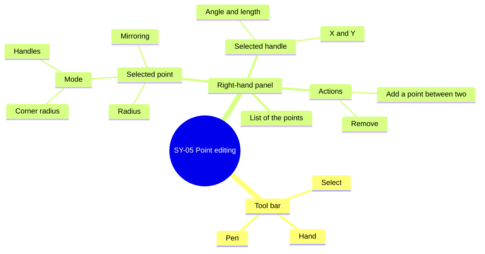

| ID | Element | Kind | Values and behaviour | Status | Source |
| --- | --- | --- | --- | --- | --- |
| SY-05.1 | Tools | Button | Select, Hand, Pen. | Decided | [Point editing mode](../symbols/05-point-editing-mode/README.md) |
| SY-05.2 | List of the points | List | Shape by shape; selecting in the list selects on the canvas and back. All shapes, or the selected ones: Open. | Decided | [Point editing mode](../symbols/05-point-editing-mode/README.md) |
| SY-05.3 | Point mode | Select | Corner radius or Handles; a select rather than radios (2026-11-24); each keeps its settings. An ellipse point: handles only. | Decided | [Points and handles](../symbols/05-point-editing-mode/points-and-handles.md) |
| SY-05.4 | Corner radius | Number field | — | Decided | [Points and handles](../symbols/05-point-editing-mode/points-and-handles.md) |
| SY-05.5 | Mirroring | Select | None, Mirror angle, Mirror angle and length; a select rather than radios (2026-11-24). | Decided | [Points and handles](../symbols/05-point-editing-mode/points-and-handles.md) |
| SY-05.6 | Handle X, Y | Number field | Linked to angle and length. | Decided | [Points and handles](../symbols/05-point-editing-mode/points-and-handles.md) |
| SY-05.7 | Handle angle, length | Number field | Linked to X and Y. | Decided | [Points and handles](../symbols/05-point-editing-mode/points-and-handles.md) |
| SY-05.8 | Remove | Button | Removes the selected points. | Decided | [Point editing mode](../symbols/05-point-editing-mode/README.md) |
| SY-05.9 | Add a point between two | Button | When two points are selected. | Decided | [Point editing mode](../symbols/05-point-editing-mode/README.md) |
| SY-05.10 | Precise move | Key held while dragging, or the toggle SY-03.11 | A point or a handle moves pixel by pixel of the symbol, even zoomed out. | Decided (key: Open) | [Precise move](../symbols/03-editor/precise-move.md) |

Gaps:

- Position X, Y of a selected point: only the handles have fields.
- How the corner radius of a point is edited precisely: "to be detailed later".

## SY-06 · Alignment mode

Path: symbol editor › Alignment.

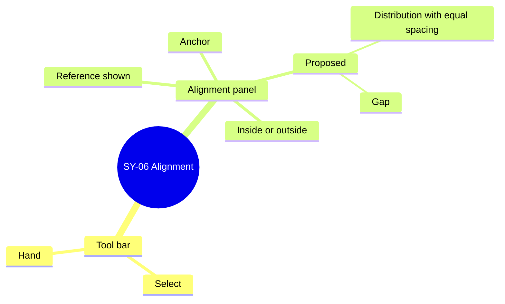

| ID | Element | Kind | Values and behaviour | Status | Source |
| --- | --- | --- | --- | --- | --- |
| SY-06.1 | Tools | Button | Select, Hand. | Decided | [Alignment mode](../symbols/06-alignment-mode/README.md) |
| SY-06.2 | Reference | — | The first shape selected; the panel shows which one. | Decided | [Alignment mode](../symbols/06-alignment-mode/README.md) |
| SY-06.3 | Anchor | not said (9-point grid) | On a real shape: the centre and eight points on the outline (proposed). | Decided (anchors on a real shape: Proposed) | [Anchors](../symbols/03-editor/anchors.md) |
| SY-06.4 | Inside or outside | Select | Placement on the limit of the reference; a select rather than radios (2026-11-24). | Decided | [Alignment mode](../symbols/06-alignment-mode/README.md) |
| SY-06.5 | Distribution with equal spacing | Button + number field | A typed gap between the edges. | Proposed | [Alignment mode](../symbols/06-alignment-mode/README.md) |
| SY-06.6 | Apply | not said | Does the shape move as soon as an anchor is chosen, or on a button? | Implied | — |

Gaps:

- One anchor for all the shapes to place, or one each (Open).
- When does the placement happen: at once, or on an "Apply" button?

## SY-07 · Interaction mode

Path: symbol editor › Interaction (symbol with a type only).

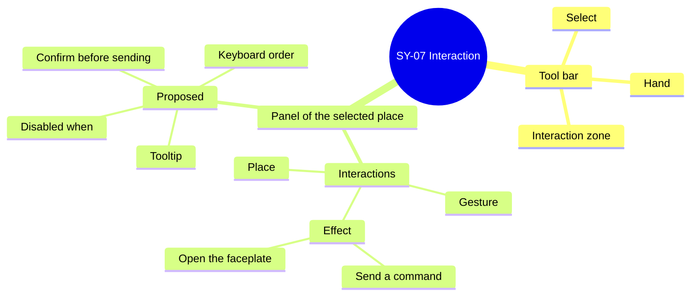

| ID | Element | Kind | Values and behaviour | Status | Source |
| --- | --- | --- | --- | --- | --- |
| SY-07.1 | Interaction zone | Button (tool) | Draws a zone by hand. | Decided | [Interaction mode](../symbols/07-interaction-mode/README.md) |
| SY-07.2 | Place | — | A drawn zone, the whole symbol, or a layer (its real shape). | Decided | [Interaction mode](../symbols/07-interaction-mode/README.md) |
| SY-07.3 | Interactions of the place | List | Several gestures per place. | Decided | [Interaction mode](../symbols/07-interaction-mode/README.md) |
| SY-07.4 | Gesture | Select | Click, double click, right click, while pressed, key (proposed list). | Decided (list: Proposed) | [Interaction mode](../symbols/07-interaction-mode/README.md) |
| SY-07.5 | Effect | Select + Select | The first select: send a command, or open the faceplate; the second, for a command: a command of the type (set a signal, trigger). Selects rather than radios (2026-11-24). | Decided | [Interaction mode](../symbols/07-interaction-mode/README.md) |
| SY-07.6 | Disabled when | Select (boolean output signal) | The place looks inactive and sends nothing. | Proposed | [Interaction mode](../symbols/07-interaction-mode/README.md) |
| SY-07.7 | Confirm before sending | Toggle | Off by default. | Proposed | [Interaction mode](../symbols/07-interaction-mode/README.md) |
| SY-07.8 | Tooltip | Text field | Plain text. | Proposed | [Interaction mode](../symbols/07-interaction-mode/README.md) |
| SY-07.9 | Keyboard order | not said | Order of the places reached with Tab. | Proposed | [Interaction mode](../symbols/07-interaction-mode/README.md) |

Gaps:

- Commands with a typed value no longer exist (2026-11-16): a command always sends a fixed value; a typed value goes through a faceplate entry set to write.
- Remove an interaction; edit or delete a zone.

## SY-08 · Animation mode

Path: symbol editor › Animation (symbol with a type only).

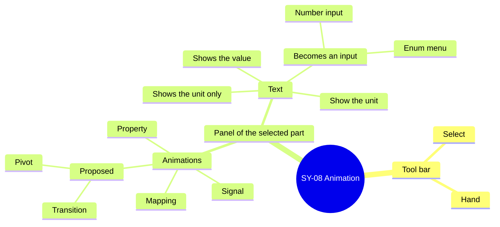

| ID | Element | Kind | Values and behaviour | Status | Source |
| --- | --- | --- | --- | --- | --- |
| SY-08.1 | Animations of the part | List | The part is a shape, a layer or a text. | Decided | [Animation mode](../symbols/08-animation-mode/README.md) |
| SY-08.2 | Signal | Select | Output signals of the type only. | Decided | [Animation mode](../symbols/08-animation-mode/README.md) |
| SY-08.3 | Property | Select | Rotation, position, opacity, visibility, fill or border colour, fill level, blink (proposed list). | Proposed | [Animation mode](../symbols/08-animation-mode/README.md) |
| SY-08.4 | Mapping | Select + fields | Bounded linear (input range, output range), by ranges (table), two values (boolean). | Proposed | [Animation mode](../symbols/08-animation-mode/README.md) |
| SY-08.4c | Column of the enum | Select | For an enum signal: a column added to its enum on the Enums page of the Symbol Lib ([SY-12](#sy-12--enums-of-a-symbol-lib)); the property takes that column's value for the current item (2026-11-17). Only columns whose kind fits the property (assistant's reading). | Decided | [Enums of a Symbol Lib](../symbols/11-enums-of-a-symbol-lib.md#used-by-an-animation) |
| SY-08.4b | Input range of a bounded linear | Two fields: minimum, maximum | Each a signal of the type, input or output, or a number typed (the number: to confirm); the value animated stays an output. | Decided (signal in or out), Proposed (number) | [Animation mode](../symbols/08-animation-mode/README.md#the-input-range-of-a-bounded-linear-animation) |
| SY-08.5 | Transition | Select + number field | None, or linear with a short duration, the field shown for linear only; a select rather than radios (2026-11-24). | Proposed | [Animation mode](../symbols/08-animation-mode/README.md) |
| SY-08.6 | Pivot | 9-point grid or a point | Centre by default. | Proposed | [Animation mode](../symbols/08-animation-mode/README.md) |
| SY-08.7 | Text: what it shows | Select | Written text, the value of a signal, or the unit of a signal only; a select rather than radios (2026-11-24). | Decided | [Text](../symbols/04-drawing-mode/text.md) |
| SY-08.8 | Text: show the unit | Toggle | With the value. | Decided | [Animation mode](../symbols/08-animation-mode/README.md) |
| SY-08.9 | Text: becomes an input | Select + Select | Selects rather than radios (2026-11-24). Number input or enum menu (display names shown, key sent); no text input, a signal is never a text (2026-11-18). What it writes is open since commands with a typed value were removed (2026-11-16); proposal: an input signal, directly. | Decided (input), Open (what it writes) | [Animation mode](../symbols/08-animation-mode/README.md) |
| SY-08.10 | Number format | Toggles | Thousand separator, sign, leading zeros, notation. | Proposed | [Animation mode](../symbols/08-animation-mode/README.md) |

Gaps:

- Blink: its rate is fixed (proposed), but is it a property, or a mapping of a boolean?
- Remove an animation; two animations on the same property (proposed: forbidden, flagged).

## SY-09 · Run mode (name proposed: Test mode)

Path: symbol editor › Run (symbol with a type only).

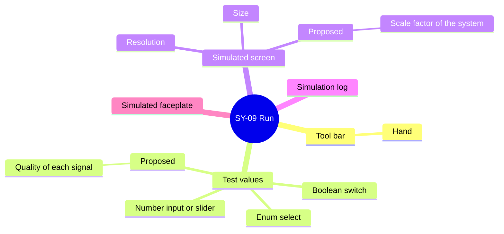

| ID | Element | Kind | Values and behaviour | Status | Source |
| --- | --- | --- | --- | --- | --- |
| SY-09.1 | Test value of a number | Number field or Slider | Any value: a signal has no bounds of its own since 2026-11-17 (a bound is a plain signal). The list also shows the signals used as a minimum or a maximum of an animation, inputs included (proposed). | Decided (field), Proposed (bound signals listed) | [Run mode](../symbols/09-run-mode/README.md#open-questions) |
| SY-09.2 | Test value of an enum | Select | The display names of the enum. | Decided | [Run mode](../symbols/09-run-mode/README.md) |
| SY-09.3 | Test value of a boolean | Toggle | — | Proposed | [Run mode](../symbols/09-run-mode/README.md) |
| SY-09.4 | Quality of a signal | Select | Good, uncertain, bad. | Proposed | [Run mode](../symbols/09-run-mode/README.md) |
| SY-09.5 | Simulated screen | Number fields (or a list of screens) | Size and resolution; scale factor proposed. | Decided | [Run mode](../symbols/09-run-mode/README.md) |
| SY-09.6 | Simulation log | List | A line per action: time, place, gesture, effect, value (proposed form). | Decided (form: Open) | [Run mode](../symbols/09-run-mode/README.md) |
| SY-09.7 | Simulated faceplate | Panel | Opens when an interaction opens the faceplate. | Decided (form: Open) | [Run mode](../symbols/09-run-mode/README.md) |

Gaps:

- A list of common screens, or only free fields?
- Clear the log; reset all the test values.

## SY-10 · Connection mode (proposed)

Path: symbol editor › Connection (assumption of the assistant).

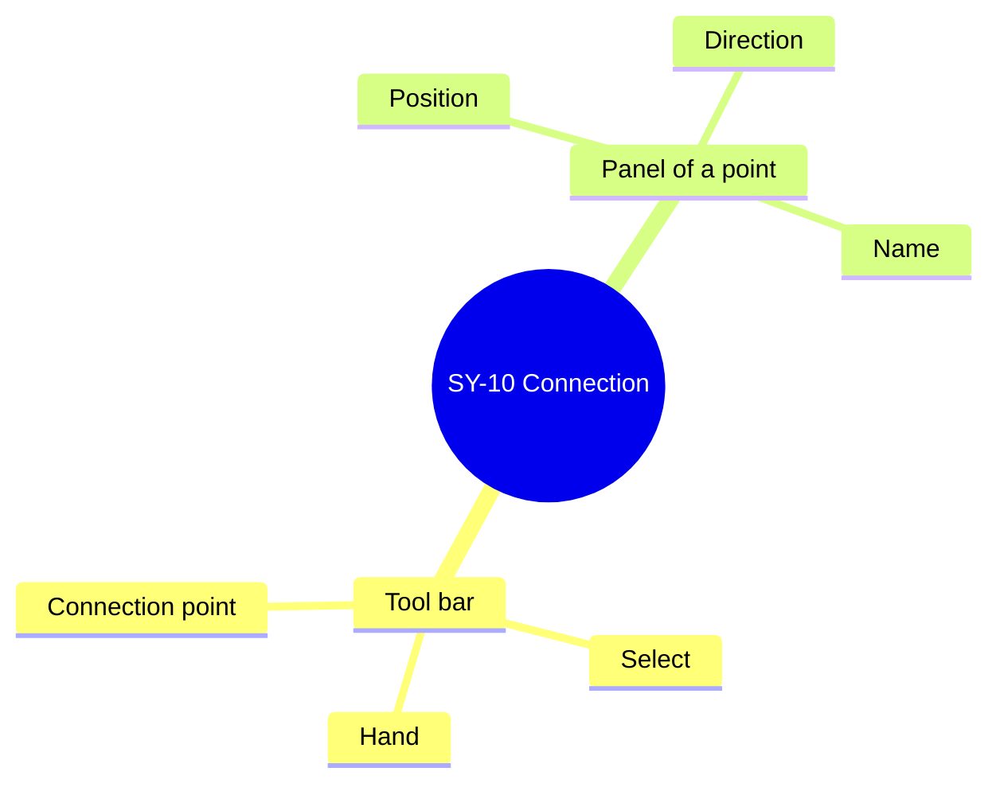

| ID | Element | Kind | Values and behaviour | Status | Source |
| --- | --- | --- | --- | --- | --- |
| SY-10.1 | Connection point | Button (tool) | Places a point where a pipe attaches. | Proposed | [Connection points](../symbols/pipes/connection-points.md) |
| SY-10.2 | Position | Number fields | — | Decided | [Connection points](../symbols/pipes/connection-points.md) |
| SY-10.3 | Direction | not said | The direction in which the pipe leaves the point. | Proposed | [Connection points](../symbols/pipes/connection-points.md) |
| SY-10.4 | Name | Text field | Inlet, outlet... | Open | [Connection points](../symbols/pipes/connection-points.md) |

Gaps:

- Is this mode also offered to a symbol without a type (proposed: yes)?
- Size of the snapping zone.

## SY-11 · Advanced tools

Path: symbol editor › tool bar › "Show the advanced tools" button. The bar appears just above the tool bar.

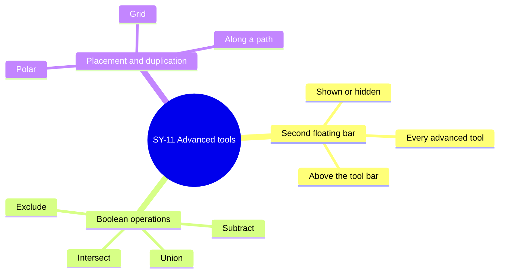

| ID | Element | Kind | Values and behaviour | Status | Source |
| --- | --- | --- | --- | --- | --- |
| SY-11.1 | Show the advanced tools | Button (in the tool bar) | Shows or hides the second bar (SY-03.3). Replaces the former three dots menu. | Decided | [Advanced tools](../symbols/03-editor/expert-menu/README.md) |
| SY-11.2 | Second bar | Floating bar | Just above the tool bar; holds every advanced tool. | Decided | [Advanced tools](../symbols/03-editor/expert-menu/README.md) |
| SY-11.3 | Boolean operation | Button each | Union, subtract, intersect, exclude; the result is a new shape. | Decided (list: Proposed) | [Boolean operations](../symbols/03-editor/expert-menu/boolean-operations.md) |
| SY-11.4 | Duplication rule | Select | Polar, along a path, grid; a select rather than radios (2026-11-24). | Decided (polar, along a path), Proposed (grid) | [Placement and duplication](../symbols/03-editor/expert-menu/placement-and-duplication.md) |
| SY-11.5 | Duplication options | Number fields + Toggle | Count or spacing, start and end angle, copies rotated or not. | Proposed | [Placement and duplication](../symbols/03-editor/expert-menu/placement-and-duplication.md) |

Gaps:

- How the reference of a duplication is picked (a point and a radius, a line): with the mouse, in fields, or both?
- Preview of the copies before they are made?

## SY-12 · Enums of a Symbol Lib

Path: Symbols › a Symbol Lib › Enums, a page of the library in the navigation bar ([SY-00.4](#sy-00--navigation-bar-of-the-symbol-mode)).

Following the layout rules, the list of enums is on the left and the selected enum on the right, as on [MD-09](metadata.md#md-09--enums).

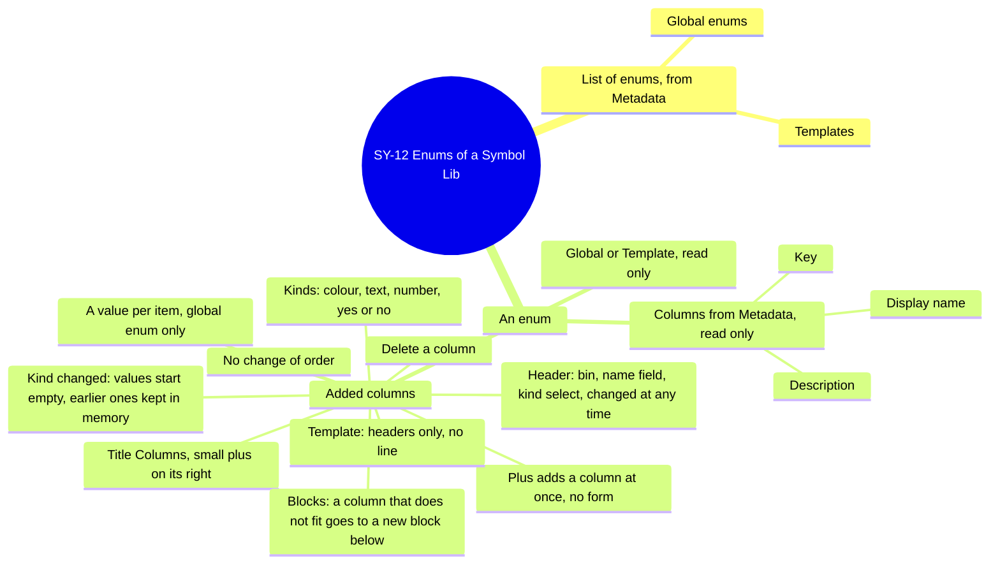

| ID | Element | Kind | Values and behaviour | Status | Source |
| --- | --- | --- | --- | --- | --- |
| SY-12.1 | Entry of the page | Button of the navigation bar | Enums, a page of the selected Symbol Lib ([SY-00.4](#sy-00--navigation-bar-of-the-symbol-mode), 2026-11-23). | Decided | [Libraries and symbols](../symbols/01-libraries-and-symbols.md#navigation-bar-of-the-symbol-mode) |
| SY-12.2 | List of enums | List | Every enum of Metadata, global and template; none is made here. Each line says Global or Template (2026-11-23). | Decided | [Enums of a Symbol Lib](../symbols/11-enums-of-a-symbol-lib.md) |
| SY-12.3 | Key, Display name, Description | Read-only columns | From Metadata, in the order of decision 0032; changed in Metadata only. A template has no items, so no lines: its name and its description are shown instead, read only (end of 2026-11-17). | Decided | [Enums of a Symbol Lib](../symbols/11-enums-of-a-symbol-lib.md) |
| SY-12.4 | Add a column | Button (+) on the right of the title "Columns" | As many columns as needed. The + adds the column at once, at the end of the last block, without a form (decision 0091, which replaces the form of 0090). The new column: name field focused and empty, kind Text by default, values empty text fields (Product Owner, 2026-11-23, replacing "Choose a kind"). The place of the + follows the [layout rules](README.md#a-title-and-a-small--on-its-right). | Decided | [Enums of a Symbol Lib](../symbols/11-enums-of-a-symbol-lib.md#added-columns) |
| SY-12.5 | Name of a column | Text field, always visible in the header of the column, above the kind | Edited at any time (end of 2026-11-17): `color`, `display name short`... | Decided | [Enums of a Symbol Lib](../symbols/11-enums-of-a-symbol-lib.md#added-columns) |
| SY-12.6 | Kind of value of a column | Select always visible in the header of the column, under the name | Chosen in the header once the column is added, for a global enum as for a template (decision 0090, which replaces "the first value chooses the kind"); changed at any time, without opening anything (decision 0091). A kind of animation, not a type of the model: Colour (RGBA), Text, Number, Yes / no (see [Kinds of value](../symbols/11-enums-of-a-symbol-lib.md#kinds-of-value)). On a change, nothing is converted: the new kind starts with empty values; the application remembers the values of the earlier kinds while it runs and gives them back if an earlier kind is chosen again (decision 0092). The change shows nothing, no warning, no notice (decision 0093). | Decided | [Enums of a Symbol Lib](../symbols/11-enums-of-a-symbol-lib.md#changing-the-kind) |
| SY-12.7 | Value of a column for an item | Field of the kind ([colour field](../controls/colour-field.md), text field, number field, checkbox) | Global enum only: one per item. For a template, filled with its items on each placed symbol, in the synoptic (end of 2026-11-17; the columns with the items: assistant's reading). | Decided | [Enums of a Symbol Lib](../symbols/11-enums-of-a-symbol-lib.md) |
| SY-12.8 | Delete a column | Icon button (bin), at the top of the header of the column, on the right, above the name | A column can be deleted (end of 2026-11-17); the bin is above the name (decision 0091). Deleted at once, with no confirmation, even with values: the undo history takes it back (decision 0093). | Decided | [Enums of a Symbol Lib](../symbols/11-enums-of-a-symbol-lib.md#added-columns) |
| SY-12.9 | Order of the columns | — | Not changed: no handle. | Decided | [Enums of a Symbol Lib](../symbols/11-enums-of-a-symbol-lib.md#added-columns) |
| SY-12.10 | Blocks of columns | Several tables, one under the other | No column narrowed, no sideways scroll: the added column that does not fit starts a new block below. Display name and Description in the first block only; each next block repeats the Key alone (Product Owner, 2026-11-23). Same lines in every block; the blocks follow the width of the window (decision 0091). | Decided | [Enums of a Symbol Lib](../symbols/11-enums-of-a-symbol-lib.md#when-the-columns-do-not-fit) |

Gaps:

- What a deleted column breaks in the animations.
- How the words Global and Template look in the list (a tag on the right of the line, in the test screen): for the design system.
