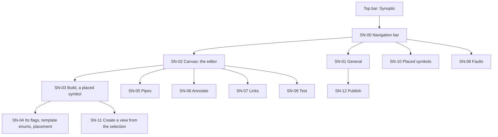
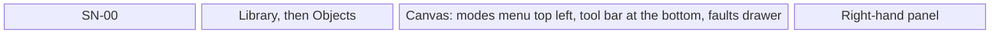

# Screens of the synoptic

> [Home](../README.md) › [Screens](README.md) › Synoptic

Status: extrapolated by the assistant on 2026-11-20 from the pages of [Synoptics](../synoptics/README.md), themselves an extrapolation, at the Product Owner's request. Almost every line is **Proposed**; the few **Decided** ones come from Metadata, Symbols and Pipes. Kinds and statuses are explained in the [guide of this folder](README.md). The wireframes are on the page "Spec" of the Figma file, section "Synoptic · SN-00 to SN-12".

## SN-00 · Navigation bar of the synoptic mode

Path: Synoptic (top bar). Same principle as [SY-00](symbols.md#sy-00--navigation-bar-of-the-symbol-mode).

| ID | Element | Kind | Values and behaviour | Status | Source |
| --- | --- | --- | --- | --- | --- |
| SN-00.1 | Create a synoptic | Button (small +), at the top | Asks a name and a kind (installation or view). | Proposed | [Synoptics and views](../synoptics/01-synoptics-and-views.md#navigation-bar-of-the-synoptic-mode) |
| SN-00.2 | Synoptics | Tree | Installations first, then views; folders. One click selects. | Proposed | [Synoptics and views](../synoptics/01-synoptics-and-views.md#navigation-bar-of-the-synoptic-mode) |
| SN-00.3 | Separator | — | Between the synoptics and the pages of the selected one. | Proposed | [Synoptics and views](../synoptics/01-synoptics-and-views.md#navigation-bar-of-the-synoptic-mode) |
| SN-00.4 | Pages of the selected synoptic | Buttons | General, Canvas, Placed symbols, Faults (with a counter). Shown once a synoptic is selected. | Proposed | [Synoptics and views](../synoptics/01-synoptics-and-views.md#navigation-bar-of-the-synoptic-mode) |

## SN-01 · General page of a synoptic

Path: Synoptic › a synoptic › General.

| ID | Element | Kind | Values and behaviour | Status | Source |
| --- | --- | --- | --- | --- | --- |
| SN-01.1 | Name | Text field | — | Proposed | [Synoptics and views](../synoptics/01-synoptics-and-views.md#general-page-of-a-synoptic) |
| SN-01.2 | Kind | Radio | Installation, view. | Proposed | idem |
| SN-01.3 | Frame | Select + two number fields (px) | Common screens, or a custom size. | Proposed | idem |
| SN-01.4 | Background | Colour | Grey advised by the HMI guides. | Proposed | idem |
| SN-01.5 | Symbol Libs used | List, small + on its title | The first gives the pipe styles offered first. | Proposed | idem |
| SN-01.6 | Home | Toggle | On one view only. | Proposed | idem |
| SN-01.7 | Description | Text field, multi-line | Never sent anywhere. | Proposed | idem |
| SN-01.8 | Publish | Button | Opens [SN-12](#sn-12--publish). | Proposed | [Outputs](../synoptics/10-outputs.md) |

## SN-02 · Synoptic editor: what every mode shares

Path: Synoptic › a synoptic › Canvas.

| ID | Element | Kind | Values and behaviour | Status | Source |
| --- | --- | --- | --- | --- | --- |
| SN-02.1 | Library | Tree, search | The symbols of the Symbol Libs used, thumbnails; drag to place. | Proposed | [Synoptic editor](../synoptics/02-synoptic-editor.md#layout) |
| SN-02.2 | Objects | Tree, search | Placed symbols, pipes, annotations, links; folders; hide, lock; order is the stack. | Proposed | idem |
| SN-02.3 | Modes menu | Floating menu, top left | Build, Pipes, Annotate, Links, Test. | Proposed | [Synoptic editor](../synoptics/02-synoptic-editor.md#modes) |
| SN-02.4 | Tool bar | Floating bar, bottom | The tools of the mode. | Proposed | idem |
| SN-02.5 | Zoom, fit the frame, fit the selection | Number field (%) + buttons | — | Proposed | [Synoptic editor](../synoptics/02-synoptic-editor.md#moving-around) |
| SN-02.6 | Minimap | Floating, on demand | The visible part as a rectangle. | Proposed | idem |
| SN-02.7 | Search on the canvas | Text field | `P-101` selects and zooms. | Proposed | idem |
| SN-02.8 | Grid, snapping | Toggles + number field | Grid step 8 px by default. | Proposed | [Synoptic editor](../synoptics/02-synoptic-editor.md#grid-snapping-guides) |
| SN-02.9 | Undo, redo, save | Buttons and keys | One history per open synoptic. | Proposed | [Synoptic editor](../synoptics/02-synoptic-editor.md#undo-redo-save-copy-paste) |
| SN-02.10 | Faults drawer | Drawer, bottom | Folded to the counts; see [SN-08](#sn-08--faults). | Proposed | [Faults](../synoptics/08-faults.md#where-the-faults-are-shown) |
| SN-02.11 | Right-hand panel, nothing selected | Panel | The settings of the synoptic (as SN-01). | Proposed | [Synoptic editor](../synoptics/02-synoptic-editor.md#layout) |

## SN-03 · Build mode · a placed symbol selected

Path: Canvas › Build › a placed symbol. The right-hand panel, top half.

| ID | Element | Kind | Values and behaviour | Status | Source |
| --- | --- | --- | --- | --- | --- |
| SN-03.1 | Symbol | Thumbnail + text | Symbol Lib › symbol. | Proposed | [Panel](../synoptics/04-placed-symbol-panel.md#symbol) |
| SN-03.2 | Type | Text, read only | Never changed in a synoptic. | Decided | [Type and symbol](../metadata/draft.md#type-and-symbol) |
| SN-03.3 | Open the symbol, Replace | Buttons | Replace: same type only. | Proposed | [Panel](../synoptics/04-placed-symbol-panel.md#symbol) |
| SN-03.4 | Reference | Text + link | In a view: from which installation, a link that opens the placed symbol there; the sections below edit the shared identity. | Decided (shared identity, 2026-11-20), Proposed (link) | idem |
| SN-03.5 | Instance ID | Text field | The key of the placed symbol, a field of its own, never the tag. Set by the software, changed by the user, unique. Name: waits for T5. | Decided (own key, 2026-11-20), Proposed (default value) | [Panel](../synoptics/04-placed-symbol-panel.md#identity) |
| SN-03.6 | Identifiers | Text field each | Those used by the preset's faceplate. | Decided (list to fill), Proposed (which ones) | [Identifiers](../metadata/draft.md#identifiers) |
| SN-03.7 | Duplicate text mark | Mark in the field | Warning, never a refusal. | Proposed | [Panel](../synoptics/04-placed-symbol-panel.md#identity) |
| SN-03.8 | Preset | Select | Among the presets of the type. | Decided | [Type and symbol](../metadata/draft.md#type-and-symbol) |
| SN-03.9 | Values changed | Table | Signal, default value, unit, decimals; texts of title and description elements; kept as changes from the preset, Reset per line; a dot on a changed line. | Decided (what changes, changes kept, Reset, 2026-11-20), Proposed (table, dot) | [Panel](../synoptics/04-placed-symbol-panel.md#preset) |
| SN-03.10 | Rotate, mirror | Buttons in the tool bar | Quarter turns; connection points follow. | Proposed | [Placed symbols](../synoptics/03-placed-symbols.md#rotation-mirror-size) |

## SN-04 · Panel of a placed symbol · flags, template enums, placement

Path: the same panel, scrolled down.

| ID | Element | Kind | Values and behaviour | Status | Source |
| --- | --- | --- | --- | --- | --- |
| SN-04.1 | Flags | Checkbox each, with its description | The flags of the type, own and inherited. | Decided | [Flags](../metadata/draft.md#flags) |
| SN-04.2 | Template enum block | Table, small + on its title | One per enum signal pointing to a template: key, display text, description, delete. | Decided (filled here), Proposed (table) | [Enums](../metadata/draft.md#global-enums-and-templates) |
| SN-04.3 | Template warning | Mark | Until the block has an item; never blocks. | Decided | idem |
| SN-04.4 | Copy the items from | Button + select | Another placed symbol of the same type. | Proposed | [Panel](../synoptics/04-placed-symbol-panel.md#template-enums) |
| SN-04.5 | X, Y, rotation, mirror, size | Number fields, buttons, toggles | — | Proposed | [Panel](../synoptics/04-placed-symbol-panel.md#placement) |
| SN-04.6 | On a pipe, Free from the pipe | Text + button | When connected (decided). | Decided (connection), Proposed (control) | [Pipes](../synoptics/05-pipes.md#symbols-on-a-pipe) |
| SN-04.7 | Faults of this placed symbol | List | With Show. | Proposed | [Faults](../synoptics/08-faults.md) |

## SN-05 · Pipes mode

Path: Canvas › Pipes.

| ID | Element | Kind | Values and behaviour | Status | Source |
| --- | --- | --- | --- | --- | --- |
| SN-05.1 | Pipe tool | Button (tool) | Click point after point; snaps to connection points. | Decided | [Pipes](../synoptics/05-pipes.md#decided-on-2026-11-11) |
| SN-05.2 | Style of the next pipe | Select in the tool bar | The last used. | Proposed | [Pipes](../synoptics/05-pipes.md#drawing-a-pipe) |
| SN-05.3 | Orthogonal lock | Toggle | On by default; Shift frees. | Proposed | idem |
| SN-05.4 | Edit points | Button (tool) | Drag a point or a segment; double click adds a point. | Proposed | [Pipes](../synoptics/05-pipes.md#editing-a-pipe) |
| SN-05.5 | Crossing on hover, click | Canvas | Highlights, swaps. | Decided | [Pipes](../synoptics/05-pipes.md#crossings) |
| SN-05.6 | Panel: style, start and end shapes | Selects | Edit this style. | Decided | [Pipes](../synoptics/05-pipes.md#the-panel-of-a-pipe) |
| SN-05.7 | Panel: connected to, crossings, symbols on the pipe, name | Texts, lists, Swap all | — | Proposed | idem |
| SN-05.8 | Panel: identity, preset, flags | Sections of SN-03 and SN-04 | When the style is linked to a type. | Proposed | [Pipes](../synoptics/05-pipes.md#a-pipe-whose-style-is-linked-to-a-type) |

## SN-06 · Annotate mode

Path: Canvas › Annotate.

| ID | Element | Kind | Values and behaviour | Status | Source |
| --- | --- | --- | --- | --- | --- |
| SN-06.1 | Drawing tools | Buttons (tools) | Rectangle, ellipse, polygon, pen, text: those of [SY-04](symbols.md#sy-04--drawing-mode). | Proposed | [Annotations](../synoptics/06-annotations.md) |
| SN-06.2 | Area | Button (tool) | A rectangle with a title. | Proposed | idem |
| SN-06.3 | Legend | Button (tool) | Pipe styles used, computed. | Proposed | idem |
| SN-06.4 | Value label | Button (tool) + panel | A placed symbol, one of its output signals, a format. | Proposed | [Annotations](../synoptics/06-annotations.md#value-labels) |

## SN-07 · Links mode

Path: Canvas › Links.

| ID | Element | Kind | Values and behaviour | Status | Source |
| --- | --- | --- | --- | --- | --- |
| SN-07.1 | Link zone | Button (tool) | Draws a rectangle. | Proposed | [Navigation links](../synoptics/07-navigation-links.md) |
| SN-07.2 | Target | Select + optional select | A synoptic, then a placed symbol of it. | Proposed | [Navigation links](../synoptics/07-navigation-links.md#the-panel-of-a-link) |
| SN-07.3 | Look | Radio | Invisible, outline on hover, always outlined. | Proposed | idem |
| SN-07.4 | Tooltip | Text field | — | Proposed | idem |

## SN-08 · Faults

Path: Synoptic › a synoptic › Faults; and the drawer of the editor.

| ID | Element | Kind | Values and behaviour | Status | Source |
| --- | --- | --- | --- | --- | --- |
| SN-08.1 | Counts | Text | "2 errors · 5 warnings"; a counter on the page icon. | Proposed | [Faults](../synoptics/08-faults.md#where-the-faults-are-shown) |
| SN-08.2 | Filters | Toggles + search | By level, by kind, by text. | Proposed | [Faults](../synoptics/08-faults.md#a-line-of-the-list) |
| SN-08.3 | List | Table | Level, object, what, where, Show. | Decided (a list), Proposed (columns) | [Faults](../synoptics/08-faults.md) |
| SN-08.4 | Marks on the canvas | Mark per object | Error, warning, information: a shape each. | Decided (red mark), Proposed (levels) | idem |

## SN-09 · Test mode

Path: Canvas › Test.

| ID | Element | Kind | Values and behaviour | Status | Source |
| --- | --- | --- | --- | --- | --- |
| SN-09.1 | Placed symbols and their signals | Tree, a control per signal | Number field or slider, select, switch. | Decided (controls, for a symbol) | [Test mode](../synoptics/09-test-mode.md) |
| SN-09.2 | Ramp | Button (play) + number field (s) | — | Proposed | idem |
| SN-09.3 | Scenarios | Select, save, play | — | Proposed | idem |
| SN-09.4 | Quality | Select per signal | Good, uncertain, bad. | Proposed | idem |
| SN-09.5 | Simulated screen | Select + scale factor | — | Decided (for a symbol), Proposed (scale) | idem |
| SN-09.6 | Log | Drawer | Time, placed symbol, gesture, command, value. | Decided (principle), Proposed (columns) | idem |
| SN-09.7 | Performance meter | Toggle | Time per image, images per second. | Proposed | idem |

## SN-10 · Page Placed symbols

Path: Synoptic › a synoptic › Placed symbols.

| ID | Element | Kind | Values and behaviour | Status | Source |
| --- | --- | --- | --- | --- | --- |
| SN-10.1 | Table | Table, whole width | Thumbnail, symbol, type, one column per identifier, preset, faults. | Proposed | [Synoptics and views](../synoptics/01-synoptics-and-views.md#the-page-placed-symbols) |
| SN-10.2 | Identifier cells | Text fields | Typed one under the other. | Proposed | idem |
| SN-10.3 | Filters and sort | Select + search | By type, symbol, fault. | Proposed | idem |
| SN-10.4 | Show on the canvas | Click on the thumbnail | — | Proposed | idem |

## SN-11 · Create a view from the selection

Path: Canvas of an installation › selection › Create a view from the selection. A dialog.

| ID | Element | Kind | Values and behaviour | Status | Source |
| --- | --- | --- | --- | --- | --- |
| SN-11.1 | Name of the view | Text field | — | Proposed | [Synoptics and views](../synoptics/01-synoptics-and-views.md#creating-a-view-from-an-installation) |
| SN-11.2 | Keep the pipes | Toggle | Between the selected symbols. | Proposed | idem |
| SN-11.3 | References | Text | "The selected symbols become references: their identity stays in this installation." No choice of copies. | Decided (2026-11-20) | idem |
| SN-11.4 | Create, Cancel | Buttons | — | Proposed | idem |

## SN-12 · Publish

Path: General › Publish, or the top of the editor. A dialog.

| ID | Element | Kind | Values and behaviour | Status | Source |
| --- | --- | --- | --- | --- | --- |
| SN-12.1 | Faults first | List | Errors and warnings; publishing with errors after a warning. | Proposed | [Outputs](../synoptics/10-outputs.md) |
| SN-12.2 | What to write | Checkboxes | Published view, configuration file, signal list, connection graph. | Proposed | idem |
| SN-12.3 | Output folder | Text, read only | A folder of the project. | Proposed | idem |
| SN-12.4 | Export an image | Select (SVG, PNG, PDF) + button | Without animation. | Proposed | idem |
| SN-12.5 | Publish, Cancel | Buttons | — | Proposed | idem |

Gaps:

- Everything here waits for the Product Owner's review: the whole part is an extrapolation, except the lines marked Decided.
