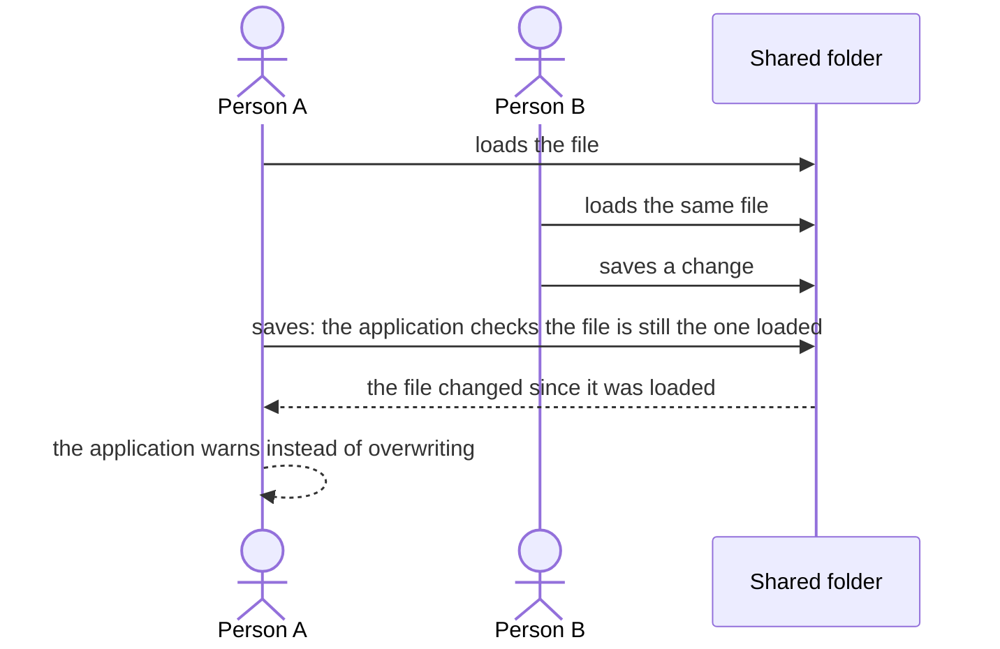

# Files and conflicts

> [Home](../README.md) › [Storage](README.md) › Files and conflicts

Status: draft, rules stated by the Product Owner on 2026-11-10. Nothing here is validated.

The open source application has access to a folder. Everything it generates (types, libraries, and the rest) is saved as files in that folder. All reading and writing goes through the server, never through the browser's file loading.

## The folder

- The user points the application to a folder.
- The folder can be a shared one: people may choose a public shared folder and work on the same files at the same time.
- Types and libraries generate files, and these files must be saved somewhere in that folder.

## Avoiding conflicts

As soon as something changes, the application must be able to check that the file it saves to is the same one that was loaded. This avoids two people overwriting each other.

- An option, to be ticked, makes the application check before saving that the file has not changed since it was loaded.
- An option makes the application refresh the folder before saving.
- Whether these are options or always on is not decided: the Product Owner has no firm idea yet.

## Open questions

- Are the check and the refresh options, or always on? Open.
- What does the application do on a conflict: warn and stop, or offer to reload? Open.
- Which files are generated and under which names and sub-folders? To be specified.
