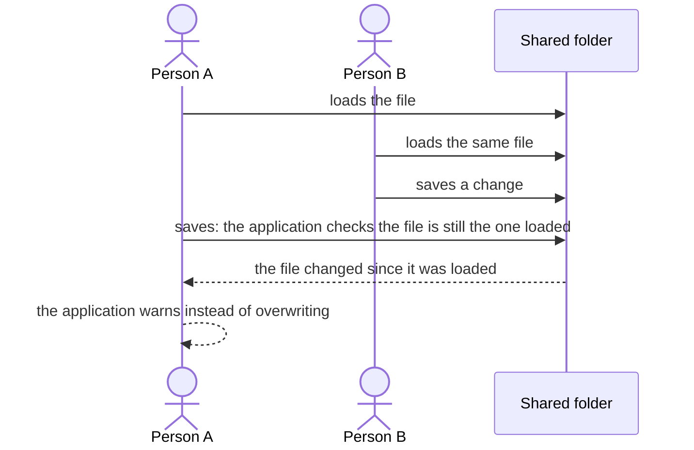

# Files and conflicts

> [Home](../README.md) › [Storage](README.md) › Files and conflicts

Status: draft. Nothing here is validated.

The open source application has access to a folder. Everything it generates (types, Symbol Libs, and the rest) is saved as files in that folder. All reading and writing goes through the server, never through the browser's file loading.

## The folder

- The user points the application to a folder.
- The folder can be a shared one: people may choose a public shared folder and work on the same files at the same time.
- Types and Symbol Libs generate files, and these files must be saved somewhere in that folder.

## Saving

- **Each change is written to its file as it is made** (Product Owner, 2026-11-23): there is no Save step; what is in the file is what the user sees.
- **The application may also keep a memory while it runs**, never written to a file: the values of an enum column under its earlier kinds, so the user can switch and go back (see [Changing the kind](../symbols/11-enums-of-a-symbol-lib.md#changing-the-kind), decision 0092).
- **Closing the application forgets that memory**; reopening shows what the files hold.

## Avoiding conflicts

As soon as something changes, the application must be able to check that the file it saves to is the same one that was loaded. This avoids two people overwriting each other.

- An option, to be ticked, makes the application check before saving that the file has not changed since it was loaded.
- An option makes the application refresh the folder before saving.
- Whether these are options or always on is not decided yet.

## Open questions

- Are the check and the refresh options, or always on? Open.
- What does the application do on a conflict: warn and stop, or offer to reload? Open.
- The synoptic editor proposes a Save button ([SN-02.9](../screens/synoptics.md)): does it stay, now that each change is written as it is made? Open.
- Does the memory kept while the application runs serve elsewhere than for the kinds of an enum column (an undo, for example)? Open.
- Which files are generated and under which names and sub-folders? To be specified. JSON files with no database are a leaning, not settled; for Metadata, see [Data model](../metadata/draft.md#as-json).
