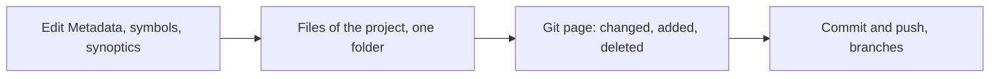

# Git

> [Home](../README.md) › [Storage](README.md) › Git

Status: noted from the Product Owner's message of 2026-11-22, for later. Not to draw nor to detail yet (Product Owner: "on verra ça après"). Not validated.

## What it is

The application keeps no versions of its own. The files of a project are saved in one Git repository, and the application offers a simple Git page to save them, so they can have versions without the application managing any.

## Rules

- **No versions managed by the application** (Product Owner, 2026-11-22: "on ne va absolument pas gérer ça"). It confirms decision 0053.
- **One Git repository for everything of a project**: the files of Metadata, the Symbol Libs and everything on the synoptic side, together.
- **One folder per project, with a guide in each folder.**
- **A Git page in the application**, to save and push, kept simple:
  - it lists each file changed, added or deleted, by its name;
  - it never shows the differences;
  - it makes a commit and a push;
  - it creates branches.

## Where it is used

| Where | What it uses |
| --- | --- |
| [Metadata](../metadata/draft.md#always-editable-no-versions) | Its files go in the repository of the project. |
| [Symbols](../symbols/README.md) | The Symbol Libs go in the same repository. |
| [Files and conflicts](files-and-conflicts.md) | The folder the application points to. |

## Open questions

- Is the Git page an option of the open source version, the application also working without Git? The Product Owner said "ou alors, sans Git, ça sera une option": to confirm.
- What "a project" is, and how its folder relates to the folder the application points to ([Files and conflicts](files-and-conflicts.md)).
- What else the Git page does besides creating branches (switching branch, pulling): "des branches et des trucs comme ça".
- Its place in the navigation and its screen: later, with the design system.
