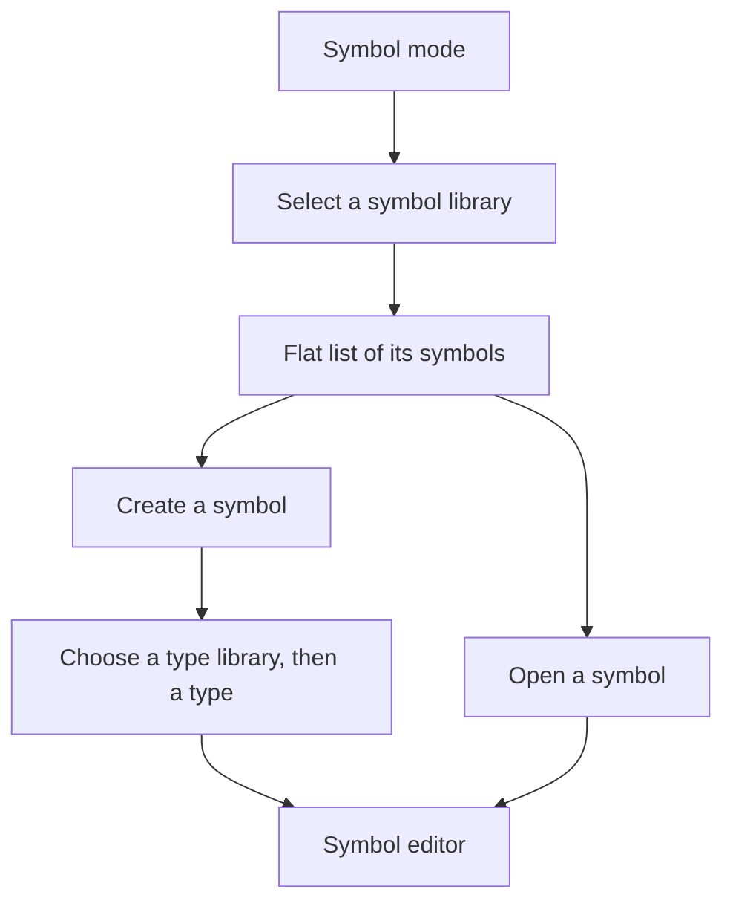

# Libraries and symbols

> [Home](../README.md) › [Symbols](README.md) › Libraries and symbols · Next: [Drawing](02-drawing.md)

Status: draft, from the Product Owner's description of 2026-11-11. Not validated.

Symbols are kept in symbol libraries. As for types, a library is only a way to sort and to find. What changes from one library to another is mostly the graphics: the same pump can be drawn in several styles.

## Rules

- Symbols are a flat list, never a tree. A symbol library is a flat list of symbols.
- In symbol mode, the user first selects a symbol library. The list of its symbols is then shown. Then the user opens a symbol or creates a new one.
- A symbol library is different from a type library of Metadata (see [Libraries](../metadata/10-libraries.md)): one sorts the drawings, the other sorts the types. Their names are to settle (see [Open questions](07-open-questions.md)).
- A symbol is attached to one type (see [Types](../metadata/01-types.md)). Several symbols can be attached to the same type, with different drawings and different presets: a centrifugal pump can have a manual symbol and a motorised one, with no change in Metadata.
- To create a symbol, the user chooses its type the way Metadata says: first a type library, then one of its types (see [Libraries](../metadata/10-libraries.md)).
- A symbol is static or dynamic (see [the overview](README.md)).

## Example

| Symbol library | Symbols | Types they use |
| --- | --- | --- |
| Hydraulics, style A | Manual centrifugal pump, motorised centrifugal pump, valve | Centrifugal pump, Valve |
| Hydraulics, style B | Centrifugal pump, valve | Centrifugal pump, Valve |

## Where it is used

| Thing | Created and changed in | Used in | In a symbol | In a synoptic |
| --- | --- | --- | --- | --- |
| Symbol library | Symbol mode | Choice of a symbol | Create, select | To settle (part 3) |
| Symbol | Symbol editor | Synoptics | Create, draw, link | Placed |

## Open questions

- What is the name of the two kinds of library, and does a symbol library hold only symbols of one style or any? See [Open questions](07-open-questions.md).
- Can a symbol live in several libraries, like a type? Not asked yet.
