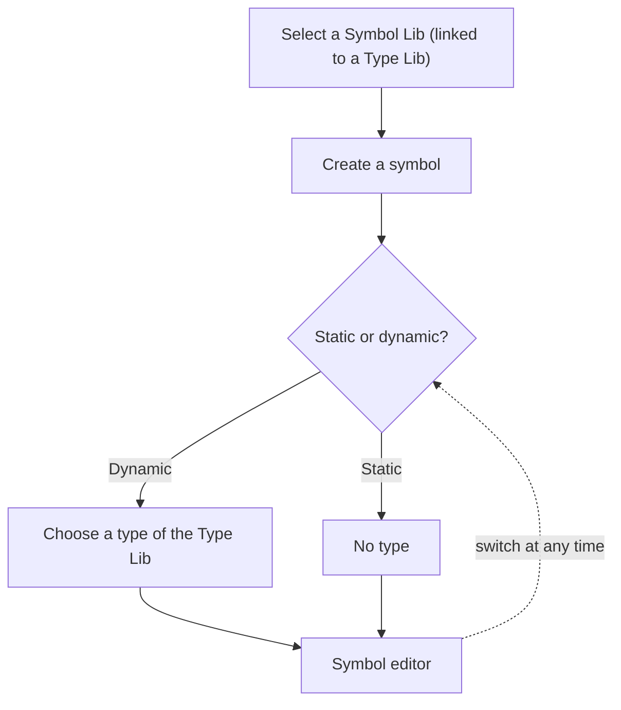

# Libraries and symbols

> [Home](../README.md) › [Symbols](README.md) › Libraries and symbols · Next: [Drawing](02-drawing.md)

Status: draft, from the Product Owner's description of 2026-11-11. Not validated.

A **Symbol Lib** holds symbols. A **Type Lib** (see [Libraries](../metadata/10-libraries.md)) holds types. This page is about the Symbol Lib, how a symbol is created, and what happens when Metadata changes.

## Rules

### Symbol Lib

- It is a flat list of symbols, not a tree.
- It has a name and a Type Lib. Nothing else.
- Every symbol is in one Symbol Lib, and only one. No symbol lives outside a library.
- In symbol mode, the user selects a Symbol Lib, sees its symbols, then opens one or creates one.
- Why several Symbol Libs: a software or a factory needs its own look for the same objects. To change a look over time, the user creates a new Symbol Lib instead of editing the old one.

### Type Lib of a Symbol Lib

- The user links the Symbol Lib to one Type Lib when creating it. The link stays.
- In this Symbol Lib, only the types of that Type Lib can be chosen.
- Why: types are global in Metadata, and each project can have its own Type Lib. The link avoids choosing a Type Lib at every symbol. A pump is the same in Metadata wherever it is used.

### Creating a symbol

"Create a symbol" first asks: static or dynamic?

|  | Dynamic | Static |
| --- | --- | --- |
| Type | Required, chosen before drawing, among the types of the Type Lib | None |
| Preset, faceplate, animation, interaction | Yes | None |
| What the user does | Draws, then links the drawing to the type | Draws only (see [Drawing](02-drawing.md)) |

The user can switch between static and dynamic at any time.

### Static to dynamic and back

- Dynamic to static hides everything linked to the type (type, preset, faceplate entries, animations, interactions). Nothing is deleted.
- Static to dynamic brings it all back, with the same type. A mistake costs nothing.
- The user chooses a type again only if the old one was deleted in Metadata, or if the symbol was never dynamic.

### When Metadata changes

- **A rename** is followed. The symbol is linked by identifier, not by name, so it keeps working and nothing is asked.
- **A change of interface** (a type changed, a signal removed...) can break a link. The animation or interaction is then marked broken and does nothing.
- **Fixing it** is done on the symbol side, never in Metadata.

## Example

| Symbol Lib | Type Lib | Symbols |
| --- | --- | --- |
| Plant A | Hydraulics | Manual centrifugal pump, motorised centrifugal pump, valve (dynamic), tank outline (static) |
| Plant B | Electricity | Circuit breaker, transformer (dynamic) |

## Where it is used

| Thing | Created and changed in | In a symbol | In a synoptic |
| --- | --- | --- | --- |
| Symbol Lib and its Type Lib | Symbol mode | Create, select | To settle (part 3) |
| Static or dynamic | Symbol editor | Choose, switch | No |
| Type of a dynamic symbol | Symbol editor | Choose, change | No |

## Open questions

- Can the Type Lib of a Symbol Lib be changed later? Can one Type Lib serve several Symbol Libs? Does a Symbol Lib of static symbols need one?
- Which changes break a link exactly, how are broken items shown, and how are they fixed (relink or remove)?
- A rename can only be followed if signals and commands have an internal identifier, as types do. Metadata does not say it yet.

All three are in [Open questions](07-open-questions.md).
