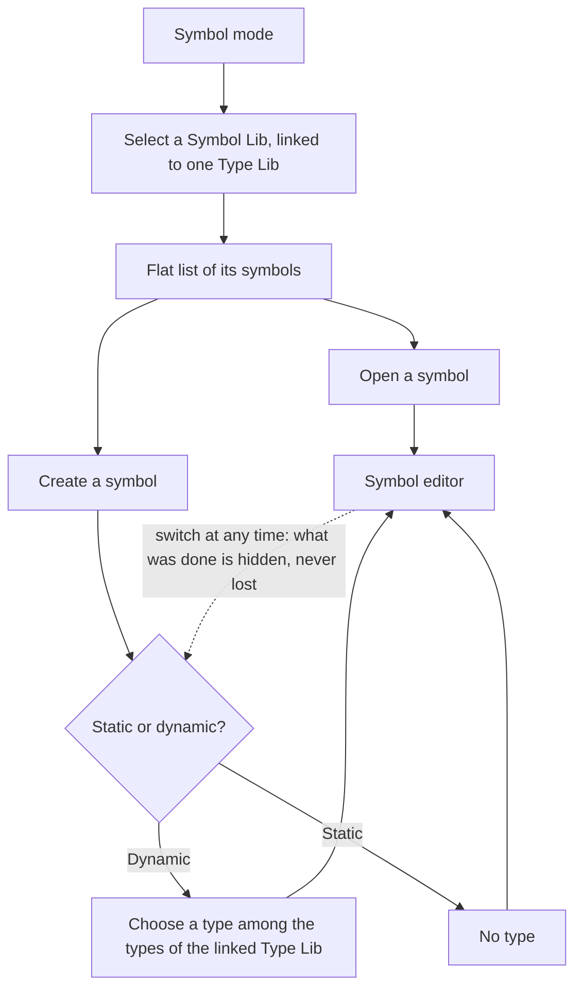

# Libraries and symbols

> [Home](../README.md) › [Symbols](README.md) › Libraries and symbols · Next: [Drawing](02-drawing.md)

Status: draft, from the Product Owner's description of 2026-11-11. Not validated.

Symbols are kept in Symbol Libs. A Symbol Lib is a way of representing symbols: what changes from one library to another is mostly the graphics, so the same pump can be drawn differently in each.

The two kinds of library are the **Symbol Lib** (sorts symbols) and the **Type Lib** (sorts types, see [Libraries](../metadata/10-libraries.md)). The names were given by the Product Owner on 2026-11-11.

## Rules

### The Symbol Lib

- A Symbol Lib is a flat list of symbols, never a tree.
- It is the only kind of symbol library. It has a name given by the user and a Type Lib (see below), and no other field: no style, no category.
- A symbol always lives in a library, and in one library only. It cannot be outside one, nor in several.
- In symbol mode, the user first selects a Symbol Lib. Its symbols are then listed, and the user opens one or creates a new one.
- Why several libraries: one cannot be enough. Symbols for one kind of software or one factory must look one way, another software or factory needs another look, and a symbol of one library may not be needed in another.
- A library also lets a look evolve: to change it, the user creates another library and draws the symbols again, instead of changing the first one.

### Its Type Lib

- A Symbol Lib is linked to one Type Lib when it is created, and stays attached to it.
- In that Symbol Lib, only the types of that Type Lib can be chosen. No type from another Type Lib is ever offered.
- Why: types are global in Metadata, and each project or need can have its own Type Lib. The link saves a Type Lib choice at every symbol and keeps the choice small. A pump is the same pump in Metadata wherever it is used: if it cannot be the same everywhere, the types are wrong, not the library.

### Creating a symbol

In a Symbol Lib, "Create a symbol" first asks: static or dynamic?

| Kind | Type | Preset, faceplate, animation, interaction | What remains |
| --- | --- | --- | --- |
| Dynamic | Required, chosen before drawing among the types of the Type Lib | Yes | Everything |
| Static | None | None | The drawing only (see [Drawing](02-drawing.md)) |

- A dynamic symbol is linked to its type from the start (see [Types](../metadata/01-types.md)). The type can be changed later, in the symbol editor only, still among the types of the Type Lib.
- Several dynamic symbols can share a type, with different drawings and presets: a centrifugal pump can have a manual symbol and a motorised one, with no change in Metadata.

### Switching between static and dynamic

- The user can switch whenever they want, in the symbol editor.
- Switching to static drops nothing: the type, preset, faceplate entries, animations and interactions are kept, only hidden. They do nothing and are shown nowhere, neither in the editor nor in a synoptic. Switching back brings them all back, so a mistake costs nothing.
- While static, there is no type selection. Metadata can still change in the meantime.
- On return to dynamic, the symbol is still linked to the type it had: the user does not choose it again (decided by the Product Owner on 2026-11-11). They choose a type only if that type was deleted in the meantime, or if the symbol was static from its creation and never had one.
- Anything that no longer fits the type is then checked as below.

### When Metadata changes

Decided by the Product Owner on 2026-11-11.

- A rename never breaks a symbol. A symbol is linked to a signal, a command or a type through its internal identifier, not through its name, so a renamed signal is followed: the symbol keeps working and nothing is asked of the user.
- A change of the interface can break it: a signal or a command removed, a signal that is no longer an output, a value of another type, a type changed, and so on. The animation or interaction that was linked to it is then broken: nothing is there any more.
- A broken item is kept, marked as broken, and does nothing. The error is solved on the symbol side, not in Metadata: the user fixes the link or removes the item.
- The same holds when the type of a dynamic symbol is changed in the editor, when its type is deleted and the user chooses another, and on return from static.

## Example

The library names are only names given by the user.

| Symbol Lib | Its Type Lib | Symbols | Types they use |
| --- | --- | --- | --- |
| Plant A | Hydraulics | Manual centrifugal pump, motorised centrifugal pump, valve, tank outline (static) | Centrifugal pump, Valve, none |
| Plant B | Electricity | Circuit breaker, transformer | Circuit breaker, Transformer |

## Where it is used

| Thing | Created and changed in | Used in | In a symbol | In a synoptic |
| --- | --- | --- | --- | --- |
| Symbol Lib and its Type Lib | Symbol mode, the link when the library is created | Choice of a symbol and of its type | Create, select | To settle (part 3) |
| Symbol | Symbol editor | Synoptics | Create, draw, link | Placed |
| Static or dynamic | Chosen at creation, switched in the symbol editor | Symbol | Choose, switch | No |
| Type of a dynamic symbol | Chosen at creation, changed in the symbol editor | Symbol | Choose, change | No |

## Open questions

- Can the link to the Type Lib be changed later, and what happens to the types of the symbols if it is? Can a Type Lib serve several Symbol Libs (it seems so: it is only a link)? Does a library of static symbols only need a Type Lib? See [Open questions](07-open-questions.md).
- Which changes of Metadata exactly break a link (the list above is only examples), how are broken items shown, and how does the user fix one (rebind it to another signal or command, or remove it)? See [Open questions](07-open-questions.md).
- For a rename to be followed, signals and commands need an internal identifier like types have; Metadata states it only for types, enums and quantities. See [Open questions](07-open-questions.md).
