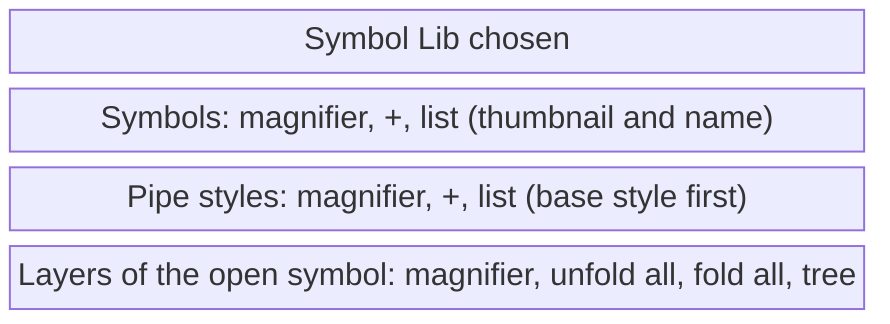
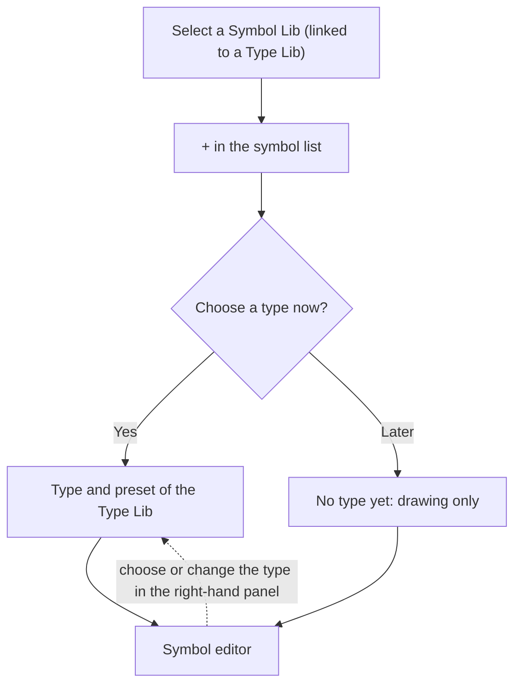

# Libraries and symbols

> [Home](../README.md) › [Symbols](README.md) › Libraries and symbols · Next: [Type, preset and faceplate](02-type-and-faceplate.md)

Status: draft, from the Product Owner's description of 2026-11-11, reviewed on 2026-11-15 (one list of symbols, type optional, the left-hand panel). Not validated.

A **Symbol Lib** holds symbols. A **Type Lib** (see [Libraries](../metadata/10-libraries.md)) holds types. This page is about the Symbol Lib, how a symbol is created, and what happens to a symbol when Metadata changes.

## Rules

### Symbol Lib

- It holds two flat lists, never a tree: its **symbols**, then its **pipe styles**. It also has one base pipe style, the global look of its pipes, that the pipe styles override. Junctions, crossings and start and end shapes are parts of the styles (decided by the Product Owner, 2026-11-11; see [Pipe styles](pipes/pipe-styles.md)). A pipe style can be linked to a type, which is then taken from the Type Lib of the Symbol Lib (assumption, to confirm).
- **One list of symbols only** (Product Owner, 2026-11-15). There is no "static" or "dynamic" kind: every symbol is the same kind of object, and a symbol simply has a type or not yet. The Product Owner settled it so that the software is simpler to understand at first.
- It has a name and a Type Lib. Nothing else: the lists above are its content, not settings.
- Every symbol is in one Symbol Lib, and only one. No symbol lives outside a library.
- In symbol mode, the user selects a Symbol Lib, sees its symbols, then opens one or creates one.
- Why several Symbol Libs: a software or a factory needs its own look for the same objects. To change a look over time, the user creates a new Symbol Lib instead of editing the old one.

### The left-hand panel of the symbol mode

Once a Symbol Lib is chosen, the left-hand panel shows, from top to bottom (Product Owner, 2026-11-15):

| Zone | What it holds |
| --- | --- |
| Symbols | A search field (a small magnifier), a **+** button to create a symbol, then the list. A click on an item opens the symbol in the editor. |
| Pipe styles | The same: a magnifier, a **+** button to create a style, then the list. A click on an item opens the style. |
| Layers | The layers of the open symbol: see [Layers](03-editor/layers.md). |

- An item of the symbol list shows a **thumbnail** and the **name** of the symbol.
- The thumbnail is the symbol itself, or, as Figma does for its outline view, the symbol drawn with the outline of every shape only, without fills. Which one is kept is open.
- The base pipe style sits in the list of the pipe styles, as its first item (assumption of the assistant, to confirm).

### Type Lib of a Symbol Lib

- The user links the Symbol Lib to one Type Lib when creating it. One Type Lib can serve several Symbol Libs.
- In this Symbol Lib, only the types of that Type Lib can be chosen.
- The user can change the Type Lib later: they click the Symbol Lib and change its Type Lib.
- Changing it can break the symbols (see below). If the new Type Lib has exactly the same types, nothing breaks.
- Why: types are global in Metadata, and each project can have its own Type Lib. The link avoids choosing a Type Lib at every symbol. A pump is the same in Metadata wherever it is used.

### Creating a symbol

- The **+** of the symbol list creates a symbol. The type, and the preset, **can** be chosen at creation, among the types of the Type Lib, but nothing is imposed (Product Owner, 2026-11-15).
- They can be chosen or changed later, in the right-hand panel of the editor (see [Type, preset and faceplate](02-type-and-faceplate.md)).
- A symbol without a type is a drawing only: it has no signal and no command, so nothing to animate, to link to a gesture or to test. The Interaction, Animation and Run modes need a type (how they look before one is chosen: open).
- Once a type is chosen, the user links the drawing to it (see [Editor](03-editor/README.md)).

Several symbols can share a type, with different drawings and presets: a centrifugal pump can have a manual symbol and a motorised one, with no change in Metadata.

### Removing the type of a symbol

- Removing the type of a symbol hides everything linked to it (preset, faceplate entries, animations, interactions). Nothing is deleted (rule kept from the former "dynamic to static" switch; to confirm).
- Choosing the same type again brings it all back. A mistake costs nothing.

### When Metadata changes

- A symbol is linked by identifier, not by name. A **rename** is followed: the symbol keeps working and nothing is asked.
- A change of the interface can **break a link**: what it points to is gone, or can no longer be used the same way (the list is below).
- A broken item is shown as broken, with a small red mark. How it looks is for the design, later; it may say why, later too. The animation itself is not changed: it just cannot work the same way any more.
- There is no tool and no automatic repair. The item only warns that it is broken, and the user redoes the mapping properly, on the symbol side, never in Metadata.
- The same rules apply when the Type Lib of the Symbol Lib is changed, when the type of a symbol is changed, and when a type is chosen again for a symbol that had lost it.

#### What breaks a link

| Change in Metadata | What breaks in the symbol |
| --- | --- |
| A type is deleted, or is not in the Type Lib any more | The symbol keeps existing but has no type: its animations and interactions are broken until the user chooses a type. |
| A signal is deleted, also one inherited from a parent | Its animations, the texts that show its value or its unit, its test value. |
| A command is deleted | The interactions that send it. |
| The value type of a signal changes (integer, real, boolean, text, enum) | Its animations and its texts, mapped for the old type. |
| The enum of an enum signal is replaced by another enum, or a value used by the symbol is removed from it | Its animations and its texts. |
| A signal changes direction, input or output | Becoming an input breaks its animations, because only outputs animate. Becoming an output breaks the commands that set it. |
| A command changes kind (set a signal, trigger) | The interactions that send it. |
| A signal loses its quantity | The texts that show its unit. |

What never breaks a link:

- a rename of a type, a signal, a command, an enum or a quantity;
- a new signal, a new command, a new enum value;
- a change of description, documentation, icon or colour;
- a change in a preset (defaults, display units, decimals, names, entries shown);
- a change of the bounds of a signal, or of its quantity, when it still has one: the link still works, the mapping is the user's.

## Example

| Symbol Lib | Type Lib | Symbols |
| --- | --- | --- |
| Plant A | Hydraulics | Manual centrifugal pump, motorised centrifugal pump, valve (with a type), tank outline (no type) |
| Plant B | Electricity | Circuit breaker, transformer (with a type) |

## What the research found

Source: the second research report (`research/t4-…/rapport.md`, sections 3.5, 3.16, 3.20). "Opinion" is the report's.

- **Linked or copied.** FactoryTalk View has "global objects": a base object, and reference objects that are linked copies of it; a change of the base reaches the references at the next opening of the screen, at design time and at run time; a missing base gives a validation error. Opinion: a symbol placed in a synoptic is a **linked instance**: it follows its symbol. A copy is a duplication of the symbol in the library. Confidence: medium.
- **Versions.** Opinion: the rule "a new Symbol Lib to change a look" is the versioning. To write in part 3: changing the Symbol Lib of a synoptic, with a match by identifier.
- **Broken link.** Ignition lays an error overlay on a component whose binding is wrong, and another one when an instance no longer finds its template (renamed, or missing from an import). It matches the small red mark of this page.
- **Quality of a value.** Ignition shows an overlay when the quality is not good (see [Animation mode](08-animation-mode/README.md)).
- **Usage counter.** The archived Figma page shows "used by 38 pipes" on a style. Opinion: add it to symbols and styles; it prepares the display of broken links.
- **Named colours.** Opinion: a flat list "Colours" in the Symbol Lib, which symbols and styles point to (see [Fill and border](04-drawing-mode/fill-and-border.md)).
- **Where pipe parts live.** The archived Figma page keeps junctions, crossings and end parts inside the pipe style. The Product Owner chose the same (2026-11-11).

## Where it is used

| Thing | Created and changed in | In a symbol | In a synoptic |
| --- | --- | --- | --- |
| Symbol Lib and its Type Lib | Symbol mode | Create, select | To settle (part 3) |
| Type of a symbol, optional | At creation, or in the right-hand panel of the editor | Choose, change, remove | No |

## Open questions

- Thumbnail of a symbol in the list: the symbol itself, or its outlines only (as Figma's outline view)? What else does an item show besides its name?
- Before a type is chosen, are the Interaction, Animation and Run modes hidden, greyed, or shown with a message?
- Is the base pipe style the first item of the pipe styles list, or elsewhere?
