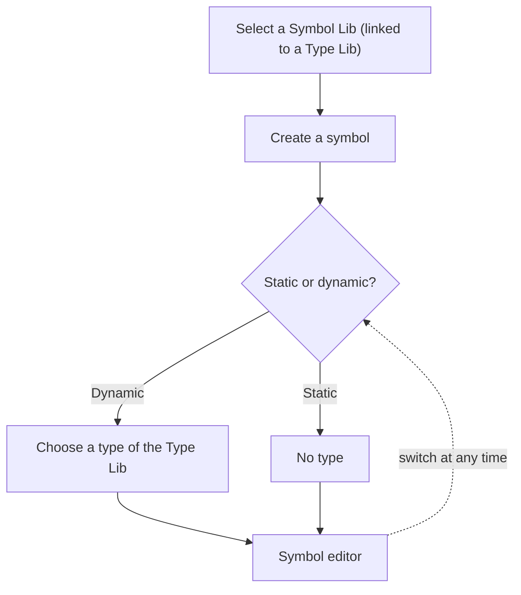

# Libraries and symbols

> [Home](../README.md) › [Symbols](README.md) › Libraries and symbols · Next: [Type, preset and faceplate](02-type-and-faceplate.md)

Status: draft, from the Product Owner's description of 2026-11-11. Not validated.

A **Symbol Lib** holds symbols. A **Type Lib** (see [Libraries](../metadata/10-libraries.md)) holds types. This page is about the Symbol Lib, how a symbol is created, and what happens to a symbol when Metadata changes.

## Rules

### Symbol Lib

- It holds two flat lists, never a tree: its dynamic symbols and its static symbols. Every library can have both.
- It has a name and a Type Lib. Nothing else.
- Every symbol is in one Symbol Lib, and only one. No symbol lives outside a library.
- In symbol mode, the user selects a Symbol Lib, sees its symbols, then opens one or creates one.
- Why several Symbol Libs: a software or a factory needs its own look for the same objects. To change a look over time, the user creates a new Symbol Lib instead of editing the old one.

### Type Lib of a Symbol Lib

- The user links the Symbol Lib to one Type Lib when creating it. One Type Lib can serve several Symbol Libs.
- In this Symbol Lib, only the types of that Type Lib can be chosen.
- The user can change the Type Lib later: they click the Symbol Lib and change its Type Lib.
- Changing it can break the symbols (see below). If the new Type Lib has exactly the same types, nothing breaks.
- Why: types are global in Metadata, and each project can have its own Type Lib. The link avoids choosing a Type Lib at every symbol. A pump is the same in Metadata wherever it is used.

### Creating a symbol

"Create a symbol" first asks: static or dynamic? The user can switch at any time.

|  | Dynamic | Static |
| --- | --- | --- |
| Type | Required, chosen before drawing, among the types of the Type Lib. It can be changed later. | None |
| Preset, faceplate, animation, interaction | Yes | None |
| What the user does | Draws, then links the drawing to the type | Draws only (see [Editor](03-editor/README.md)) |

Several dynamic symbols can share a type, with different drawings and presets: a centrifugal pump can have a manual symbol and a motorised one, with no change in Metadata.

### Switching between static and dynamic

- Dynamic to static hides everything linked to the type (type, preset, faceplate entries, animations, interactions). Nothing is deleted.
- Static to dynamic brings it all back, with the same type. A mistake costs nothing.
- The user chooses a type again only if the old one was deleted in Metadata, or if the symbol was never dynamic.

### When Metadata changes

- A symbol is linked by identifier, not by name. A **rename** is followed: the symbol keeps working and nothing is asked.
- A change of the interface can **break a link**: what it points to is gone, or can no longer be used the same way (the list is below).
- A broken item is shown as broken, with a small red mark. How it looks is for the design, later; it may say why, later too. The animation itself is not changed: it just cannot work the same way any more.
- There is no tool and no automatic repair. The item only warns that it is broken, and the user redoes the mapping properly, on the symbol side, never in Metadata.
- The same rules apply when the Type Lib of the Symbol Lib is changed, when the type of a symbol is changed, and when a static symbol becomes dynamic again.

#### What breaks a link

| Change in Metadata | What breaks in the symbol |
| --- | --- |
| A type is deleted, or is not in the Type Lib any more | The symbol keeps existing but has no type: its animations and interactions are broken until the user chooses a type. |
| A signal is deleted, also one inherited from a parent | Its animations, the texts that show its value or its unit, its test value. |
| A command is deleted | The interactions that send it. |
| The value type of a signal changes (integer, real, boolean, text, enum) | Its animations and its texts, mapped for the old type. |
| The enum of an enum signal is replaced by another enum, or a value used by the symbol is removed from it | Its animations and its texts. |
| A signal changes direction, input or output | Becoming an input breaks its animations, because only outputs animate. Becoming an output breaks the commands that set it. |
| A command changes kind (set a signal, trigger) | The interactions that send it. |
| A signal loses its quantity | The texts that show its unit. |

What never breaks a link:

- a rename of a type, a signal, a command, an enum or a quantity;
- a new signal, a new command, a new enum value;
- a change of description, documentation, icon or colour;
- a change in a preset (defaults, display units, decimals, names, entries shown);
- a change of the bounds of a signal, or of its quantity, when it still has one: the link still works, the mapping is the user's.

## Example

| Symbol Lib | Type Lib | Symbols |
| --- | --- | --- |
| Plant A | Hydraulics | Manual centrifugal pump, motorised centrifugal pump, valve (dynamic), tank outline (static) |
| Plant B | Electricity | Circuit breaker, transformer (dynamic) |

## Where it is used

| Thing | Created and changed in | In a symbol | In a synoptic |
| --- | --- | --- | --- |
| Symbol Lib and its Type Lib | Symbol mode | Create, select | To settle (part 3) |
| Static or dynamic | Symbol editor | Choose, switch | No |
| Type of a dynamic symbol | Symbol editor | Choose, change | No |
