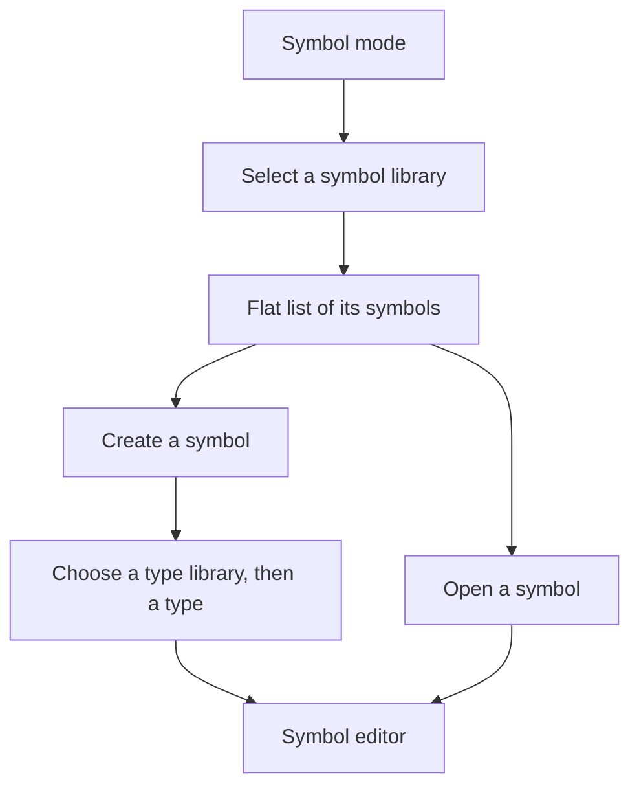

# Libraries and symbols

> [Home](../README.md) › [Symbols](README.md) › Libraries and symbols · Next: [Drawing](02-drawing.md)

Status: draft, from the Product Owner's description of 2026-11-11. Not validated.

Symbols are kept in symbol libraries. As for types, a library is only a way to sort and to find. What changes from one library to another is mostly the graphics: the same pump can be drawn differently in each library.

## Rules

- Symbols are a flat list, never a tree. A symbol library is a flat list of symbols.
- In symbol mode, the user first selects a symbol library. The list of its symbols is then shown. Then the user opens a symbol or creates a new one.
- A symbol library is different from a type library of Metadata (see [Libraries](../metadata/10-libraries.md)): one sorts the drawings, the other sorts the types. Their names are to settle (see [Open questions](07-open-questions.md)).
- A symbol always lives in a library. There is no symbol outside a library, and a symbol lives in one library only: it cannot be in several (decided by the Product Owner on 2026-11-11).
- There is one kind of symbol library. A library is a way of representing symbols, and it only has a name given by the user. It has no style, no category and no other field.
- Why several libraries: one library alone cannot be enough. Symbols used for one kind of software, or for one factory, must look one way; another software or factory needs another look. A pump is not always drawn the same way, and a symbol that exists in one library may not be needed in another.
- A library also lets a graphic representation evolve over time: when the user wants to change the look, they create another library and draw the symbols again there, instead of changing the first one.
- A symbol is attached to one type (see [Types](../metadata/01-types.md)). Several symbols can be attached to the same type, with different drawings and different presets: a centrifugal pump can have a manual symbol and a motorised one, with no change in Metadata.
- To create a symbol, the user must first choose its type, before drawing anything, the way Metadata says: first a type library, then one of its types (see [Libraries](../metadata/10-libraries.md)). The symbol is linked to its type from the start.
- The type of a symbol can be changed afterwards, in the symbol editor only (see [Types](../metadata/01-types.md)).
- A symbol is static or dynamic (see [the overview](README.md)).

## Example

The names below are only names given by the user, not styles.

| Symbol library | Symbols | Types they use |
| --- | --- | --- |
| Plant A | Manual centrifugal pump, motorised centrifugal pump, valve | Centrifugal pump, Valve |
| Plant B | Centrifugal pump, valve, circuit breaker | Centrifugal pump, Valve, Circuit breaker |

## Where it is used

| Thing | Created and changed in | Used in | In a symbol | In a synoptic |
| --- | --- | --- | --- | --- |
| Symbol library | Symbol mode | Choice of a symbol | Create, select | To settle (part 3) |
| Symbol | Symbol editor | Synoptics | Create, draw, link | Placed |
| Type of a symbol | Chosen at creation, changed in the symbol editor | Symbol | Choose, change | No |

## Open questions

- What are the names of the two kinds of library (symbol library, type library)? See [Open questions](07-open-questions.md).
