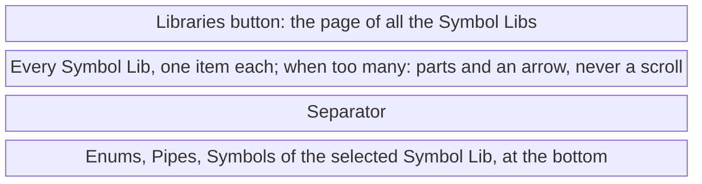
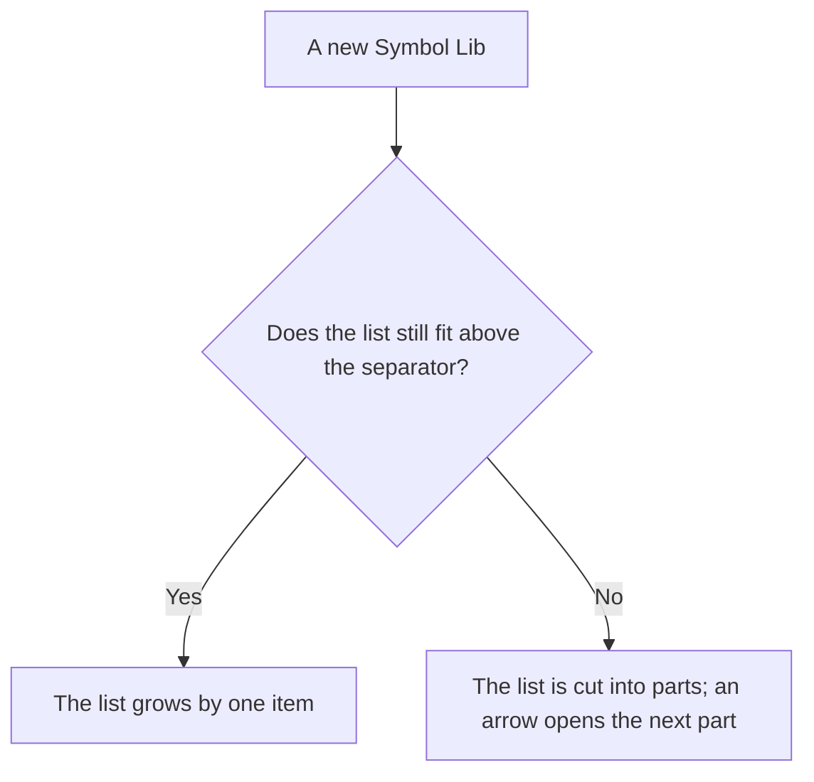
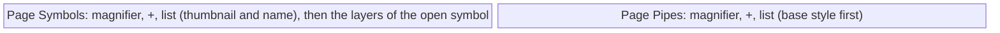
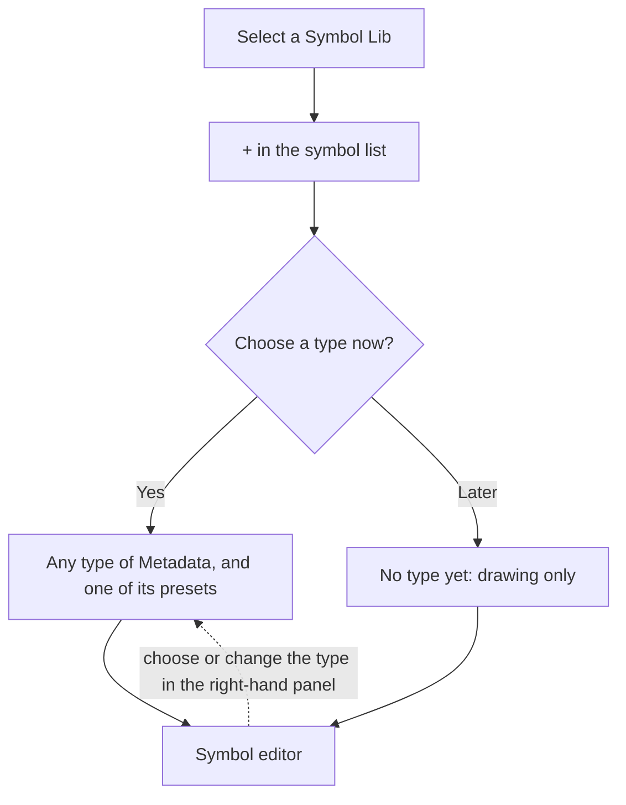

# Libraries and symbols

> [Home](../README.md) › [Symbols](README.md) › Libraries and symbols · Next: [Type, preset and faceplate](02-type-and-faceplate.md)

Status: draft. Not validated.

A **Symbol Lib** holds symbols. It is the only kind of library: there are no libraries of types. This page is about the Symbol Lib, how a symbol is created, and what happens to a symbol when Metadata changes.

## Rules

### Symbol Lib

- It holds two lists: its **symbols**, a **tree** where a sub-symbol sits under its parent, as in Metadata (decision 0045; see [Sub-symbols](12-sub-symbols.md)), then its **pipe styles**, a flat list. It also has one base pipe style, the global look of its pipes, that the pipe styles override. Junctions, crossings and start and end shapes are parts of the styles (see [Pipe styles](pipes/pipe-styles.md)). A pipe style can be linked to a type, chosen among all the types of Metadata.
- **One list of symbols only**. There is no "static" or "dynamic" kind: every symbol is the same kind of object, and a symbol simply has a type or not yet, so that the software is simpler to understand at first.
- It has a small **Enums** page: the enums of Metadata, read only, with the columns the library adds to them for the animations (see [Enums of a Symbol Lib](11-enums-of-a-symbol-lib.md)).
- It has a name. Nothing else: the lists above are its content, not settings. The name is set on the **Libraries** page, the page of all the Symbol Libs (proposed: the library has no General page any more, decision 0089).
- Every symbol is in one Symbol Lib, and only one. No symbol lives outside a library.
- In symbol mode, the user selects a Symbol Lib in the navigation bar, then one of its three pages: Enums, Pipes or Symbols.
- Why several Symbol Libs: a software or a factory needs its own look for the same objects. To change a look over time, the user creates a new Symbol Lib instead of editing the old one.

### No library of types

- There are no libraries of types (Type Libs). A Symbol Lib is linked to no list of types.
- Every type of Metadata can be chosen for any symbol, in any Symbol Lib.
- So changing the types offered to a Symbol Lib no longer exists, and cannot break symbols.

### Navigation bar of the symbol mode

The symbol mode has a navigation bar on the far left, like the one of Metadata (see [Layout rules](../screens/README.md#layout-rules)). It reaches every Symbol Lib in one click, and the pages of the selected one (Product Owner, 2026-11-23, decision 0089, which replaces the bar of the end of 2026-11-17).

From top to bottom:

1. A **Libraries** button: it opens the **Libraries** page, the page of all the Symbol Libs ("un bouton pour arriver sur la page où il y a toutes les libs").
2. Under it, the list of **every Symbol Lib**, one item each, as quick links: one click selects the library.
3. A **separator**.
4. The buttons of the **pages of the selected Symbol Lib**, at the bottom of the bar: **Enums** (see [Enums of a Symbol Lib](11-enums-of-a-symbol-lib.md)), **Pipes** (the pipe styles, see [Pipes](pipes/README.md)) and **Symbols** (the symbols and the editor). Three pages: the library has no General page any more. Their order here is the order the Product Owner named them in: to confirm.

The following holds:

- The separator and the page buttons **sit at the bottom of the bar**. The list of the Symbol Libs takes the room between the Libraries button and the separator: it grows with each new library until it reaches the separator.
- When the libraries no longer fit, the list **never scrolls**. It is cut into **parts**, each as long as the room allows, and an **arrow** says that there are more and opens the next part ("il y a X pages, allez voir la deuxième partie des liens rapides"). Proposed: an arrow down at the bottom of the list while there is a next part, with "Part 1 of 2" on hover; an arrow up at the top of the list on a later part, to go back.
- The page buttons **show only once a Symbol Lib is selected** (kept from the end of 2026-11-17). On the Libraries page, no library is selected: the bar shows the Libraries button and the list only.
- How a Symbol Lib looks in the list: open. Proposed in the mockups: its initials in a square, its name on hover.
- Why: every library is one click away, the pipes are not mixed with the symbols, and the pages sit under the libraries, which is simple to understand.

### Libraries page

- The page of all the Symbol Libs, opened by the Libraries button at the top of the bar.
- Proposed: a Symbol Lib is created, renamed and deleted there, since the bar keeps no small + and the library no General page. What the page shows of each library: open.

### Layout of the symbol mode

```mermaid
block-beta
    columns 4
    rail["Navigation bar: Libraries, every Symbol Lib, separator, then Enums, Pipes, Symbols of the selected one"] panel["Left-hand panel of the page chosen"] canvas["Editor or page"]:2
```

### The left-hand panel of the symbol mode

What the left-hand panel shows depends on the page chosen in the bar. Since 2026-11-17 (end of the day), the symbols and the pipe styles are on two pages, no longer two zones of one panel.

| Page | Left-hand panel, from top to bottom |
| --- | --- |
| Symbols | A search field (a small magnifier), a **+** button to create a symbol, then the list; a click on an item opens the symbol in the editor. Under it, the **layers** of the open symbol: see [Layers](03-editor/layers.md). |
| Pipes | The same for the pipe styles: a magnifier, a **+** button to create a style, then the list; a click on an item opens the style. |

- An item of the symbol list shows a **thumbnail** and the **name** of the symbol.
- The thumbnail is the symbol itself, or, as Figma does for its outline view, the symbol drawn with the outline of every shape only, without fills. Which one is kept is open.
- The base pipe style sits in the list of the pipe styles, as its first item (assumption of the assistant, to confirm).

### Creating a symbol

- The **+** of the symbol list creates a symbol. The type, and the preset, **can** be chosen at creation, among all the types of Metadata, but nothing is imposed.
- They can be chosen or changed later, in the right-hand panel of the editor (see [Type, preset and faceplate](02-type-and-faceplate.md)).
- A symbol without a type is a drawing only: it has no signal and no command, so nothing to animate, to link to a gesture or to test. The Interaction, Animation and Run modes need a type (how they look before one is chosen: open).
- Once a type is chosen, the user links the drawing to it (see [Editor](03-editor/README.md)).

Several symbols can share a type, with different drawings and presets: a centrifugal pump can have a manual symbol and a motorised one, with no change in Metadata.

A symbol can also be created as a **sub-symbol** of another one, of the same Symbol Lib, by the small + of its parent, in the tree or in the editor: it takes what was made for its parent, read only, preset and connection points included, follows its changes, and adds more; its type is the parent's or a sub-type of it (see [Sub-symbols](12-sub-symbols.md)).

### Removing the type of a symbol

- Removing the type of a symbol hides everything linked to it (preset, faceplate entries, animations, interactions). Nothing is deleted (rule kept from the former "dynamic to static" switch; to confirm).
- Choosing the same type again brings it all back. A mistake costs nothing.

### When Metadata changes

- A symbol is linked by identifier, not by name. A **rename** is followed: the symbol keeps working and nothing is asked.
- A change of the interface can **break a link**: what it points to is gone, or can no longer be used the same way (the list is below).
- A broken item is shown as broken, with a small red mark. How it looks is for the design, later; it may say why, later too. The animation itself is not changed: it just cannot work the same way any more.
- There is no tool and no automatic repair. The item only warns that it is broken, and the user redoes the mapping properly, on the symbol side, never in Metadata.
- **Metadata never warns about what a change breaks**; the symbol mode and the synoptic mode show **a list of what is broken**. Where this list sits and what each line says: not described yet.
- The same rules apply when the type of a symbol is changed, and when a type is chosen again for a symbol that had lost it.

#### What breaks a link

| Change in Metadata | What breaks in the symbol |
| --- | --- |
| A type is deleted | The symbol keeps existing but has no type: its animations and interactions are broken until the user chooses a type. |
| A signal is deleted, also one inherited from a parent | Its animations, the texts that show its value or its unit, its test value. |
| A command is deleted | The interactions that send it. |
| The value type of a signal changes (integer, real, boolean, enum) | Its animations and its texts, mapped for the old type. |
| The enum of an enum signal is replaced by another enum, or a value used by the symbol is removed from it | Its animations and its texts. |
| A signal changes direction, input or output | Becoming an input breaks its animations, because only outputs animate. Becoming an output breaks the commands that set it. |
| A command changes kind (set a signal, trigger) | The interactions that send it. |
| A signal loses its quantity | The texts that show its unit. |
| A column added to an enum in the Symbol Lib is deleted (not Metadata, to confirm) | The animations that use that column (see [Enums of a Symbol Lib](11-enums-of-a-symbol-lib.md)). |

What never breaks a link:

- a rename of a type, a signal, a command, an enum or a quantity;
- a new signal, a new command, a new enum value;
- a change of description, documentation, icon or colour;
- a change in a preset (defaults, display units, decimals, names, entries shown);
- a change of the quantity of a signal, when it still has one: the link still works, the mapping is the user's.

## Example

| Symbol Lib | Symbols |
| --- | --- |
| Plant A | Manual centrifugal pump, motorised centrifugal pump, valve (with a type), tank outline (no type) |
| Plant B | Circuit breaker, transformer (with a type) |

## What the research found

Source: the second research report (`research/t4-…/rapport.md`, sections 3.5, 3.16, 3.20). "Opinion" is the report's.

- **Linked or copied.** FactoryTalk View has "global objects": a base object, and reference objects that are linked copies of it; a change of the base reaches the references at the next opening of the screen, at design time and at run time; a missing base gives a validation error. Opinion: a symbol placed in a synoptic is a **linked instance**: it follows its symbol. A copy is a duplication of the symbol in the library. Confidence: medium.
- **Versions.** Opinion: the rule "a new Symbol Lib to change a look" is the versioning. To write in part 3: changing the Symbol Lib of a synoptic, with a match by identifier.
- **Broken link.** Ignition lays an error overlay on a component whose binding is wrong, and another one when an instance no longer finds its template (renamed, or missing from an import). It matches the small red mark of this page.
- **Quality of a value.** Ignition shows an overlay when the quality is not good (see [Animation mode](08-animation-mode/README.md)).
- **Usage counter.** The archived Figma page shows "used by 38 pipes" on a style. Opinion: add it to symbols and styles; it prepares the display of broken links.
- **Named colours.** Opinion: a flat list "Colours" in the Symbol Lib, which symbols and styles point to (see [Fill and border](04-drawing-mode/fill-and-border.md)).
- **Where pipe parts live.** Junctions, crossings and end parts are inside the pipe style, as in the archived Figma page.

## Where it is used

| Thing | Created and changed in | In a symbol | In a synoptic |
| --- | --- | --- | --- |
| Symbol Lib | Symbol mode: Libraries page (proposed); selected in the navigation bar | Create, select | To settle (part 3) |
| Type of a symbol, optional | At creation, or in the right-hand panel of the editor | Choose among all the types, change, remove | No |

## Open questions

- Thumbnail of a symbol in the list: the symbol itself, or its outlines only (as Figma's outline view)? What else does an item show besides its name?
- Before a type is chosen, are the Interaction, Animation and Run modes hidden, greyed, or shown with a message?
- Is the base pipe style the first item of the pipe styles list, or elsewhere?
- How does a Symbol Lib look in the navigation bar (icon, initials, name)?
- The order of the three pages (Enums, Pipes, Symbols as named, or Symbols first)?
- The Libraries page: is a Symbol Lib created, renamed and deleted there, and what does it show of each library?
- The arrow of a list cut into parts: one arrow down, then one arrow up on a later part, as proposed?
- With all the types offered, how does the type choice stay quick when the tree grows (a tree with a search field, as in Metadata)?
