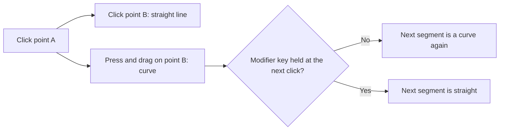

# Drawing

> [Home](../README.md) › [Symbols](README.md) › Drawing · Previous: [Libraries and symbols](01-libraries-and-symbols.md) · Next: [Type, preset and faceplate](03-type-and-faceplate.md)

Status: draft, from the Product Owner's description of 2026-11-11. Not validated.

The symbol editor is a vector drawing editor, close to Figma and Inkscape for what it needs. It works with **modes** and **tools**: a mode is a way of working on the drawing, and each mode shows its own tools in the tool bar.

## Rules

- A **tool** is what the mouse does in the drawing: select, draw a rectangle, write a text.
- A **mode** changes what the editor is for. Switching mode changes the tools of the tool bar and what the right-hand panel shows.
- Nothing is hidden behind a double click: to edit points, the user switches to the point editing mode.
- Everything drawn stays a path, in the layers of an SVG, so the symbol stays a real SVG. A rectangle, an ellipse and a polygon are paths once drawn. A text stays a text, because it can show a value or a unit (see [Animation](04-animation.md)).
- The name "layer" is provisional. A layer can be the target of an animation or of an interaction (see [Animation](04-animation.md) and [Interactions](05-interactions.md)).
- Colours (fill, stroke) and the options of a shape (corner radius, for example) are neither tools nor modes. They are in the right-hand panel, which shows the options that fit the selected shape.

## Moving around the drawing

- Mouse: the scroll wheel, and the middle button held down, which shows the hand while it is held.
- Trackpad: the usual gestures, to scroll and to zoom.
- The Hand tool does the same from the tool bar.
- The zoom is shown as a percentage, in one place of the editor, and the user can type a value in it. At 100%, the symbol is shown at its real size.
- Simulating the size of the symbol on another screen is not done here but in the Run mode (see [Testing](06-testing.md)).

## Modes

| Mode | What it is for | Tools in the tool bar | Right-hand panel |
| --- | --- | --- | --- |
| Drawing | The default mode: draw and arrange shapes. | Select, Hand, Rectangle, Ellipse, Polygon, Text, Pen | Options of the selected shape (colours, corner radius...) |
| Point editing | Edit the points of a path. | Select, Hand, Pen | Options of the selected point |
| Alignment | Place shapes in relation to each other. | Select, Hand | Alignment of the selected shapes |
| Interaction | Draw the zones that react to a gesture, and link them to commands (see [Interactions](05-interactions.md)). | Select, Hand, Interaction zone | The interactions of the selected place |
| Animation | Link the signals to the parts of the drawing (see [Animation](04-animation.md)). | Select, Hand | The animations of the selected part |
| Run | Try the symbol with test values and see it at the size of another screen (see [Testing](06-testing.md)). | Hand | The test values, and the simulated screen |

- The Rectangle, Ellipse, Polygon and Text tools exist only in the drawing mode.
- The Interaction, Animation and Run modes are only for a dynamic symbol: a static symbol has no interaction, no animation and nothing to test with signals.
- Other modes may be added later.

## Tools

### Select

- Clicks a shape to select it. Several shapes can be selected.
- Moves the selected shapes with the mouse and resizes them.
- A text is not resized like a shape: its box is shown when it is selected, and dragging the box enlarges the text zone only. The size of the text does not change and no transform is applied to it.
- A right click on a selection opens a menu, which has "Group".
- In the point editing mode, it selects points and handles instead of shapes.

### Hand

- Moves the view, not a shape. It is also given by the middle button of the mouse.

### Rectangle

- Draws a rectangle by dragging. It becomes a path. Its corner radius is set in the right-hand panel.

### Ellipse

- Draws an ellipse, or a circle, by dragging. It becomes a path.

### Polygon

- Draws a closed shape with straight sides. It becomes a path.

### Text

- Writes a text in the drawing. A text can show the value or the unit of a signal (see [Animation](04-animation.md)).
- The box of a text sets the text zone. Resizing the box never resizes the text itself (see Select).

### Pen

- Draws a path point by point, with straight lines and curves.
- It is also the tool for lines: there is no line tool.
- In the point editing mode, it starts from an existing point to draw further.

| Action | Result |
| --- | --- |
| Click a point, then click another | A straight line between them. |
| Press on the second point and drag before releasing | The segment becomes a curve, shaped by the drag. |
| Click again, with no modifier | As in Figma, the next segment is a curve again. |
| Click again, holding a modifier key | The next segment is a straight line straight away. |

The modifier is an option wanted by the Product Owner, because a curve again after a curve is often a nuisance. The key is not chosen (Shift and Alt were mentioned), nor whether it applies to the next segment only or stays on.

### Interaction zone

- Only in the Interaction mode. Draws a zone on the symbol that reacts to a gesture (see [Interactions](05-interactions.md)).

## Point editing mode

- The tool bar keeps Select, Hand and Pen. The shape tools disappear.
- Select picks points and handles, and moves them.
- Points can be added and removed.
- The Pen starts from an existing point to trace another one.

## Alignment mode

- The tool bar keeps only Select and Hand.
- The right-hand panel becomes an alignment panel for the selected shapes.
- The mode is only for placing shapes, not for drawing them.

## Groups

A group is neither a tool nor a mode.

- To make one, the user selects several shapes, then right click and "Group", or Ctrl+G.
- A group has no size of its own: it has the size of what is inside it, as in an SVG.
- A group is a node of the SVG, above the paths. An empty group does not exist.

## Expert menu

A menu for the tools that are not for everyday drawing. They work on shapes that already exist. Whether they are tools or modes is not decided yet: they change the editor a lot, like a mode, but they only make sense with the right shapes selected (two shapes for a boolean operation), which is not like a mode.

### Boolean operations

- The user selects two shapes, then chooses the operation (intersection and the like).
- The result is a new shape made from the two.

### Placement and duplication

- The user picks a reference, then a shape to duplicate, then the rule of the duplication.
- Example 1: pick a point and a radius, then ask for 30 copies of a shape, equally spaced on the circle.
- Example 2: pick an existing line or shape, then ask for copies that follow its edge, equally spaced along it.

## Where it is used

| Thing | Created and changed in | Used in | In a symbol | In a synoptic |
| --- | --- | --- | --- | --- |
| Paths, text, groups, layers | Symbol editor | Symbol drawing, animation and interaction targets | Draw, edit | No |

## Open questions

- The exact options of the expert tools (boolean operations, placement and duplication) and of the alignment panel.
- The pen modifier key, and how it works.

Both are in [Open questions](07-open-questions.md).
