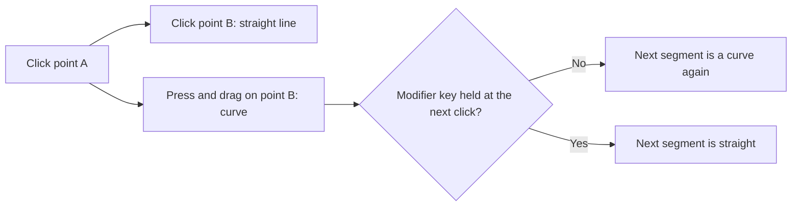

# Drawing

> [Home](../README.md) › [Symbols](README.md) › Drawing · Previous: [Libraries and symbols](01-libraries-and-symbols.md) · Next: [Type, preset and faceplate](03-type-and-faceplate.md)

Status: draft, from the Product Owner's description of 2026-11-11. Not validated.

The symbol editor is a vector drawing editor, close to Figma and Inkscape for what it needs: shapes, text, a pen, layers.

## Rules

- Every editing mode is a tool in one menu. Nothing is hidden behind a double click: as in the rest of the application, hidden options are avoided.
- Moving around the drawing is possible with a hand tool (a grab hand with handles) and with the trackpad.
- Several layers can be drawn, as in Figma and Inkscape. The name "layer" is provisional (see [Open questions](07-open-questions.md)). A layer can later be the target of an animation or of an interaction (see [Animation](04-animation.md) and [Interactions](05-interactions.md)).

## Tools

| Tool | What it does | Status |
| --- | --- | --- |
| Move (select) | Select, move and resize shapes with the mouse. | To detail |
| Hand | Move the view over the drawing. | Asked |
| Rectangle | Draw a rectangle. | Asked |
| Ellipse | Draw a circle or an ellipse. | Asked (the Product Owner said "rond") |
| Polygon | Draw a polygon. | Asked |
| Text | Write a text. A text can later show a signal's value or unit (see [Animation](04-animation.md)). | Asked |
| Pen | Draw a path point by point, with straight lines and curves. | Asked |
| Point editing | Edit the points of a shape. A mode of its own, chosen in the menu, not a double click. | Asked |
| Interaction zone | Draw a zone on the symbol that reacts to a gesture (see [Interactions](05-interactions.md)). | Asked |

The Product Owner wants a menu with every image editing mode, taking Figma as the reference. The exact list, with the options of each tool (fill, stroke, align, group, boolean operations, zoom, snapping...), is to describe.

## The pen

| Action | Result |
| --- | --- |
| Click a point, then click another | A straight line between them. |
| Press on the second point and drag before releasing | The segment becomes a curve, shaped by the drag. |
| Click again, with no modifier | By default, as in Figma, the next segment is a curve again. |
| Click again, holding a modifier key | The next segment is a straight line straight away. |

The modifier is an option wanted by the Product Owner, because the usual behaviour (a curve again after a curve) is often a nuisance. The key is not chosen: the Product Owner said Shift and Alt, then left it open. How it works exactly (no curve out of the point just made, or a switch that stays on) is to confirm.

## Point editing

- Every shape can have its points edited, in the point editing mode, chosen from the tool menu.
- In this mode, the user selects, moves, adds and removes points and handles of a shape. The detail is to describe.

## Where it is used

| Thing | Created and changed in | Used in | In a symbol | In a synoptic |
| --- | --- | --- | --- | --- |
| Shapes, text, paths, layers | Symbol editor | Symbol drawing, animation and interaction targets | Draw, edit | No |

## Open questions

- Name of "layer", the list of tools and their options, the pen modifier key. See [Open questions](07-open-questions.md).
