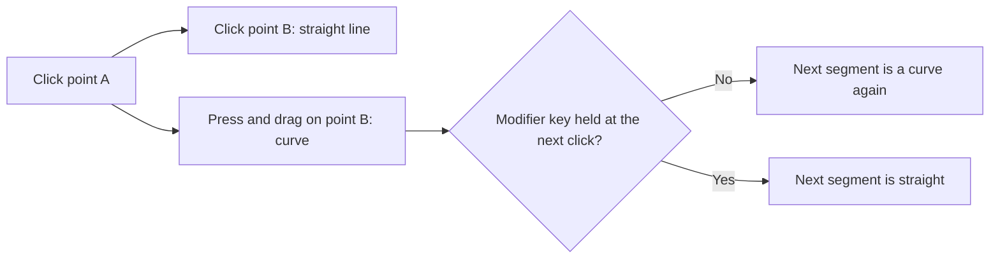

# Drawing

> [Home](../README.md) › [Symbols](README.md) › Drawing · Previous: [Libraries and symbols](01-libraries-and-symbols.md) · Next: [Type, preset and faceplate](03-type-and-faceplate.md)

Status: draft, from the Product Owner's description of 2026-11-11. Not validated.

The symbol editor is a vector drawing editor, close to Figma and Inkscape for what it needs. It works with **modes** and **tools**: a mode is a way of working on the drawing, and each mode shows its own tools in the tool bar.

## Rules

- A **tool** is what the mouse does in the drawing: select, draw a rectangle, write a text.
- A **mode** changes what the editor is for. Switching mode changes the tools of the tool bar and what the right-hand panel shows.
- Nothing is hidden behind a double click: to edit points, the user switches to the point editing mode.
- Key shortcuts and modifier keys are allowed, as in every drawing software, but never alone: each one has a visible equivalent (an option in the panel or the tool bar). The software is used by everyone, including an expert of 80 who makes synoptics.
- Everything drawn stays a path, in the layers of an SVG, so the symbol stays a real SVG. A text stays a text, because it can show a value or a unit (see [Animation](04-animation.md)).
- The name "layer" is provisional. A layer can be the target of an animation or of an interaction (see [Animation](04-animation.md) and [Interactions](05-interactions.md)).
- Colours (fill, stroke) and the options of a shape (corner radius, for example) are neither tools nor modes. They are in the right-hand panel, which shows the options that fit the selected shape.

## Moving around the drawing

- Mouse: the scroll wheel, and the middle button held down, which shows the hand while it is held.
- Trackpad: the usual gestures, to scroll and to zoom.
- The Hand tool does the same from the tool bar.
- The zoom is shown as a percentage, in one place of the editor, and the user can type a value in it. At 100%, the symbol is shown at its real size.
- Simulating the size of the symbol on another screen is not done here but in the Run mode (see [Testing](06-testing.md)).

## Modes

| Mode | What it is for | Tools in the tool bar | Right-hand panel |
| --- | --- | --- | --- |
| Drawing | The default mode: draw and arrange shapes. | Select, Hand, Rectangle, Ellipse, Polygon, Text, Pen | Options of the selected shape (colours, corner radius...) |
| Point editing | Edit the points of a path. | Select, Hand, Pen | Options of the selected point |
| Alignment | Place shapes in relation to each other. | Select, Hand | Alignment of the selected shapes |
| Interaction | Draw the zones that react to a gesture, and link them to commands (see [Interactions](05-interactions.md)). | Select, Hand, Interaction zone | The interactions of the selected place |
| Animation | Link the signals to the parts of the drawing (see [Animation](04-animation.md)). | Select, Hand | The animations of the selected part |
| Run | Try the symbol with test values and see it at the size of another screen (see [Testing](06-testing.md)). | Hand | The test values, and the simulated screen |

- The Rectangle, Ellipse, Polygon and Text tools exist only in the drawing mode.
- The Interaction, Animation and Run modes are only for a dynamic symbol: a static symbol has no interaction, no animation and nothing to test with signals.
- Other modes may be added later.

## Tools

### Select

What it does depends on the mode.

| Mode | What Select picks |
| --- | --- |
| Drawing | Shapes: to select them, move them and resize them. |
| Point editing | Points and handles of a path. |
| Alignment | The shapes to place in relation to each other. |
| Interaction | The shapes, or the places, on which an interaction is set. |
| Animation | The parts of the drawing that a signal animates. |
| Run | Nothing: Select is not offered. |

Selecting:

- A click on a shape selects it.
- Several shapes can be selected: with Shift or Ctrl held, a click adds a shape to the selection (or removes it). In the point editing mode, several points can be selected the same way.
- A press in the empty space, held while dragging, draws a selection rectangle.
- By default, every shape the rectangle touches is selected. A modifier key makes the rectangle select only the shapes it contains entirely. The key is not chosen yet (Shift and Alt were mentioned); like every modifier, it has a visible option too.

Moving and resizing:

- The selected shapes can be moved with the mouse.
- A selection has a box with small squares on its sides and corners, to resize it.
- Resizing never applies a scale or a transform. A rectangle that grows gets a bigger width and a bigger height. Its stroke does not grow: the stroke has the fixed value the user gave it.
- A text is resized the same way, with one rule more: its box is shown when it is selected, and dragging the box enlarges the text zone only. The size of the text does not change.

### Hand

- Moves the view, not a shape. It is also given by the middle button of the mouse.

### Rectangle

- Draws a rectangle by dragging. It becomes a path.
- Its corner radius is set in the right-hand panel.
- While drawing, a modifier key (Shift or Ctrl, not chosen) forces the width and the height to be equal: a square. The panel has a visible option that links the width and the height, for the same result.

### Ellipse

- Draws an ellipse by dragging: an oval or a circle. It becomes a path.
- An ellipse has no corner radius. It is not a rectangle with a big radius.
- The same modifier key and the same visible option as for the rectangle force the width and the height to be equal: a circle.

### Polygon

The polygon is drawn by dragging a box, like the rectangle and the ellipse. It becomes a path. A polygon does not always touch all the sides of its box, so the tool has options, set in the right-hand panel.

**Number of sides.** Chosen by the user, from 3 to 20. Figma goes up to 60, which is useless here, and real shapes rarely go above 8, but 20 does not get in the way of anyone.

**How the polygon fills its box.** Three modes:

| Mode | The polygon... |
| --- | --- |
| Filled | fills the box as much as possible. Its sides may be unequal. |
| Equilateral | keeps all its sides equal, and is as big as the box allows. |
| Like Figma | is placed in the box the way Figma and other drawing software do it: a triangle does not fill the box, a polygon of four sides touches the four corners. |

**Anchors.** The user says where the polygon is placed in its box, with anchors on the box (its sides and its corners). Two ways to use an anchor:

- a **corner** of the polygon touches the anchor;
- a **side** of the polygon touches the anchor.

Example: "a side always touches the left anchor, whatever the number of sides". It makes the shape easier to place.

### Text

- Writes a text in the drawing. A text can show the value or the unit of a signal (see [Animation](04-animation.md)).
- The editor computes the size of the text from the font, to give the box its size.
- A text is edited like in a word processor: the user can format a part of it.

Options proposed for a text, to confirm:

| Group | Options |
| --- | --- |
| Font | Family, size, weight (bold), italic |
| Colour | Colour of the text, colour of the background (highlight) |
| Lines | Underline, strikethrough, line above. They sit below, in the middle and above the text. |
| Layout | Horizontal alignment (left, centre, right), vertical alignment in the box, line height, letter spacing, wrapping inside the box |

### Pen

- Draws a path point by point, with straight lines and curves.
- It is also the tool for lines: there is no line tool.
- In the point editing mode, it starts from an existing point to draw further.

| Action | Result |
| --- | --- |
| Click a point, then click another | A straight line between them. |
| Press on the second point and drag before releasing | The segment becomes a curve, shaped by the drag. |
| Click again, with no modifier | As in Figma, the next segment is a curve again. |
| Click again, holding a modifier key | The next segment is a straight line straight away. |

The modifier is an option wanted by the Product Owner, because a curve again after a curve is often a nuisance. It works like the key that makes a rectangle a square: a shortcut, not the only way. So the pen also has a visible option that says, point by point, "this point is a curve" or "this point is a straight line". The key is not chosen (Shift, Ctrl and Alt were mentioned), nor whether it applies to the next segment only or stays on.

### Interaction zone

- Only in the Interaction mode. Draws a zone on the symbol that reacts to a gesture (see [Interactions](05-interactions.md)).

## Point editing mode

- The tool bar keeps Select, Hand and Pen. The Rectangle, Ellipse, Polygon and Text tools disappear.
- Select picks points and handles, one or several, and moves them.
- Points can be added and removed.
- The Pen starts from an existing point to trace another one.

## Alignment mode

- The tool bar keeps only Select and Hand.
- Select picks the shapes to place in relation to each other.
- The right-hand panel becomes an alignment panel for the selected shapes.
- The mode is only for placing shapes, not for drawing them.

## Groups

A group is neither a tool nor a mode.

- To make one, the user selects several shapes, then right click and "Group", or Ctrl+G. A group gathers shapes: an empty group does not exist.
- By default, the children of a group are placed freely (absolute), and the group has the size of what is inside it.
- A group can be given a **layout**, set in the right-hand panel, like the auto layout of Figma or a flex display in CSS: everything inside is laid out horizontally or vertically, and starts from a corner, for example the bottom left. Grids are not decided.
- A child can leave the layout and stay placed freely, fixed or tied to a corner of the group: "this one goes to the bottom right of the group, that one to the top right".
- The runtime may do more than an SVG can. A group with a layout can have its own size, and the runtime recalculates the layout when something changes: a text that grows, for example, pushes or follows the others as the layout says.

## Expert menu

A menu for the tools that are not for everyday drawing. They work on shapes that already exist. Whether they are tools or modes is not decided yet: they change the editor a lot, like a mode, but they only make sense with the right shapes selected (two shapes for a boolean operation), which is not like a mode.

### Boolean operations

- The user selects shapes, then opens the shape creation entry of the expert menu.
- The editor goes into a mode where the user picks the kind of operation (intersection and the like). The result is a new shape made from the selected shapes.

### Placement and duplication

- The user picks a reference, then a shape to duplicate, then the rule of the duplication.
- Example 1: pick a point and a radius, then ask for 30 copies of a shape, equally spaced on the circle.
- Example 2: pick an existing line or shape, then ask for copies that follow its edge, equally spaced along it.

## Where it is used

| Thing | Created and changed in | Used in | In a symbol | In a synoptic |
| --- | --- | --- | --- | --- |
| Paths, text, groups, layers | Symbol editor | Symbol drawing, animation and interaction targets | Draw, edit | No |

## Open questions

- The exact geometry of the three polygon modes, to take from how Figma places a polygon in its box.
- The exact options of the expert tools, of the alignment panel and of the group layout.
- The modifier keys (square, selection rectangle, pen), and how the pen modifier works.

All three are in [Open questions](07-open-questions.md).
