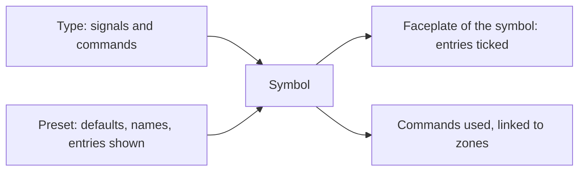

# Type, preset and faceplate

> [Home](../README.md) › [Symbols](README.md) › Type, preset and faceplate · Previous: [Libraries and symbols](01-libraries-and-symbols.md) · Next: [Editor](03-editor/README.md)

Status: draft, from the Product Owner's description of 2026-11-11, on top of the validated Metadata part. Not validated.

A dynamic symbol is linked to a type, which gives it signals and commands. This page only recalls what Metadata already says, and what the symbol adds. It does not apply to static symbols, which have no type, preset or faceplate (see [Libraries and symbols](01-libraries-and-symbols.md)).

## Rules

- A dynamic symbol has one type. The type is chosen when the symbol is created, before any drawing, among the types of the Type Lib linked to the Symbol Lib, and can be changed afterwards (still among those types). Both happen in the symbol editor and only there (see [Types](../metadata/01-types.md)). The signals of the type, with those it inherits, are then the signals the symbol can use.
- The symbol chooses a preset of its type (see [Presets](../metadata/09-presets.md)), then can edit its default values, display units, decimal places, names and descriptions. Example: to see a green pump, the user sets the default colour in the symbol.
- The symbol decides which faceplate entries are ticked. The full list is always there; ticking or unticking changes the display only (see [Faceplates](../metadata/08-faceplates.md)).
- The symbol says which commands it uses: a preset never chooses commands (see [Commands](../metadata/07-commands.md)).
- Two symbols of the same type can differ only by their preset and their faceplate: a manual pump and a motorised one need no new type.

## Where it is used

| Thing | Created and changed in | Used in | In a symbol | In a synoptic |
| --- | --- | --- | --- | --- |
| Type of a dynamic symbol | Metadata | Symbol | Choose, only here | No |
| Preset choice, defaults, display units, names | Preset, in Metadata | Dynamic symbol | Choose, edit | Choose, edit |
| Faceplate entries ticked | Metadata | Dynamic symbol | Tick or untick | Tick or untick |
