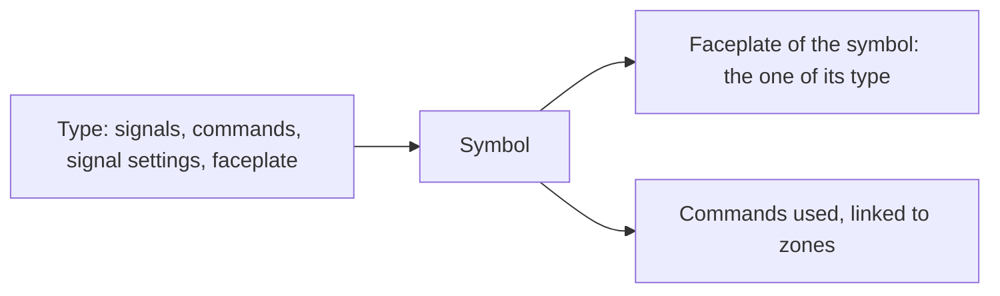

# Type and faceplate

> [Home](../README.md) › [Symbols](README.md) › Type and faceplate · Previous: [Libraries and symbols](01-libraries-and-symbols.md) · Next: [Editor](03-editor/README.md)

Status: draft, on top of the Metadata part, reviewed on 2026-11-15 (type optional) and on 2026-11-24 (no presets). Not validated.

A symbol can be linked to a type, which gives it signals, commands, signal settings and a faceplate. This page only recalls what Metadata already says, and what the symbol adds. A symbol without a type yet has no faceplate (see [Libraries and symbols](01-libraries-and-symbols.md)).

## Rules

- A symbol has at most one type, among all the types of Metadata (no library of types since 2026-11-16). The type is never imposed: it can be chosen when the symbol is created, or later, and changed afterwards. Both happen in the symbol editor and only there (see [Types](../metadata/draft.md#types)). The signals of the type, with those it inherits, are then the signals the symbol can use.
- The type is chosen in the **right-hand panel** of the editor, and nothing else is chosen there: no preset, no faceplate entries (Product Owner, 2026-11-24: "Il y a la sélection du type, et puis voilà"). Assumption of the assistant: the panel shows it when no shape is selected, as the setting of the symbol itself.
- There are no presets (2026-11-24): the start values, the display units, the decimals and the texts of a boolean are the [signal settings](../metadata/entities/19-signal-setting.md) of the type, and the faceplate is the one of the type ([MD-14](../screens/metadata.md#md-14--faceplate)). To show the same equipment another way, a sub-type is made in Metadata and the symbol takes it.
- The symbol says which commands it uses, by linking them to zones (see [Interaction mode](07-interaction-mode/README.md)).
- Two symbols of the same type differ by their drawing, their animations and their interactions: a manual pump and a motorised one need no new type. A different faceplate or different signal settings need a sub-type.

## Where it is used

| Thing | Created and changed in | Used in | In a symbol | In a synoptic |
| --- | --- | --- | --- | --- |
| Type of a symbol, optional | Metadata | Symbol | Choose, only here | No |
| Signal settings: start values, display units, decimals, texts of a boolean | Signal settings of the type, in Metadata | Symbol with a type | No | See [Panel of a placed symbol](../synoptics/04-placed-symbol-panel.md) |
| Elements of the faceplate (signals, commands, titles, descriptions, groups) | Faceplate of the type, in Metadata | Symbol with a type | No | No |
