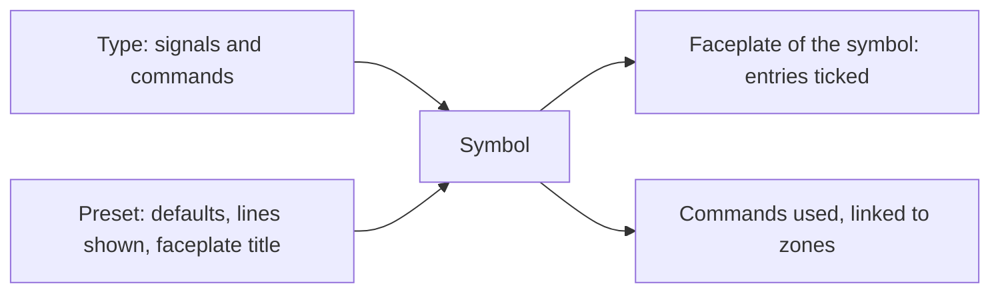

# Type, preset and faceplate

> [Home](../README.md) › [Symbols](README.md) › Type, preset and faceplate · Previous: [Libraries and symbols](01-libraries-and-symbols.md) · Next: [Editor](03-editor/README.md)

Status: draft, from the Product Owner's description of 2026-11-11, on top of the validated Metadata part, reviewed on 2026-11-15 (type optional). Not validated.

A symbol can be linked to a type, which gives it signals and commands. This page only recalls what Metadata already says, and what the symbol adds. A symbol without a type yet has no preset and no faceplate (see [Libraries and symbols](01-libraries-and-symbols.md)).

## Rules

- A symbol has at most one type, among all the types of Metadata (no library of types since 2026-11-16). The type is never imposed: it can be chosen when the symbol is created, or later, and changed afterwards (Product Owner, 2026-11-15). Both happen in the symbol editor and only there (see [Types](../metadata/01-types.md)). The signals of the type, with those it inherits, are then the signals the symbol can use.
- The type and the preset are chosen in the **right-hand panel** of the editor (Product Owner, 2026-11-15). Assumption of the assistant: the panel shows them when no shape is selected, as the settings of the symbol itself.
- The symbol chooses a preset of its type (see [Presets](../metadata/09-presets.md)), then can edit its default values, display units, decimal places, and the title and description of the faceplate. Example: to see a green pump, the user sets the default colour in the symbol. The names shown come from the display names of the signals (see [Signals](../metadata/04-signals.md)).
- The symbol decides which lines of the faceplate are ticked. The full list is always there; ticking or unticking changes the display only (see [Presets](../metadata/09-presets.md#the-table-of-a-preset)).
- The symbol says which commands it uses: a preset never chooses commands (see [Commands](../metadata/07-commands.md)).
- Two symbols of the same type can differ only by their preset and their faceplate: a manual pump and a motorised one need no new type.

## Where it is used

| Thing | Created and changed in | Used in | In a symbol | In a synoptic |
| --- | --- | --- | --- | --- |
| Type of a symbol, optional | Metadata | Symbol | Choose, only here | No |
| Preset choice, defaults, display units, faceplate title | Preset, in Metadata | Symbol with a type | Choose, edit | Choose, edit |
| Lines of the faceplate ticked | Preset, in Metadata | Symbol with a type | Tick or untick | Tick or untick |
