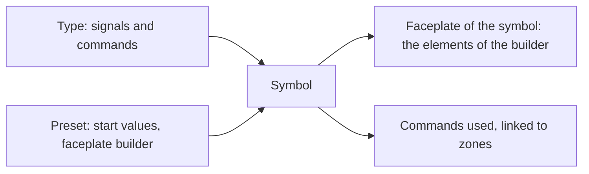

# Type, preset and faceplate

> [Home](../README.md) › [Symbols](README.md) › Type, preset and faceplate · Previous: [Libraries and symbols](01-libraries-and-symbols.md) · Next: [Editor](03-editor/README.md)

Status: draft, on top of the validated Metadata part, reviewed on 2026-11-15 (type optional). Not validated.

A symbol can be linked to a type, which gives it signals and commands. This page only recalls what Metadata already says, and what the symbol adds. A symbol without a type yet has no preset and no faceplate (see [Libraries and symbols](01-libraries-and-symbols.md)).

## Rules

- A symbol has at most one type, among all the types of Metadata (no library of types since 2026-11-16). The type is never imposed: it can be chosen when the symbol is created, or later, and changed afterwards. Both happen in the symbol editor and only there (see [Types](../metadata/draft.md#types)). The signals of the type, with those it inherits, are then the signals the symbol can use.
- The type and the preset are chosen in the **right-hand panel** of the editor. Assumption of the assistant: the panel shows them when no shape is selected, as the settings of the symbol itself.
- The symbol chooses a preset of its type (see [Presets](../metadata/draft.md#presets-and-their-faceplate)), then can edit its start values, display units, decimal places, and the texts of the title and description elements of the faceplate (the faceplate has no title nor description by default since 2026-11-16; assistant's reading). Example: to see a green pump, the user sets the start value of the colour in the symbol. The names shown come from the faceplate builder of the preset, one per signal placed in it (see [Presets](../metadata/draft.md#mode-faceplate-the-faceplate-builder)).
- Open since the faceplate builder (2026-11-16): the symbol used to decide which lines of the faceplate are ticked; now that the preset builds the faceplate as a list of elements, what the symbol can change in it is to settle (see [Presets](../metadata/draft.md#in-a-symbol-and-in-a-synoptic)).
- The symbol says which commands it uses: a preset never chooses commands (see [Commands](../metadata/draft.md#commands)).
- Two symbols of the same type can differ only by their preset and their faceplate: a manual pump and a motorised one need no new type.

## Where it is used

| Thing | Created and changed in | Used in | In a symbol | In a synoptic |
| --- | --- | --- | --- | --- |
| Type of a symbol, optional | Metadata | Symbol | Choose, only here | No |
| Preset choice, start values, display units | Preset, in Metadata | Symbol with a type | Choose, edit | Choose, edit |
| Elements of the faceplate (signals, commands, titles, descriptions, groups) | Preset, mode Faceplate, in Metadata | Symbol with a type | Open | Open |
