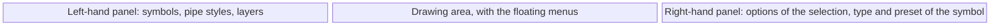
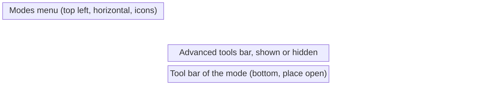

# The symbol editor

> [Home](../../README.md) › [Symbols](../README.md) › Editor · Previous: [Type, preset and faceplate](../02-type-and-faceplate.md) · Next: [Drawing mode](../04-drawing-mode/README.md)

Status: draft, reviewed on 2026-11-15 (layout, floating bars, layers, precise move). Not validated.

The symbol editor is a vector drawing editor, close to Figma and Inkscape for what it needs. It works with **modes** and **tools**. This page holds what is common to every mode; each mode has its own folder, with its tools inside.

## Layout

Decided, unless said otherwise.

| Zone | What it holds |
| --- | --- |
| Left-hand panel | The symbols and the pipe styles of the Symbol Lib, then the [layers](layers.md) of the open symbol (see [Libraries and symbols](../01-libraries-and-symbols.md)). |
| Modes menu | A floating bar at the **top left of the drawing area**, **horizontal**, made of **icons only** (the name of each mode in its tooltip): every mode, in the order of the work, and the switch from one to another (Product Owner, 2026-11-23). |
| Tool bar | A floating bar over the drawing area, with the tools of the current mode. Its place is open: at the **bottom** or at the top. |
| Advanced tools bar | A button of the tool bar shows or hides a second floating bar, **just above the tool bar**, with all the [advanced tools](expert-menu/README.md). |
| Right-hand panel | The options of the selection; the type and the preset of the symbol (see [Type, preset and faceplate](../02-type-and-faceplate.md)). |

Not placed yet: the zoom field, undo and redo. There is no save: each change is written as it is made, and the undo history keeps every action (decision 0093; see [Files and conflicts](../../storage/files-and-conflicts.md#undo-history)).

## Rules

- A **tool** is what the mouse does in the drawing: select, draw a rectangle, write a text.
- A **mode** changes what the editor is for. Switching mode changes the tools of the tool bar and what the right-hand panel shows.
- Nothing is hidden behind a double click: to edit points, the user switches to the point editing mode.
- **Same keys on every platform**. Windows, macOS and Linux behave the same. Only keys that exist on all three are used: Shift, Ctrl and Alt (the Option key on a Mac), with letters, digits, arrows and function keys. No Command, Option or Windows key in the specs. Whenever a page asks which key to use, this rule applies first.
- Key shortcuts and modifier keys are allowed, as in every drawing software, but never alone: each one has a visible equivalent (an option in the panel or the tool bar). The software is used by everyone, including an expert of 80 who makes synoptics.
- Everything drawn stays a path, in the layers of an SVG, so the symbol stays a real SVG. A text stays a text, because it can show a value or a unit (see [Animation mode](../08-animation-mode/README.md)).
- The name "layer" is provisional. A layer can be the target of an animation or of an interaction.
- Colours (fill, border) and the options of a shape (corner radius, for example) are neither tools nor modes. They are in the right-hand panel, which shows the options that fit the selected shape.

## Modes

In the order of the modes menu, which is the order of the work: draw, edit the points, connect, align, animate, then the interactions, and run last (Product Owner, 2026-11-23).

| Mode | What it is for | Tools in the tool bar | Right-hand panel |
| --- | --- | --- | --- |
| [Drawing](../04-drawing-mode/README.md) | The default mode: draw and arrange shapes. | Select, Hand, Group, Rectangle, Ellipse, Polygon, Pen, Text | Options of the selected shape (colours, corner radius...) |
| [Point editing](../05-point-editing-mode/README.md) | Edit the points of a path. | Select, Hand, Pen | Options of the selected point |
| [Connection](../pipes/connection-points.md) | Place the connection points where pipes attach. | Select, Hand, Connection point | The options of the selected point |
| [Alignment](../06-alignment-mode/README.md) | Place shapes in relation to each other. | Select, Hand | Alignment of the selected shapes |
| [Animation](../08-animation-mode/README.md) | Link the signals to the parts of the drawing. | Select, Hand | The animations of the selected part |
| [Interaction](../07-interaction-mode/README.md) | Draw the zones that react to a gesture, and link them to commands. | Select, Hand, Interaction zone | The interactions of the selected place |
| [Run](../09-run-mode/README.md) | Try the symbol with test values and see it at the size of another screen. | Hand | The test values, and the simulated screen |

- The Connection mode is in the menu (Product Owner, 2026-11-23); its tools and its panel are still the assistant's assumption (see [Connection points](../pipes/connection-points.md)).
- The icon of each mode: to draw in the design system.
- The Interaction, Animation and Run modes need a type: a symbol without a type has no interaction, no animation and nothing to test with signals (see [Libraries and symbols](../01-libraries-and-symbols.md)).
- The [advanced tools](expert-menu/README.md) add a second bar just above the tool bar of the current mode.
- Other modes may be added later.

## Moving around the drawing

- Mouse: the scroll wheel, and the middle button held down, which shows the hand while it is held.
- Trackpad: the usual gestures, to scroll and to zoom.
- The [Hand tool](hand.md) does the same from the tool bar.
- The zoom is shown as a percentage, in one place of the editor, and the user can type a value in it. At 100%, the symbol is shown at its real size.
- Simulating the size of the symbol on another screen is done in the [Run mode](../09-run-mode/README.md), not here.

## What is common to the modes

| Page | What it holds |
| --- | --- |
| [Select](select.md) | The Select tool, in every mode except Run. |
| [Hand](hand.md) | The Hand tool, in every mode. |
| [Layers](layers.md) | The tree of the layers of the symbol, in the left-hand panel. |
| [Precise move](precise-move.md) | A key that makes a dragged point or handle move pixel by pixel. |
| [Anchors](anchors.md) | The nine named points of a box, used by groups, polygons, alignment and pipe ends. |
| [Advanced tools](expert-menu/README.md) | The second bar of the tools that are not for everyday drawing. |

## Where it is used

| Thing | Created and changed in | Used in | In a symbol | In a synoptic |
| --- | --- | --- | --- | --- |
| Paths, text, groups, layers | Symbol editor | Symbol drawing, animation and interaction targets | Draw, edit | No |

## What the research found

Source: the second research report (`research/t4-…/rapport.md`, sections 3.15, 3.17, 3.22). "Opinion" is the report's, not a decision.

### Geometry of a symbol

| Subject | Sources | Opinion of the report | Confidence |
| --- | --- | --- | --- |
| Frame | Ignition gives a drawing a `viewBox` and `preserveAspectRatio`. | A fixed frame in pixels, equal to the `viewBox`, origin at the top left; a command "fit the frame to the content". | low |
| A placed symbol resized | Figma: constraints to the parent frame, "Scale" keeps size and position in percent. `vector-effect: non-scaling-stroke` keeps the width of a stroke, not of a fill. | In the synoptic, a uniform scale of the whole symbol; write that "never a scale" holds in the symbol editor. Later: a new layout by the anchors of the groups. | low |
| Rotation, mirror | In libavoid the connection points follow quarter turns and mirrors; in Figma the rotation stays a property. | Rotation: a property of the shape, the only transform allowed; the box and the anchors turn with it. Mirror: recomputed in the points. In the synoptic: quarter turns and mirror, connection points and directions followed. | low |
| Crisp lines | `shape-rendering: crispEdges` may align edges on screen pixels, with no guarantee. | Positions and sizes in whole pixels by default. A fill-based border of whole width on whole coordinates is crisp with no half-pixel shift. | low |
| Grid and snapping | No source read. | Minimum: snap to the pixel, to the points, edges, centres and anchors of other shapes, to the frame; temporary guides of alignment and equal spacing; arrows: 1 px, Shift: 10 px. Rulers and placed guides: later. | very low |

### Names (opinion of the report)

| Current name | Proposal | Support |
| --- | --- | --- |
| Layer | Keep | Inkscape marks a group as a layer |
| Interaction, gesture | Keep | Figma |
| Zone | Interaction zone | "Hotspot" in Figma |
| Static, dynamic | Keep | Same words in the archived Figma file |
| Expert menu | Advanced tools | Name of a page of the archived Figma file |
| Free form | Path | Word of SVG |
| Fit, fixed; absolute child | Keep | — |
| Reference, shapes to place | Keep | "Key object" at Adobe |
| Test display | Preview (kept, decision 0094) | "Pipe style preview" in the archived Figma file |
| Run mode | Test mode | Nothing runs; the archived file has a separate "Runtime" page |
| Connection mode | Provisional | — |

### What looks missing compared with the editors read (opinion of the report)

Undo and redo; grid, snapping and guides; import of an SVG; variants of a symbol; display of the quality of a value (see [Animation mode](../08-animation-mode/README.md)); "disabled when" condition and tooltip (see [Interaction mode](../07-interaction-mode/README.md)); inline symbols on a pipe (see [Pipes](../pipes/README.md)); usage counter; lock and hide a layer; stacking order; translatable texts; keyboard access.

### Symbol file and SVG export

- Inkscape saves an ordinary SVG plus attributes in two namespaces of its own; the standard allows them, and the file must render the same with or without them; its "plain SVG" export removes them.

| Option | For | Against |
| --- | --- | --- |
| A · A namespace of its own (like Inkscape) | Proven | Another tool may read it badly |
| B · `data-*` attributes | Simple | Spreads the model over the whole file |
| C · One `<metadata>` block, linked to the elements by their `id` | Geometry in pure SVG; one block to remove at export | The block and the drawing can drift apart |
| D · A JSON file beside it | SVG intact | Two files to keep together |

- Opinion of the report: **C**, with a "plain SVG" export that removes the block. Confidence: low.
- Portable export (opinion): paths, groups, plain text, linear and radial gradients, cuts; no `foreignObject`, no animation, no own attribute; effects as an option. Ignition warns that embedding a big SVG can degrade performance (link above 100 KB).
- Import of an SVG made elsewhere (opinion): worth it, as a symbol without a type, after the first version: strokes turned into "middle" borders, transforms recomputed, CSS styles brought back on the elements, with the list of what was lost. The file is read through the server.

## To decide by the Product Owner

1. The names above (Advanced tools, Path, Interaction zone, Preview, Test mode).
2. Rotation as the only transform allowed on a shape; mirror recomputed in the points.
3. The minimum set of snapping and guides.
4. The data of the editor in one `<metadata>` block of the SVG.
5. Which missing features go in the specs now, and which later.

## Open questions

- Key conflicts (Alt and the window managers of Linux, Ctrl+G in browsers) were not read by the research: still open.
- The other open questions are on the pages they concern, and listed in [Open questions](../10-open-questions.md).
