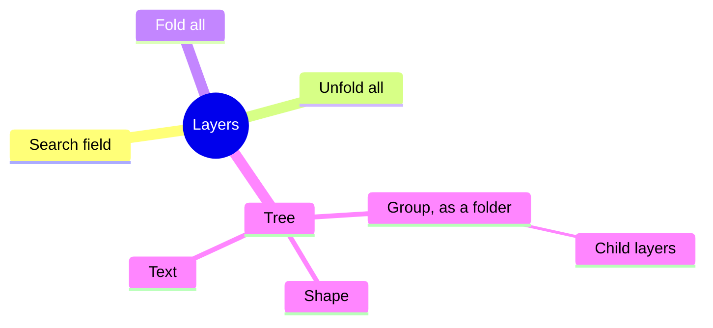

# Layers

> [Home](../../README.md) › [Symbols](../README.md) › [Editor](README.md) › Layers

Status: draft, from the Product Owner's description of 2026-11-15. Not validated.

The layers panel shows every layer of the open symbol, as a tree. It is in the left-hand panel of the symbol mode, under the symbols and the pipe styles (see [Libraries and symbols](../01-libraries-and-symbols.md)).

## Rules

- It works like the layers panel of Figma and like the file tree of a code editor (Product Owner, 2026-11-15).
- A [group](../04-drawing-mode/group.md) is shown as a folder: it holds its children, and it can be folded and unfolded.
- A **search field** filters the layers by name.
- Two icons, as in code editors: **unfold all** the groups, and **fold all** the groups.
- A shape with a border is one line: its border is computed, it is not a layer of its own (see [Fill and border](../04-drawing-mode/fill-and-border.md)).
- Assumption of the assistant, to confirm: selecting a line selects the layer on the drawing, and the other way round, in every mode that has the Select tool.

## Example

| Line | Kind |
| --- | --- |
| Pump body | Group, unfolded |
| — Casing | Shape |
| — Impeller | Shape, animated by `speed` |
| Label | Text |

## Open questions

- What a line shows besides the name: an icon of its kind, hide, lock (proposal: all three).
- How a layer is named and renamed.
- Is the order of the tree the stacking order of the drawing, and can a line be dragged to change it (proposal: yes to both, as in Figma)?
