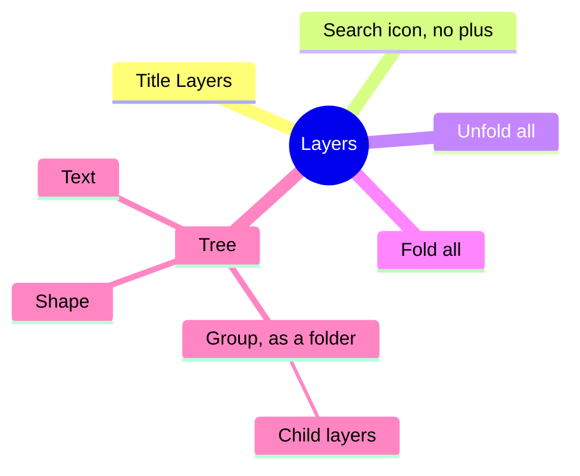

# Layers

> [Home](../../README.md) › [Symbols](../README.md) › [Editor](README.md) › Layers

Status: draft. Not validated.

The layers panel shows every layer of the open symbol, as a tree. It is in the left-hand panel of the symbol mode, under the symbols and the pipe styles (see [Libraries and symbols](../01-libraries-and-symbols.md)).

## Rules

- It works like the layers panel of Figma and like the file tree of a code editor.
- A [group](../04-drawing-mode/group.md) is shown as a folder: it holds its children, and it can be folded and unfolded.
- The tree has the title "Layers", under a separator that ends the list of the symbols.
- On the line of the title: a **search** icon, which opens a field over the title that filters the layers by name, as for every list (see [Search: a small icon on the line of the title](../../screens/README.md#search-a-small-icon-on-the-line-of-the-title)). **No +**: a layer is made by drawing, never added to the list (Product Owner, 2026-11-23).
- Two icons, as in code editors: **unfold all** the groups, and **fold all** the groups.
- A shape with a border is one line: its border is computed, it is not a layer of its own (see [Fill and border](../04-drawing-mode/fill-and-border.md)).
- Assumption of the assistant, to confirm: selecting a line selects the layer on the drawing, and the other way round, in every mode that has the Select tool.
- Exception: in the [point editing mode](../05-point-editing-mode/README.md#which-shapes-are-edited), the shapes are chosen here only, never by a click on the drawing (Product Owner, 2026-11-26).
- **What happens on a layer is seen at a glance** (Product Owner, 2026-11-26: "ça permet de capter ce qui se passe d'un coup d'œil"): on the right of its line, the icon of the [Animation mode](../08-animation-mode/README.md) when the layer has at least one animation, and the icon of the [Interaction mode](../07-interaction-mode/README.md) when it is the place of at least one interaction; both when it has both. The icons are the same as in the modes menu, grey, blue while their mode is open. A click on one opens its mode with the layer selected; clicked again in that mode, it goes back to the mode before ([the rule](../../screens/README.md#nothing-hidden-every-list-in-every-mode)). In every mode.
- **The same in every mode**: the clip shapes under their shape, then, under the tree, the [connection points](../pipes/connection-points.md), then the [interaction zones](../07-interaction-mode/README.md#panels), each list with the icon of its mode on its title. A click on an element of another mode, or on that icon, opens that mode (Product Owner, 2026-11-26; see [Nothing hidden](../../screens/README.md#nothing-hidden-every-list-in-every-mode)).

## Example

The example of the test screens in Figma, the same in every mode:

| Line | Kind | Icons on the right |
| --- | --- | --- |
| Body | Group, unfolded | Interaction (right click: `maintenance_requested`) |
| — Casing | Shape | Animation (`mode` → Colour) |
| —— Clip · Rectangle 1 | Clip shape of Casing | — |
| — Outlet | Shape | — |
| — Impeller | Shape | Animation (`speed` → Spin, `fault` → Colour) |
| Tag | Text | — |

## Open questions

- What a line shows besides the name, its kind and its icons of animation and interaction: hide, lock (proposal: both).
- How a layer is named and renamed.
- Is the order of the tree the stacking order of the drawing, and can a line be dragged to change it (proposal: yes to both, as in Figma)?
