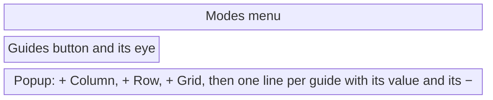

# Layout guides

> [Home](../../README.md) › [Symbols](../README.md) › [Editor](README.md) › Layout guides

Status: draft. Asked by the Product Owner on 2026-11-25 ("comme sur Figma... je te laisse gérer"); the form is the assistant's proposal. Not validated.

Lines and grids drawn over the view of a symbol, to place and align shapes. They belong to the view, never to a layer: nothing of them goes into the SVG of the symbol.

## Rules

- **Where**: a **Guides** button in a small floating bar **under the modes menu**, at the top left of the drawing area; it opens the **guides popup** (Product Owner, 2026-11-25: "un menu en dessous des modes").
- **Three kinds**, added with three buttons at the top of the popup:

| Kind | What it draws | Its settings, on its line |
| --- | --- | --- |
| Column | A vertical line. | X, in pixels from the left of the symbol. |
| Row | A horizontal line. | Y, in pixels from the top of the symbol. |
| Grid | Squares over the whole symbol. | The size of a square, in pixels. |

- **The list**: one line per guide, in the popup: its kind, its value, a **−** that removes it. Removing or adding a guide is one click (Product Owner, 2026-11-25: "simple à enlever, à ajouter"); there is no editing mode for the guides.
- **On the drawing**: a column or a row can be dragged with the mouse, its value follows; a guide dragged out of the drawing area is removed.
- **Show or hide all**: an eye on the Guides button hides every guide without removing them; Ctrl+' does the same (visible equivalent: the eye).
- **Snapping**: while a shape, a point or a handle is dragged, it snaps to the guides near it, as to the other shapes (see [Editor](README.md#geometry-of-a-symbol)).
- **Kept with the symbol**: the guides are saved in the file of the symbol, in the data of the editor, outside the drawing; they are the same in every mode.
- **Colour**: one colour for every guide, from the design system, never a colour of the drawing.

## Example

| Line of the popup | On the drawing |
| --- | --- |
| Column · 100 | A vertical line at 100 px, the middle of a symbol 200 wide. |
| Row · 36 | A horizontal line at 36 px, the top of the casing. |
| Grid · 8 | Squares of 8 px over the whole symbol. |

## Where it is used

| Screen | Control |
| --- | --- |
| [SY-03](../../screens/symbols.md#sy-03--symbol-editor-what-every-mode-shares) | Guides button and popup (SY-03.17) |

## Open questions

- A grid with columns and gutters (as Figma's layout grids), or only squares?
- Guides placed in percent of the symbol, so that they follow a resize of its frame?
