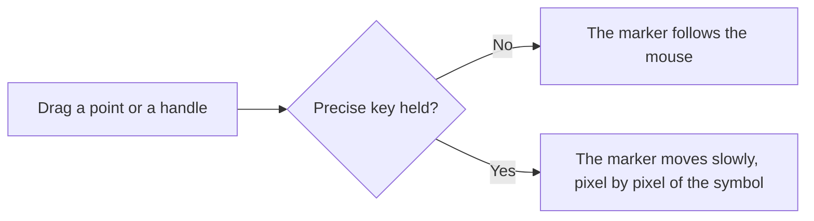

# Precise move

> [Home](../../README.md) › [Symbols](../README.md) › [Editor](README.md) › Precise move

Status: draft. Not validated.

A way to place a marker precisely with the mouse, without zooming in.

## Rules

- While the user drags a marker with the mouse (a point, a curve handle, and the like), holding a modifier key makes the move **precise**: the marker moves slowly, and can be placed pixel by pixel of the symbol.
- What it is for: when the view is zoomed out, the user can still put a point exactly where it must go, without zooming in again.
- It works whatever the zoom: in precise mode, the marker moves by whole pixels of the symbol, at a pace that does not depend on the zoom (assumption of the assistant, to confirm).
- Like every modifier, it has a visible equivalent: a "Precise move" toggle in the floating tool bar (see [Editor](README.md)).
- The key is not chosen yet: Shift, Alt or Ctrl, "to find". It follows the rule of the [editor](README.md): the same key on Windows, macOS and Linux.
- The same idea, the other way round, exists in the number fields: a modifier key makes the arrows go faster (see [Number and text fields](../../controls/number-and-text-fields.md)).

## Where it applies

| Marker | Precise move |
| --- | --- |
| Point of a path | Yes |
| Curve handle | Yes |
| Other markers: squares of the selection box, connection point, pivot of an animation | Proposed by the assistant |
| A whole shape moved with Select | Open |

## Open questions

- Which key? Proposal of the assistant: **Ctrl**, because Shift already adds to the selection and is the usual key for a square or a locked angle, and Alt already selects "entirely enclosed" during a selection rectangle. To confirm, with the key conflicts still open in the [editor](README.md).
- How slow: how many pixels of mouse movement for one pixel of the symbol (to try in a POC)?
- Does it also apply to whole shapes moved with Select, and to the markers proposed above?
