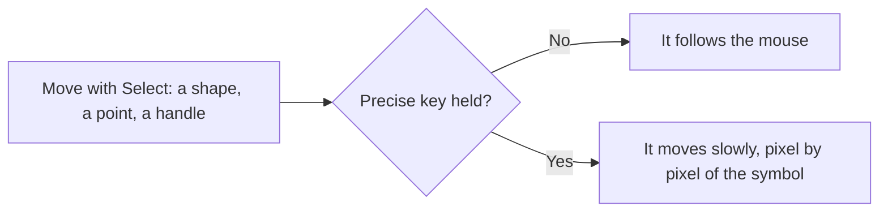

# Precise move

> [Home](../../README.md) › [Symbols](../README.md) › [Editor](README.md) › Precise move

Status: draft. Reviewed by the Product Owner on 2026-11-25: a key only, no button. Not validated.

A way to place something precisely with the mouse, without zooming in.

## Rules

- While the user moves something with the mouse in [Select](select.md) (a shape, a point, a curve handle, and the like), holding a modifier key makes the move **precise**: what is dragged moves slowly, and can be placed pixel by pixel of the symbol (Product Owner, 2026-11-25: "quand tu es en mode select et que tu bouges un truc").
- What it is for: when the view is zoomed out, the user can still put a point exactly where it must go, without zooming in again.
- It works whatever the zoom: in precise mode, what is dragged moves by whole pixels of the symbol, at a pace that does not depend on the zoom (assumption of the assistant, to confirm).
- **No button**: there is no "Precise move" toggle in the tool bar (Product Owner, 2026-11-25: "une icône, absolument pas"). It is the one exception to the rule of a visible equivalent for every key (see [Editor](README.md)).
- The key: Shift or Ctrl, not chosen yet (Product Owner, 2026-11-25: "Shift ou Commande"; Command does not exist on every platform, so Ctrl, by the rule of the [editor](README.md)).
- The same idea, the other way round, exists in the number fields: a modifier key makes the arrows go faster (see [Number and text fields](../../controls/number-and-text-fields.md)).

## Where it applies

| What is dragged | Precise move |
| --- | --- |
| A whole shape moved with Select | Yes (2026-11-25) |
| Point of a path | Yes |
| Curve handle | Yes |
| Other markers: squares of the selection box, connection point, pivot of an animation | Proposed by the assistant |

## Open questions

- Which key, Shift or Ctrl? Shift already adds to the selection and is the usual key for a square or a locked angle; Ctrl also adds to the selection. To settle with the key conflicts still open in the [editor](README.md).
- How slow: how many pixels of mouse movement for one pixel of the symbol (to try in a POC)?
