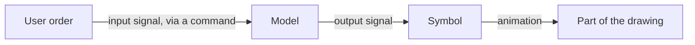
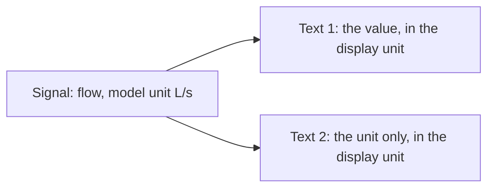

# Animation

> [Home](../README.md) › [Symbols](README.md) › Animation · Previous: [Type, preset and faceplate](03-type-and-faceplate.md) · Next: [Interactions](05-interactions.md)

Status: draft, from the Product Owner's description of 2026-11-11. Not validated.

Animating a symbol means that the value of a signal changes a part of the drawing. The change of scale or of range (0 to 1 turned into 0 to 90 degrees) is done here, not in Metadata: Metadata only states the contract with the model (see [Signals](../metadata/04-signals.md)).

## Rules

- Animations are made in the Animation mode of the editor (see [Drawing](02-drawing.md)).
- The user selects a signal, then says what it animates: a shape, a layer, a text.
- Only the output signals of the type are offered for an animation. An output is what the model sends, and the model computes what the symbol shows. An input is what the model receives and is never animated.
- A value ordered and a value obtained are two signals for the model. Example: `opening_order` (input, what the user asks) and `opening` (output, what the model computes). The symbol animates `opening`. The faceplate can show both (see [Faceplates](../metadata/08-faceplates.md)).
- Only a dynamic symbol has animations. A static symbol has none, and no signal to animate, since it has no type.

## What an animation can do

| Signal type | Example | What it does |
| --- | --- | --- |
| Real or integer | `opening` from 0 to 1 | A range of values becomes a range of a property of the drawing: 0 to 1 becomes a rotation of 0 to 90 degrees. |
| Boolean | `running` | A value gives a state: when `true`, an element blinks. |
| Enum | `mode` | To settle: a look per value. |

The properties of a part of the drawing that an animation can drive (rotation, position, size, colour, opacity, visibility, blinking...) are to list.

## Texts: value and unit

A text of the symbol can be linked to a signal that has a quantity (a volume, a flow...).

- The text shows the signal's value, converted to the display unit and rounded to the decimal places set in the preset (see [Units](../metadata/05-units.md)).
- The user chooses whether the text shows the unit or not.
- Another text can hold only the unit of the signal, in the display unit. This lets the user put the value in one place and the unit in another, and the unit follows the display unit.

A text that shows a value can be turned into an input when the user clicks it, if a typed-value command is linked to it (see [Commands](../metadata/07-commands.md), the display that becomes an input). This is to confirm with the Product Owner.

## Where it is used

| Thing | Created and changed in | Used in | In a symbol | In a synoptic |
| --- | --- | --- | --- | --- |
| Animation (signal, target, mapping) | Symbol editor | Symbol | Create, edit | No |
| Text linked to a value or to a unit | Symbol editor | Symbol | Create, edit | No |

## Open questions

- The list of animatable properties, the shapes of mapping (linear or not), animation of an enum. See [Open questions](07-open-questions.md).
