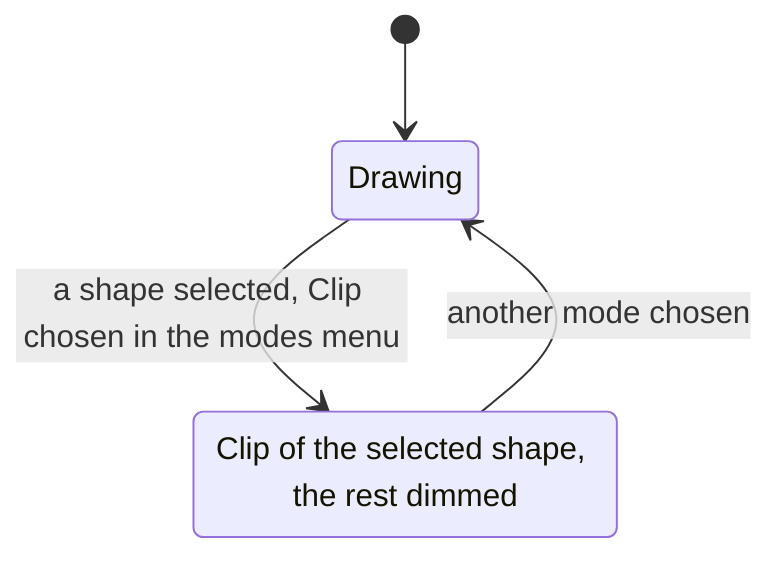

# Clip mode

> [Home](../../README.md) › [Symbols](../README.md) › [Drawing mode](README.md) › Clip mode

Status: draft. Asked by the Product Owner on 2026-11-25: the clip is a mode of the modes menu, no longer an effect of the right-hand panel. Not validated.

The mode of the [editor](../03-editor/README.md) in which the user draws the **clip shapes** of a shape: the shape is shown only inside them. Example: a liquid level that rises inside a tank, cut by the outline of the tank.

## Rules

- **A mode of the modes menu**, at the top left of the drawing area (Product Owner, 2026-11-25: "ça reste un mode, puisque ça va afficher des choses un peu différentes"). Its place in the menu: right after Drawing (assistant's proposal).
- **The name** "Clip" is kept for want of a better one; the Product Owner doubts it (open question).
- **Tools**: [Select](../03-editor/select.md), [Hand](../03-editor/hand.md), [Rectangle](rectangle.md), [Ellipse](ellipse.md), [Polygon](polygon.md), [Pen](pen.md). No Group and no Text: a clip is made of shapes only, the free forms of the pen included (Product Owner, 2026-11-25).
- **Which shape is clipped**: the shape selected when the mode is chosen. A click on another shape in the layers changes it. With nothing selected, the mode is greyed in the menu, its tooltip says to select a shape first (assistant's proposal).
- **On the drawing**: the clipped shape stays shown, the part of it outside the clip shapes faded; the rest of the symbol is dimmed. The clip shapes are drawn as outlines, with no fill, no border and no effect.
- **Right-hand panel**: the title "Clip of Casing", the list "Clip shapes" (one line per clip shape, a − on each), then the geometry of the selected clip shape ([Geometry](geometry.md); the corner radius of a rectangle, the sides of a polygon). Assistant's proposal.
- **Layers**: the clip shapes are under their shape, in a line "Clip" folded by default, never at the level of the drawing.
- Several clip shapes add up: what is inside any of them is shown. The clip shapes follow the shape: moved, resized or turned with it.
- A shape with no clip shape is shown whole. Removing the last clip shape removes the clip.
- Leaving the mode: another mode chosen in the menu. There is no bar "Clip of …" with a Done button any more: it was the editing mode of the clip effect (assistant's proposal).
- **In the SVG**: a `clipPath` that belongs to the shape, with no group to make. CSS `clip-path` with a simple shape is another way to write the same, for the POC (P7).

## Where it is used

| Screen | Element |
| --- | --- |
| [SY-03](../../screens/symbols.md#sy-03--symbol-editor-what-every-mode-shares) | SY-03.1, the modes menu |
| [SY-13](../../screens/symbols.md#sy-13--clip-mode) | The Clip mode |
| [Figma](../../design-system/04-figma-file.md#mode-screens) | The id of its screen |

## Open questions

- The name: Clip, or another word?
- Can a group or a text be clipped, or only a shape?
- How the points of a clip shape are edited: in this mode, or in the point editing mode?
