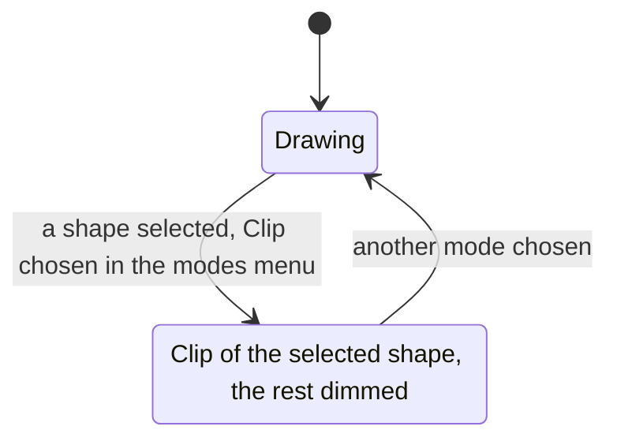

# Clip mode

> [Home](../../README.md) › [Symbols](../README.md) › [Drawing mode](README.md) › Clip mode

Status: draft. Asked by the Product Owner on 2026-11-25: the clip is a mode of the modes menu, no longer an effect of the right-hand panel. Not validated.

The mode of the [editor](../03-editor/README.md) in which the user draws the **clip shapes** of a shape: the shape is shown only inside them. Example: a liquid level that rises inside a tank, cut by the outline of the tank.

## Rules

- **A mode of the modes menu**, at the top left of the drawing area (Product Owner, 2026-11-25: "ça reste un mode, puisque ça va afficher des choses un peu différentes"). Its place in the menu: **in its own group**, between the drawing group (Drawing, Point editing, Alignment) and the group of the outside (Connection, Animation, Interaction), split from both by a separator (Product Owner, 2026-11-25: "c'est pas du dessin [...] on peut le mettre tout seul après ces trois-là"; see [Modes](../03-editor/README.md#modes)). The [Intersection mode](intersection-mode.md) follows it in the same group (Product Owner, 2026-11-25: "après le mode clip"; the group, the assistant's choice).
- **The name** "Clip" is kept for want of a better one; the Product Owner doubts it (open question).
- **Tools**: [Select](../03-editor/select.md), [Hand](../03-editor/hand.md), [Rectangle](rectangle.md), [Ellipse](ellipse.md), [Polygon](polygon.md), [Pen](pen.md). No Group and no Text: a clip is made of shapes only, the free forms of the pen included (Product Owner, 2026-11-25).
- **Which shape is clipped**: the shape selected when the mode is chosen. A click on another shape in the layers changes it. With nothing selected, the mode is greyed in the menu, its tooltip says to select a shape first (assistant's proposal).
- **On the drawing**: the clipped shape stays shown, the part of it outside the clip shapes faded; the rest of the symbol is dimmed. The clip shapes are drawn as outlines, with no fill, no border and no effect.
- **The clip shapes are chosen in the [layers](../03-editor/layers.md)**, on the left, under their shape; the right-hand panel does not list them again (Product Owner, 2026-11-26: "faut que la sélection se fasse à gauche"; this removes the list "Clip shapes" of 2026-11-25). A clip shape is removed with the Delete key.
- **Right-hand panel**: the title "Clip of Casing", then the options of the selected clip shape.
- **The options of a clip shape are those of the same shape in the [drawing mode](README.md), without what makes its look**: no opacity, no fill, no border (Product Owner, 2026-11-26: "exactement les mêmes choses que quand on fait une forme, sauf que c'est sans les couleurs, sans l'opacité"). Same fields, same order as the drawing mode ([Geometry](geometry.md#order-of-the-right-hand-panel)); this replaces the order of 2026-11-25, X and Y first.

| Clip shape | Options, in the order of the panel |
| --- | --- |
| [Rectangle](rectangle.md) | W, H; X, Y, rotation; corner radius. |
| [Ellipse](ellipse.md) | W, H; X, Y, rotation. No corner radius: it makes no sense for an ellipse. |
| [Polygon](polygon.md) | Number of sides, how it fills its box (Filled, Equilateral), anchor and whether a corner or a side touches it; then W, H; X, Y, rotation; corner radius. |
| Free form, drawn with the [Pen](pen.md) | W, H; X, Y, rotation; corner radius, for every corner of the path at once. |

- **The Pen in this mode makes closed shapes only**: a path becomes a clip shape once it is closed, nothing else (Product Owner, 2026-11-26: "que ça fonctionne que si on fait une forme qui est refermée, et point barre"). A path left open when the drawing ends (Escape, another tool) is not kept (assistant's proposal).

- **Layers**: the clip shapes are under their shape, in a line "Clip", never at the level of the drawing, **in every mode** (Product Owner, 2026-11-26: "tout ce qui est truc de clip [...] il faut un peu toujours le montrer dans le truc à gauche"). A click on a clip shape from another mode opens the Clip mode on it (see [the layout rule](../../screens/README.md#nothing-hidden-every-list-in-every-mode)). The line "Clip" is folded by default, unfolded in the Clip mode (assistant's proposal).
- Several clip shapes add up: what is inside any of them is shown. The clip shapes follow the shape: moved, resized or turned with it.
- A shape with no clip shape is shown whole. Removing the last clip shape removes the clip.
- Leaving the mode: another mode chosen in the menu. There is no bar "Clip of …" with a Done button any more: it was the editing mode of the clip effect (assistant's proposal).
- **In the SVG**: a `clipPath` that belongs to the shape, with no group to make. CSS `clip-path` with a simple shape is another way to write the same, for the POC (P7).

## Where it is used

| Screen | Element |
| --- | --- |
| [SY-03](../../screens/symbols.md#sy-03--symbol-editor-what-every-mode-shares) | SY-03.1, the modes menu |
| [SY-13](../../screens/symbols.md#sy-13--clip-mode) | The Clip mode |
| [Figma](../../design-system/04-figma-file.md#mode-screens) | The id of its screen |

## Open questions

- The name: Clip, or another word?
- Can a group or a text be clipped, or only a shape?
- How the points of a clip shape are edited: in this mode, or in the point editing mode?
- A path left open with the Pen: not kept (proposal), or closed by itself?
