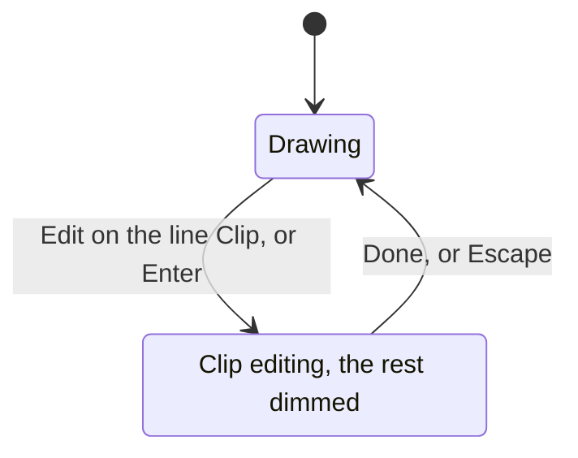

# Effects and masks of a shape

> [Home](../../README.md) › [Symbols](../README.md) › [Drawing mode](README.md) › Effects and masks

Status: draft, the research report of 2026-11-11, and the clip asked by the Product Owner on 2026-11-25. Not validated.

Effects, clips and masks are set from the right-hand panel, in the section "Effects", after the [fill and border](fill-and-border.md). The editor offers them in a menu, and the user writes nothing.

## Rules

- **Only what SVG does natively.** Every effect comes from the SVG itself: its filters, its `clipPath` and its `mask`. Nothing is simulated with copies or tricks. An effect that SVG does not do natively is not offered. This is why there is no "blur of what is behind the shape".
- **Performance comes first**: an effect is offered only if it keeps the performance objective (see the project criteria on gestures and 120 Hz). The goal: never offer something that lags; a heavy effect is useless (Product Owner, 2026-11-25).
- If an effect or a setting makes the performance fall too much, it is not offered. The answer is "not possible".

### The section "Effects"

- A **+** on the right of the title "Effects" opens the menu of the effects offered (see the [catalogue](#catalogue-of-the-native-svg-effects)); the one chosen becomes a **line** of the section.
- Each line: an **eye** that turns the effect off without removing it, the **name** of the effect, a **settings** button that opens its settings in a popup beside the panel (as the paint popup), and a **−** that removes it.
- The lines are applied from the top down.
- There is no "Mask" select any more in the panel: clip and mask are effects with their own shapes (Product Owner, 2026-11-25).

### Clip

- **What it does**: only the part of the shape inside the **clip shape** is shown; whatever goes beyond it is hidden. Example: a liquid level that rises inside a tank, cut by the outline of the tank; it allows many animations (Product Owner, 2026-11-25).
- **In SVG**: a `clipPath`. Elsewhere it needs a group, a shape put in it and another shape set as the clip; here, the clip belongs to the shape itself, with no group to make (Product Owner, 2026-11-25).
- **Adding it**: + of the section, then "Clip": a line "Clip" appears, with an **Edit** button (a pencil) instead of the settings button.
- **Clip editing**: the Edit button, or the line selected and Enter, enters the clip editing of that shape:
  - the shape stays selected and shown; the rest of the drawing is **dimmed**;
  - a bar at the top of the drawing area says "Clip of Casing" and has a **Done** button (Escape does the same);
  - the user draws the clip shape **in it**, with the Rectangle, Ellipse, Polygon and Pen tools; what is outside it is shown faded, so the user sees what will be hidden;
  - the clip shapes are edited like any shape: points, size, position; they have no fill, no border and no effect of their own.
- **In the layers**: the clip shapes are under their shape, in a line "Clip" folded by default, never at the level of the drawing.
- **Several clip shapes** add up: what is inside any of them is shown.
- **No clip shape yet**: the shape is shown whole, and the line says "Clip · empty".
- The clip shape follows the shape: moved, resized or turned with it.

### Mask

- The same as the clip, with a soft edge: the clip shapes become **mask shapes** whose opacity gives the transparency of the shape (white shown, transparent hidden).
- **In SVG**: a `mask`. It costs more than a clip (an image computed per pixel); it is offered only within the limit the POC sets (P7). A hard edge is always a clip.
- Same line, same Edit button and same editing as the clip; the mask shapes have a fill (its opacity is what counts) and no border.

### Catalogue of the native SVG effects

Every effect SVG does natively, with what the specs do with it. An example of each is drawn in Figma, page Spec, row "Effects · catalogue" of the section "Symbol mode · test screens". "Proposed" follows the opinion of the research report (below), never a measure; the POC settles it.

| Effect | SVG feature | What it does | In Synoptic Studio |
| --- | --- | --- | --- |
| Clip | `clipPath` | Shows the shape only inside other shapes, hard edge. | Effect "Clip", decided (2026-11-25); its limits measured by P7. |
| Mask | `mask` | The same with a soft edge, by the opacity of the mask. | Effect "Mask", proposed: offered with a limit (P7). |
| Linear gradient | `linearGradient` | Colours along a line. | Kind of fill, decided. |
| Radial gradient | `radialGradient` | Colours around a centre. | Kind of fill, decided. |
| Pattern | `pattern` | A small drawing repeated to fill the shape. | Kind of fill, open. |
| Dashes | `stroke-dasharray` | Dashes of one colour on a stroke. | Replaced by the computed dash sequence of the border (several colours). |
| Opacity | `opacity` | The whole element more or less transparent. | Proposed: offered as an effect "Opacity" (cheap). |
| Drop shadow | `feDropShadow` | A blurred, offset copy behind the shape. | Proposed: offered with a limit (P2). A glow is a drop shadow without offset. |
| Inner shadow | `feOffset`, `feGaussianBlur`, `feComposite` | A shadow inside the edge. | Proposed: offered only if P5 holds. |
| Blur | `feGaussianBlur` | Blurs the shape itself. | Proposed: offered with a strict limit (P2). |
| Colour change | `feColorMatrix`, `feComponentTransfer` | Greyscale, saturation, hue turn, brightness, contrast. | Proposed: offered with a limit, or as recomputed colours (P6). |
| Blend mode | `mix-blend-mode` (CSS on SVG) | Mixes the colours with what is under the shape (multiply, screen...). | Not read by the research: refused until measured. |
| Thicken, thin | `feMorphology` | Grows or shrinks the shape by pixels. | Refused (cost); the inside and outside border does it on the path. |
| Noise, texture | `feTurbulence` | A noise image, for paper or metal. | Refused (cost). |
| Distortion | `feDisplacementMap` | Moves the pixels by another image: waves, heat. | Refused (cost). |
| Lighting, relief | `feDiffuseLighting`, `feSpecularLighting` | A light on a relief. | Refused (cost). |
| Sharpen, emboss | `feConvolveMatrix` | A matrix applied to the pixels. | Refused (cost). |
| Building blocks | `feBlend`, `feComposite`, `feFlood`, `feMerge`, `feOffset`, `feTile`, `feImage` | The pieces the effects above are made of. | Not offered alone. |
| Arrow heads | `marker` | A shape at the start, the middle or the end of a line. | Open (end shape of a line, see [Fill and border](fill-and-border.md#open-paths)). |
| Text border | `stroke` with `paint-order` | A true stroke under the letters. | Decided for the text (see [Text](text.md)). |
| Text along a path | `textPath` | Letters following a curve. | Refused first (research). |

- **Offset of a path** (Inkscape's "Dynamic offset", "Linked offset", Path menu): not an SVG effect, a computation that makes another path. Not an effect here; the inside and outside border of a shape covers its common use.

## What the research found

Source: the research report (`research/t1-…/rapport.md`, in the project, not committed). It measured nothing: everything below is read from sources, and the performance POC will settle it. The "Opinion" column is the report's provisional opinion, not a decision.

### Why the engine matters

| Window | Engine | SVG filters on the graphics card |
| --- | --- | --- |
| Chrome, Edge, Electron (Windows, macOS, Linux), Tauri on Windows | Chromium | Yes |
| Firefox 132 or later | Gecko | Yes, for 9 primitives (blend, colour matrix, component transfer, composite, drop shadow, flood, Gaussian blur, merge, offset) |
| Safari, Tauri on macOS (WKWebView) and Linux (WebKitGTK) | WebKit | No (open WebKit bug since 2023) |

- WebKit renders at 60 frames per second by default. The embedded view (WKWebView) has no public way to ask for 120. With a WebKit window, the 120 Hz objective cannot be reached by default, with or without effects.
- The choice of the desktop window (embedded Chromium or the system view) weighs more than any effect setting. It is not made yet.

### What makes the cost vary

- The cost follows the number of pixels of the filter area, which grows with the size of the shape, the zoom and the screen density. A big blur radius costs mainly because it forces a bigger filter area.
- Moving a filtered shape can reuse the image already computed. Resizing it, editing a point or changing its colour recomputes the filter at every frame.
- The default colour space of SVG filters (linear RGB) costs more than sRGB.
- A cut by one simple path takes the fast path; a text, a nested cut or too many shapes make the engine switch to a mask.
- No source gives the cost of a gradient, nor of the number of filtered shapes.

### Effect by effect

| Effect | SVG feature | Opinion of the report | Limit to measure |
| --- | --- | --- | --- |
| Cut by a shape | `clipPath` | Offer. Confidence: medium. | The shape that cuts is one simple shape, no text, no nested cut. |
| Gradients | Linear or radial gradient | Offer, subject to a short POC. Confidence: low. | Number of colour stops. |
| Dashes | See [fill and border](fill-and-border.md) | Offer with a limit. Confidence: low. | Maximum number of dashes per shape. |
| Colour changes | Filter | Offer with a limit, or without a filter (recomputed colours). Confidence: medium. | Filtered area and number of shapes. |
| Drop shadow | Filter | Offer with a limit. Confidence: medium. | Maximum radius and maximum filter area, in screen pixels. |
| Blur of the shape | Filter | Offer with a limit stricter than the drop shadow. Confidence: medium. | Radius, filter area. |
| Mask by a shape | `mask` | Offer with a limit. Replace by a cut when the edge is hard. Confidence: low. | Filtered area. |
| Inner shadow | Chain of filter primitives | Offer with a limit if the POC holds, else refuse. Confidence: low. | Radius, area. |
| Noise, lighting, convolution, displacement, morphology | Other filter primitives | Refuse (not in the project's list anyway). | — |

### Cheaper alternatives for the same look

- Filters declared in sRGB instead of linear RGB: a coloured blur changes a little.
- A cut instead of a mask when the edge is hard: no progressive transparency.
- Recomputed fill colours instead of a colour filter: the effect is then no longer a filter, and this must be written in the specs.
- CSS filter functions on the SVG element: support to check engine by engine, and no inner shadow.
- A tight filter area around the shape: too tight, it cuts the effect.
- Moving by transform during the gesture: only for moving, not for resizing.
- A radial gradient that imitates a shadow is against the rule above ("nothing simulated"): not retained.

### POC plan proposed (to be done in `synoptic-studio-poc`)

| POC | Question |
| --- | --- |
| P0 | Does each engine deliver 120 frames per second with no effect? (also window: desktop or browser) |
| P1 | Base cost of the gestures: 1, 50, 200 shapes without effect; move, resize, edit a point. |
| P2 | How far do blur and drop shadow hold? Radius 1 to 32, shape 50 to 800 px, zoom 100 % and 400 %, single and double density, linear RGB or sRGB. |
| P3 | How many filtered shapes? 1, 10, 50, 200, all animated. |
| P4 | Cost of an animation near an effect (below, above, the filtered shape itself animated). |
| P5 | Does the inner shadow hold? |
| P6 | Colour filter or recomputed colours? |
| P7 | Cut or mask? Simple cut, multi-shape cut, hard mask, progressive mask. |
| P8 | How many dashes, how many gradient stops? 10 to 10 000 dashes, native stroke or computed dashes, 2, 8, 32 stops. |

- Engines to cover: Chromium, Firefox 132 or later, WebKit (Safari, then the desktop window if it is WebKit).
- What is measured: the work time of each frame during the gesture, in milliseconds, read in the browser profiler (the time between two frames is not enough: a 60 Hz engine lengthens it without being slow). P0 and P2 first.
- Decision threshold proposed: 95 % of the frames at 8.3 ms or less and none above 16.7 ms at the most demanding setting offered, in each engine aimed at: offer. The rule holds up to a setting, then breaks: offer with that limit. It breaks at the smallest useful setting: refuse. The maximum stays the one set by criterion C14.

### POC added by the second research

The second report (`research/t4-…/rapport.md`) proposes four more POC, in the same repository and with the same measure:

| POC | Question | Page |
| --- | --- | --- |
| P9 | Pipes: search of the crossings while a point moves, with and without spatial index; two strokes or computed outlines. | [Pipes](../pipes/README.md) |
| P10 | Animated flow dashes on 10 to 500 pipes: CSS, SMIL, JavaScript steps. | [Pipe styles](../pipes/pipe-styles.md) |
| P11 | 50 to 1 000 symbols animated by signals at 10 updates per second. | [Animation mode](../08-animation-mode/README.md) |
| P12 | Input in a `foreignObject` against an HTML field laid over the text, with zoom and rotation. | [Animation mode](../08-animation-mode/README.md) |

### Desktop window: Chromium without Electron? (second research)

| Option | Engine per system | Size | Updates | Shell language | Licence, state |
| --- | --- | --- | --- | --- | --- |
| Electron | Embedded Chromium everywhere | Most apps above 100 MB | One Chromium major version out of two | JavaScript (Node.js) | MIT |
| NW.js | Embedded browser and Node.js everywhere | Not read | Not read | JavaScript | NW.js community |
| Tauri 2 (system view) | WebView2 on Windows, WKWebView on macOS, webkit2gtk on Linux | Light | With the system | Rust | Stable |
| Tauri 3 with CEF | Embedded Chromium everywhere | Hundreds of MB more | Chromium version chosen by the app | Rust | Alpha (page of 2026-09-13); no sandbox on Windows yet |
| CEF directly | Embedded Chromium | Heavy | Follows Chromium | C or C++ | BSD |
| Wails | WebView2 on Windows; no embedded browser | Light | With the system | Go | Not read |
| Neutralinojs | The system web view | Light | With the system | Provided binary, JavaScript interface | Not read |
| Installed web app | The user's browser: Chrome or Edge; Safari "Add to Dock"; not Firefox | None | With the browser | No shell | — |

- Chromium without Electron exists (Tauri 3 with CEF, CEF, NW.js), but the project criterion "all the code in JavaScript" sets aside Tauri, Wails and CEF, unless an exception is validated.
- The options based on the system view inherit WebKit on macOS and Linux (no GPU filters, 60 frames per second).
- The installed web app works from a local address: it fits the architecture of the project (a local server for the files, the same front in a browser).
- Opinion of the report (not a decision): 1. **Electron**, the only fully JavaScript option that guarantees Chromium on the three systems; the price is the size and following its versions. 2. **Local server and installed web app**, the lightest, which exists anyway; to ship first for trials, if Chrome or Edge is present. 3. **Tauri 3 with CEF**: to watch, not now. Confidence: medium.

## To decide by the Product Owner

The report's questions that the specs cannot answer alone:

1. Which desktop window: embedded Chromium or the system view? It fixes the engine to measure first. **Postponed, not decided.** The aim is the lightest and simplest to maintain for an open source application, so possibly Tauri, possibly Electron. Chromium is probably the best for effects and 120 Hz; whether Chromium can be used without Electron: the second research answers above. Linked question: does the criterion "all the code in JavaScript" allow a shell in Rust?
2. Which browsers must the front hold at 8.3 ms when plugged into a browser: Chromium only, or Firefox and Safari too?
3. Is an effect suspended during the gesture and restored at release an acceptable concession (if the drop shadow does not hold in WebKit)?
4. Can a colour filter be replaced by recomputed colours, or must it stay a filter in the exported SVG?
5. Which effects go in the specs now: all of them and measure afterwards, two lots (a safe lot, a lot "subject to the POC"), or only the safe lot? The report advises two lots.
