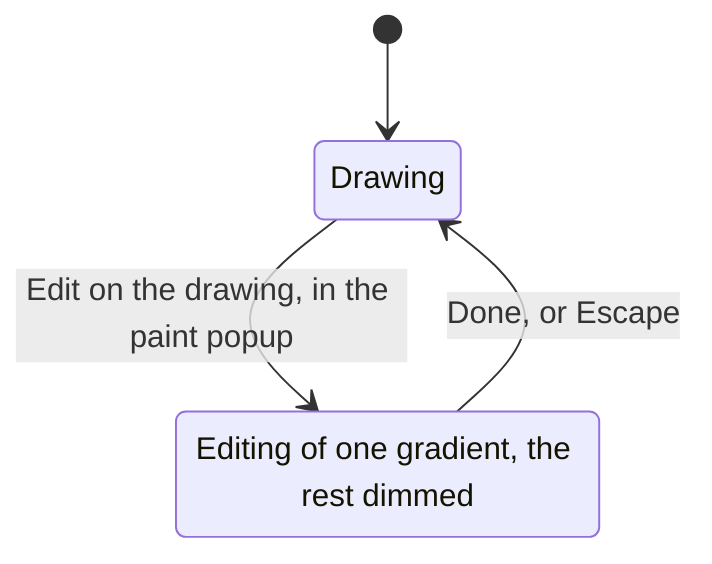

# Effects of a shape

> [Home](../../README.md) › [Symbols](../README.md) › [Drawing mode](README.md) › Effects

Status: draft. The research report of 2026-11-11, the clip asked by the Product Owner on 2026-11-25, the complete catalogue asked the same day, the Product Owner's first selection of the same day, and the section "Effects" removed the same day: the clip is a mode. Not validated.

What a shape can carry besides its fills and its border. In this version, the right-hand panel has **no section "Effects"**: the clip is a [mode of its own](clip-mode.md), the opacity a line of the panel, the other kept entries are set in the fill, the border or the text.

## Rules

- **What the symbol file can hold.** An effect is written in the SVG of the symbol: an SVG feature (a filter, a `clipPath`, a paint) or a CSS property applied to the SVG and written in the file. Nothing is simulated with copies of the shape. What needs something outside the file (a shader, an HTML element) is not possible (Product Owner, 2026-11-25: "les effets possibles dans un SVG, et plus avec du CSS").
- **This version keeps few effects.** The Product Owner's first selection (2026-11-25) keeps seven entries of the [catalogue](#catalogue-of-the-effects): the clip, the opacity, the linear and radial gradients, the border that keeps its width, the text border and the dashes. Every other entry is set aside, not in this version (Product Owner, 2026-11-25: "mon but, c'est de pas tout mettre"). The pages and the screens of the entries set aside stay in the specification and in Figma as a record, marked "Set aside" (Product Owner, 2026-11-25).
- **The POC measures what is kept.** The POC of the effects (P13) tries the kept entries not decided yet: their cost in each engine and the simplest way to set them.
- **Performance comes first**: an effect is kept after the POC only if it keeps the performance objective (see the project criteria on gestures and 120 Hz). A heavy effect is useless (Product Owner, 2026-11-25).

### Where each kept entry is set

| Entry | Where |
| --- | --- |
| Clip | The [Clip mode](clip-mode.md), in the modes menu (Product Owner, 2026-11-25: "le clip, c'est pas vraiment un effet en soi"). |
| Opacity | A line "Opacity" of the right-hand panel, under the geometry, its percent on the line (Product Owner, 2026-11-25). |
| Linear and radial gradients | Kinds of fill ([Paints](paints.md)), with their editing on the drawing. |
| Border that keeps its width | A switch of the border ([Lines and text](effects-lines-and-text.md#border-that-keeps-its-width)). |
| Text border | The panel of a [text](text.md). |
| Dashes | Lines of the [border](fill-and-border.md#border-options). |

### The section "Effects"

Removed from this version (Product Owner, 2026-11-25): with the clip a mode and the opacity a line of the panel, the section has nothing left. What follows is kept as a record, for the entries set aside, which would be its lines.

- A **+** on the right of the title "Effects" opens the **menu of the effects**; the one chosen becomes a **line** of the section.
- Each line: an **eye** that turns the effect off without removing it, the **name** of the effect, a button, and a **−** that removes it. The button is one of three: settings (a popup), Edit (a pencil, for an effect that owns shapes) or a value on the line.
- The lines are applied from the top down.

### Editing modes

What is better set by hand on the drawing has an **editing mode** (Product Owner, 2026-11-25: "comme pour le clip, un mode d'édition par rapport à cet effet"): in this version, the linear and radial gradients ([Paints](paints.md)), entered from their paint popup. The clip has become a mode of the modes menu ([Clip mode](clip-mode.md)).

- the shape stays selected and shown; the rest of the drawing is **dimmed**;
- a bar at the top of the drawing area names what is edited ("Gradient of Casing") and has a **Done** button; Escape does the same;
- the handles are on the drawing (a gradient line); the right-hand panel shows the same settings as the popup, which follow the handles;
- the other tools are off;
- a popup whose setting can also be made on the drawing (the paint popup of a gradient) has an **Edit on the drawing** button at its bottom, which enters the editing mode.

## Catalogue of the effects

Every effect a symbol could carry, by family: what SVG does, what CSS adds on an SVG, and the other leads. An example of each is drawn in Figma, page Spec, section "Symbol mode · Effects"; the kept entries and their screens are gathered in the section "Symbol mode · Effects kept (2026-11-25)". Status: **Kept** (in this version, decided or measured in the POC); **Set aside** (not in this version, Product Owner, 2026-11-25); **Not an effect** (said elsewhere); **Not possible** (no engine, or outside the SVG file).

| Family | Effect | SVG or CSS feature | What it does | Status | Page |
| --- | --- | --- | --- | --- | --- |
| Clip and mask | Clip | `clipPath`; CSS `clip-path` (inset, circle, ellipse, polygon, path) | Shows the shape only inside its clip shapes, hard edge. | Kept, decided (2026-11-25): a mode, not an effect | [Clip mode](clip-mode.md) |
| Clip and mask | Mask | `mask`, `mask-type` alpha or luminance | The same with a soft edge, by the opacity or the brightness of the mask shapes. | Set aside | [Clip, mask, fade](effects-clip-and-mask.md#mask) |
| Clip and mask | Fade | CSS `mask-image` with a gradient, or a `mask` filled with a gradient | The shape fades out along a line or from a centre, with no shape to draw. | Set aside | [Clip, mask, fade](effects-clip-and-mask.md#fade) |
| Opacity and blend | Opacity | `opacity` | The whole object more or less transparent, not only its fill or its border. | Kept, a line of the panel; measured in the POC | [Opacity and blend](effects-opacity-and-blend.md#opacity) |
| Opacity and blend | Blend mode | CSS `mix-blend-mode` (16 modes and `plus-lighter`), `isolation` on a group | Mixes the colours of the shape with what is under it. | Set aside | [Opacity and blend](effects-opacity-and-blend.md#blend-mode) |
| Opacity and blend | Background blur | CSS `backdrop-filter` | Blurs what is behind the shape (frosted glass). | Set aside | [Opacity and blend](effects-opacity-and-blend.md#background-blur) |
| Shadows and light | Drop shadow | `feDropShadow`; CSS `drop-shadow()` | A blurred, offset copy behind the shape. | Set aside | [Shadows and light](effects-shadows-and-light.md#drop-shadow) |
| Shadows and light | Outer glow | `feGaussianBlur`, `feFlood`, `feComposite`, `feMerge` | A coloured halo around the shape, without offset. | Set aside | [Shadows and light](effects-shadows-and-light.md#outer-glow) |
| Shadows and light | Inner shadow | `feOffset`, `feGaussianBlur`, `feComposite` | A shadow inside the edge. | Set aside | [Shadows and light](effects-shadows-and-light.md#inner-shadow) |
| Shadows and light | Inner glow | `feGaussianBlur`, `feFlood`, `feComposite` | A coloured halo inside the edge. | Set aside | [Shadows and light](effects-shadows-and-light.md#inner-glow) |
| Shadows and light | Lighting | `feDiffuseLighting`, `feSpecularLighting`, with `feDistantLight`, `fePointLight` or `feSpotLight` | A light on a relief: bevel, relief, shine. | Set aside | [Shadows and light](effects-shadows-and-light.md#lighting) |
| Blur and sharpness | Blur | `feGaussianBlur` (one radius per axis); CSS `blur()` | Blurs the shape itself, the same in both directions or in one. | Set aside | [Blur and sharpness](effects-blur-and-sharpness.md#blur) |
| Blur and sharpness | Sharpen, edges, emboss | `feConvolveMatrix` | A small matrix applied to the pixels. | Set aside | [Blur and sharpness](effects-blur-and-sharpness.md#sharpen-edges-emboss) |
| Colour | Colour adjustments | `feColorMatrix`, `feComponentTransfer`; CSS `brightness()`, `contrast()`, `saturate()`, `grayscale()`, `sepia()`, `hue-rotate()`, `invert()` | Brightness, contrast, saturation, hue, greyscale, sepia, invert. | Set aside | [Colour](effects-colour.md#colour-adjustments) |
| Colour | Colour overlay | `feFlood`, `feComposite`, `feBlend` | Paints one colour over the shape, keeping its outline. | Set aside | [Colour](effects-colour.md#colour-overlay) |
| Colour | Colour map | `feComponentTransfer` (table, discrete) | Duotone, posterize, threshold. | Set aside | [Colour](effects-colour.md#colour-map) |
| Texture and distortion | Thicken, thin | `feMorphology` (dilate, erode) | Grows or shrinks the shape by pixels, text included. | Set aside | [Texture and distortion](effects-texture-and-distortion.md#thicken-thin) |
| Texture and distortion | Noise, texture | `feTurbulence` (fractal noise, turbulence) | A noise over the shape: paper, metal, concrete. | Set aside | [Texture and distortion](effects-texture-and-distortion.md#noise-texture) |
| Texture and distortion | Distortion | `feDisplacementMap`, from a noise or an image | Moves the pixels: waves, heat, glass. | Set aside | [Texture and distortion](effects-texture-and-distortion.md#distortion) |
| Expert | Filter chain | Every filter primitive, chained by hand; `color-interpolation-filters` | A filter built step by step from the building blocks (`feBlend`, `feComposite` with its arithmetic, `feFlood`, `feMerge`, `feOffset`, `feTile`, `feImage`, and the primitives above). | Set aside: "une bonne idée, mais là, c'est non" | [Filter chain](effects-filter-chain.md) |
| Paints | Linear gradient | `linearGradient`, `spreadMethod` pad, reflect, repeat | Colours along a line. | Kept: kind of fill decided; its editing on the drawing measured in the POC | [Paints](paints.md#linear-gradient) |
| Paints | Radial gradient | `radialGradient`, focal point (`fx`, `fy`, `fr`) | Colours around a centre. | Kept: kind of fill decided; its editing on the drawing measured in the POC | [Paints](paints.md#radial-gradient) |
| Paints | Conic gradient | CSS `conic-gradient()`; no SVG paint | Colours turning around a centre. | Set aside: CSS, not SVG | [Paints](paints.md#conic-gradient) |
| Paints | Pattern | `pattern` | A small drawing repeated to fill the shape: dots, hatching, grid. | Set aside | [Paints](paints.md#pattern) |
| Paints | Image | `image` in a `pattern`, or `feImage` | A picture fills the shape. | Set aside | [Paints](paints.md#image) |
| Lines and text | Arrow heads | `marker` (`marker-start`, `marker-mid`, `marker-end`) | A shape at the start, the corners or the end of a line. | Set aside | [Lines and text](effects-lines-and-text.md#arrow-heads) |
| Lines and text | Border that keeps its width | A computation, as the border; `vector-effect: non-scaling-stroke` works on a native stroke only | The border keeps its width when the symbol is scaled in a synoptic. | Kept: computed, a switch of the border; measured in the POC | [Lines and text](effects-lines-and-text.md#border-that-keeps-its-width) |
| Lines and text | Crisp edges | `shape-rendering` (`crispEdges`, `geometricPrecision`) | Edges on whole pixels, without smoothing. | Set aside | [Lines and text](effects-lines-and-text.md#crisp-edges) |
| Lines and text | Text along a path | `textPath` | Letters following a curve. | Set aside | [Lines and text](effects-lines-and-text.md#text-along-a-path) |
| Lines and text | Text border | `stroke` with `paint-order` | A true stroke under the letters. | Kept, decided | [Text](text.md) |
| Lines and text | Dashes | `stroke-dasharray`, `stroke-dashoffset` | Dashes of one colour on a stroke. | Kept, decided: replaced by the computed dash sequence (several colours) | [Fill and border](fill-and-border.md#border-options) |
| Lines and text | Caps and joins | `stroke-linecap`, `stroke-linejoin`, `stroke-miterlimit` | The look of the ends and corners of a stroke. | Not offered (2026-11-25): the border follows the corner radius of the path | [Fill and border](fill-and-border.md#border-of-an-open-path) |
| Other leads | Text shadow | CSS `text-shadow` | A shadow under the letters. | Set aside | [Shadows and light](effects-shadows-and-light.md#drop-shadow) |
| Other leads | Tilt in 3D | CSS `perspective`, `rotateX()`, `rotateY()` | Tilts the shape in depth. | Set aside | [Geometry](geometry.md) |
| Other leads | Skew | `transform` `skewX()`, `skewY()` | Slants the shape. | Set aside | [Geometry](geometry.md) |
| Other leads | Offset of a path | None: a computation (Inkscape's "Dynamic offset") | Another path at a distance from the first. | Set aside: the inside and outside border covers its common use | [Fill and border](fill-and-border.md) |
| Other leads | Inside or outside stroke | SVG 2 draft `stroke-alignment`, never shipped | A native stroke inside or outside the edge. | Not possible natively: the border is computed (decided) | [Fill and border](fill-and-border.md) |
| Other leads | Gradient along a border | None | Colours that follow the border along its length. | Set aside; not possible natively | [Fill and border](fill-and-border.md) |
| Other leads | Mesh gradient | SVG 2 draft `meshgradient`, removed | Colours set on a grid of points. | Not possible: no engine | [Paints](paints.md) |
| Other leads | Hatch | SVG 2 draft `hatch`, removed | Hatching along lines. | Not possible | [Paints](paints.md#pattern) |
| Other leads | Shaders | WebGL | Any effect computed by the graphics card. | Not possible: outside the SVG file | — |
| Other leads | Animation of a setting | CSS animations, SMIL | A setting that changes over time. | Not an effect: the animation mode | [Animation mode](../08-animation-mode/README.md) |

## Effects one by one

Each effect, its line, its popup and its editing mode, by family. The screens: Figma, page Spec, section "Symbol mode · Effects", one row per effect; the kept ones again in "Symbol mode · Effects kept (2026-11-25)".

| Page | Kept | Set aside |
| --- | --- | --- |
| [Clip, mask, fade](effects-clip-and-mask.md) | Clip, now the [Clip mode](clip-mode.md) | Mask, fade |
| [Opacity and blend](effects-opacity-and-blend.md) | Opacity, a line of the panel | Blend mode, background blur |
| [Shadows and light](effects-shadows-and-light.md) | — | Drop shadow, outer glow, inner shadow, inner glow, lighting |
| [Blur and sharpness](effects-blur-and-sharpness.md) | — | Blur; sharpen, edges, emboss |
| [Colour](effects-colour.md) | — | Colour adjustments, colour overlay, colour map |
| [Texture and distortion](effects-texture-and-distortion.md) | — | Thicken or thin, noise, distortion |
| [Filter chain](effects-filter-chain.md) | — | A filter built from the building blocks |
| [Paints](paints.md) | The editing on the drawing of the linear and radial gradients | Conic gradient, pattern, image |
| [Lines and text](effects-lines-and-text.md) | Border that keeps its width | Arrow heads, crisp edges, text along a path |

## What the research found

Source: the research report (`research/t1-…/rapport.md`, in the project, not committed). It measured nothing: everything below is read from sources, and the performance POC will settle it. The "Opinion" column is the report's provisional opinion, not a decision; the Product Owner's first selection (2026-11-25) replaces it: see the [catalogue](#catalogue-of-the-effects).

### Why the engine matters

| Window | Engine | SVG filters on the graphics card |
| --- | --- | --- |
| Chrome, Edge, Electron (Windows, macOS, Linux), Tauri on Windows | Chromium | Yes |
| Firefox 132 or later | Gecko | Yes, for 9 primitives (blend, colour matrix, component transfer, composite, drop shadow, flood, Gaussian blur, merge, offset) |
| Safari, Tauri on macOS (WKWebView) and Linux (WebKitGTK) | WebKit | No (open WebKit bug since 2023) |

- WebKit renders at 60 frames per second by default. The embedded view (WKWebView) has no public way to ask for 120. With a WebKit window, the 120 Hz objective cannot be reached by default, with or without effects.
- The choice of the desktop window (embedded Chromium or the system view) weighs more than any effect setting. It is not made yet.

### What makes the cost vary

- The cost follows the number of pixels of the filter area, which grows with the size of the shape, the zoom and the screen density. A big blur radius costs mainly because it forces a bigger filter area.
- Moving a filtered shape can reuse the image already computed. Resizing it, editing a point or changing its colour recomputes the filter at every frame.
- The default colour space of SVG filters (linear RGB) costs more than sRGB.
- A cut by one simple path takes the fast path; a text, a nested cut or too many shapes make the engine switch to a mask.
- No source gives the cost of a gradient, nor of the number of filtered shapes.

### Effect by effect

| Effect | SVG feature | Opinion of the report | Limit to measure |
| --- | --- | --- | --- |
| Cut by a shape | `clipPath` | Offer. Confidence: medium. | The shape that cuts is one simple shape, no text, no nested cut. |
| Gradients | Linear or radial gradient | Offer, subject to a short POC. Confidence: low. | Number of colour stops. |
| Dashes | See [fill and border](fill-and-border.md) | Offer with a limit. Confidence: low. | Maximum number of dashes per shape. |
| Colour changes | Filter | Offer with a limit, or without a filter (recomputed colours). Confidence: medium. | Filtered area and number of shapes. |
| Drop shadow | Filter | Offer with a limit. Confidence: medium. | Maximum radius and maximum filter area, in screen pixels. |
| Blur of the shape | Filter | Offer with a limit stricter than the drop shadow. Confidence: medium. | Radius, filter area. |
| Mask by a shape | `mask` | Offer with a limit. Replace by a cut when the edge is hard. Confidence: low. | Filtered area. |
| Inner shadow | Chain of filter primitives | Offer with a limit if the POC holds, else refuse. Confidence: low. | Radius, area. |
| Noise, lighting, convolution, displacement, morphology | Other filter primitives | Refuse (not in the project's list then). | — |

### POC plan proposed (to be done in `synoptic-studio-poc`)

The POC that measured filters (P2, P3, P5, P6) are dropped: no filter is kept (2026-11-25).

| POC | Question |
| --- | --- |
| P0 | Does each engine deliver 120 frames per second with no effect? (also window: desktop or browser) |
| P1 | Base cost of the gestures: 1, 50, 200 shapes without effect; move, resize, edit a point. |
| P2 | Dropped (2026-11-25): blur and drop shadow set aside. |
| P3 | Dropped (2026-11-25): no filtered shape. |
| P4 | Cost of an animation near an effect (below, above, the shape with a clip or an opacity itself animated). |
| P5 | Dropped (2026-11-25): inner shadow set aside. |
| P6 | Dropped (2026-11-25): colour filters set aside. |
| P7 | Clip: simple cut, multi-shape cut. |
| P8 | How many dashes, how many gradient stops? 10 to 10 000 computed dashes; 2, 8, 32 stops. |
| P13 | One POC of the kept entries not decided yet: the opacity of a whole object, the border that keeps its width (computed), the editing of the linear and radial gradients on the drawing; their cost in each engine and the simplest way to set them; then the Product Owner confirms (2026-11-25). |

- Engines to cover: Chromium, Firefox 132 or later, WebKit (Safari, then the desktop window if it is WebKit).
- What is measured: the work time of each frame during the gesture, in milliseconds, read in the browser profiler (the time between two frames is not enough: a 60 Hz engine lengthens it without being slow). P0 first.
- Decision threshold proposed: 95 % of the frames at 8.3 ms or less and none above 16.7 ms at the most demanding setting offered, in each engine aimed at: offer. The rule holds up to a setting, then breaks: offer with that limit. It breaks at the smallest useful setting: refuse. The maximum stays the one set by criterion C14.

### POC added by the second research

The second report (`research/t4-…/rapport.md`) proposes four more POC, in the same repository and with the same measure:

| POC | Question | Page |
| --- | --- | --- |
| P9 | Pipes: search of the crossings while a point moves, with and without spatial index; two strokes or computed outlines. | [Pipes](../pipes/README.md) |
| P10 | Animated flow dashes on 10 to 500 pipes: CSS, SMIL, JavaScript steps. | [Pipe styles](../pipes/pipe-styles.md) |
| P11 | 50 to 1 000 symbols animated by signals at 10 updates per second. | [Animation mode](../08-animation-mode/README.md) |
| P12 | Input in a `foreignObject` against an HTML field laid over the text, with zoom and rotation. | [Animation mode](../08-animation-mode/README.md) |

### Desktop window: Chromium without Electron? (second research)

| Option | Engine per system | Size | Updates | Shell language | Licence, state |
| --- | --- | --- | --- | --- | --- |
| Electron | Embedded Chromium everywhere | Most apps above 100 MB | One Chromium major version out of two | JavaScript (Node.js) | MIT |
| NW.js | Embedded browser and Node.js everywhere | Not read | Not read | JavaScript | NW.js community |
| Tauri 2 (system view) | WebView2 on Windows, WKWebView on macOS, webkit2gtk on Linux | Light | With the system | Rust | Stable |
| Tauri 3 with CEF | Embedded Chromium everywhere | Hundreds of MB more | Chromium version chosen by the app | Rust | Alpha (page of 2026-09-13); no sandbox on Windows yet |
| CEF directly | Embedded Chromium | Heavy | Follows Chromium | C or C++ | BSD |
| Wails | WebView2 on Windows; no embedded browser | Light | With the system | Go | Not read |
| Neutralinojs | The system web view | Light | With the system | Provided binary, JavaScript interface | Not read |
| Installed web app | The user's browser: Chrome or Edge; Safari "Add to Dock"; not Firefox | None | With the browser | No shell | — |

- Chromium without Electron exists (Tauri 3 with CEF, CEF, NW.js), but the project criterion "all the code in JavaScript" sets aside Tauri, Wails and CEF, unless an exception is validated.
- The options based on the system view inherit WebKit on macOS and Linux (no GPU filters, 60 frames per second).
- The installed web app works from a local address: it fits the architecture of the project (a local server for the files, the same front in a browser).
- Opinion of the report (not a decision): 1. **Electron**, the only fully JavaScript option that guarantees Chromium on the three systems; the price is the size and following its versions. 2. **Local server and installed web app**, the lightest, which exists anyway; to ship first for trials, if Chrome or Edge is present. 3. **Tauri 3 with CEF**: to watch, not now. Confidence: medium.

## To decide by the Product Owner

1. Which desktop window: embedded Chromium or the system view? It fixes the engine to measure first. **Postponed, not decided.** The aim is the lightest and simplest to maintain for an open source application, so possibly Tauri, possibly Electron. Whether Chromium can be used without Electron: the second research answers above. Linked question: does the criterion "all the code in JavaScript" allow a shell in Rust?
2. Which browsers must the front hold at 8.3 ms when plugged into a browser: Chromium only, or Firefox and Safari too?
3. After the POC: do the kept entries hold the performance, and which way to set each one?
