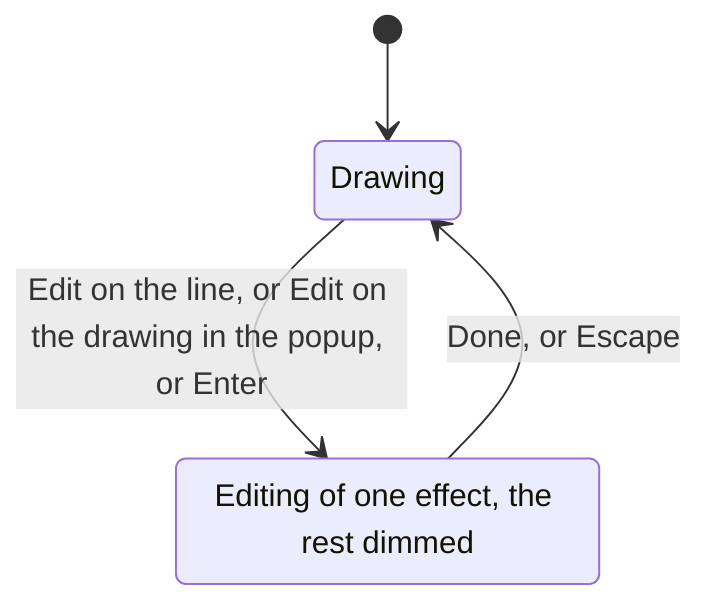

# Effects of a shape

> [Home](../../README.md) › [Symbols](../README.md) › [Drawing mode](README.md) › Effects

Status: draft. The research report of 2026-11-11, the clip asked by the Product Owner on 2026-11-25, and the complete catalogue asked the same day for the POC. Not validated.

Effects, clips and masks are set from the right-hand panel, in the section "Effects", after the [fill and border](fill-and-border.md). The editor offers them in a menu, and the user writes nothing.

## Rules

- **What the symbol file can hold.** An effect is written in the SVG of the symbol: an SVG feature (a filter, a `clipPath`, a `mask`, a paint) or a CSS property applied to the SVG and written in the file. Nothing is simulated with copies of the shape. What needs something outside the file (a shader, an HTML element) is not possible (Product Owner, 2026-11-25: "les effets possibles dans un SVG, et plus avec du CSS").
- **The POC chooses.** Every effect of the [catalogue](#catalogue-of-the-effects) that is not decided is tried in the POC of the effects: the Product Owner then chooses what is kept, and the simplest way to set it (Product Owner, 2026-11-25: "dans le POC, je pourrai choisir vraiment ce que je veux"). Nothing is refused beforehand.
- **Performance comes first**: an effect is kept after the POC only if it keeps the performance objective (see the project criteria on gestures and 120 Hz). A heavy effect is useless (Product Owner, 2026-11-25).

### The section "Effects"

- A **+** on the right of the title "Effects" opens the **menu of the effects**, grouped by family, in the order of the catalogue; the one chosen becomes a **line** of the section.
- Each line: an **eye** that turns the effect off without removing it, the **name** of the effect, a button, and a **−** that removes it. The button is one of three:

| Button | When | What it does |
| --- | --- | --- |
| Settings | The effect has settings. | Opens its **popup** beside the panel, as the paint popup. |
| Edit (a pencil) | The effect owns shapes (clip, mask, filter chain). | Enters its **editing mode**. |
| None, a value on the line | The effect has one setting (opacity, blend mode, crisp edges). | The value is set on the line itself. |

- A popup whose effect can also be set on the drawing has an **Edit on the drawing** button at its bottom, which enters its editing mode.
- The lines are applied from the top down.
- There is no "Mask" select in the panel: clip and mask are effects with their own shapes (Product Owner, 2026-11-25).

### Editing modes

An effect that is better set by hand on the drawing has an **editing mode**, on the model of the clip editing (Product Owner, 2026-11-25: "comme pour le clip, un mode d'édition par rapport à cet effet"):

- the shape stays selected and shown; the rest of the drawing is **dimmed**;
- a bar at the top of the drawing area names what is edited ("Clip of Casing", "Shadow of Casing") and has a **Done** button; Escape does the same;
- the handles of the effect are on the drawing (an offset, a light, a gradient line, a path); the right-hand panel shows the same settings as the popup, which follow the handles;
- the other tools are off, except those the mode needs (the shape tools to draw a clip, a mask or a pattern tile).

## Catalogue of the effects

Every effect a symbol can carry, by family: what SVG does, what CSS adds on an SVG, and the other leads. An example of each is drawn in Figma, page Spec, section "Symbol mode · Effects". Status: **Decided**; **POC** (tried in the POC, chosen after); **POC, support to check** (the engines may not draw it on an SVG shape); **Later** (not in this version, good to know); **Not an effect** (said elsewhere); **Not possible** (no engine, or outside the SVG file).

| Family | Effect | SVG or CSS feature | What it does | Status | Page |
| --- | --- | --- | --- | --- | --- |
| Clip and mask | Clip | `clipPath`; CSS `clip-path` (inset, circle, ellipse, polygon, path) | Shows the shape only inside its clip shapes, hard edge. | Decided (2026-11-25) | [Clip, mask, fade](effects-clip-and-mask.md#clip) |
| Clip and mask | Mask | `mask`, `mask-type` alpha or luminance | The same with a soft edge, by the opacity or the brightness of the mask shapes. | POC | [Clip, mask, fade](effects-clip-and-mask.md#mask) |
| Clip and mask | Fade | CSS `mask-image` with a gradient, or a `mask` filled with a gradient | The shape fades out along a line or from a centre, with no shape to draw. | POC | [Clip, mask, fade](effects-clip-and-mask.md#fade) |
| Opacity and blend | Opacity | `opacity` | The whole shape more or less transparent. | POC | [Opacity and blend](effects-opacity-and-blend.md#opacity) |
| Opacity and blend | Blend mode | CSS `mix-blend-mode` (16 modes and `plus-lighter`), `isolation` on a group | Mixes the colours of the shape with what is under it. | POC | [Opacity and blend](effects-opacity-and-blend.md#blend-mode) |
| Opacity and blend | Background blur | CSS `backdrop-filter` | Blurs what is behind the shape (frosted glass). | POC, support to check | [Opacity and blend](effects-opacity-and-blend.md#background-blur) |
| Shadows and light | Drop shadow | `feDropShadow`; CSS `drop-shadow()` | A blurred, offset copy behind the shape. | POC | [Shadows and light](effects-shadows-and-light.md#drop-shadow) |
| Shadows and light | Outer glow | `feGaussianBlur`, `feFlood`, `feComposite`, `feMerge` | A coloured halo around the shape, without offset. | POC | [Shadows and light](effects-shadows-and-light.md#outer-glow) |
| Shadows and light | Inner shadow | `feOffset`, `feGaussianBlur`, `feComposite` | A shadow inside the edge. | POC | [Shadows and light](effects-shadows-and-light.md#inner-shadow) |
| Shadows and light | Inner glow | `feGaussianBlur`, `feFlood`, `feComposite` | A coloured halo inside the edge. | POC | [Shadows and light](effects-shadows-and-light.md#inner-glow) |
| Shadows and light | Lighting | `feDiffuseLighting`, `feSpecularLighting`, with `feDistantLight`, `fePointLight` or `feSpotLight` | A light on a relief: bevel, relief, shine. | POC | [Shadows and light](effects-shadows-and-light.md#lighting) |
| Blur and sharpness | Blur | `feGaussianBlur` (one radius per axis); CSS `blur()` | Blurs the shape itself, the same in both directions or in one. | POC | [Blur and sharpness](effects-blur-and-sharpness.md#blur) |
| Blur and sharpness | Sharpen, edges, emboss | `feConvolveMatrix` | A small matrix applied to the pixels. | POC | [Blur and sharpness](effects-blur-and-sharpness.md#sharpen-edges-emboss) |
| Colour | Colour adjustments | `feColorMatrix`, `feComponentTransfer`; CSS `brightness()`, `contrast()`, `saturate()`, `grayscale()`, `sepia()`, `hue-rotate()`, `invert()` | Brightness, contrast, saturation, hue, greyscale, sepia, invert. | POC | [Colour](effects-colour.md#colour-adjustments) |
| Colour | Colour overlay | `feFlood`, `feComposite`, `feBlend` | Paints one colour over the shape, keeping its outline. | POC | [Colour](effects-colour.md#colour-overlay) |
| Colour | Colour map | `feComponentTransfer` (table, discrete) | Duotone, posterize, threshold. | POC | [Colour](effects-colour.md#colour-map) |
| Texture and distortion | Thicken, thin | `feMorphology` (dilate, erode) | Grows or shrinks the shape by pixels, text included. | POC | [Texture and distortion](effects-texture-and-distortion.md#thicken-thin) |
| Texture and distortion | Noise, texture | `feTurbulence` (fractal noise, turbulence) | A noise over the shape: paper, metal, concrete. | POC | [Texture and distortion](effects-texture-and-distortion.md#noise-texture) |
| Texture and distortion | Distortion | `feDisplacementMap`, from a noise or an image | Moves the pixels: waves, heat, glass. | POC | [Texture and distortion](effects-texture-and-distortion.md#distortion) |
| Expert | Filter chain | Every filter primitive, chained by hand; `color-interpolation-filters` | A filter built step by step from the building blocks (`feBlend`, `feComposite` with its arithmetic, `feFlood`, `feMerge`, `feOffset`, `feTile`, `feImage`, and the primitives above). | POC | [Filter chain](effects-filter-chain.md) |
| Paints | Linear gradient | `linearGradient`, `spreadMethod` pad, reflect, repeat | Colours along a line. | Decided (kind of fill); its editing on the drawing: POC | [Paints](paints.md#linear-gradient) |
| Paints | Radial gradient | `radialGradient`, focal point (`fx`, `fy`, `fr`) | Colours around a centre. | Decided (kind of fill); its editing on the drawing: POC | [Paints](paints.md#radial-gradient) |
| Paints | Conic gradient | CSS `conic-gradient()`; no SVG paint | Colours turning around a centre. | POC, support to check | [Paints](paints.md#conic-gradient) |
| Paints | Pattern | `pattern` | A small drawing repeated to fill the shape: dots, hatching, grid. | POC | [Paints](paints.md#pattern) |
| Paints | Image | `image` in a `pattern`, or `feImage` | A picture fills the shape. | POC | [Paints](paints.md#image) |
| Lines and text | Arrow heads | `marker` (`marker-start`, `marker-mid`, `marker-end`) | A shape at the start, the corners or the end of a line. | POC | [Lines and text](effects-lines-and-text.md#arrow-heads) |
| Lines and text | Border that keeps its width | `vector-effect: non-scaling-stroke` | The border keeps its width when the symbol is scaled in a synoptic. | POC | [Lines and text](effects-lines-and-text.md#border-that-keeps-its-width) |
| Lines and text | Crisp edges | `shape-rendering` (`crispEdges`, `geometricPrecision`) | Edges on whole pixels, without smoothing. | POC | [Lines and text](effects-lines-and-text.md#crisp-edges) |
| Lines and text | Text along a path | `textPath` | Letters following a curve. | Later: of no use in this version, good to know (Product Owner, 2026-11-25) | [Lines and text](effects-lines-and-text.md#text-along-a-path) |
| Lines and text | Text border | `stroke` with `paint-order` | A true stroke under the letters. | Decided | [Text](text.md) |
| Lines and text | Dashes | `stroke-dasharray`, `stroke-dashoffset` | Dashes of one colour on a stroke. | Decided: replaced by the computed dash sequence (several colours) | [Fill and border](fill-and-border.md#border-options) |
| Lines and text | Caps and joins | `stroke-linecap`, `stroke-linejoin`, `stroke-miterlimit` | The look of the ends and corners of a stroke. | Decided: not offered (2026-11-25) | [Fill and border](fill-and-border.md#border-of-an-open-path) |
| Other leads | Text shadow | CSS `text-shadow` | A shadow under the letters. | POC, support to check; the drop shadow does the same on a text | [Shadows and light](effects-shadows-and-light.md#drop-shadow) |
| Other leads | Tilt in 3D | CSS `perspective`, `rotateX()`, `rotateY()` | Tilts the shape in depth. | POC, support to check | [Geometry](geometry.md) |
| Other leads | Skew | `transform` `skewX()`, `skewY()` | Slants the shape. | Not an effect: a lead for the geometry | [Geometry](geometry.md) |
| Other leads | Offset of a path | None: a computation (Inkscape's "Dynamic offset") | Another path at a distance from the first. | Not an effect: the inside and outside border covers its common use | [Fill and border](fill-and-border.md) |
| Other leads | Inside or outside stroke | SVG 2 draft `stroke-alignment`, never shipped | A native stroke inside or outside the edge. | Not possible natively: the border is computed (decided) | [Fill and border](fill-and-border.md) |
| Other leads | Gradient along a border | None | Colours that follow the border along its length. | Not possible natively | [Fill and border](fill-and-border.md) |
| Other leads | Mesh gradient | SVG 2 draft `meshgradient`, removed | Colours set on a grid of points. | Not possible: no engine | [Paints](paints.md) |
| Other leads | Hatch | SVG 2 draft `hatch`, removed | Hatching along lines. | Not possible: the pattern does it | [Paints](paints.md#pattern) |
| Other leads | Shaders | WebGL | Any effect computed by the graphics card. | Not possible: outside the SVG file | — |
| Other leads | Animation of a setting | CSS animations, SMIL | A setting that changes over time. | Not an effect: the animation mode | [Animation mode](../08-animation-mode/README.md) |

"Support to check": a CSS feature defined for every element, whose drawing on an SVG shape differs between engines; the POC checks it in each engine aimed at. Said from the knowledge of the assistant, not from a research: the POC settles it.

## Effects one by one

Each effect, its line, its popup and its editing mode, by family. The screens: Figma, page Spec, section "Symbol mode · Effects", one row per effect.

| Page | Effects |
| --- | --- |
| [Clip, mask, fade](effects-clip-and-mask.md) | Clip, mask, fade |
| [Opacity and blend](effects-opacity-and-blend.md) | Opacity, blend mode, background blur |
| [Shadows and light](effects-shadows-and-light.md) | Drop shadow, outer glow, inner shadow, inner glow, lighting |
| [Blur and sharpness](effects-blur-and-sharpness.md) | Blur; sharpen, edges, emboss |
| [Colour](effects-colour.md) | Colour adjustments, colour overlay, colour map |
| [Texture and distortion](effects-texture-and-distortion.md) | Thicken or thin, noise, distortion |
| [Filter chain](effects-filter-chain.md) | A filter built from the building blocks |
| [Paints](paints.md) | The editing on the drawing of the linear and radial gradients; conic gradient, pattern, image |
| [Lines and text](effects-lines-and-text.md) | Arrow heads, border that keeps its width, crisp edges, text along a path |

## What the research found

Source: the research report (`research/t1-…/rapport.md`, in the project, not committed). It measured nothing: everything below is read from sources, and the performance POC will settle it. The "Opinion" column is the report's provisional opinion, not a decision. Its opinion "refuse" no longer applies: every effect goes to the POC (2026-11-25).

### Why the engine matters

| Window | Engine | SVG filters on the graphics card |
| --- | --- | --- |
| Chrome, Edge, Electron (Windows, macOS, Linux), Tauri on Windows | Chromium | Yes |
| Firefox 132 or later | Gecko | Yes, for 9 primitives (blend, colour matrix, component transfer, composite, drop shadow, flood, Gaussian blur, merge, offset) |
| Safari, Tauri on macOS (WKWebView) and Linux (WebKitGTK) | WebKit | No (open WebKit bug since 2023) |

- WebKit renders at 60 frames per second by default. The embedded view (WKWebView) has no public way to ask for 120. With a WebKit window, the 120 Hz objective cannot be reached by default, with or without effects.
- The choice of the desktop window (embedded Chromium or the system view) weighs more than any effect setting. It is not made yet.

### What makes the cost vary

- The cost follows the number of pixels of the filter area, which grows with the size of the shape, the zoom and the screen density. A big blur radius costs mainly because it forces a bigger filter area.
- Moving a filtered shape can reuse the image already computed. Resizing it, editing a point or changing its colour recomputes the filter at every frame.
- The default colour space of SVG filters (linear RGB) costs more than sRGB.
- A cut by one simple path takes the fast path; a text, a nested cut or too many shapes make the engine switch to a mask.
- No source gives the cost of a gradient, nor of the number of filtered shapes.

### Effect by effect

| Effect | SVG feature | Opinion of the report | Limit to measure |
| --- | --- | --- | --- |
| Cut by a shape | `clipPath` | Offer. Confidence: medium. | The shape that cuts is one simple shape, no text, no nested cut. |
| Gradients | Linear or radial gradient | Offer, subject to a short POC. Confidence: low. | Number of colour stops. |
| Dashes | See [fill and border](fill-and-border.md) | Offer with a limit. Confidence: low. | Maximum number of dashes per shape. |
| Colour changes | Filter | Offer with a limit, or without a filter (recomputed colours). Confidence: medium. | Filtered area and number of shapes. |
| Drop shadow | Filter | Offer with a limit. Confidence: medium. | Maximum radius and maximum filter area, in screen pixels. |
| Blur of the shape | Filter | Offer with a limit stricter than the drop shadow. Confidence: medium. | Radius, filter area. |
| Mask by a shape | `mask` | Offer with a limit. Replace by a cut when the edge is hard. Confidence: low. | Filtered area. |
| Inner shadow | Chain of filter primitives | Offer with a limit if the POC holds, else refuse. Confidence: low. | Radius, area. |
| Noise, lighting, convolution, displacement, morphology | Other filter primitives | Refuse (not in the project's list then). | — |

### Cheaper alternatives for the same look

- Filters declared in sRGB instead of linear RGB: a coloured blur changes a little.
- A cut instead of a mask when the edge is hard: no progressive transparency.
- Recomputed fill colours instead of a colour filter: the effect is then no longer a filter, and this must be written in the specs.
- CSS filter functions on the SVG element: support to check engine by engine, and no inner shadow.
- A tight filter area around the shape: too tight, it cuts the effect.
- Moving by transform during the gesture: only for moving, not for resizing.
- A radial gradient that imitates a shadow is against the rule above ("nothing simulated"): not retained.

### POC plan proposed (to be done in `synoptic-studio-poc`)

| POC | Question |
| --- | --- |
| P0 | Does each engine deliver 120 frames per second with no effect? (also window: desktop or browser) |
| P1 | Base cost of the gestures: 1, 50, 200 shapes without effect; move, resize, edit a point. |
| P2 | How far do blur and drop shadow hold? Radius 1 to 32, shape 50 to 800 px, zoom 100 % and 400 %, single and double density, linear RGB or sRGB. |
| P3 | How many filtered shapes? 1, 10, 50, 200, all animated. |
| P4 | Cost of an animation near an effect (below, above, the filtered shape itself animated). |
| P5 | Does the inner shadow hold? |
| P6 | Colour filter or recomputed colours? |
| P7 | Cut or mask? Simple cut, multi-shape cut, hard mask, progressive mask. |
| P8 | How many dashes, how many gradient stops? 10 to 10 000 dashes, native stroke or computed dashes, 2, 8, 32 stops. |
| P13 | Every effect of the catalogue that is not decided: its cost in each engine, its look, and the simplest way to set it (line, popup, editing mode); then the Product Owner chooses (2026-11-25). |

- Engines to cover: Chromium, Firefox 132 or later, WebKit (Safari, then the desktop window if it is WebKit).
- What is measured: the work time of each frame during the gesture, in milliseconds, read in the browser profiler (the time between two frames is not enough: a 60 Hz engine lengthens it without being slow). P0 and P2 first.
- Decision threshold proposed: 95 % of the frames at 8.3 ms or less and none above 16.7 ms at the most demanding setting offered, in each engine aimed at: offer. The rule holds up to a setting, then breaks: offer with that limit. It breaks at the smallest useful setting: refuse. The maximum stays the one set by criterion C14.

### POC added by the second research

The second report (`research/t4-…/rapport.md`) proposes four more POC, in the same repository and with the same measure:

| POC | Question | Page |
| --- | --- | --- |
| P9 | Pipes: search of the crossings while a point moves, with and without spatial index; two strokes or computed outlines. | [Pipes](../pipes/README.md) |
| P10 | Animated flow dashes on 10 to 500 pipes: CSS, SMIL, JavaScript steps. | [Pipe styles](../pipes/pipe-styles.md) |
| P11 | 50 to 1 000 symbols animated by signals at 10 updates per second. | [Animation mode](../08-animation-mode/README.md) |
| P12 | Input in a `foreignObject` against an HTML field laid over the text, with zoom and rotation. | [Animation mode](../08-animation-mode/README.md) |

### Desktop window: Chromium without Electron? (second research)

| Option | Engine per system | Size | Updates | Shell language | Licence, state |
| --- | --- | --- | --- | --- | --- |
| Electron | Embedded Chromium everywhere | Most apps above 100 MB | One Chromium major version out of two | JavaScript (Node.js) | MIT |
| NW.js | Embedded browser and Node.js everywhere | Not read | Not read | JavaScript | NW.js community |
| Tauri 2 (system view) | WebView2 on Windows, WKWebView on macOS, webkit2gtk on Linux | Light | With the system | Rust | Stable |
| Tauri 3 with CEF | Embedded Chromium everywhere | Hundreds of MB more | Chromium version chosen by the app | Rust | Alpha (page of 2026-09-13); no sandbox on Windows yet |
| CEF directly | Embedded Chromium | Heavy | Follows Chromium | C or C++ | BSD |
| Wails | WebView2 on Windows; no embedded browser | Light | With the system | Go | Not read |
| Neutralinojs | The system web view | Light | With the system | Provided binary, JavaScript interface | Not read |
| Installed web app | The user's browser: Chrome or Edge; Safari "Add to Dock"; not Firefox | None | With the browser | No shell | — |

- Chromium without Electron exists (Tauri 3 with CEF, CEF, NW.js), but the project criterion "all the code in JavaScript" sets aside Tauri, Wails and CEF, unless an exception is validated.
- The options based on the system view inherit WebKit on macOS and Linux (no GPU filters, 60 frames per second).
- The installed web app works from a local address: it fits the architecture of the project (a local server for the files, the same front in a browser).
- Opinion of the report (not a decision): 1. **Electron**, the only fully JavaScript option that guarantees Chromium on the three systems; the price is the size and following its versions. 2. **Local server and installed web app**, the lightest, which exists anyway; to ship first for trials, if Chrome or Edge is present. 3. **Tauri 3 with CEF**: to watch, not now. Confidence: medium.

## To decide by the Product Owner

The report's questions that the specs cannot answer alone:

1. Which desktop window: embedded Chromium or the system view? It fixes the engine to measure first. **Postponed, not decided.** The aim is the lightest and simplest to maintain for an open source application, so possibly Tauri, possibly Electron. Chromium is probably the best for effects and 120 Hz; whether Chromium can be used without Electron: the second research answers above. Linked question: does the criterion "all the code in JavaScript" allow a shell in Rust?
2. Which browsers must the front hold at 8.3 ms when plugged into a browser: Chromium only, or Firefox and Safari too?
3. Is an effect suspended during the gesture and restored at release an acceptable concession (if the drop shadow does not hold in WebKit)?
4. Can a colour filter be replaced by recomputed colours, or must it stay a filter in the exported SVG?
5. After the POC: which effects are kept, and which way to set each one (line, popup, editing mode).
