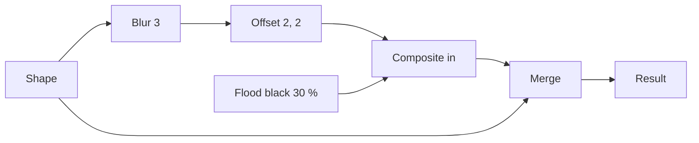

# Effects: filter chain

> [Home](../../README.md) › [Symbols](../README.md) › [Drawing mode](README.md) › [Effects](effects-and-masks.md) › Filter chain

Status: draft. Proposal of the assistant for the POC (2026-11-25). Not validated.

An effect for experts: a filter built step by step from the building blocks of SVG, for what the other effects do not do. It follows the [section "Effects"](effects-and-masks.md#the-section-effects) and its [editing modes](effects-and-masks.md#editing-modes).

## Filter chain

|  |  |
| --- | --- |
| What it does | Chains filter steps: each step takes the shape or the result of earlier steps, and gives its own result; the last step is what is drawn. |
| Feature | An SVG `filter` with its primitives: `feGaussianBlur`, `feOffset`, `feFlood`, `feComposite` (with its arithmetic), `feBlend`, `feMerge`, `feColorMatrix`, `feComponentTransfer`, `feMorphology`, `feTurbulence`, `feDisplacementMap`, `feConvolveMatrix`, `feDiffuseLighting`, `feSpecularLighting`, `feTile`, `feImage`, `feDropShadow`; `color-interpolation-filters` sRGB or linear RGB. |
| Line | "Filter chain · 4 steps", with an **Edit** button (a pencil). |
| Popup | None: the chain is edited in its editing mode. |
| On the drawing | **Filter editing**: the drawing area becomes a graph of the steps, from left to right: "Shape" first, then one box per step, linked to the steps it takes, and "Result" last. A + adds a step from the list of the primitives; a box selected shows its settings in the right-hand panel; a small preview of the shape stays in a corner. The bar says "Filter of Casing". |
| Status | POC. |

The graph above is a drop shadow built by hand: blur, offset, a colour, then the shape merged over it.

## Where it is used

| Screen | Element |
| --- | --- |
| [Figma](../../design-system/04-figma-file.md#effects-screens) | The id of each screen |
| [SY-04](../../screens/symbols.md#effects-one-by-one) | SY-04.63 (line), SY-04.64 (filter editing) |
