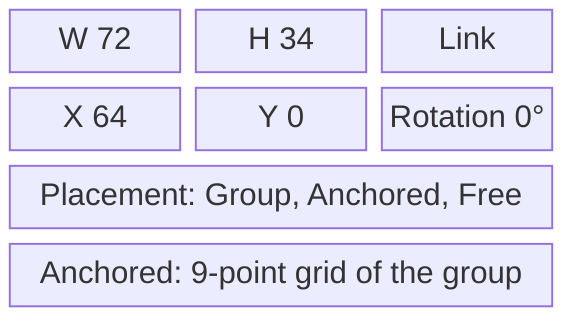

# Geometry of a shape: size, position, rotation

> [Home](../../README.md) › [Symbols](../README.md) › [Drawing mode](README.md) › Geometry

Status: draft. Asked by the Product Owner on 2026-11-25; the form is the assistant's, which the Product Owner left to it ("je te laisse le contrôle"). Not validated.

What every element of the drawing has in common: a [group](group.md), a [rectangle](rectangle.md), an [ellipse](ellipse.md), a [polygon](polygon.md), a path drawn with the [pen](pen.md) and a [text](text.md). It is the first section of the right-hand panel.

## Rules

- **Size**: W and H, the [size fields](../../controls/size-fields.md), with the link icon. Fixed or Hug only for what can wrap a content (a group, a text).
- **Position**: X and Y, two number fields on one line, in pixels, without unit, under the size.
- **Rotation**: a number field in degrees, on the line of X and Y; the box and its anchors turn with the element. It is the only transform of an element (opinion of the research, see [Editor](../03-editor/README.md#geometry-of-a-symbol)).
- **Everywhere the same**: these fields are in the panel of every kind of element, in the same order (Product Owner, 2026-11-25: "il faut que tu appliques ça partout").

### Position in the group

An element inside a group with its own size (see [Group](group.md#layout-of-the-children)) chooses how it is placed, with a select on the line of the position:

| Placement | X and Y | What it does |
| --- | --- | --- |
| Group | Shown, read only | The element follows the placement of the children set on the group (centred by default). The default. |
| Anchored | Shown, read only | The element is placed on one of the nine [anchors](../03-editor/anchors.md) of the group, chosen in a 9-point grid under the line: left, top right, middle left... Each child of a group can go its own way: one on the left, one on the right. |
| Free | Typed | The element is at the X and Y the user types, from the top left corner of the group. |

- **Anchored** puts the matching anchor of the element on the anchor of the group: its left middle on the left middle of the group, its top right corner on the top right corner.
- An element at the root of the symbol, or in a group that hugs its content, has no select: its X and Y are typed.
- The anchors of the element and of the group can differ, to put the element outside the group: it is the absolute child of [Group](group.md#absolute-children), reached by a second 9-point grid "Anchor of the element", shown under the first once the user asks for it (assistant's proposal).

## Order of the right-hand panel

The panel reads from what the element is to how it looks (Product Owner, 2026-11-25):

1. **The element**: its title (kind and name), then the options that make its shape, when it has some, **first**: sides and box of a [polygon](polygon.md#rules).
2. **Geometry**: size, position, rotation, then the options of the outline: the corner radius of a rectangle or of a path, **under the height** (Product Owner, 2026-11-25).
3. **Opacity**: one line, the opacity of the whole element, under the geometry (Product Owner, 2026-11-25; see [Opacity](effects-opacity-and-blend.md#opacity)). No section "Effects" in this version.
4. **Fill**, then **border**: see [Fill and border](fill-and-border.md).

A text keeps its own sections after the geometry (see [Text](text.md)).

## Where it is used

| Screen | Control |
| --- | --- |
| [SY-04](../../screens/symbols.md#sy-04--drawing-mode) · every element | Size, position, rotation (SY-04.36, SY-04.37, SY-04.38) |
| [SY-04](../../screens/symbols.md#sy-04--drawing-mode) · a child of a group | Placement in the group (SY-04.21) |

## Open questions

- Mirror (horizontal, vertical): recomputed in the points, as the research proposes, or not offered?
- Rotation of a group: do its children turn with it in the panel (their X and Y read in the turned group)?

Skew and tilt in 3D are not offered: set aside with the [catalogue of the effects](effects-and-masks.md#catalogue-of-the-effects) (Product Owner, 2026-11-25).
