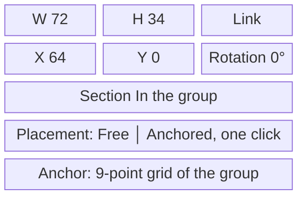

# Geometry of a shape: size, position, rotation

> [Home](../../README.md) › [Symbols](../README.md) › [Drawing mode](README.md) › Geometry

Status: draft. Asked by the Product Owner on 2026-11-25; the form is the assistant's, which the Product Owner left to it ("je te laisse le contrôle"). Not validated.

What every element of the drawing has in common: a [group](group.md), a [rectangle](rectangle.md), an [ellipse](ellipse.md), a [polygon](polygon.md), a path drawn with the [pen](pen.md) and a [text](text.md). It is the first section of the right-hand panel.

## Rules

- **Size**: W and H, the [size fields](../../controls/size-fields.md), with the link icon. Fixed or Hug only for what can wrap a content (a group, a text).
- **Position**: X and Y, two number fields on one line, in pixels, without unit, under the size.
- **Rotation**: a number field in degrees, on the line of X and Y; the box and its anchors turn with the element. It is the only transform of an element (opinion of the research, see [Editor](../03-editor/README.md#geometry-of-a-symbol)). **Never for a group**, always upright (Product Owner, 2026-11-26).
- **Everywhere the same**: these fields are in the panel of every kind of element, in the same order (Product Owner, 2026-11-25: "il faut que tu appliques ça partout").

### In the group

Every element inside a group (a rectangle, an ellipse, a polygon, a path, a text, a group) has a **section of its own, "In the group"**, under its geometry (Product Owner, 2026-11-26: "que ce soit un carré, un rond, un polygone, peu importe. Mais il faut que ce soit une section à part"). It says how the element is placed in its group:

- **Two placements, Free or Anchored**, chosen in one click with a [segmented control](../../screens/README.md#a-segmented-control-for-two-or-three-short-options) (Product Owner, 2026-11-26: "soit libre, soit avec ancre. Il n'y en a que deux"). "As the group" is no longer offered.
- **Always an anchor**, in a 9-point grid, in both placements: every placement is computed from an anchor, so that a resized group never leaves a position to guess (Product Owner, 2026-11-26: "ce sera toujours un calcul par rapport à une ancre").

| Placement | Anchor | X and Y | What it does |
| --- | --- | --- | --- |
| Free | A 9-point grid | Typed | The element does not touch the anchor: the user puts it where they want, its X and Y measured from the anchor. When the group is resized, it **follows the anchor**, at the same distance: anchored at the top right, it keeps its distance to the top right corner (Product Owner, 2026-11-26: "elle va suivre ce redimensionnement par rapport au coin en haut à droite"). |
| Anchored | A 9-point grid | Shown, read only | The element **touches** the anchor: its matching anchor on the anchor of the group, its top right corner on the top right corner. When the group is resized, it stays stuck there ("ça colle le coin, tout bêtement"). |

- Free with the top left anchor is the X and Y of an element at the root (assistant's proposal: the anchor of a free element starts at the top left).
- An element put in a group takes the placement and the anchor of its group (see [Group](group.md#layout-of-the-children)), then keeps its own (Product Owner, 2026-11-26).
- An element at the root of the symbol has no section "In the group": its X and Y are typed.
- The anchors of the element and of the group can differ, to put the element outside the group: it is the absolute child of [Group](group.md#absolute-children), reached by a second 9-point grid "Anchor of the element", shown under the first once the user asks for it (assistant's proposal).

## Order of the right-hand panel

The panel reads from what the element is to how it looks (Product Owner, 2026-11-25):

1. **The element**: its title (kind and name), then the options that make its shape, when it has some, **first**: sides and box of a [polygon](polygon.md#rules).
2. **Geometry**: size, position, rotation, then the options of the outline: the corner radius of a rectangle, of a polygon (Product Owner, 2026-11-26) or of a path, **under the height** (Product Owner, 2026-11-25); never for an ellipse.
3. **In the group**, for an element inside a group: its placement and its anchor (see [above](#in-the-group)). For a group: the placement of its children (see [Group](group.md#layout-of-the-children)).
4. **Opacity**: one line, the opacity of the whole element, under the geometry (Product Owner, 2026-11-25; see [Opacity](effects-opacity-and-blend.md#opacity)). No section "Effects" in this version.
5. **Fill**, then **border**: see [Fill and border](fill-and-border.md).

A text keeps its own sections after the geometry (see [Text](text.md)).

## Where it is used

| Screen | Control |
| --- | --- |
| [SY-04](../../screens/symbols.md#sy-04--drawing-mode) · every element | Size, position, rotation (SY-04.36, SY-04.37, SY-04.38) |
| [SY-04](../../screens/symbols.md#sy-04--drawing-mode) · a child of a group | Placement in the group (SY-04.21) |

## Open questions

- Mirror (horizontal, vertical): recomputed in the points, as the research proposes, or not offered?
- The anchor a free element starts with: the top left (proposal)?

Skew and tilt in 3D are not offered: set aside with the [catalogue of the effects](effects-and-masks.md#catalogue-of-the-effects) (Product Owner, 2026-11-25).
