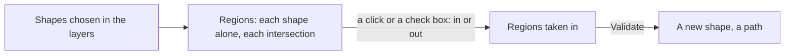

# Intersection mode

> [Home](../../README.md) › [Symbols](../README.md) › [Drawing mode](README.md) › Intersection mode

Status: draft. Asked by the Product Owner on 2026-11-25. Not validated.

The mode of the [editor](../03-editor/README.md) in which the user builds a **new shape** from several shapes and from their intersections. Example: the outlet of a pump cut along the outline of its casing.

## Rules

- **A mode of the modes menu**, right after [Clip](clip-mode.md) (Product Owner, 2026-11-25: "un nouveau mode après le mode clip"). It goes in the group of Clip, with no separator between the two (assistant's choice; see [Modes](../03-editor/README.md#modes)).
- **Tools**: [Select](../03-editor/select.md) and [Hand](../03-editor/hand.md).
- **Choosing the shapes**: in the layers, on the left, as many shapes as wanted (Shift or Ctrl and a click add one). On the drawing, the chosen shapes are put forward; the rest of the symbol is translucent (Product Owner, 2026-11-25).
- **The regions**: the chosen shapes cut each other into regions: the part of each shape that no other covers, and each intersection. The user chooses, region by region, whether it belongs to the new shape or not (Product Owner, 2026-11-25: "choisir si tu veux une forme ou pas").
  - On the drawing, a click on a region takes it in or out (assistant's proposal).
  - In the right-hand panel, a list of the regions, a check box each: the visible equivalent (assistant's proposal).
  - A region taken in is filled; a region left out shows only its outline.
- **Validate**: a button of the panel creates the new shape from the regions taken in (Product Owner, 2026-11-25: "tu cliques sur Valider, et ça crée une nouvelle forme"). A Cancel button, or another mode, leaves without creating anything.
- **The new shape** is a path (a free form, see [Point editing mode](../05-point-editing-mode/README.md)), put in the layers above the highest chosen shape, with the look of the first chosen shape (assistant's proposal, as the research advised for boolean operations).
- **The chosen shapes stay** as they were: the mode adds a shape, it destroys none (assistant's reading, to confirm).

### What it does compared with the boolean operations

The four boolean operations of the [advanced tools](../03-editor/expert-menu/boolean-operations.md), set aside in this version, are particular choices of regions:

| Operation | Regions taken in, for two shapes A and B |
| --- | --- |
| Union | A alone, B alone, A and B |
| Intersect | A and B |
| Subtract | A alone |
| Exclude | A alone, B alone |

### Computing

Cutting shapes into regions is a computation of intersections: it belongs to the geometry engine (`synoptic-studio-geometry`), measured by the research before development (criteria C7 and C16 of the project).

## Where it is used

| Screen | Element |
| --- | --- |
| [SY-03](../../screens/symbols.md#sy-03--symbol-editor-what-every-mode-shares) | SY-03.1, the modes menu |
| [SY-14](../../screens/symbols.md#sy-14--intersection-mode) | The Intersection mode |
| [Figma](../../design-system/04-figma-file.md#mode-screens) | The id of its screen |

## Open questions

- The name "Intersection": the mode also makes unions and differences.
- The chosen shapes kept (proposal), or replaced by the new shape?
- The look of the new shape: that of the first chosen shape (proposal)?
- Its place in the menu: in the group of Clip (proposal), or a group of its own?
- Can a group, a text or an open path be chosen?
