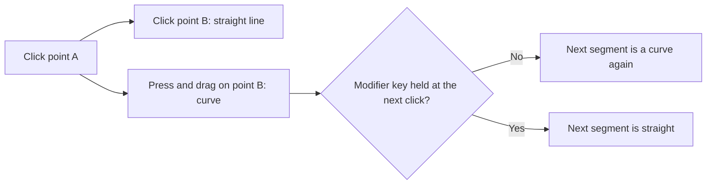

# Pen tool

> [Home](../../README.md) › [Symbols](../README.md) › [Drawing mode](README.md) › Pen

Status: draft, from the Product Owner's description of 2026-11-11. Not validated.

The Pen is also in the [point editing mode](../05-point-editing-mode/README.md).

## Rules

- Draws a path point by point, with straight lines and curves.
- It is also the tool for lines: there is no line tool.
- In the point editing mode, it starts from an existing point to draw further.

| Action | Result |
| --- | --- |
| Click a point, then click another | A straight line between them. |
| Press on the second point and drag before releasing | The segment becomes a curve, shaped by the drag. |
| Click again, with no modifier | As in Figma, the next segment is a curve again. |
| Click again, holding a modifier key | The next segment is a straight line straight away. |

- The modifier is wanted by the Product Owner, because a curve again after a curve is often a nuisance.
- It is a shortcut, not the only way: the pen also has a visible option that says, point by point, "this point is a curve" or "this point is a straight line".

## Open questions

- None kept here. Which key, and how the modifier works, is in the [research brief](../research-brief.md).
