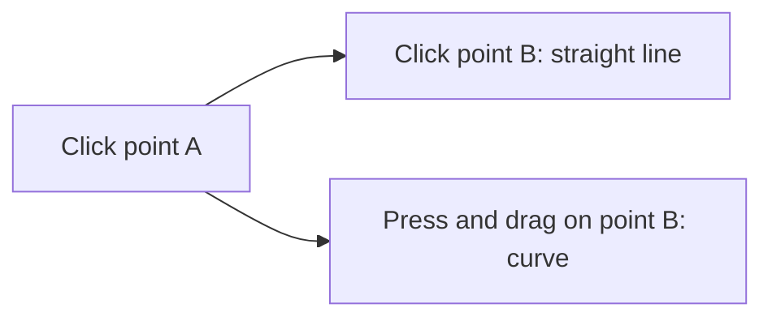

# Pen tool

> [Home](../../README.md) › [Symbols](../README.md) › [Drawing mode](README.md) › Pen

Status: draft. Not validated.

The Pen is also in the [point editing mode](../05-point-editing-mode/README.md).

## Rules

- Draws a path point by point, with straight lines and curves.
- It is also the tool for lines: there is no line tool.
- In the point editing mode, it starts from an existing point to draw further.

| Action | Result |
| --- | --- |
| Click a point, then click another | A straight line between them. |
| Press on the second point and drag before releasing | The segment becomes a curve, shaped by the drag. |
| Click again | As in Figma, the next segment is a curve again, after a curve. |

## Panel of a path

What the right-hand panel shows for a path drawn with the Pen, open (a line) or closed, in the order of [Geometry](geometry.md#order-of-the-right-hand-panel):

- **Geometry**: size, position, rotation.
- **Corner radius**, under the height: it rounds every corner of the path at once, as long as the corners are in the same path (Product Owner, 2026-11-25: "tant que ça reste dans le même objet"). A point given its own radius or its handles in the [point editing mode](../05-point-editing-mode/README.md) keeps it.
- **Fill**, the same list as the other shapes; an open path has none by default (assumption).
- **Border**: its lines, its size and its position **Middle, Inside or Outside**, also for an open path (see [Fill and border](fill-and-border.md#border-of-an-open-path)).
- **No caps and no joins**: not offered (Product Owner, 2026-11-25).
- **Opacity** and **clip**, as every shape (see [Effects](effects-and-masks.md#where-each-kept-entry-is-set)).

## No buttons of its own

- While the Pen is used, the tool bar shows **nothing more** than the tools of the mode: no "straight line" button, no "angle lock" button with its step (Product Owner, 2026-11-26, on the test screen: "ça devrait pas être là dans le mode plume [...] tu vas pouvoir les dégager"). This replaces the two buttons written on 2026-11-11.

## Open questions

- With the two buttons gone, are their gestures kept, and how: turning a curve being drawn back into a straight line, and locking the direction of a segment to steps of 15°, 30°, 45° or 90°?

## What the research found

Source: the research report (`research/t1-…/rapport.md`). The keys are not chosen; the Product Owner decides, among keys that exist on every platform (Shift, Ctrl, Alt: see the rule in the [editor](../03-editor/README.md)). Command and Option, quoted below for other software, are not available.

- Angle steps found in other software: 45° (Sketch, with Shift, from the previous point; Illustrator for a rotation) and 15° (Inkscape, with Ctrl).
- Turning a curve back to a straight segment, in other software: a gesture on the last point (Illustrator: click the last point again, its outgoing handle disappears; Sketch: Command at the creation of the next point makes it independent; Penpot: "Make corner" and "Make curve" commands), or a mode that lasts (Affinity: "Polygon" mode for straight lines, "Pen" or "Smart" for curves).
- "As in Figma, after a curve the next segment is a curve": neither confirmed nor contradicted, the Figma pages read do not document it.
