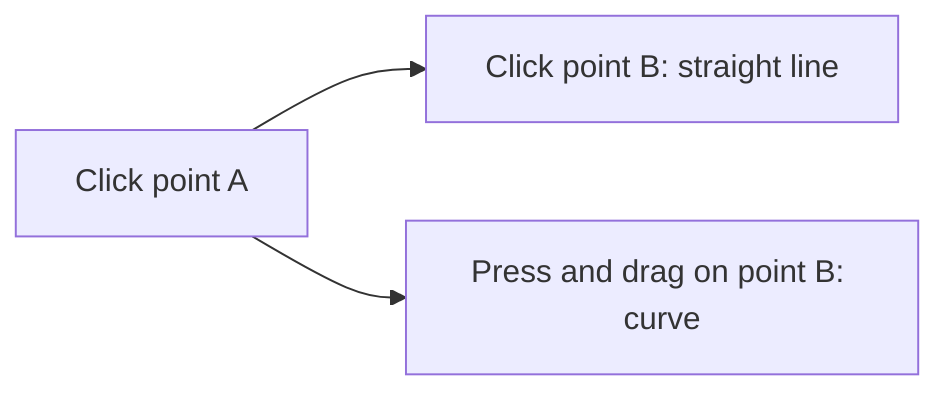

# Pen tool

> [Home](../../README.md) › [Symbols](../README.md) › [Drawing mode](README.md) › Pen

Status: draft, from the Product Owner's description of 2026-11-11. Not validated.

The Pen is also in the [point editing mode](../05-point-editing-mode/README.md).

## Rules

- Draws a path point by point, with straight lines and curves.
- It is also the tool for lines: there is no line tool.
- In the point editing mode, it starts from an existing point to draw further.

| Action | Result |
| --- | --- |
| Click a point, then click another | A straight line between them. |
| Press on the second point and drag before releasing | The segment becomes a curve, shaped by the drag. |
| Click again | As in Figma, the next segment is a curve again, after a curve. |

## The two buttons of the Pen

While the Pen is used, the editor shows two buttons, so that the user never has to hunt for how to do things. Like every shortcut, each one can also be done with a key, but the button is always there (see the rule on visible equivalents in the [editor](../03-editor/README.md)).

### Straight line button

- When the segment being drawn is a curve, the button turns it back into a straight line.
- It answers the case where a curve after a curve is a nuisance.

### Angle lock button

- It locks the direction of the segment to fixed angles, so that a perfectly straight line, horizontal, vertical or at a regular angle, is easy to draw.
- Angle steps proposed by the assistant, to confirm: 15°, 30°, 45° and 90°. The user picks the step; 45° is the usual one. A step of 90° gives horizontal and vertical lines only.
- With the lock on, the segment snaps to the nearest angle of the step.
