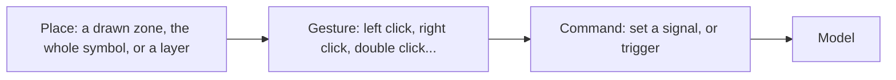

# Interactions

> [Home](../README.md) › [Symbols](README.md) › Interactions · Previous: [Animation](04-animation.md) · Next: [Testing](06-testing.md)

Status: draft, from the Product Owner's description of 2026-11-11. Not validated.

An interaction says: when the user does a gesture on a place of the symbol, a command is sent. The name "interaction" is provisional (see [Open questions](07-open-questions.md)).

## Rules

- The user can draw interaction zones on the symbol by hand.
- The places offered for an interaction are: the zones the user drew, the bounding box of the whole symbol, and the bounding box of a layer. Example: a button drawn on its own layer can be the place.
- Several gestures are possible on a place: left click, right click, double click, and others (the Product Owner wants more than these three; the list is to settle).
- Each interaction links a place, a gesture and a command of the type (see [Commands](../metadata/07-commands.md)): a command that sets a signal, or a trigger.
- A symbol uses only the commands it links: a preset never chooses commands.
- Interactions only make sense on a dynamic symbol (to confirm for a static one).

## Example

| Place | Gesture | Command |
| --- | --- | --- |
| Zone "start button" | Left click | `start` (sets `running` to `true`) |
| Layer "body" | Right click | `maintenance_requested` (trigger) |

## Where it is used

| Thing | Created and changed in | Used in | In a symbol | In a synoptic |
| --- | --- | --- | --- | --- |
| Interaction zone | Symbol editor | Symbol | Draw | No |
| Interaction (place, gesture, command) | Symbol editor | Symbol | Create, edit | No |

## Open questions

- Gesture list, name of the concept, whether an interaction can also open the faceplate. See [Open questions](07-open-questions.md).
