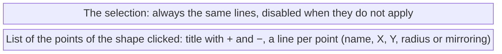
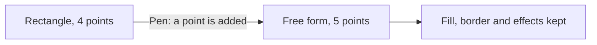

# Point editing mode

> [Home](../../README.md) › [Symbols](../README.md) › Point editing mode · Previous: [Drawing mode](../04-drawing-mode/README.md) · Next: [Alignment mode](../06-alignment-mode/README.md)

Status: draft. Not validated.

The mode of the [editor](../03-editor/README.md) in which the points of a path are edited.

## Rules

### Tool bar

- [Select](../03-editor/select.md), [Hand](../03-editor/hand.md) and [Pen](../04-drawing-mode/pen.md).
- The Group, Rectangle, Ellipse, Polygon and Text tools disappear.

### Which points are shown

- Every shape has points that can be edited here: a [rectangle](../04-drawing-mode/rectangle.md) has 4, an [ellipse](../04-drawing-mode/ellipse.md) has 4, a [polygon](../04-drawing-mode/polygon.md) has one per side, a path drawn with the pen has its own.
- **Only the points of the shape clicked** are shown, on the canvas and in the right-hand panel; the other shapes of the same level show none (Product Owner, 2026-11-25: "faut montrer les points de la forme dans laquelle on a cliqué").
- **A group has no points**: clicking a group shows none, even though a group has a size (Product Owner, 2026-11-25: "un groupe, ça a pas de points").
- Selecting a point in the list selects it on the canvas, and the other way round.

### Select

- Select picks points and handles, one or several, and moves them (several points can be selected as in the [editor](../03-editor/select.md): Shift or Ctrl, or a selection rectangle).
- A click on a handle selects it like a point: the panel then shows the X and Y of the handle, as in Figma (Product Owner, 2026-11-25).
- Points can be added (the + of the list, the Pen) and removed (the Delete key).

### Right-hand panel

- Every change is **one click**: no select to open, then an item to pick (Product Owner, 2026-11-25: "c'est obligé de faire deux clics au lieu d'un").
- **The layout never changes**: the same lines in the same places, whatever is selected (a point, a handle, several points, nothing). A field that does not apply is **disabled** (greyed), never hidden, and no button appears or disappears (Product Owner, 2026-11-25: "il y a jamais de trucs cachés", "ça change trop de layout").

1. **The selection**, at the top: the options of the selected point, handle or points (see [Points and handles](points-and-handles.md)).
2. **The list of the points**, under it: a long list does not push the options of the selection down (Product Owner, 2026-11-25, with a doubt: "je la mettrais peut-être plus en dessous"; to confirm on the screens).

#### List of the points

- The title is the name of the shape, with a small **−** and a small **+** on its right (below).
- A line per point. **A line of a point holds what it is**, editable in the line itself (Product Owner, 2026-11-25: "un point, c'est comme un X, un Y, un corner radius"):

| Cell | Point in the corner radius mode | Point in the handles mode |
| --- | --- | --- |
| Name | Point 1 | Point 1 |
| X, Y | Two number fields | Two number fields |
| Last cell | The radius, a number field | The mirroring, an icon button |

- **The mirroring cell selects a handle**: a click on it selects a handle of the point, not the point, so a handle is reached in one click from the list (Product Owner, 2026-11-25: "faudrait que ça clique sur une poignée tout seul"). Which handle: the one before the point along the path (assistant's proposal).
- A click on a line selects the point; Shift or Ctrl and a click add a line to the selection, as on the canvas.
- **No bin on the lines**: it sat too close to the fields (Product Owner, 2026-11-25: "trop dangereux comme ça"). A selected point is removed with the **Delete key**. Its visible equivalent: a small **−** next to the + of the title, enabled when points are selected (assistant's proposal, see the rule on visible equivalents in the [editor](../03-editor/README.md)).

#### Adding a point

- The **+** of the title adds a point (Product Owner, 2026-11-25: "un petit + à la liste des points, et ça suffirait").
- It is **disabled** until two points next to each other on the path are selected; then it adds a point in the middle of the two (Product Owner, 2026-11-25: "quand on en sélectionne 2, il se grise plus").
- The new point takes the next number: with 4 points, it is Point 5, placed between the two selected (between Point 4 and Point 1, for example).
- The list keeps its length until the point is added: nothing is inserted above it when two points are selected (Product Owner, 2026-11-25: "ça va faire bouger la liste du bas").

#### Several points selected

- The title says how many: "3 points".
- A field whose value differs between the points shows **Mixed** (see [Number and text fields](../../controls/number-and-text-fields.md#several-elements-selected)). Typing a value gives it to every selected point.
- The mode and the mirroring show no choice when they differ; a click on a choice sets it for every point.

### Pen

- The Pen starts from an existing point to trace another one.
- This works on **any** shape: the user clicks the shape, its points appear, takes the Pen, clicks a point and draws a line from it. A rectangle can therefore be drawn over to become a free form.

### A shape that receives points becomes a free form

- When points are added to a rectangle, an ellipse or a polygon (with the Select tool or the Pen), the shape becomes a free form: a path.
- It **loses nothing** of what it had (fill, border, effects, position); it is only now a free form, whose points are all editable.
- The path now follows its points, not the options of the former shape.
- The same holds when a point is **removed**: a rectangle that loses a point becomes a triangle, as a free form. Moving the points of a rectangle also makes it a free form.

### The ellipse

- An ellipse is, at its base, only a shape with handles: its 4 points have handles and no corner radius mode (see [Points and handles](points-and-handles.md)).
- When a point is added to it or removed from it, it becomes a free form. Its points then gain the corner radius mode, like the points of any other path. It is not applied by itself: the points keep their handles, and the user switches a point to the corner radius mode when they want it.
- How the roundings are edited precisely (a point switched to the corner radius mode, its radius) is not detailed yet: to be settled later.

### Not offered

- Hiding the fill of a closed part of a path while keeping its points, as Figma does: set aside (Product Owner, 2026-11-25, after weighing it: "il ne faut pas venir ajouter ça comme dans Figma").

## What the research found

Source: the second research report (`research/t4-…/rapport.md`, section 3.15).

- In a boolean group of Figma, each shape keeps its dimensions, position, rotation and corner radius. Opinion of the report: a free form keeps fill, border and effects; the options proper to the former shape (number of sides, box of the ellipse) leave the panel; the global corner radius becomes a radius per point.
- Points list: no source read. Opinion of the report: the points of the selected shapes; all the shapes, folded, when nothing is selected.
- Name: the report proposes **Path** instead of "free form" (the word of SVG).

## Open questions

- Options that belong to the former shape (the corner radius of a rectangle, the number of sides of a polygon, the box of an ellipse): once the shape is a free form, are they gone from the panel, or kept as shortcuts? Nothing is lost, but these options describe a shape that no longer has a fixed geometry.
- Precise editing of the roundings (corner radius mode of a point): to be detailed later.
- The list under the options of the selection, or above them: under, to confirm on the screens.
- Several shapes selected at once: no points shown, or the points of each, shape by shape?
- The + of the list: disabled until two points are selected (written), or also enabled with no point selected, adding a point after the last one (between the last and Point 1)?
- The handle selected by the mirroring cell of a line: the one before the point along the path (proposal), or the other?
- The − next to the + as the visible equivalent of the Delete key (proposal).
