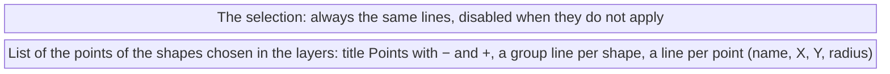
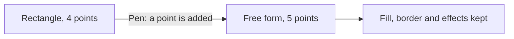

# Point editing mode

> [Home](../../README.md) › [Symbols](../README.md) › Point editing mode · Previous: [Drawing mode](../04-drawing-mode/README.md) · Next: [Alignment mode](../06-alignment-mode/README.md)

Status: draft. Not validated.

The mode of the [editor](../03-editor/README.md) in which the points of a path are edited.

## Rules

### Tool bar

- [Select](../03-editor/select.md), [Hand](../03-editor/hand.md) and [Pen](../04-drawing-mode/pen.md).
- The Group, Rectangle, Ellipse, Polygon and Text tools disappear.

### Which shapes are edited

- Every shape has points that can be edited here: a [rectangle](../04-drawing-mode/rectangle.md) has 4, an [ellipse](../04-drawing-mode/ellipse.md) has 4, a [polygon](../04-drawing-mode/polygon.md) has one per side, a path drawn with the pen has its own.
- **The shapes are chosen in the [layers](../03-editor/layers.md) only**, in the left-hand panel: a click chooses one, Shift or Ctrl and a click add others. Only the points of the chosen shapes are shown, on the canvas and in the list (Product Owner, 2026-11-26: "pour sélectionner la forme, ça se ferait qu'à gauche, dans le truc layer").
- **Several shapes**: the points of every chosen shape are shown at the same time (Product Owner, 2026-11-26: "tous les points de toutes les formes en même temps").
- **A click on the canvas never changes the chosen shapes**: a click on another shape does not choose it, and nothing leaves the mode; a missed click is never punished. No double click to enter a shape, as in Figma (Product Owner, 2026-11-26: "un miss-click, faut pas qu'il soit punitif").
- **A group has no points**: chosen in the layers, it shows none, even though a group has a size (Product Owner, 2026-11-25: "un groupe, ça a pas de points").
- When the mode opens, the shapes selected before stay chosen (assistant's proposal). With no shape chosen, the canvas shows no points and the list says "Choose a shape in the layers" (assistant's proposal).
- Selecting a point in the list selects it on the canvas, and the other way round.

### Select

- Select picks the points and handles of the chosen shapes, one or several, and moves them (several points as in the [editor](../03-editor/select.md): Shift or Ctrl, or a selection rectangle). A click on an empty place of the canvas deselects the points; the shapes stay chosen (assistant's proposal).
- A click on a handle selects it like a point: the panel then shows the X and Y of the handle, as in Figma (Product Owner, 2026-11-25).
- Points can be added (the + of the list, the Pen) and removed (the Delete key, the − of the list).

### Right-hand panel

- Every change is **one click**: no select to open, then an item to pick (Product Owner, 2026-11-25: "c'est obligé de faire deux clics au lieu d'un").
- **The layout never changes**: the same lines in the same places, whatever is selected (a point, a handle, several points, nothing). A field that does not apply is **disabled** (greyed), never hidden, and no button appears or disappears (Product Owner, 2026-11-25: "il y a jamais de trucs cachés", "ça change trop de layout").

1. **The selection**, at the top: the options of the selected point, handle or points (see [Points and handles](points-and-handles.md)).
2. **The list of the points**, under it: a long list does not push the options of the selection down (Product Owner, 2026-11-25, with a doubt: "je la mettrais peut-être plus en dessous"; to confirm on the screens).

#### List of the points

- The title is "Points", with a small **−** and a small **+** on its right (below).
- Under it, **a group line per chosen shape**, in the order of the layers: the icon of its kind and its name (Casing, then Outlet, then Impeller), then the lines of its points. The same with one shape, so the layout does not change with the number of shapes (Product Owner, 2026-11-26: "qu'on montre casing, ellipse, outlet ensuite, impeller après").
- The points are numbered in each shape: Casing and Outlet each have a Point 1.
- The values in the list repeat those of the options of the selection on purpose: they show every point at once and are changed in place (Product Owner, 2026-11-26: "ça permet de tout voir à côté [...] super pratique quand même").
- A line per point. **A line of a point holds what it is**, editable in the line itself (Product Owner, 2026-11-25: "un point, c'est comme un X, un Y, un corner radius"):

| Cell | Point in the corner radius mode | Point in the handles mode |
| --- | --- | --- |
| Name | Point 1 | Point 1 |
| X, Y | Two number fields | Two number fields |
| Radius | A number field | Disabled (greyed, a dash) |

- **The list does not show the mode**: the last cell is always the radius, disabled for a point in the handles mode. Each column has one meaning, as the lines of the selection, and the mode and the mirroring are one click away just above (assistant's choice, asked by the Product Owner on 2026-11-26: "peut-être qu'afficher que le radius, ça serait plus simple [...] à toi de vérifier").
- There is therefore no mirroring cell any more: a handle is selected on the canvas. On a point whose two handles mirror angle and length, the handles are changed from the point itself (see [Points and handles](points-and-handles.md#angle-and-length-on-a-point)).
- A click on a line selects the point; Shift or Ctrl and a click add a line to the selection, as on the canvas, in one shape or across several.
- **No bin on the lines**: it sat too close to the fields (Product Owner, 2026-11-25: "trop dangereux comme ça"). A selected point is removed with the **Delete key**, or the small **−** next to the + of the title, enabled when points are selected (Product Owner, 2026-11-26: "le - qui n'est pas grisé, c'est cool").

#### Adding a point

- The **+** of the title adds a point (Product Owner, 2026-11-25: "un petit + à la liste des points, et ça suffirait").
- It is **disabled** until two points next to each other on the same shape are selected (Product Owner, 2026-11-26: "que le + soit grisé, c'est super clair").
- **Adding a point is never destructive**: the new point is put on the outline, half-way between the two, and the outline does not change. On a straight side, it is the middle of the side; on a curve, the middle of the curve, the handles of the two neighbours and of the new point set so that the curve stays exactly the same. A circle with a point added is still the same circle (Product Owner, 2026-11-26: "ça détruit pas le cercle [...] faut jamais que ce soit destructif").
- The new point takes the next number of its shape: with 4 points, it is Point 5, placed between the two selected (between Point 4 and Point 1, for example).
- The list keeps its length until the point is added: nothing is inserted above it when two points are selected (Product Owner, 2026-11-25: "ça va faire bouger la liste du bas").

#### Several points selected

- The title says how many: "3 points", in one shape or across several.
- A field whose value differs between the points shows **Mixed** (see [Number and text fields](../../controls/number-and-text-fields.md#several-elements-selected)). Typing a value gives it to every selected point.
- The mode and the mirroring show no choice when they differ; a click on a choice sets it for every point.

### Pen

- The Pen starts from an existing point to trace another one.
- This works on **any** shape: the user chooses the shape in the layers, its points appear, takes the Pen, clicks a point and draws a line from it. A rectangle can therefore be drawn over to become a free form.

### A shape that receives points becomes a free form

- When points are added to a rectangle, an ellipse or a polygon (with the + of the list or the Pen), the shape becomes a free form: a path.
- It **loses nothing** of what it had (fill, border, effects, position); it is only now a free form, whose points are all editable. A point added with the + leaves its outline as it was (see [Adding a point](#adding-a-point)).
- The path now follows its points, not the options of the former shape.
- The same holds when a point is **removed**: a rectangle that loses a point becomes a triangle, as a free form. Moving the points of a rectangle also makes it a free form.

### The ellipse

- An ellipse is, at its base, only a shape with handles: its 4 points have handles and no corner radius mode (see [Points and handles](points-and-handles.md)).
- When a point is added to it or removed from it, it becomes a free form. Its points then gain the corner radius mode, like the points of any other path. It is not applied by itself: the points keep their handles, and the user switches a point to the corner radius mode when they want it.
- How the roundings are edited precisely (a point switched to the corner radius mode, its radius) is not detailed yet: to be settled later.

### Not offered

- Hiding the fill of a closed part of a path while keeping its points, as Figma does: set aside (Product Owner, 2026-11-25, after weighing it: "il ne faut pas venir ajouter ça comme dans Figma").

## What the research found

Source: the second research report (`research/t4-…/rapport.md`, section 3.15).

- In a boolean group of Figma, each shape keeps its dimensions, position, rotation and corner radius. Opinion of the report: a free form keeps fill, border and effects; the options proper to the former shape (number of sides, box of the ellipse) leave the panel; the global corner radius becomes a radius per point.
- Points list: no source read. Opinion of the report: the points of the selected shapes; all the shapes, folded, when nothing is selected.
- Name: the report proposes **Path** instead of "free form" (the word of SVG).

## Open questions

- Options that belong to the former shape (the corner radius of a rectangle, the number of sides of a polygon, the box of an ellipse): once the shape is a free form, are they gone from the panel, or kept as shortcuts? Nothing is lost, but these options describe a shape that no longer has a fixed geometry.
- Precise editing of the roundings (corner radius mode of a point): to be detailed later.
- The list under the options of the selection, or above them: under, to confirm on the screens.
- The shapes selected before the mode opens: kept as the chosen shapes (proposal)?
- A click on an empty place of the canvas: it deselects the points and keeps the shapes (proposal)?
