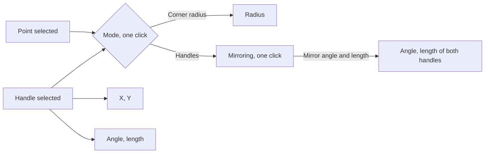

# Points and handles

> [Home](../../README.md) › [Symbols](../README.md) › [Point editing mode](README.md) › Points and handles

Status: draft. Reviewed by the Product Owner on 2026-11-25 ("t'as à peu près mis les trucs que je voulais, mais la UX, c'est beaucoup trop mal fait"). Not validated.

What the right-hand panel offers when a point or a handle is selected in the [point editing mode](README.md). Every choice is one click (Product Owner, 2026-11-25).

## Rules

### The options of the selection: always the same lines

The same lines in the same order, whatever is selected; a line that does not apply is disabled (greyed), never hidden (Product Owner, 2026-11-25: "l'angle length, faudrait l'afficher tout le temps, même si c'est en mode radius [...] il devient désactivé").

| Line | Controls | Point, corner radius mode | Point, handles mode | Handle | Nothing selected |
| --- | --- | --- | --- | --- | --- |
| Title | Text | "Casing · Point 2" | "Casing · Point 2" | "Casing · Point 2 · Handle" | "No point selected" |
| Name | A text field, "Name" written in it while empty | Enabled | Enabled | Disabled: the name of its point | Disabled |
| Position | X and Y, two number fields | The point | The point | The end of the handle | Disabled |
| Mode | A segmented control of two icons: Corner radius, Handles | Enabled | Enabled | Enabled: it switches the point of the handle | Disabled |
| Radius | A number field | Enabled | Disabled | Disabled | Disabled |
| Mirroring | A segmented control of three icons (below) | Disabled | Enabled | Enabled | Disabled |
| Angle and length | Two number fields | Disabled | After the mirroring (below) | Enabled | Disabled |

- The mode stays offered when a handle is selected, so the user can go back to the corner radius mode from a handle (Product Owner, 2026-11-25: "quand on clique sur une poignée, on peut quand même en revenir en mode border radius"). The handles then go away, and the selection becomes their point (assistant's reading).
- With several points, see [Several points selected](README.md#several-points-selected).
- The title names the shape before the point: several shapes can be chosen, and each has its Point 2 (assistant's proposal, kept by the Product Owner on 2026-11-26).
- **A point can be named**, to say what it stands for (Product Owner, 2026-11-26: "comme ça, on peut dire explicitement ce que ça représenterait"). The name replaces "Point 2" in the title and in the list; empty, the point keeps its number. The field shows "Name" written in it while empty, with no title beside or above it, like the other lines (Product Owner, 2026-11-26).

### Two modes for a point

A selected point is in one of two modes, and the user switches between them in one click (Product Owner, 2026-11-25: "pouvoir sélectionner si on passe en mode corner radius ou en mode poignée, assez facilement"):

| Mode | What it is |
| --- | --- |
| Corner radius | The point is rounded with a corner radius. |
| Handles | The point has handles that shape the curve. |

- Each mode keeps its own settings. Switching to the corner radius mode and back to the handles mode gives the handles as they were, and the other way round. Nothing is forgotten.
- The points of a [rectangle](../04-drawing-mode/rectangle.md), of a [polygon](../04-drawing-mode/polygon.md) and of a path can each have their own corner radius or their handles.
- A point of an [ellipse](../04-drawing-mode/ellipse.md) has no corner radius mode: it has handles only. The Corner radius choice of the mode is then disabled, not hidden. Once a point is added to the ellipse or removed from it, it is a free form (see the [point editing mode](README.md)) and its points gain the corner radius mode.

### Mirroring of the handles

Offered when the point is in the handles mode, on the point and on each of its handles: the user chooses how its two handles follow each other, with a segmented control of three icons, the name in the tooltip.

| Mirroring | Meaning |
| --- | --- |
| None | The two handles are independent. |
| Mirror angle | The two handles keep opposite angles. Their lengths are free. |
| Mirror angle and length | The two handles keep opposite angles and the same length. |

### Angle and length on a point

A point in the handles mode whose handles mirror each other is edited without selecting a handle: its two handles move as one (Product Owner, 2026-11-26: "vu que je suis en mirroring longueur et angle, c'est censé fonctionner, sans avoir à cliquer sur la poignée").

| Mirroring of the point | Angle | Length |
| --- | --- | --- |
| Mirror angle and length | Enabled: the angle of both handles | Enabled: the length of both handles |
| Mirror angle | Enabled: the angle of both handles | Disabled: the two lengths differ (Product Owner, 2026-11-26) |
| None | Disabled | Disabled |

- The angle shown is that of the handle after the point along the path; the other handle stays opposite (assistant's proposal).

### A selected handle

A click on a handle of a chosen shape selects it, on the canvas (Product Owner, 2026-11-25: "si tu cliques sur une poignée, ça fait un point et on voit le X, le Y").

- Position: X and Y of the end of the handle, as in Figma.
- Angle and length: the angle of the line of the handle, and its length; always enabled for a handle (on a point, see [above](#angle-and-length-on-a-point)).
- Mirroring: the mirroring of its point, the same segmented control.
- X and Y, the angle and the length stay linked: changing X and Y changes the angle and the length, and the other way round.
- The angle and the length are for a handle that must go at a precise angle and length: a length of 20 at a given angle (Product Owner, 2026-11-25).
- **Angle 0**: the handle lies flat, horizontal, towards the right; 90° points up (assistant's proposal, counted as on a protractor). The Product Owner said "si le trait est à plat, ça fait un angle de 0, enfin en vertical": horizontal or vertical for 0 is to confirm.

### Several points selected

See [Point editing mode](README.md#several-points-selected): the fields that differ show Mixed, and a value typed goes to every point.

### With the mouse

A point or a handle can be dragged pixel by pixel while Ctrl is held, even when the view is zoomed out (see [Precise move](../03-editor/precise-move.md)).

## Where it is used

| Screen | Element |
| --- | --- |
| [SY-05](../../screens/symbols.md#sy-05--point-editing-mode) | SY-05.3 to SY-05.7, SY-05.11, SY-05.14, SY-05.17 |

## What the research found

Source: the research report (`research/t1-…/rapport.md`). Confidence: high.

- The three names are those of Figma (its programming interface has `NONE`, `ANGLE`, `ANGLE_AND_LENGTH`) and, since its "Dublin" version, of Sketch. Figma writes the first one "No mirroring": a possible variant of "None".
- The same three behaviours exist elsewhere under other names: Inkscape Cusp / Smooth / Symmetric, CorelDRAW Cusp / Smooth / Symmetrical.
- **The list is complete for mirrors.** Other modes exist but are not mirrors: "Auto" (Inkscape) and "Smart" (Affinity) set the handles in place of the user; Sketch "Straight" is already the corner radius mode; Penpot "Corner" and "Curve" are two states only.

## Open questions

- Angle 0 of a handle: horizontal (proposal) or vertical?
- The three icons of the mirroring: to draw in the design system.
- Switching a selected handle to the corner radius mode: the selection becomes its point (assistant's reading), to confirm.
- Angle on a mirrored point: the angle of the handle after the point (proposal)?
