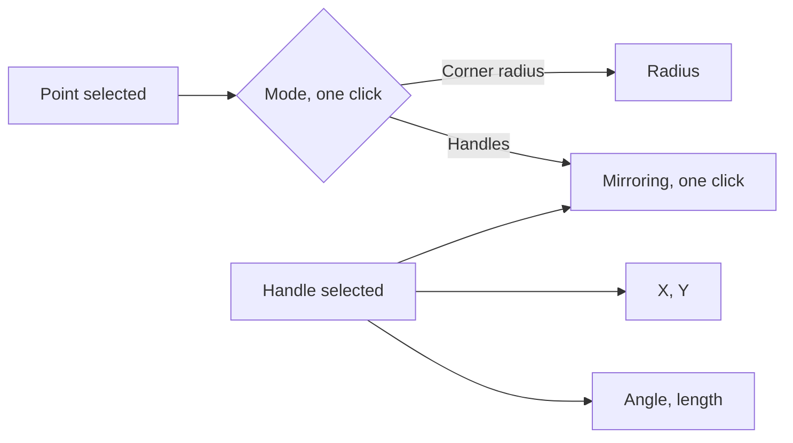

# Points and handles

> [Home](../../README.md) › [Symbols](../README.md) › [Point editing mode](README.md) › Points and handles

Status: draft. Reviewed by the Product Owner on 2026-11-25 ("t'as à peu près mis les trucs que je voulais, mais la UX, c'est beaucoup trop mal fait"). Not validated.

What the right-hand panel offers when a point or a handle is selected in the [point editing mode](README.md). Every choice is one click (Product Owner, 2026-11-25).

## Rules

### A selected point

| Line | Controls |
| --- | --- |
| Title | "Point 2 · Casing" |
| Position | X and Y, two number fields |
| Mode | A segmented control of two icons: Corner radius, Handles |
| Corner radius mode | Radius, a number field |
| Handles mode | Mirroring, a segmented control of three icons (below) |

### Two modes for a point

A selected point is in one of two modes, and the user switches between them in one click (Product Owner, 2026-11-25: "pouvoir sélectionner si on passe en mode corner radius ou en mode poignée, assez facilement"):

| Mode | What it is |
| --- | --- |
| Corner radius | The point is rounded with a corner radius. |
| Handles | The point has handles that shape the curve. |

- Each mode keeps its own settings. Switching to the corner radius mode and back to the handles mode gives the handles as they were, and the other way round. Nothing is forgotten.
- The points of a [rectangle](../04-drawing-mode/rectangle.md), of a [polygon](../04-drawing-mode/polygon.md) and of a path can each have their own corner radius or their handles.
- A point of an [ellipse](../04-drawing-mode/ellipse.md) has no corner radius mode: it has handles only. Once a point is added to the ellipse or removed from it, it is a free form (see the [point editing mode](README.md)) and its points gain the corner radius mode.

### Mirroring of the handles

Offered when the point is in the handles mode, on the point and on each of its handles: the user chooses how its two handles follow each other, with a segmented control of three icons, the name in the tooltip.

| Mirroring | Meaning |
| --- | --- |
| None | The two handles are independent. |
| Mirror angle | The two handles keep opposite angles. Their lengths are free. |
| Mirror angle and length | The two handles keep opposite angles and the same length. |

### A selected handle

A click on a handle selects it (Product Owner, 2026-11-25: "si tu cliques sur une poignée, ça fait un point et on voit le X, le Y").

| Line | Controls |
| --- | --- |
| Title | "Upper handle · Point 2" |
| Position | X and Y of the end of the handle, as in Figma |
| Angle and length | Two number fields: the angle of the line of the handle, and its length |
| Mirroring | The mirroring of its point, the same segmented control |

- X and Y, the angle and the length stay linked: changing X and Y changes the angle and the length, and the other way round.
- The angle and the length are for a handle that must go at a precise angle and length: a length of 20 at a given angle (Product Owner, 2026-11-25).
- **Angle 0**: the handle lies flat, horizontal, towards the right; 90° points up (assistant's proposal, counted as on a protractor). The Product Owner said "si le trait est à plat, ça fait un angle de 0, enfin en vertical": horizontal or vertical for 0 is to confirm.

### Several points selected

See [Point editing mode](README.md#several-points-selected): the fields that differ show Mixed, and a value typed goes to every point.

### With the mouse

A point or a handle can be dragged pixel by pixel while Ctrl is held, even when the view is zoomed out (see [Precise move](../03-editor/precise-move.md)).

## Where it is used

| Screen | Element |
| --- | --- |
| [SY-05](../../screens/symbols.md#sy-05--point-editing-mode) | SY-05.3 to SY-05.7, SY-05.11 |

## What the research found

Source: the research report (`research/t1-…/rapport.md`). Confidence: high.

- The three names are those of Figma (its programming interface has `NONE`, `ANGLE`, `ANGLE_AND_LENGTH`) and, since its "Dublin" version, of Sketch. Figma writes the first one "No mirroring": a possible variant of "None".
- The same three behaviours exist elsewhere under other names: Inkscape Cusp / Smooth / Symmetric, CorelDRAW Cusp / Smooth / Symmetrical.
- **The list is complete for mirrors.** Other modes exist but are not mirrors: "Auto" (Inkscape) and "Smart" (Affinity) set the handles in place of the user; Sketch "Straight" is already the corner radius mode; Penpot "Corner" and "Curve" are two states only.

## Open questions

- Angle 0 of a handle: horizontal (proposal) or vertical?
- The three icons of the mirroring: to draw in the design system.
