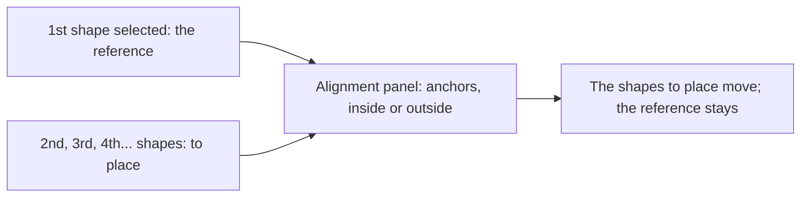

# Alignment mode

> [Home](../../README.md) › [Symbols](../README.md) › Alignment mode · Previous: [Point editing mode](../05-point-editing-mode/README.md) · Next: [Interaction mode](../07-interaction-mode/README.md)

Status: draft. Not validated.

The mode of the [editor](../03-editor/README.md) in which shapes are placed in relation to each other.

## Rules

### Tool bar and panel

- Tool bar: only [Select](../03-editor/select.md) and [Hand](../03-editor/hand.md).
- Select picks the shapes to place in relation to each other.
- The right-hand panel becomes an alignment panel for the selected shapes.
- The mode is only for placing shapes, not for drawing them.

### One single mode: the first shape is the reference

There is only one way to align, with no choice of mode:

- The **first** shape selected is the **reference**: it does not move.
- The **second, third, fourth... shapes** selected are the shapes **to place**: they move, each one in relation to the reference.
- The order of the selection therefore matters, and the panel shows which shape is the reference.

### Anchoring

The user chooses how the shapes to place are anchored on the reference (see [Anchors](../03-editor/anchors.md)). The choice is made in the alignment panel, by anchors, and it applies to the shapes to place.

- The reference is the **real shape** of the first selected layer, not a square box around it. A circle is a circle: it is the same area the user can click (see [Select](../03-editor/select.md)).
- Two placements, on the limit of the reference:

| Placement | Meaning |
| --- | --- |
| Inside | The shape to place goes inside the limit of the reference, held by the anchor chosen. |
| Outside | The shape to place goes outside the limit of the reference, held by the anchor chosen. |

- The outside placement puts a shape **next to** another, on their common limit: the two shapes touch along the limit of the reference. This is the practical case wanted.

## What the research found

Source: the second research report (`research/t4-…/rapport.md`, sections 3.15, 3.19).

- Illustrator aligns on a "key object" that does not move, and measures the spacing between the edges: the same idea as the reference here. No tool read aligns on the real outline.
- Opinion of the report on anchors: on a real shape, the centre plus the eight points where a ray from the centre (top, bottom, left, right, diagonals) meets the outline (see [Anchors](../03-editor/anchors.md)).
- Illustrator offers, next to alignment, a **distribution with equal spacing**, with a typed value, measured between the edges. Opinion of the report: it is missing here, and it also answers the question of a gap between the shapes.

## Open questions

- Anchors on a real shape: the proposal above, to confirm.
- Distribution with equal spacing and a typed gap: add it to this mode?
- Several shapes to place: do they all go to the same anchor (so they pile up), or can each have its own?
