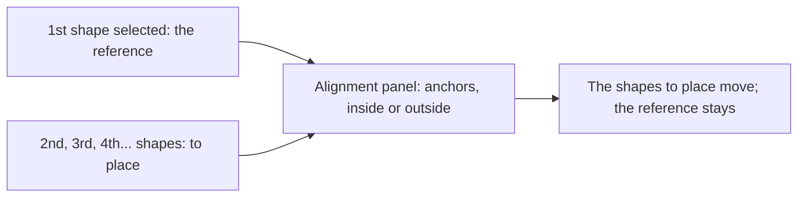

# Alignment mode

> [Home](../../README.md) › [Symbols](../README.md) › Alignment mode · Previous: [Point editing mode](../05-point-editing-mode/README.md) · Next: [Interaction mode](../07-interaction-mode/README.md)

Status: draft, from the Product Owner's descriptions of 2026-11-11. Not validated.

The mode of the [editor](../03-editor/README.md) in which shapes are placed in relation to each other.

## Rules

### Tool bar and panel

- Tool bar: only [Select](../03-editor/select.md) and [Hand](../03-editor/hand.md).
- Select picks the shapes to place in relation to each other.
- The right-hand panel becomes an alignment panel for the selected shapes.
- The mode is only for placing shapes, not for drawing them.

### One single mode: the first shape is the reference

There is only one way to align, with no choice of mode:

- The **first** shape selected is the **reference**: it does not move.
- The **second, third, fourth... shapes** selected are the shapes **to place**: they move, each one in relation to the reference.
- The order of the selection therefore matters, and the panel shows which shape is the reference.

### Anchoring

The user chooses how the shapes to place are anchored on the reference. The choice is made in the alignment panel, by anchors, and it applies to the shapes to place.

- The reference is the **bounding box** of the first shape.
- Two placements, on the bounding box of the reference:

| Placement | Meaning |
| --- | --- |
| Inside | The shape to place goes inside the bounding box of the reference, held by the anchor chosen. |
| Outside | The shape to place goes outside the bounding box of the reference, held by the anchor chosen. |

- The outside placement puts a shape **next to** another, on their common limit: the two shapes touch along the edge of the bounding box. This is the practical case the Product Owner wants.

## Open questions

- The exact anchors: the Product Owner said the shapes must be "anchored" and the values are inside and outside. The assistant assumes the usual nine anchors of a bounding box (the four corners, the four sides and the centre), the same on the reference and on the shape to place, to confirm.
- Offset: can the user add a gap (a distance) between the shapes once anchored, for example a margin for a shape placed outside?
- Several shapes to place: do they all go to the same anchor (so they pile up), or can each have its own?
- The assistant did not find any source for the alignment options in the research report: none is quoted here.
