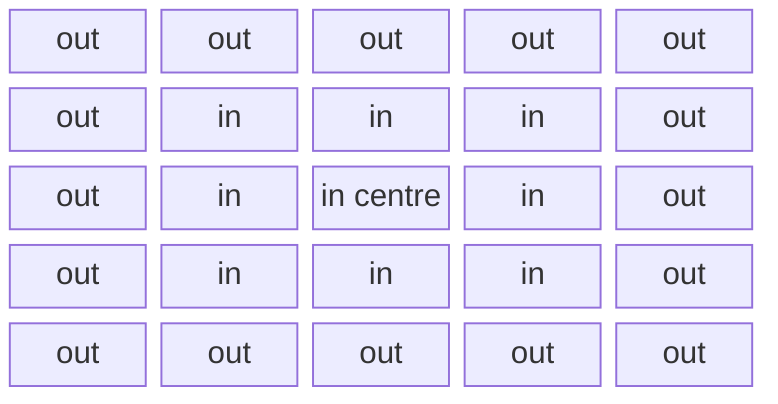
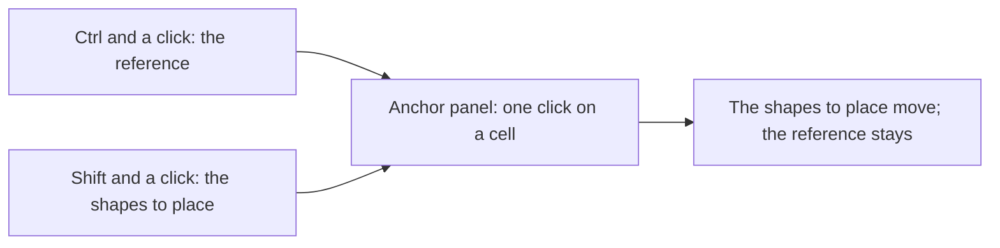

# Alignment mode

> [Home](../../README.md) › [Symbols](../README.md) › Alignment mode · Previous: [Point editing mode](../05-point-editing-mode/README.md) · Next: [Interaction mode](../07-interaction-mode/README.md)

Status: draft. Not validated.

The mode of the [editor](../03-editor/README.md) in which shapes are placed in relation to each other.

## Rules

### Tool bar and panel

- Tool bar: only [Select](../03-editor/select.md) and [Hand](../03-editor/hand.md).
- Select picks the shapes to place in relation to each other.
- The right-hand panel becomes an alignment panel for the selected shapes.
- The mode is only for placing shapes, not for drawing them.

### The reference and the shapes to place: Ctrl and Shift

In this mode, the two keys have a meaning of their own (Product Owner, 2026-11-25: "Contrôle, c'est toujours pour la référence, et Shift, c'est toujours pour sélectionner les choses à placer"):

| Gesture | What it does |
| --- | --- |
| Ctrl and a click on a shape | It becomes the **reference**: it does not move. The former reference stops being one. |
| Ctrl and a click on the reference | It stops being the reference. |
| Shift and a click on a shape | It is added to the shapes **to place**: they move, each in relation to the reference. |
| Shift and a click on a shape to place | It is taken out of the shapes to place. |

- There is one reference at most; there can be several shapes to place.
- The order of the clicks no longer matters: the first shape selected is no longer the reference.
- A shape cannot be both: Ctrl on a shape to place makes it the reference and takes it out of the shapes to place; Shift on the reference does the opposite (assistant's reading).
- On the drawing, the reference and the shapes to place are marked differently (a colour and a word, "Reference", "To place").
- **Visible equivalent** (rule of the [editor](../03-editor/README.md#rules)): a plain click selects a shape, and the panel offers two buttons for it, "Reference" and "To place" (assistant's proposal).
- On a Mac, Ctrl and a click opens the context menu of the browser: the same open point as the [precise move](../03-editor/precise-move.md).

### The anchor panel

A large panel of anchors, easy to click, says where the shapes to place go (Product Owner, 2026-11-25: "si c'est suffisamment gros, ça devient simple à cliquer"). It replaces the select Inside or Outside.

- A square of **5 × 5** cells. The **3 × 3** cells of the middle are the anchors **inside** the reference; the **16** cells around them are the anchors **outside**.
- A **line** runs between the two: it stands for the limit of the reference, so inside and outside read at a glance.
- **One click on a cell** places the shapes to place at once (assistant's proposal: undo is there to go back).
- The cell of the last placement stays marked.

| Cells | Placement | The shape to place goes |
| --- | --- | --- |
| The 3 × 3 of the middle | Inside | Inside the limit of the reference, held by that anchor: the top left corner, the centre... |
| The 4 corners of the ring | Outside, diagonal | Outside a corner of the reference, touching it by its own opposite corner. |
| The 12 others of the ring | Outside, along a side | Next to a side of the reference, touching it, aligned on the start, the middle or the end of that side. |

- The reference is the **real shape** of its layer, not a square box around it. A circle is a circle: it is the same area the user can click (see [Select](../03-editor/select.md)).
- The outside placement puts a shape **next to** another, on their common limit: the two shapes touch along the limit of the reference. This is the practical case wanted.

## What the research found

Source: the second research report (`research/t4-…/rapport.md`, sections 3.15, 3.19).

- Illustrator aligns on a "key object" that does not move, and measures the spacing between the edges: the same idea as the reference here. No tool read aligns on the real outline.
- Opinion of the report on anchors: on a real shape, the centre plus the eight points where a ray from the centre (top, bottom, left, right, diagonals) meets the outline (see [Anchors](../03-editor/anchors.md)).
- Illustrator offers, next to alignment, a **distribution with equal spacing**, with a typed value, measured between the edges. Opinion of the report: it is missing here, and it also answers the question of a gap between the shapes.

## Open questions

- Anchors on a real shape: the proposal above, to confirm; and where the 16 outside anchors sit on a round shape.
- A plain click: selects a shape for the buttons "Reference" and "To place" (proposal), or nothing?
- Placement at once on a click of a cell (proposal), or on a button?
- Distribution with equal spacing and a typed gap: add it to this mode?
- Several shapes to place: do they all go to the same anchor (so they pile up), or can each have its own?
