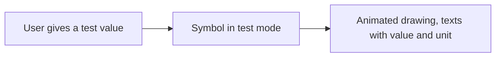

# Testing

> [Home](../README.md) › [Symbols](README.md) › Testing · Previous: [Interactions](05-interactions.md)

Status: draft, from the Product Owner's description of 2026-11-11. Not validated.

The symbol editor has an option to try the symbol without a model: the user gives values to the signals that animate it, and sees the symbol move.

## Rules

- The test mode offers every output signal used by an animation of the symbol.
- The user gives each one a value, within its bounds when it has some (see [Signals](../metadata/04-signals.md)): a number, a boolean, or a value of its enum.
- The symbol is redrawn at each change, with the display units and decimal places of its preset.
- Nothing is sent to a model, and nothing is saved in the symbol.

## Where it is used

| Thing | Created and changed in | Used in | In a symbol | In a synoptic |
| --- | --- | --- | --- | --- |
| Test mode | Symbol editor | Checking a symbol | Use | No |

## Open questions

- Do the interactions work in the test mode, and what do they do without a model? See [Open questions](07-open-questions.md).
