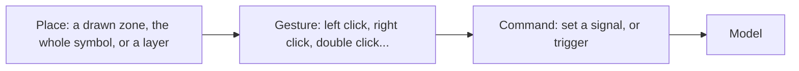

# Interaction mode

> [Home](../../README.md) › [Symbols](../README.md) › Interaction mode · Previous: [Alignment mode](../06-alignment-mode/README.md) · Next: [Animation mode](../08-animation-mode/README.md)

Status: draft, from the Product Owner's description of 2026-11-11. Not validated.

The mode of the [editor](../03-editor/README.md) in which the user says what happens when a gesture is done on the symbol. An interaction says: when the user does a gesture on a place of the symbol, a command is sent. The name "interaction" is provisional (see [Open questions](../10-open-questions.md)).

## Rules

- Tool bar: [Select](../03-editor/select.md), [Hand](../03-editor/hand.md) and Interaction zone (below).
- Right-hand panel: the interactions of the selected place.
- Only for a dynamic symbol. A static symbol has no interaction: it has no type, so no command to send.
- The places offered for an interaction are: the zones the user drew, the bounding box of the whole symbol, and a layer. A layer is clickable as its real shape, not as the square around it, and stays clickable when its fill is transparent (see [Select](../03-editor/select.md)). Example: a button drawn on its own layer can be the place.
- Several gestures are possible on a place: left click, right click, double click, and others (the Product Owner wants more than these three; the list is to settle).
- Each interaction links a place, a gesture and a command of the type (see [Commands](../../metadata/07-commands.md)): a command that sets a signal, or a trigger.
- A symbol uses only the commands it links: a preset never chooses commands.

## Interaction zone tool

- Only in this mode. Draws a zone on the symbol, by hand, that reacts to a gesture.

## Example

| Place | Gesture | Command |
| --- | --- | --- |
| Zone "start button" | Left click | `start` (sets `running` to `true`) |
| Layer "body" | Right click | `maintenance_requested` (trigger) |

## Where it is used

| Thing | Created and changed in | Used in | In a symbol | In a synoptic |
| --- | --- | --- | --- | --- |
| Interaction zone | Symbol editor | Symbol | Draw | No |
| Interaction (place, gesture, command) | Symbol editor | Symbol | Create, edit | No |

## Open questions

- Gesture list, name of the concept, whether an interaction can also open the faceplate. See [Open questions](../10-open-questions.md).
